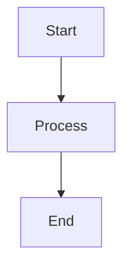

# Obsidian Markdown Guidelines

When working with Markdown files in this Obsidian vault, follow these conventions.

## Wiki-Style Internal Links

Use Obsidian's wiki-link syntax for internal links:

- `[[Note Name]]` - link to another note
- `[[Note Name|Display Text]]` - link with custom display text
- `[[Note Name#Heading]]` - link to a specific heading
- `[[Note Name#^block-id]]` - link to a specific block

## Embeds

Embed content from other notes:

- `![[Note Name]]` - embed entire note
- `![[Note Name#Heading]]` - embed specific section
- `![[image.png]]` - embed images from the vault
- `![[image.png|300]]` - embed with width constraint

## Illustrations

### ASCII Art and Text Diagrams

- ASCII illustrations must respect Obsidian's page width limitations
- Keep ASCII art narrow enough to display without horizontal scrolling
- Use monospace code blocks for ASCII diagrams:
  ```
  ┌─────────┐
  │  Box    │
  └─────────┘
  ```

### Generated and Derived Graphics

When creating graphics (e.g., rendered from ASCII, generated diagrams, exports):

- **Format**: PNG with transparent background
- **Theme-agnostic**: Use colors that work on both dark and light mode themes
  - Avoid pure black (`#000000`) or pure white (`#FFFFFF`) for lines/shapes
  - Prefer neutral grays or colors with sufficient contrast in both modes
  - Test visibility in both Obsidian themes before finalizing
- Store generated graphics in the `.assets/` directory alongside the source note

### Figure Captions

Every illustration or picture must have a description beneath it:

- **Identifier format**: `<markdown-filename>-<number>` where `<number>` is unique within that file
- **Color coding**: The identifier is styled in blue using CSS class

**Required CSS snippet** (Settings → Appearance → CSS snippets):

```css
/* .obsidian/snippets/figure-captions.css */
.fig-id {
  color: #4a86e8;
  font-weight: bold;
}
```

**Usage:**

```markdown
![[./.assets/architecture-diagram.png]]
*<span class="fig-id">my-note-1</span>: System architecture overview showing the main components.*
```

Example for a file named `database-design.md`:
- First figure: `database-design-1`
- Second figure: `database-design-2`
- And so on...

## Assets and Attachments

Pictures, attachments, and other media files used in a Markdown file must be stored in a hidden asset directory within the same directory as the Markdown file:

```
chapter/
├── 01-some-note.md
├── 02-another-note.md
└── .assets/
    ├── screenshot.png
    ├── diagram.svg
    └── document.pdf
```

- Directory name: `.assets/` (hidden directory, prefixed with dot)
- Reference assets using **explicit relative paths** with `./` prefix: `![[./.assets/screenshot.png]]`
- The `./` prefix ensures Obsidian resolves the path relative to the current file's directory, not the vault root
- Keep assets co-located with their referencing notes for portability
- When moving a note, move its corresponding `.assets/` contents as well

## Tags

Use tags for organization:

- `#tag` - inline tags
- Place tags in YAML frontmatter when appropriate:
  ```yaml
  ---
  tags:
    - topic
    - subtopic
  ---
  ```

## Frontmatter

Include YAML frontmatter for metadata:

```yaml
---
title: Note Title
date: YYYY-MM-DD
tags: []
aliases: []
---
```

## Callouts

Use Obsidian callout syntax for highlighted blocks:

```markdown
> [!note]
> This is a note callout.

> [!warning]
> This is a warning.

> [!tip]
> Helpful tip here.

> [!info]
> Informational content.

> [!question]
> A question or consideration.
```

Callout types: `note`, `abstract`, `info`, `tip`, `success`, `question`, `warning`, `failure`, `danger`, `bug`, `example`, `quote`

## Code Blocks

Use fenced code blocks with language identifiers:

````markdown
```python
def example():
    pass
```
````

## Task Lists

- `- [ ]` - unchecked task
- `- [x]` - completed task
- `- [/]` - in progress (with Tasks plugin)
- `- [-]` - cancelled (with Tasks plugin)

## Footnotes

Use standard Markdown footnotes:

```markdown
Here is a statement[^1].

[^1]: This is the footnote content.
```

## Math (LaTeX)

- Inline: `$E = mc^2$`
- Block:
  ```markdown
  $$
  \int_0^\infty e^{-x^2} dx = \frac{\sqrt{\pi}}{2}
  $$
  ```

## Mermaid Diagrams

Use mermaid code blocks for diagrams:

````markdown

````

**Page width considerations**: Obsidian renders Mermaid diagrams within the note's content width. Keep diagrams compact to avoid horizontal overflow:

- Prefer vertical layouts (`TD`, `TB`) over horizontal (`LR`, `RL`) for complex diagrams
- Use short, concise node labels
- Break large diagrams into multiple smaller ones
- For wide diagrams, consider using subgraphs to organize content vertically
- Test diagram rendering in both editing and reading view

## Best Practices

1. **Atomic notes**: Keep notes focused on a single concept
2. **Descriptive titles**: Use clear, searchable note titles
3. **Link liberally**: Create connections between related notes
4. **Use headings**: Structure content with proper heading hierarchy (H1 for title, H2+ for sections)
5. **Consistent naming**: Follow a naming convention for files (e.g., kebab-case or Title Case)
