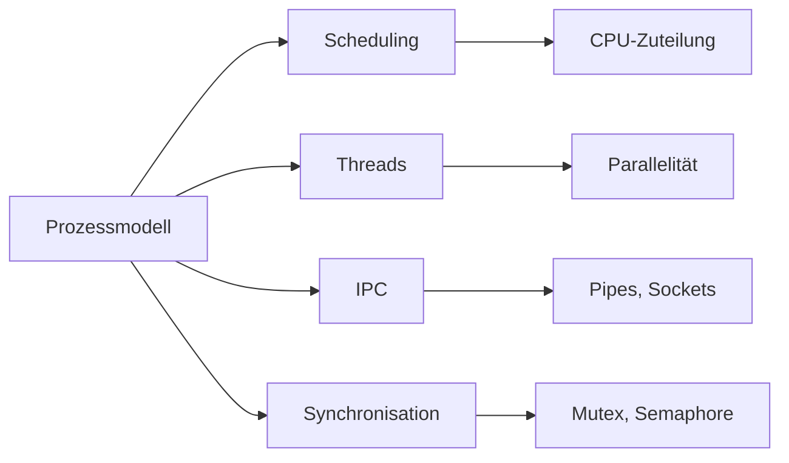

# Prozessmodell

> [!info] **Lernziele**
> Nach diesem Kapitel solltest du:
> - Verstehen, warum das Prozessmodell eine Abstraktion der CPU ist
> - Die Definition eines Prozesses kennen und erklären können
> - Den Aufbau und Inhalt des Process Control Blocks (PCB) verstehen
> - Die drei Prozesszustände (Running, Ready, Blocked) unterscheiden können
> - Die Prozesshierarchie und Prozesstypen verstehen
> - Die Funktion von Interrupts im Prozessmanagement erklären können
> - Den Unterschied zwischen Systemprozessen und Benutzerprozessen kennen

---

## Das Prozessmodell als CPU-Abstraktion

> [!important] **Kernkonzept**
> Das **Prozessmodell** ist die Abstraktion des Betriebssystems für die Verwaltung der Ressource **CPU**. Es erzeugt die Illusion, dass jeder Prozess seine eigene CPU besitzt.

### Das Problem: Eine CPU, viele Programme

Ein Computer hat typischerweise nur wenige CPUs (oft 1-16 Kerne), aber dutzende oder hunderte Programme wollen gleichzeitig ausgeführt werden:

![[cpu-problem.png]]
*<span class="fig-id">02-03-01-cpu-problem</span>: Mehrere Programme konkurrieren um eine einzige CPU – das fundamentale Problem, das das Prozessmodell löst.*

### Die Lösung: Virtuelle CPUs durch Prozesse

Das Prozessmodell löst dieses Problem durch **Virtualisierung**:

![[cpu-abstraction.png]]
*<span class="fig-id">02-03-01-cpu-abstraction</span>: Das Betriebssystem erzeugt die Illusion, dass jeder Prozess seine eigene CPU besitzt.*

### Wie funktioniert die Illusion?

Das Betriebssystem wechselt so schnell zwischen Prozessen, dass jeder Prozess glaubt, die CPU alleine zu besitzen:

![[timeslicing.png]]
*<span class="fig-id">02-03-01-timeslicing</span>: Das Betriebssystem teilt die CPU-Zeit in kleine Zeitscheiben auf und wechselt schnell zwischen Prozessen.*

### Abstraktion vs. Realität

| Aspekt | Realität | Abstraktion (Prozesssicht) |
|--------|----------|---------------------------|
| **CPU-Anzahl** | 1-16 physische Kerne | "Unendlich" viele virtuelle CPUs |
| **CPU-Besitz** | Geteilt zwischen allen | "Ich habe meine eigene CPU" |
| **Ausführung** | Unterbrochen, zeitversetzt | "Kontinuierlich" |
| **Geschwindigkeit** | Volle CPU-Geschwindigkeit | Anteilige Geschwindigkeit |

### Warum diese Abstraktion?

> [!success] **Vorteile des Prozessmodells**
> 
> 1. **Vereinfachung für Programmierer**
>    - Programme müssen nicht wissen, dass andere Programme existieren
>    - Keine manuelle CPU-Verwaltung nötig
> 
> 2. **Isolation und Schutz**
>    - Prozesse können sich nicht gegenseitig stören
>    - Absturz eines Prozesses betrifft nicht die anderen
> 
> 3. **Fairness**
>    - Betriebssystem verteilt CPU-Zeit gerecht
>    - Kein Prozess kann die CPU monopolisieren
> 
> 4. **Multitasking**
>    - Benutzer kann mehrere Programme gleichzeitig nutzen
>    - System reagiert auch bei rechenintensiven Aufgaben

### Analogie: Restaurant mit einem Koch

> [!example] **Restaurant-Analogie**
> 
> **Realität:**
> - 1 Koch (= 1 CPU)
> - 10 Tische mit Bestellungen (= 10 Prozesse)
> 
> **Abstraktion:**
> - Jeder Tisch denkt: "Der Koch arbeitet an meinem Essen"
> - In Wahrheit: Koch wechselt schnell zwischen Gerichten
> - Alle Essen werden "gleichzeitig" fertig (mit Verzögerung)
> 
> **Der Oberkellner (= Scheduler)** entscheidet:
> - Welches Gericht als nächstes bearbeitet wird
> - Wie lange an jedem Gericht gearbeitet wird
> - Priorisierung (z.B. VIP-Tische zuerst)

### Zusammenhang mit anderen Abstraktionen

Das Betriebssystem bietet Abstraktionen für alle Hardware-Ressourcen:

| Ressource | Abstraktion | Verwaltungseinheit |
|-----------|-------------|-------------------|
| **CPU** | Prozess/Thread | Scheduler |
| **RAM** | Virtueller Speicher | Speicherverwaltung |
| **Festplatte** | Datei | Dateisystem |
| **Netzwerk** | Socket | Netzwerk-Stack |
| **Bildschirm** | Fenster | Window Manager |

> [!tip] **Merke**
> Das Prozessmodell ist für die CPU das, was der virtuelle Speicher für den RAM ist: Eine Abstraktion, die eine begrenzte physische Ressource in scheinbar unbegrenzte virtuelle Ressourcen verwandelt.

---

## Definition

> [!quote] **Formale Definition**
> Ein **Prozess** ist ein Programm, das ausgeführt wird. Er besitzt einen eigenen Prozesskontext und unterliegt der Kontrolle des Betriebssystems.

### Programm vs. Prozess

Der Unterschied zwischen Programm und Prozess ist fundamental:

| Aspekt | Programm | Prozess |
|--------|----------|---------|
| **Zustand** | Passiv (Datei auf Festplatte) | Aktiv (in Ausführung) |
| **Speicher** | Statisch gespeichert | Dynamisch im RAM |
| **Ressourcen** | Keine | CPU-Zeit, Speicher, Dateien |
| **Lebenszyklus** | Dauerhaft | Temporär (Start → Ende) |
| **Instanzen** | Eine Datei | Mehrere Prozesse möglich |

> [!example] **Analogie**
> - **Programm** = Kochrezept (statische Anleitung)
> - **Prozess** = Kochvorgang (aktive Ausführung des Rezepts)
> 
> Ein Rezept kann mehrfach gleichzeitig "ausgeführt" werden (mehrere Köche kochen dasselbe Gericht), genauso wie ein Programm mehrere Prozesse erzeugen kann.

### Prozesserzeugung

Ein neuer Prozess entsteht durch:

1. **Systemstart** – Init-Prozesse beim Booten
2. **Systemaufruf** – `fork()` (Unix) oder `CreateProcess()` (Windows)
3. **Benutzeraktion** – Klick auf Programm-Icon, Kommandozeile
4. **Batch-Job** – Geplante Aufgaben starten Prozesse

```c
// Unix/Linux: Prozesserzeugung mit fork()
#include <unistd.h>
#include <stdio.h>

int main() {
    pid_t pid = fork();  // Erzeugt Kindprozess
    
    if (pid == 0) {
        // Kindprozess
        printf("Kind: Meine PID ist %d\n", getpid());
    } else if (pid > 0) {
        // Elternprozess
        printf("Eltern: Kind-PID ist %d\n", pid);
    } else {
        // Fehler
        perror("fork fehlgeschlagen");
    }
    return 0;
}
```

### Prozessbeendigung

Ein Prozess wird beendet durch:

| Beendigung | Beschreibung | Beispiel |
|------------|--------------|----------|
| **Normale Beendigung** | Prozess beendet sich selbst | `exit(0)`, `return 0` |
| **Fehlerbeendigung** | Prozess meldet Fehler | `exit(1)`, Exception |
| **Fataler Fehler** | Unbehandelter Fehler | Segmentation Fault |
| **Abbruch durch anderen Prozess** | Signal von außen | `kill -9 PID`

---

## Prozesskontext und PCB

Der **Process Control Block (PCB)** speichert alle Informationen eines Prozesses. Er ist die zentrale Datenstruktur des Betriebssystems zur Prozessverwaltung.

> [!important] **Warum ist der PCB wichtig?**
> Der PCB ermöglicht:
> - **Kontextwechsel**: CPU kann zwischen Prozessen wechseln und später fortfahren
> - **Prozessverwaltung**: BS kann Prozesse starten, stoppen, priorisieren
> - **Ressourcenverwaltung**: Zuordnung und Überwachung von Ressourcen

![[pcb-diagram.png]]
*<span class="fig-id">02-03-01-pcb-diagram</span>: Der Process Control Block enthält alle Informationen, die das Betriebssystem zur Verwaltung eines Prozesses benötigt.*

### PCB-Inhalte im Detail

| Kategorie | Inhalt | Zweck |
|-----------|--------|-------|
| **Identifikation** | PID, PPID, UID, GID | Eindeutige Zuordnung |
| **Zustand** | Running, Ready, Blocked | Scheduling-Entscheidungen |
| **CPU-Kontext** | Register, PC, SP, PSW | Wiederaufnahme nach Unterbrechung |
| **Speicherinfo** | Seitentabellen, Segmentgrenzen | Speicherschutz und -verwaltung |
| **Ressourcen** | Offene Dateien, Geräte, Sockets | Ressourcenverwaltung |
| **Accounting** | CPU-Zeit, Startzeit, Limits | Abrechnung und Fairness |
| **Scheduling** | Priorität, Nice-Wert, Zeitscheibe | CPU-Zuteilung |

### Speicherlayout eines Prozesses

![[memory-layout.png]]
*<span class="fig-id">02-03-01-memory-layout</span>: Das Speicherlayout eines Prozesses zeigt die Aufteilung des virtuellen Adressraums in verschiedene Segmente.*

> [!tip] **Merkhilfe: TDBHS**
> Von unten nach oben: **T**ext → **D**ata → **B**SS → **H**eap → **S**tack
> 
> "**T**olles **D**atenbank-**B**uch **H**ilft **S**ehr"

---

## Prozesszustände

Prozesse durchlaufen während ihrer Lebenszeit verschiedene Zustände. Das **Drei-Zustands-Modell** ist das Grundmodell:

![[process-states-3.png]]
*<span class="fig-id">02-03-01-process-states-3</span>: Das Drei-Zustands-Modell zeigt die grundlegenden Prozesszustände Running, Ready und Blocked mit ihren Übergängen.*

| Zustand | Beschreibung | Typische Situation |
|---------|--------------|-------------------|
| **Running** | Der Prozess wird gerade auf der CPU ausgeführt | Aktive Berechnung |
| **Ready** | Der Prozess ist rechenbereit und wartet auf CPU-Zuteilung | Nach Zeitscheiben-Ende |
| **Blocked** | Der Prozess wartet auf Beendigung einer E/A-Aktivität | Warten auf Festplatte, Netzwerk |

### Zustandsübergänge im Detail

| Übergang | Von → Nach | Auslöser | Beispiel |
|----------|-----------|----------|----------|
| **Dispatch** | Ready → Running | Scheduler wählt Prozess | CPU frei, höchste Priorität |
| **Timeout** | Running → Ready | Zeitscheibe abgelaufen | Preemptives Scheduling |
| **Block** | Running → Blocked | E/A-Anforderung | `read()`, `scanf()`, `sleep()` |
| **Wakeup** | Blocked → Ready | E/A abgeschlossen | Datei gelesen, Timer abgelaufen |

### Erweitertes Fünf-Zustands-Modell

In der Praxis werden oft zwei weitere Zustände verwendet:

![[process-states-5.png]]
*<span class="fig-id">02-03-01-process-states-5</span>: Das Fünf-Zustands-Modell erweitert das Grundmodell um die Zustände New und Terminated.*

| Zustand | Beschreibung |
|---------|--------------|
| **New** | Prozess wird gerade erzeugt, PCB wird angelegt |
| **Terminated** | Prozess ist beendet, Ressourcen werden freigegeben |

### Kontextwechsel (Context Switch)

Beim Wechsel zwischen Prozessen muss der **Kontext** gesichert und wiederhergestellt werden:

![[context-switch.png]]
*<span class="fig-id">02-03-01-context-switch</span>: Beim Kontextwechsel sichert der Kernel den Zustand des alten Prozesses und lädt den Zustand des neuen Prozesses.*

> [!warning] **Kontextwechsel-Overhead**
> Kontextwechsel sind teuer:
> - Direkter Overhead: Sichern/Laden der Register (~1-10 μs)
> - Indirekter Overhead: Cache-Invalidierung, TLB-Flush
> 
> Deshalb: Weniger Kontextwechsel = Bessere Performance

---

## Prozesstypen und Prioritäten

Prozesse werden nach ihrer Art und Priorität unterschieden:

![[process-priorities.png]]
*<span class="fig-id">02-03-01-process-priorities</span>: Prozesstypen werden nach Priorität eingestuft – Systemprozesse haben die höchste, normale Benutzerprozesse die niedrigste Priorität.*

| Prozesstyp | Beschreibung | Priorität |
|------------|--------------|-----------|
| **Systemprozesse** | Kernel-Aktivitäten, Treiber | Höchste |
| **Interaktive Prozesse** | Reagieren auf Benutzereingaben | Hoch |
| **Batchprozesse** | Hintergrundverarbeitung | Mittel |
| **Benutzerprozesse** | Normale Anwendungen | Normal |

---

## Interrupts

> [!quote] **Definition**
> Ein **Interrupt** ist ein Signal an den Prozessor, um die sequenzielle Abarbeitung der Befehlszyklen zu unterbrechen.

Interrupts sind der Mechanismus, der Multitasking erst ermöglicht. Ohne Interrupts müsste die CPU einen Prozess vollständig abarbeiten, bevor sie zum nächsten wechseln kann.

### Interrupt-Typen

| Typ | Auslöser | Beispiele |
|-----|----------|-----------|
| **Hardware-Interrupt** | Externe Geräte | Tastatur, Maus, Festplatte, Timer |
| **Software-Interrupt** | Programm (Syscall) | `int 0x80` (Linux), `syscall` |
| **Exception** | CPU-Fehler | Division durch 0, Page Fault |

### Funktionsweise

![[assets/interrupt-swimlane.png]]
<span class="fig-id">02-03-01-interrupt-swimlane</span> *Ablauf einer Interrupt-Behandlung: Das Programm wird unterbrochen, CPU sichert den Zustand, der Kernel ruft die passende ISR auf, danach wird der Zustand wiederhergestellt und das Programm fortgesetzt.*

### Interrupt Vector Table (IVT)

Die **Interrupt Vector Table** ist eine Tabelle mit Zeigern auf die jeweiligen Interrupt Service Routines (ISR):

| Interrupt | Handler |
|-----------|---------|
| IRQ 0 | Timer-Interrupt (Scheduler) |
| IRQ 1 | Tastatur-Interrupt |
| IRQ 2 | Kaskadiert zu IRQ 8-15 |
| IRQ 3 | COM2 (Serielle Schnittstelle) |
| ... | ... |
| IRQ 14 | Primärer IDE-Controller |
| IRQ 15 | Sekundärer IDE-Controller |
| INT 0x80 | Linux System Call Handler |
| INT 0x21 | DOS System Call Handler |

> [!note] Die Tabelle zeigt ein vereinfachtes Beispiel einer IVT für x86-PCs.

### Timer-Interrupt und Scheduling

Der **Timer-Interrupt** ist besonders wichtig für das Scheduling:

![[assets/timer-interrupt.png]]
<span class="fig-id">02-03-01-timer-interrupt</span> *Timer-Interrupts unterbrechen regelmäßig die Ausführung und ermöglichen dem Scheduler, zwischen Prozessen zu wechseln.*

> [!info] **Typische Timer-Frequenz**
> - Linux: 100-1000 Hz (HZ-Wert im Kernel)
> - Windows: ~15.6 ms (64 Hz) Standard, kann auf 1 ms gesetzt werden

### Eigenschaften von Interrupts

- **Asynchron**: Können jederzeit auftreten (außer wenn maskiert)
- **Priorisiert**: Höhere Priorität kann niedrigere unterbrechen
- **Maskierbar**: Können temporär deaktiviert werden (außer NMI)
- **Schnell**: ISR sollte möglichst kurz sein (Bottom Half für längere Arbeit)

> [!example] **Praktisches Beispiel: Tastatureingabe**
> 1. Benutzer drückt Taste
> 2. Tastatur-Controller sendet IRQ 1
> 3. CPU unterbricht aktuellen Prozess
> 4. Keyboard-ISR liest Scancode aus Controller
> 5. Scancode wird in Tastenpuffer geschrieben
> 6. ISR endet, Prozess wird fortgesetzt
> 7. Prozess mit `read()` auf Tastatur wird aufgeweckt

---

## Prozesshierarchie

Prozesse bilden eine **Prozesshierarchie** (Eltern-Kind-Beziehungen):

![[assets/process-hierarchy.png]]
<span class="fig-id">02-03-01-process-hierarchy</span> *Prozesshierarchie: init als Wurzelprozess mit Kindprozessen login, sshd und cron, die wiederum eigene Kindprozesse erzeugen.*

### Eltern-Kind-Beziehungen

| Konzept | Unix/Linux | Windows |
|---------|-----------|---------|
| **Erster Prozess** | `init` (PID 1) / `systemd` | System Process (PID 4) |
| **Erzeugung** | `fork()` + `exec()` | `CreateProcess()` |
| **Eltern-ID** | PPID (Parent PID) | Lockerer, Handle-basiert |
| **Verwaiste Prozesse** | Werden von init adoptiert | Unabhängig |
| **Zombie-Prozesse** | Eltern muss `wait()` aufrufen | Automatisch bereinigt |

### Zombie-Prozesse

Ein **Zombie** ist ein Prozess, der beendet ist, aber dessen Exit-Status noch nicht vom Elternprozess abgeholt wurde:

![[assets/zombie-process.png]]
<span class="fig-id">02-03-01-zombie-process</span> *Lebenszyklus eines Zombie-Prozesses: Nach exit() wartet der Kindprozess als Zombie, bis der Elternprozess mit wait() den Exit-Status abholt.*

**Zombie vermeiden:**

```c
// Korrekte Behandlung von Kindprozessen
pid_t pid = fork();
if (pid == 0) {
    // Kind
    exit(0);
} else {
    // Eltern: auf Kind warten
    int status;
    waitpid(pid, &status, 0);  // Verhindert Zombie
}
```

**Zombie-Prozesse finden:**

```bash
# Alle Zombie-Prozesse anzeigen (Status 'Z')
ps aux | grep 'Z'

# Oder spezifischer mit awk
ps aux | awk '$8=="Z" {print $0}'

# Anzahl der Zombies zählen
ps aux | awk '$8=="Z"' | wc -l

# Elternprozess eines Zombies finden
ps -o ppid= -p <ZOMBIE_PID>
```

Ausgabe-Beispiel:
```
USER   PID  %CPU %MEM   VSZ  RSS TTY  STAT START  TIME COMMAND
root  1234  0.0  0.0     0    0 ?    Z    10:15  0:00 [defunct]
```

Der Status `Z` und `[defunct]` kennzeichnen einen Zombie-Prozess.

---

## Praktische Kommandos

### Linux/Unix

| Kommando | Beschreibung | Beispiel |
|----------|--------------|----------|
| `ps aux` | Alle Prozesse mit Details | `ps aux \| grep firefox` |
| `ps -ef --forest` | Prozesse als Baum | Zeigt Eltern-Kind-Beziehungen |
| `pstree -p` | Prozesshierarchie mit PIDs | `pstree -p \| less` |
| `top` / `htop` | Interaktive Prozessübersicht | Live-Monitoring |
| `nice -n 10 cmd` | Prozess mit niedrigerer Priorität starten | `nice -n 19 ./backup.sh` |
| `renice -n 5 -p PID` | Priorität ändern | `renice -n -5 -p 1234` |
| `kill -SIGTERM PID` | Prozess beenden (sanft) | `kill 1234` |
| `kill -9 PID` | Prozess sofort beenden | `kill -9 1234` |
| `cat /proc/PID/status` | PCB-Informationen | `cat /proc/1/status` |
| `cat /proc/PID/maps` | Speicherlayout | Zeigt Text, Data, Stack, Heap |

```bash
# Beispiel: Prozessinformationen anzeigen
$ ps aux | head -5
USER       PID %CPU %MEM    VSZ   RSS TTY      STAT START   TIME COMMAND
root         1  0.0  0.1 169584 13256 ?        Ss   Oct09   0:03 /sbin/init
root         2  0.0  0.0      0     0 ?        S    Oct09   0:00 [kthreadd]
root         3  0.0  0.0      0     0 ?        I<   Oct09   0:00 [rcu_gp]

# PCB-Informationen aus /proc
$ cat /proc/1/status | head -15
Name:   systemd
Umask:  0000
State:  S (sleeping)
Tgid:   1
Ngid:   0
Pid:    1
PPid:   0
TracerPid:      0
Uid:    0       0       0       0
Gid:    0       0       0       0
```

### Windows

| Kommando | Beschreibung | Beispiel |
|----------|--------------|----------|
| `tasklist` | Prozesse auflisten | `tasklist /v` |
| `tasklist /FI "PID eq 1234"` | Bestimmten Prozess anzeigen | Filter nach PID |
| `taskkill /PID 1234` | Prozess beenden | `taskkill /PID 1234 /F` |
| `wmic process list` | Detaillierte Prozessliste | WMIC-Abfrage |
| `Get-Process` | PowerShell Prozesse | `Get-Process \| Sort CPU` |

```powershell
# PowerShell: Prozesse nach CPU sortiert
Get-Process | Sort-Object CPU -Descending | Select-Object -First 10

# Prozess mit niedriger Priorität starten
Start-Process -FilePath "backup.exe" -Priority BelowNormal
```

---

## Zusammenhänge



- [[02-Scheduling|Scheduling]] → CPU-Zuteilung für Prozesse
- [[03-Threads|Threads]] → Leichtgewichtige Prozesse innerhalb eines Prozesses
- [[04-Interprozesskommunikation|Interprozesskommunikation]] → Kommunikation zwischen Prozessen
- [[01-Kritische-Abschnitte|Kritische Abschnitte]] → Synchronisation bei Ressourcenzugriff
- [[../04-Speicher/01-Speicherverwaltung|Speicherverwaltung]] → Adressräume und virtueller Speicher

---

## Prüfungstipps

> [!warning] **Prüfungsrelevant**
> - **Prozessmodell als CPU-Abstraktion** (Virtualisierung der CPU)
> - Definition von Prozess vs. Programm (mit Analogie)
> - Aufbau und Inhalte des PCB (alle Kategorien)
> - Die drei/fünf Prozesszustände und ihre Übergänge
> - Unterschied Systemprozesse vs. Benutzerprozesse
> - Speicherlayout eines Prozesses (Text, Data, BSS, Heap, Stack)
> - Kontextwechsel-Mechanismus

> [!question] **Häufige Prüfungsfragen**
> 1. **Erklären Sie, warum das Prozessmodell eine Abstraktion der CPU ist!**
> 2. Was ist der Unterschied zwischen einem Programm und einem Prozess?
> 3. Welche Informationen enthält der PCB?
> 4. Erklären Sie die drei Prozesszustände und ihre Übergänge!
> 5. Was ist ein Interrupt und wozu wird er benötigt?
> 6. Welche Prozesstypen gibt es und wie unterscheiden sie sich in der Priorität?
> 7. Beschreiben Sie den Ablauf eines Kontextwechsels!
> 8. Was ist ein Zombie-Prozess und wie entsteht er?
> 9. Erklären Sie das Speicherlayout eines Prozesses!
> 10. Welche Rolle spielt der Timer-Interrupt beim Multitasking?

> [!tip] **Merkhilfen**
> - **Prozess** = "Virtuelle CPU" (jeder Prozess glaubt, eine eigene CPU zu haben)
> - **PCB** = "Personalausweis" des Prozesses (alle wichtigen Daten)
> - **RRB**: Running → Ready → Blocked (Zustandskreislauf)
> - **Interrupt** = "Türklingel" für die CPU
> - **fork()** = "Zellteilung" (Kopie des Elternprozesses)
> - **TDBHS**: Text → Data → BSS → Heap → Stack (Speicherlayout von unten nach oben)
> - **Restaurant-Analogie**: 1 Koch (CPU), viele Tische (Prozesse), Oberkellner (Scheduler)
---

## Weiterführende Ressourcen

> [!note] **Videos (YouTube)**
> 
> | | Video | Beschreibung |
> |---|-------|--------------|
> | 🎬 | [CoreDumped – A Program is not a Process](https://www.youtube.com/watch?v=7ge7u5VUSbE) | Unterschied zwischen Programm und Prozess |
> | 🎬 | [CoreDumped – Processes](https://www.youtube.com/watch?v=7ge7u5VUSbE) | Prozesserzeugung, fork(), exec() |

> [!tip] **Weiterführende Links**
> - [AnimOS – Prozess-Visualisierung](https://ess.cs.uni-osnabrueck.de/software/AnimOS/)

---

## Quellen

- Tanenbaum: Modern Operating Systems
