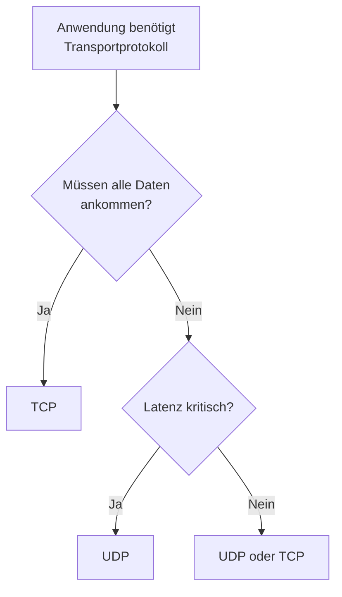

# UDP - User Datagram Protocol

> [!info] Lernziele
> Nach diesem Kapitel können Sie...
> - Die Eigenschaften von UDP (verbindungslos, unzuverlässig) erklären
> - Den minimalen UDP-Header beschreiben
> - Typische Anwendungsfälle für UDP nennen
> - UDP und TCP vergleichen und Einsatzkriterien ableiten

## Definition

> [!quote] Definition
> Das **User Datagram Protocol (UDP)** ist ein verbindungsloses, unzuverlässiges Transportprotokoll mit minimalem Overhead, das eine schnelle Datenübertragung ohne Garantien ermöglicht.
## Eigenschaften

| Eigenschaft | Beschreibung |
|-------------|--------------|
| **Verbindungslos** | Kein Handshake, sofortiger Versand |
| **Unzuverlässig** | Keine Bestätigungen, keine Garantien |
| **Ungeordnet** | Keine Sequenznummern |
| **Leichtgewichtig** | Nur 8 Byte Header |
| **Nachrichtenorientiert** | Behält Nachrichtengrenzen bei |
| **Keine Flusskontrolle** | Sender sendet so schnell wie möglich |

> [!info] Best-Effort-Prinzip
> UDP bietet keinerlei Garantien. Pakete können:
> - Verloren gehen
> - In falscher Reihenfolge ankommen
> - Dupliziert werden
> 
> Die Anwendung muss selbst damit umgehen!

## UDP-Header

Der UDP-Header ist extrem einfach mit nur **8 Bytes**:

![[udp-header.png]]
*<span class="fig-id">03-07-02-udp-header</span>: UDP-Header-Struktur mit 8 Bytes fixem Overhead*

### Header-Felder

| Feld | Bits | Beschreibung |
|------|------|--------------|
| **Source Port** | 16 | Quell-Portnummer (optional, kann 0 sein) |
| **Destination Port** | 16 | Ziel-Portnummer |
| **Length** | 16 | Gesamtlänge (Header + Daten) in Bytes |
| **Checksum** | 16 | Prüfsumme (optional bei IPv4, Pflicht bei IPv6) |

> [!tip] Header-Vergleich
> ```
> TCP-Header:  20-60 Bytes (mindestens 20)
> UDP-Header:  8 Bytes (immer)
> 
> Overhead-Ersparnis bei UDP: mindestens 12 Bytes pro Paket
> ```

## UDP vs. TCP

### Kommunikationsablauf

**TCP (verbindungsorientiert):** Erfordert einen 3-Way-Handshake (SYN → SYN-ACK → ACK) bevor Daten übertragen werden können. Jedes Datenpaket wird bestätigt.

**UDP (verbindungslos):** Datagramme werden sofort gesendet, ohne vorherigen Handshake und ohne Bestätigung. Der Sender weiß nicht, ob die Daten angekommen sind.

![[tcp-vs-udp.png]]
*<span class="fig-id">03-07-02-tcp-vs-udp</span>: Vergleich TCP (mit Handshake und Bestätigung) vs. UDP (verbindungslos)*

### Detaillierter Vergleich

| Aspekt | TCP | UDP |
|--------|-----|-----|
| **Verbindungsaufbau** | 3-Way-Handshake | Keiner |
| **Bestätigungen** | Ja (ACK) | Nein |
| **Sequenznummern** | Ja | Nein |
| **Flusskontrolle** | Sliding Window | Keine |
| **Staukontrolle** | Slow Start, etc. | Keine |
| **Reihenfolge** | Garantiert | Nicht garantiert |
| **Duplizierung** | Erkannt/verworfen | Möglich |
| **Fragmentierung** | Durch TCP | Nur durch IP |
| **Header-Größe** | 20-60 Bytes | 8 Bytes |
| **Latenz** | Höher (Handshake) | Niedriger |

## Anwendungsfälle für UDP

### Wann UDP verwenden?

**1. Echtzeitanwendungen**
- VoIP (Voice over IP)
- Video-Streaming (Live)
- Online-Gaming

*Grund:* Veraltete Daten sind wertlos – eine Neuübertragung käme zu spät.

**2. Kurze Transaktionen**
- DNS-Anfragen
- DHCP
- NTP (Zeitsynchronisation)

*Grund:* Der Handshake-Overhead wäre größer als die eigentlichen Nutzdaten.

**3. Broadcast / Multicast**
- Service Discovery
- Routing-Protokolle (RIP)
- IPTV Multicast

*Grund:* TCP unterstützt kein Broadcast oder Multicast.

**4. Eigene Zuverlässigkeitsschicht**
- QUIC (Google, HTTP/3)
- Spiele mit eigenem Reliability-Layer

*Grund:* Die Anwendung implementiert eine besser angepasste Kontrolle als TCP bieten würde.

### Typische UDP-Anwendungen

| Anwendung | Port | Beschreibung |
|-----------|------|--------------|
| **DNS** | 53 | Namensauflösung (kurze Anfragen) |
| **DHCP** | 67/68 | IP-Adressvergabe |
| **NTP** | 123 | Zeitsynchronisation |
| **SNMP** | 161/162 | Netzwerkmanagement |
| **TFTP** | 69 | Trivial File Transfer |
| **RIP** | 520 | Routing Information Protocol |
| **SIP** | 5060 | VoIP Signalisierung |
| **RTP** | dynamisch | Real-time Transport (Audio/Video) |

## UDP-basierte Protokolle

### DNS über UDP

![[dns-udp.png]]
*<span class="fig-id">03-07-02-dns-udp</span>: DNS-Anfrage über UDP – ein Paket hin, ein Paket zurück*

**Vorteile von DNS über UDP:**
- Schnell (kein Handshake erforderlich)
- Ein Paket hin, ein Paket zurück
- Bei Verlust: Client wiederholt nach Timeout

> [!info] Hinweis
> Bei großen Antworten (>512 Bytes) wechselt DNS automatisch zu TCP.

### DHCP über UDP

![[dhcp-dora.png]]
*<span class="fig-id">03-07-02-dhcp-dora</span>: DHCP DORA-Prozess – Discover, Offer, Request, Acknowledge*

**DORA = Discover, Offer, Request, Acknowledge**

### RTP (Real-time Transport Protocol)

![[rtp-udp.png]]
*<span class="fig-id">03-07-02-rtp-udp</span>: RTP-Paketstruktur über UDP/IP*

**RTP-Header enthält:**
- Sequenznummer (für Reihenfolge/Verlusterkennung)
- Timestamp (für Synchronisation)
- SSRC (Synchronization Source Identifier)

**Warum nicht TCP?**
- Retransmission bei Audio/Video nutzlos
- Head-of-Line Blocking würde Wiedergabe verzögern
- Lieber Frame auslassen als Verzögerung

## UDP-Checksum

Die Prüfsumme wird über einen Pseudo-Header berechnet:

![[udp-pseudo-header.png]]
*<span class="fig-id">03-07-02-udp-pseudo-header</span>: UDP Pseudo-Header für die Checksum-Berechnung*

> [!warning] IPv4 vs. IPv6
> - **IPv4:** Checksum optional (kann 0 sein)
> - **IPv6:** Checksum **Pflicht** (da IPv6-Header keine Checksum hat)

## Nachteile von UDP

| Problem | Auswirkung | Lösung auf Anwendungsebene |
|---------|------------|---------------------------|
| **Paketverlust** | Daten fehlen | Eigene Bestätigungen, FEC |
| **Reihenfolge** | Durcheinander | Sequenznummern in Anwendung |
| **Duplikate** | Mehrfachverarbeitung | Deduplizierung |
| **Keine Flusskontrolle** | Empfänger-Überlastung | Anwendungslogik |
| **Keine Staukontrolle** | Netzwerk-Überlastung | Rate Limiting |

## QUIC - UDP-basiertes Transport

> [!info] QUIC (Quick UDP Internet Connections)
> QUIC ist ein modernes Transportprotokoll über UDP, das von Google entwickelt wurde und die Basis für **HTTP/3** bildet.

![[quic-udp.png]]
*<span class="fig-id">03-07-02-quic-udp</span>: Vergleich traditioneller Stack vs. QUIC/HTTP3*

**Vorteile von QUIC:**
- 0-RTT Verbindungsaufbau (bei bekanntem Server)
- Kein Head-of-Line Blocking
- Verbindungsmigration (IP-Wechsel möglich)

## Prüfungsrelevante Themen

> [!warning] Klausurrelevanz: Hoch
>
> **Häufige Prüfungsthemen:**
> 1. UDP-Header-Aufbau (8 Bytes!)
> 2. Unterschiede TCP vs. UDP
> 3. Anwendungsfälle für UDP
> 4. Warum UDP für DNS/DHCP/VoIP?
> 5. Vor- und Nachteile von UDP

### Entscheidungsbaum: TCP oder UDP?



## Zusammenhänge

- [[01-TCP]] - Zuverlässiges Transportprotokoll
- [[03-Ports]] - Portnummern für Multiplexing
- [[08-Anwendungsschicht/01-DNS|DNS]] - Nutzt primär UDP
- [[06-Netzwerkschicht/01-IP-Protokoll|IP-Protokoll]] - Darunterliegende Schicht

## Quellen

- [[A-RFC-Index|RFC 768]] - User Datagram Protocol
- [[A-RFC-Index|RFC 8085]] - UDP Usage Guidelines
- [[A-RFC-Index|RFC 9000]] - QUIC
- Tanenbaum, A. S.: Computernetzwerke, Kap. 6
