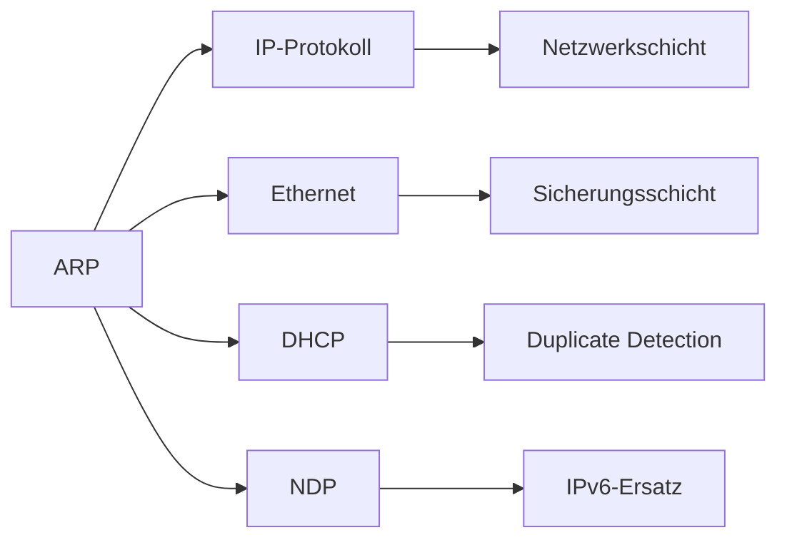

# ARP – Address Resolution Protocol

> [!info] **Lernziele**
> Nach diesem Kapitel solltest du:
> - Den Zweck von ARP verstehen (Brücke zwischen Layer 2 und Layer 3)
> - Den ARP-Request/Reply-Ablauf erklären können
> - Das ARP-Paketformat kennen
> - Den ARP-Cache und dessen Bedeutung verstehen
> - ARP-Spoofing als Sicherheitsrisiko erkennen und Gegenmaßnahmen kennen
> - Den Unterschied zwischen ARP (IPv4) und NDP (IPv6) verstehen

---

## Das Problem: IP kennt keine MAC-Adressen

> [!important] **Kernkonzept**
> Das **Address Resolution Protocol (ARP)** löst IP-Adressen in MAC-Adressen auf. Es ist die essenzielle Brücke zwischen Layer 3 (IP) und Layer 2 (Ethernet) – ohne ARP könnte kein IP-Paket im lokalen Netzwerk zugestellt werden.

### Warum ist ARP notwendig?

Wenn ein Host ein IP-Paket senden will, kennt er nur die Ziel-IP-Adresse. Aber Switches arbeiten mit MAC-Adressen – sie verstehen keine IP-Adressen:

```
┌─────────────────────────────────────────────────────────────────┐
│              Das Adressierungsproblem                          │
├─────────────────────────────────────────────────────────────────┤
│                                                                  │
│   Anwendung will Daten an 192.168.1.20 senden                  │
│                                                                  │
│   ┌─────────────────────────────────────────────────────────┐  │
│   │ IP-Schicht:   "Ziel-IP: 192.168.1.20" ✓                │  │
│   │ Ethernet:     "Ziel-MAC: ???"         ✗                │  │
│   └─────────────────────────────────────────────────────────┘  │
│                                                                  │
│   Ohne MAC-Adresse kann der Switch das Paket nicht zustellen!  │
│                                                                  │
│   → ARP fragt im Netzwerk: "Wer hat IP 192.168.1.20?"         │
│   → Antwort: "Ich! Meine MAC ist 00:1A:2B:3C:4D:5E"           │
│                                                                  │
└─────────────────────────────────────────────────────────────────┘
```

> [!example] **Analogie: Telefonbuch**
> - Du kennst den **Namen** deines Freundes (= IP-Adresse)
> - Du brauchst aber die **Telefonnummer** (= MAC-Adresse)
> - Das **Telefonbuch** (= ARP) liefert die Zuordnung

---

## ARP im Protokollstapel

ARP arbeitet zwischen Layer 2 und Layer 3. Es wird direkt in Ethernet-Frames gekapselt (EtherType: 0x0806), nicht in IP:

```
┌─────────────────────────────────────────────────────────────────┐
│                    ARP im Protokollstapel                       │
├─────────────────────────────────────────────────────────────────┤
│                                                                  │
│   ┌─────────────────────────────────────────────────────────┐   │
│   │              Netzwerkschicht (Layer 3)                  │   │
│   │                       IP                                 │   │
│   │   "Ich will an 192.168.1.20 senden"                     │   │
│   └─────────────────────────────────────────────────────────┘   │
│                            │                                     │
│                            ▼                                     │
│   ┌─────────────────────────────────────────────────────────┐   │
│   │                       ARP                                │   │
│   │   "Welche MAC-Adresse hat 192.168.1.20?"                │   │
│   │   Antwort: "00:1A:2B:3C:4D:5E"                          │   │
│   └─────────────────────────────────────────────────────────┘   │
│                            │                                     │
│                            ▼                                     │
│   ┌─────────────────────────────────────────────────────────┐   │
│   │              Sicherungsschicht (Layer 2)                │   │
│   │                    Ethernet                              │   │
│   │   Ziel-MAC: 00:1A:2B:3C:4D:5E                           │   │
│   └─────────────────────────────────────────────────────────┘   │
│                                                                  │
└─────────────────────────────────────────────────────────────────┘
```

---

## ARP-Ablauf

### Request und Reply

```
┌─────────────────────────────────────────────────────────────────┐
│                    ARP Request/Reply                            │
├─────────────────────────────────────────────────────────────────┤
│                                                                  │
│   Host A                      Switch                  Host B    │
│   192.168.1.10                                    192.168.1.20  │
│   AA:AA:AA:AA:AA:AA                              BB:BB:BB:BB:..│
│       │                                               │         │
│       │                                               │         │
│       │  1. ARP Request (Broadcast)                   │         │
│       │     Ziel-MAC: FF:FF:FF:FF:FF:FF              │         │
│       │     "Wer hat IP 192.168.1.20?                │         │
│       │      Sagt es 192.168.1.10 (AA:AA:...)"       │         │
│       │───────────────────────────────────────────────┼────────>│
│       │               (an alle Ports)                 │         │
│       │                                               │         │
│       │  2. ARP Reply (Unicast)                       │         │
│       │     Ziel-MAC: AA:AA:AA:AA:AA:AA              │         │
│       │     "192.168.1.20 ist bei BB:BB:BB:BB:BB:BB" │         │
│       │<──────────────────────────────────────────────┼─────────│
│       │                                               │         │
│       │  3. Kommunikation jetzt möglich              │         │
│       │     IP-Paket mit korrekter Ziel-MAC          │         │
│       │───────────────────────────────────────────────┼────────>│
│       │                                               │         │
│                                                                  │
└─────────────────────────────────────────────────────────────────┘
```

### Detaillierter Ablauf

1. **Host A** will ein IP-Paket an **192.168.1.20** senden
2. Host A prüft den **ARP-Cache** – Eintrag nicht vorhanden
3. Host A sendet **ARP Request** als **Broadcast** (FF:FF:FF:FF:FF:FF)
4. **Alle Hosts** im lokalen Netzwerk empfangen den Request
5. Nur **Host B** (192.168.1.20) antwortet mit **ARP Reply** (Unicast)
6. Host A speichert die Zuordnung im **ARP-Cache**
7. Host A kann nun das IP-Paket mit korrekter Ziel-MAC senden

> [!tip] **Merke: Broadcast vs. Unicast**
> - **ARP Request** = **Broadcast** (alle hören zu)
> - **ARP Reply** = **Unicast** (nur der Anfragende empfängt)

---

## ARP-Paketformat

Das ARP-Paket ist 28 Bytes groß (für Ethernet/IPv4):

```
 0                   1                   2                   3
 0 1 2 3 4 5 6 7 8 9 0 1 2 3 4 5 6 7 8 9 0 1 2 3 4 5 6 7 8 9 0 1
+-+-+-+-+-+-+-+-+-+-+-+-+-+-+-+-+-+-+-+-+-+-+-+-+-+-+-+-+-+-+-+-+
│         Hardware Type         │         Protocol Type         │
+-+-+-+-+-+-+-+-+-+-+-+-+-+-+-+-+-+-+-+-+-+-+-+-+-+-+-+-+-+-+-+-+
│ HW Addr Len   │ Proto Addr Len│           Operation           │
+-+-+-+-+-+-+-+-+-+-+-+-+-+-+-+-+-+-+-+-+-+-+-+-+-+-+-+-+-+-+-+-+
│                    Sender Hardware Address                    │
│                         (6 Bytes MAC)                         │
+-+-+-+-+-+-+-+-+-+-+-+-+-+-+-+-+-+-+-+-+-+-+-+-+-+-+-+-+-+-+-+-+
│                    Sender Protocol Address                    │
│                         (4 Bytes IP)                          │
+-+-+-+-+-+-+-+-+-+-+-+-+-+-+-+-+-+-+-+-+-+-+-+-+-+-+-+-+-+-+-+-+
│                    Target Hardware Address                    │
│                         (6 Bytes MAC)                         │
+-+-+-+-+-+-+-+-+-+-+-+-+-+-+-+-+-+-+-+-+-+-+-+-+-+-+-+-+-+-+-+-+
│                    Target Protocol Address                    │
│                         (4 Bytes IP)                          │
+-+-+-+-+-+-+-+-+-+-+-+-+-+-+-+-+-+-+-+-+-+-+-+-+-+-+-+-+-+-+-+-+
```

| Feld | Bytes | Wert (Ethernet/IPv4) | Beschreibung |
|------|-------|---------------------|--------------|
| **Hardware Type** | 2 | 0x0001 | Ethernet |
| **Protocol Type** | 2 | 0x0800 | IPv4 |
| **HW Addr Len** | 1 | 6 | MAC = 6 Bytes |
| **Proto Addr Len** | 1 | 4 | IPv4 = 4 Bytes |
| **Operation** | 2 | 1 oder 2 | **1 = Request, 2 = Reply** |
| **Sender HW Addr** | 6 | MAC | MAC des Absenders |
| **Sender Proto Addr** | 4 | IP | IP des Absenders |
| **Target HW Addr** | 6 | MAC/00:00:... | Bei Request: 00:00:00:00:00:00 |
| **Target Proto Addr** | 4 | IP | Gesuchte IP-Adresse |

---

## ARP-Cache

Der ARP-Cache speichert gelernte IP→MAC-Zuordnungen, um wiederholte ARP-Anfragen zu vermeiden.

### Cache-Einträge

| Typ | Beschreibung | Timeout |
|-----|--------------|---------|
| **Dynamisch** | Durch ARP gelernt | 2-20 Minuten (OS-abhängig) |
| **Statisch** | Manuell konfiguriert | Kein Timeout |
| **Incomplete** | Request gesendet, keine Antwort | Wenige Sekunden |

### Praktische Befehle

**Linux:**
```bash
# ARP-Cache anzeigen
$ ip neigh show
192.168.1.1 dev eth0 lladdr 00:1a:2b:3c:4d:5e REACHABLE
192.168.1.20 dev eth0 lladdr aa:bb:cc:dd:ee:ff STALE

# Alternativ (veraltet, aber funktioniert)
$ arp -a
gateway (192.168.1.1) at 00:1a:2b:3c:4d:5e [ether] on eth0

# Statischen Eintrag setzen
$ sudo ip neigh add 192.168.1.100 lladdr 11:22:33:44:55:66 dev eth0 nud permanent

# Cache leeren
$ sudo ip neigh flush all
```

**Windows:**
```cmd
:: ARP-Cache anzeigen
C:\> arp -a
Schnittstelle: 192.168.1.10 --- 0x5
  Internetadresse       Physische Adresse     Typ
  192.168.1.1           00-1a-2b-3c-4d-5e     dynamisch
  192.168.1.20          aa-bb-cc-dd-ee-ff     dynamisch

:: Statischen Eintrag setzen
C:\> netsh interface ip add neighbors "Ethernet" 192.168.1.100 11-22-33-44-55-66

:: Cache leeren
C:\> arp -d *
```

---

## ARP-Varianten

### Gratuitous ARP

Ein Host sendet einen ARP Request für seine **eigene** IP-Adresse:

```
┌─────────────────────────────────────────────────────────────────┐
│                    Gratuitous ARP                               │
├─────────────────────────────────────────────────────────────────┤
│                                                                  │
│   Sender IP:  192.168.1.10                                      │
│   Target IP:  192.168.1.10   ← Gleich!                         │
│                                                                  │
│   Verwendungszwecke:                                            │
│   • Duplicate Address Detection (DAD)                          │
│   • ARP-Cache-Update bei anderen Hosts (z.B. nach MAC-Wechsel) │
│   • Failover-Szenarien (VRRP, HSRP)                            │
│                                                                  │
└─────────────────────────────────────────────────────────────────┘
```

### Proxy ARP

Ein Router antwortet auf ARP Requests im Namen von Hosts in anderen Netzen:

```
┌─────────────────────────────────────────────────────────────────┐
│                    Proxy ARP                                    │
├─────────────────────────────────────────────────────────────────┤
│                                                                  │
│   Netz A                    Router                    Netz B    │
│   192.168.1.0/24                                 192.168.2.0/24 │
│                                                                  │
│   Host A fragt: "Wer hat 192.168.2.20?"                        │
│   Router antwortet mit SEINER MAC!                              │
│                                                                  │
│   → Host A sendet an Router-MAC                                │
│   → Router leitet an echtes Ziel weiter                        │
│                                                                  │
└─────────────────────────────────────────────────────────────────┘
```

> [!warning] **Proxy ARP**
> Proxy ARP wird heute selten verwendet und kann Sicherheitsrisiken bergen. Es maskiert die tatsächliche Netzwerktopologie.

### RARP (Reverse ARP)

Historisches Protokoll – löste MAC-Adressen in IP-Adressen auf (für disklose Workstations). Wurde durch **BOOTP** und später **DHCP** ersetzt.

---

## Sicherheit: ARP-Spoofing

### Das Angriffsszenario

```
┌─────────────────────────────────────────────────────────────────┐
│                    ARP-Spoofing-Angriff                        │
├─────────────────────────────────────────────────────────────────┤
│                                                                  │
│   Opfer A         Angreifer          Gateway                    │
│   192.168.1.10    192.168.1.99       192.168.1.1                │
│       │               │                   │                     │
│       │               │                   │                     │
│       │  Gefälschte ARP Replies          │                     │
│       │◄──────────────│                   │                     │
│       │  "192.168.1.1 ist bei            │                     │
│       │   ANGREIFER-MAC"                  │                     │
│       │               │                   │                     │
│       │               │──────────────────►│                     │
│       │               │  "192.168.1.10    │                     │
│       │               │   ist bei         │                     │
│       │               │   ANGREIFER-MAC"  │                     │
│       │               │                   │                     │
│       │                                   │                     │
│       │──────────────►│──────────────────►│                     │
│       │    Traffic    │    Traffic        │                     │
│       │  (abgehört!)  │  (weitergeleitet) │                     │
│       │               │                   │                     │
│                                                                  │
│   → Man-in-the-Middle: Angreifer sieht allen Traffic!          │
│                                                                  │
└─────────────────────────────────────────────────────────────────┘
```

### Mögliche Angriffe

| Angriff | Beschreibung |
|---------|--------------|
| **Man-in-the-Middle** | Abfangen und Mitlesen des Traffics |
| **DoS** | Umleiten von Traffic ins Nichts |
| **Session Hijacking** | Übernahme aktiver Verbindungen |
| **DNS-Spoofing** | Kombination mit gefälschten DNS-Antworten |

### Gegenmaßnahmen

| Maßnahme | Beschreibung |
|----------|--------------|
| **Dynamic ARP Inspection (DAI)** | Switch prüft ARP gegen DHCP-Snooping-Datenbank |
| **Static ARP Entries** | Manuelle MAC-IP-Zuordnung für kritische Hosts |
| **Port Security** | Begrenzt MAC-Adressen pro Switch-Port |
| **Private VLANs** | Isoliert Hosts im gleichen VLAN |
| **802.1X** | Authentifizierung vor Netzwerkzugriff |
| **VPN/TLS** | Verschlüsselung macht MITM nutzlos |

---

## ARP vs. NDP (IPv6)

In IPv6 wird ARP durch das **Neighbor Discovery Protocol (NDP)** ersetzt:

| Aspekt | ARP (IPv4) | NDP (IPv6) |
|--------|------------|------------|
| **Transport** | Eigenes Protokoll (EtherType 0x0806) | ICMPv6 (Type 135/136) |
| **Request** | Broadcast (FF:FF:FF:FF:FF:FF) | Multicast (Solicited-Node) |
| **Sicherheit** | Keine eingebaute | SEND (optional) |
| **Zusatzfunktionen** | Nur Adressauflösung | + Router Discovery, SLAAC, DAD |

---

## Zusammenhänge



- [[../03-Referenzmodelle/05-Sicherungsschicht/02-MAC-Adressen|MAC-Adressen]] → Ziel der Auflösung
- [[../03-Referenzmodelle/06-Netzwerkschicht/01-IP-Protokoll|IP-Protokoll]] → Quelle der Auflösung
- [[02-DHCP|DHCP]] → Nutzt ARP für Duplicate Address Detection
- [[06-NDP|NDP]] → IPv6-Ersatz für ARP
- [[../05-Sicherheit/00-Sicherheit-Index|Netzwerksicherheit]] → ARP-Spoofing-Prävention

---

## Prüfungstipps

> [!warning] **Prüfungsrelevant**
> - Zweck von ARP (Brücke Layer 2/Layer 3)
> - ARP-Ablauf: Request (Broadcast) → Reply (Unicast)
> - ARP-Paketformat (Operation: 1=Request, 2=Reply)
> - ARP-Cache und Timeouts
> - ARP-Spoofing als Sicherheitsrisiko
> - Unterschied ARP vs. NDP

> [!question] **Häufige Prüfungsfragen**
> 1. Warum wird ein ARP-Request als Broadcast gesendet?
> 2. Warum wird ein ARP-Reply als Unicast gesendet?
> 3. Was passiert, wenn der Zielhost in einem anderen Subnetz ist?
> 4. Erklären Sie den Ablauf eines ARP-Requests!
> 5. Wie kann ein Angreifer ARP-Spoofing durchführen?
> 6. Welche Gegenmaßnahmen gibt es gegen ARP-Spoofing?
> 7. Was ist der Unterschied zwischen ARP und NDP?

> [!tip] **Merkhilfen**
> - **Request** = **Broadcast** ("Ich frage alle")
> - **Reply** = **Unicast** ("Ich antworte direkt")
> - **Cache** = **Speicher** ("Damit ich nicht nochmal fragen muss")
> - **EtherType 0x0806** = ARP (nicht in IP gekapselt!)
> - **Operation 1** = Request, **Operation 2** = Reply

---

## Weiterführende Ressourcen

> [!note] **RFC und Standards**
> - [[A-RFC-Index#RFC 826|RFC 826]] - An Ethernet Address Resolution Protocol (1982)
> - [[A-RFC-Index#RFC 5227|RFC 5227]] - IPv4 Address Conflict Detection

> [!tip] **Praktische Tools**
> - **Wireshark** → ARP-Traffic analysieren (Filter: `arp`)
> - **arpwatch** → ARP-Änderungen überwachen
> - **arping** → Manuell ARP-Requests senden

---

## Quellen

- Tanenbaum, Andrew S.: Computernetzwerke
- Kurose, Ross: Computernetze – Ein Top-Down-Ansatz
- RFC 826 – An Ethernet Address Resolution Protocol
