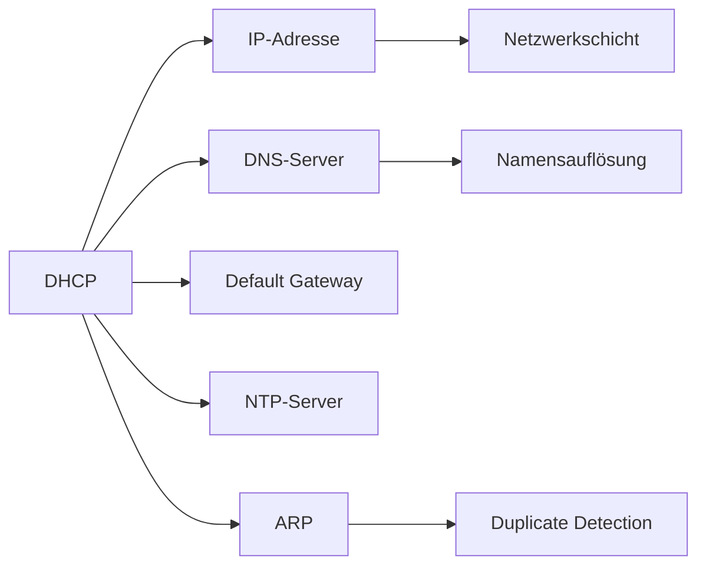

# DHCP – Dynamic Host Configuration Protocol

> [!info] **Lernziele**
> Nach diesem Kapitel solltest du:
> - Den Zweck von DHCP verstehen (automatische Netzwerkkonfiguration)
> - Den DORA-Prozess (Discover, Offer, Request, Acknowledge) erklären können
> - Die Lease-Verwaltung mit T1 und T2 verstehen
> - Die wichtigsten DHCP-Optionen kennen
> - DHCP-Relay und dessen Notwendigkeit verstehen
> - Sicherheitsrisiken (Starvation, Rogue Server) und Gegenmaßnahmen kennen
> - Den Unterschied zwischen DHCPv4 und DHCPv6/SLAAC verstehen

---

## Das Problem: Manuelle Konfiguration skaliert nicht

> [!important] **Kernkonzept**
> Das **Dynamic Host Configuration Protocol (DHCP)** automatisiert die Netzwerkkonfiguration von Endgeräten. Es vergibt IP-Adressen, Subnetzmasken, Default Gateways, DNS-Server und weitere Parameter dynamisch an Clients – ohne manuelle Konfiguration jedes einzelnen Geräts.

### Warum ist DHCP notwendig?

Ohne DHCP müsste jedes Gerät manuell konfiguriert werden:

**Ohne DHCP:**
- Jedes Gerät manuell konfigurieren
- IP-Adressen manuell vergeben und dokumentieren
- Bei Änderungen: alle Geräte anfassen
- Fehleranfällig: Tippfehler, Duplikate
- Hoher Administrationsaufwand

**Mit DHCP:**
- Gerät anschließen → automatisch konfiguriert
- Zentrale Verwaltung aller IP-Parameter
- Änderungen nur am Server → alle Clients aktualisiert
- Keine Duplikate möglich
- Skaliert auf tausende Geräte

> [!example] **Analogie: Hotel-Rezeption**
> - Du kommst in ein Hotel (= Netzwerk) und brauchst ein Zimmer (= IP-Adresse)
> - Die **Rezeption** (= DHCP-Server) weist dir ein freies Zimmer zu
> - Du bekommst einen **Schlüssel** (= vollständige Netzwerkkonfiguration)
> - Das Zimmer ist für deine **Aufenthaltsdauer reserviert** (= Lease-Zeit)
> - Beim Auschecken wird das Zimmer wieder **freigegeben** (= Release)

---

## DHCP im Protokollstapel

> [!info] **Schichtzuordnung**
> DHCP ist ein **Layer 7-Protokoll** (Anwendungsschicht), das auf UDP aufsetzt. Es hat jedoch eine Besonderheit: Es muss funktionieren, **bevor** der Client eine IP-Adresse hat. Deshalb nutzt es Broadcast auf Layer 2/3 mit den speziellen Adressen 0.0.0.0 (Quelle) und 255.255.255.255 (Ziel).

![[dhcp-protocol-stack.png]]
*<span class="fig-id">04-02-dhcp-protocol-stack</span>: DHCP im Protokollstapel – Layer 7 Protokoll über UDP mit Broadcast-Adressen.*

### Portnummern

| Protokoll | Port | Verwendung |
|-----------|------|------------|
| UDP | **67** | DHCP-Server (IPv4) / Relay Agent |
| UDP | **68** | DHCP-Client (IPv4) |
| UDP | **547** | DHCPv6-Server / Relay Agent |
| UDP | **546** | DHCPv6-Client |

---

## DORA-Prozess

Der DHCP-Prozess besteht aus vier Schritten – **DORA**:

![[dhcp-dora.png]]
*<span class="fig-id">04-02-dhcp-dora</span>: Der DORA-Prozess – Discover, Offer, Request, Acknowledge.*

### Die vier DORA-Schritte im Detail

| Schritt | Name | Richtung | Übertragung | Beschreibung |
|---------|------|----------|-------------|--------------|
| **D** | DHCPDISCOVER | Client → Server | Broadcast | Client sucht DHCP-Server |
| **O** | DHCPOFFER | Server → Client | Broadcast/Unicast | Server bietet IP an |
| **R** | DHCPREQUEST | Client → Server | Broadcast | Client akzeptiert Angebot |
| **A** | DHCPACK | Server → Client | Broadcast/Unicast | Server bestätigt |

> [!question] Warum ist DHCPREQUEST ein Broadcast?
> Der Client sendet DHCPREQUEST als **Broadcast**, damit **alle** DHCP-Server im Netzwerk erfahren, welchen Server der Client gewählt hat. Die nicht gewählten Server können ihre Angebote dann zurücknehmen.

---

## Weitere DHCP-Nachrichten

| Nachricht | Richtung | Beschreibung |
|-----------|----------|--------------|
| **DHCPNAK** | Server → Client | Server lehnt Request ab (IP nicht mehr verfügbar) |
| **DHCPDECLINE** | Client → Server | Client lehnt ab (IP bereits in Verwendung - ARP-Test) |
| **DHCPRELEASE** | Client → Server | Client gibt IP vorzeitig frei |
| **DHCPINFORM** | Client → Server | Client hat statische IP, fragt nur nach Optionen |

> [!info] Nachrichtenabläufe
> - **Normaler Ablauf:** D → O → R → A
> - **Fehlerfall:** D → O → R → NAK (Server lehnt ab)
> - **IP-Konflikt:** D → O → R → A → DECLINE (Client erkennt Duplikat per ARP)
> - **Vorzeitige Freigabe:** RELEASE (Client gibt IP zurück)
> - **Nur Optionen:** INFORM (Client hat statische IP)

---

## Lease-Verwaltung

Die IP-Adresse wird für eine **Lease-Zeit** vergeben – nicht dauerhaft.

![[dhcp-lease-timeline.png]]
*<span class="fig-id">04-02-dhcp-lease-timeline</span>: DHCP Lease-Zeitleiste mit T1 (Renewal) und T2 (Rebind) Zeitpunkten.*

### Lease-Erneuerung

| Zeitpunkt | Name | Verhalten |
|-----------|------|-----------|
| **T1 (50%)** | Renewal | Client sendet DHCPREQUEST direkt an ursprünglichen Server |
| **T2 (87.5%)** | Rebinding | Client sendet DHCPREQUEST als Broadcast an alle Server |
| **100%** | Lease Expired | Client **muss** IP aufgeben, startet DORA neu |

---

## DHCP-Paketformat

DHCP basiert auf dem älteren **BOOTP**-Format:

![[dhcp-packet-format.png]]
*<span class="fig-id">04-02-dhcp-packet-format</span>: DHCP-Paketformat basierend auf BOOTP.*

| Feld | Bytes | Beschreibung |
|------|-------|--------------|
| **op** | 1 | Operation: 1 = Request (Client), 2 = Reply (Server) |
| **htype** | 1 | Hardware-Typ: 1 = Ethernet |
| **hlen** | 1 | Hardware-Adresslänge: 6 (MAC) |
| **hops** | 1 | Relay-Hop-Count |
| **xid** | 4 | Transaction ID (zufällig, zur Zuordnung) |
| **yiaddr** | 4 | "Your" IP (vom Server angeboten) |
| **giaddr** | 4 | Gateway/Relay IP |
| **chaddr** | 16 | Client Hardware Address (MAC) |

---

## DHCP-Optionen

DHCP-Optionen transportieren die eigentlichen Konfigurationsparameter:

| Option | Name | Beschreibung |
|--------|------|--------------|
| **1** | Subnet Mask | z.B. 255.255.255.0 |
| **3** | Router | Default Gateway |
| **6** | DNS Server | DNS-Server-Adressen |
| **15** | Domain Name | z.B. "firma.local" |
| **42** | NTP Server | Zeitserver |
| **51** | Lease Time | Gültigkeitsdauer in Sekunden |
| **53** | Message Type | DISCOVER, OFFER, REQUEST, ACK, etc. |
| **54** | Server Identifier | IP des DHCP-Servers |

---

## DHCP-Relay

Da DHCP Broadcasts verwendet, funktioniert es nur im lokalen Netzwerk. Ein **DHCP-Relay-Agent** leitet Anfragen an Server in anderen Netzen weiter.

![[dhcp-relay.png]]
*<span class="fig-id">04-02-dhcp-relay</span>: DHCP-Relay-Agent leitet Anfragen über Subnetzgrenzen weiter.*

---

## DHCPv6

DHCPv6 unterscheidet sich von DHCPv4:

| Aspekt | DHCPv4 | DHCPv6 |
|--------|--------|--------|
| **Ports** | 67/68 UDP | 546/547 UDP |
| **Adressen** | Broadcast | Multicast (ff02::1:2) |
| **Nachrichten** | DISCOVER, OFFER, REQUEST, ACK | SOLICIT, ADVERTISE, REQUEST, REPLY |
| **Alternative** | Keine | SLAAC (Stateless) |

### Stateful vs. Stateless

> [!info] **Stateful vs. Stateless Konfiguration**
> 
> **Stateless (SLAAC + DHCPv6):**
> - IP-Adresse: Router Advertisement (SLAAC)
> - DNS, NTP, etc.: DHCPv6
> - Server speichert keine IP-Zuordnungen
> 
> **Stateful (nur DHCPv6):**
> - IP-Adresse: DHCPv6
> - Alle Optionen: DHCPv6
> - Server führt Lease-Datenbank
> 
> **Steuerung über Router Advertisement Flags:**
> - **M-Flag** (Managed): Stateful DHCPv6 verwenden
> - **O-Flag** (Other): Zusätzliche Infos per DHCPv6

---

## Sicherheit

### DHCP-Starvation

Bei einem **DHCP-Starvation-Angriff** versucht ein Angreifer, den gesamten IP-Adresspool des DHCP-Servers zu erschöpfen. Der Angreifer sendet massenhaft DHCPDISCOVER-Nachrichten mit gefälschten MAC-Adressen. Da der Server für jede scheinbar neue MAC-Adresse eine IP reserviert, ist der Pool schnell aufgebraucht.

![[dhcp-starvation-flow.png]]
*<span class="fig-id">04-02-dhcp-starvation-flow</span>: Ablauf eines DHCP-Starvation-Angriffs.*

**Auswirkungen:**
- Legitime Clients können keine IP-Adresse mehr erhalten
- Denial-of-Service für neue Geräte im Netzwerk
- Vorbereitung für einen Rogue-Server-Angriff (siehe unten)

### Rogue DHCP Server

Ein **Rogue DHCP Server** ist ein bösartiger oder unbeabsichtigt aktiver DHCP-Server im Netzwerk, der nicht vom Administrator kontrolliert wird. Da DHCP keine Authentifizierung verwendet, akzeptiert ein Client das erste OFFER, das er erhält – unabhängig davon, ob es vom legitimen Server stammt.

![[dhcp-rogue-flow.png]]
*<span class="fig-id">04-02-dhcp-rogue-flow</span>: Ein Rogue Server antwortet schneller als der legitime Server.*

**Was der Angreifer erreichen kann:**
- **Falsches Gateway:** Der Angreifer wird zum Default Gateway → Man-in-the-Middle
- **Falsche DNS-Server:** Alle DNS-Anfragen gehen zum Angreifer → Phishing, Umleitungen
- **Falsches Subnetz:** Client kann nicht richtig kommunizieren → DoS

### Gegenmaßnahmen

| Maßnahme | Beschreibung |
|----------|--------------|
| **DHCP Snooping** | Switch lernt legitime DHCP-Server, blockiert andere |
| **Port Security** | Begrenzt MAC-Adressen pro Port |
| **Rate Limiting** | Begrenzt DHCP-Nachrichten pro Zeiteinheit |
| **802.1X** | Authentifizierung vor Netzwerkzugang |
| **IP Source Guard** | Blockiert Traffic mit gefälschter Quell-IP |

---

## Praxisbeispiele

> [!example] DHCP-Client-Befehle
> 
> **Linux:**
> ```bash
> # IP erneuern
> $ sudo dhclient -r eth0    # Release
> $ sudo dhclient eth0       # Neue IP anfordern
> 
> # Lease-Informationen anzeigen
> $ cat /var/lib/dhcp/dhclient.leases
> ```
> 
> **Windows:**
> ```cmd
> C:\> ipconfig /release      # IP freigeben
> C:\> ipconfig /renew        # Neue IP anfordern
> C:\> ipconfig /all          # Lease-Infos anzeigen
> ```

---

## Zusammenhänge



- [[01-ARP|ARP]] → DHCP nutzt ARP für Duplicate Address Detection
- [[03-DNS|DNS]] → DNS-Server-Adressen werden via DHCP verteilt
- [[04-NTP|NTP]] → NTP-Server können via DHCP verteilt werden
- [[06-NDP|NDP]] → IPv6 Alternative: SLAAC via Router Advertisement

---

## Prüfungstipps

> [!warning] **Prüfungsrelevant**
> - DORA-Prozess (Discover, Offer, Request, Acknowledge)
> - Warum ist DHCPREQUEST ein Broadcast?
> - Lease-Konzept (T1 = 50%, T2 = 87.5%)
> - DHCP-Relay: Warum nötig? Wie funktioniert es?
> - Wichtige DHCP-Optionen (1, 3, 6, 51, 53)
> - Sicherheitsrisiken (Starvation, Rogue Server)

> [!question] **Häufige Prüfungsfragen**
> 1. Beschreiben Sie den DORA-Prozess.
> 2. Was passiert, wenn T1 erreicht wird und der ursprüngliche Server nicht antwortet?
> 3. Warum kann ein DHCP-Server nicht in einem anderen Subnetz stehen (ohne Relay)?
> 4. Wie schützt DHCP Snooping vor Rogue-Servern?
> 5. Was ist der Unterschied zwischen DHCPv4 und SLAAC?

> [!tip] **Merkhilfen**
> - **D**iscover = "**D**arf ich eine IP haben?"
> - **O**ffer = "**O**k, hier ist ein Angebot"
> - **R**equest = "**R**eserviere mir diese IP"
> - **A**ck = "**A**lles klar, sie gehört dir"
> - **Port 67** = Server, **Port 68** = Client (aufsteigend)
> - **T1 = 50%**, **T2 = 87.5%** (Renewal, Rebind)

---

## Weiterführende Ressourcen

> [!note] **RFC und Standards**
> - [[A-RFC-Index#RFC 2131|RFC 2131]] - Dynamic Host Configuration Protocol
> - [[A-RFC-Index#RFC 2132|RFC 2132]] - DHCP Options and BOOTP Vendor Extensions
> - [[A-RFC-Index#RFC 8415|RFC 8415]] - DHCPv6

> [!tip] **Praktische Tools**
> - **Wireshark** → DHCP-Traffic analysieren (Filter: `bootp` oder `dhcp`)
> - **dhcpdump** → DHCP-Pakete im Klartext anzeigen
> - **dnsmasq** → Einfacher DHCP-Server für Tests

---

## Quellen

- Tanenbaum, Andrew S.: Computernetzwerke – Die Standardreferenz für Netzwerkprotokolle mit detaillierter Beschreibung von DHCP und anderen Basisdiensten.
- Kurose, Ross: Computernetze – Ein Top-Down-Ansatz – Didaktisch aufbereitete Darstellung der Anwendungsschicht-Protokolle.
- RFC 2131 – Dynamic Host Configuration Protocol – Die maßgebliche Spezifikation für DHCPv4.
