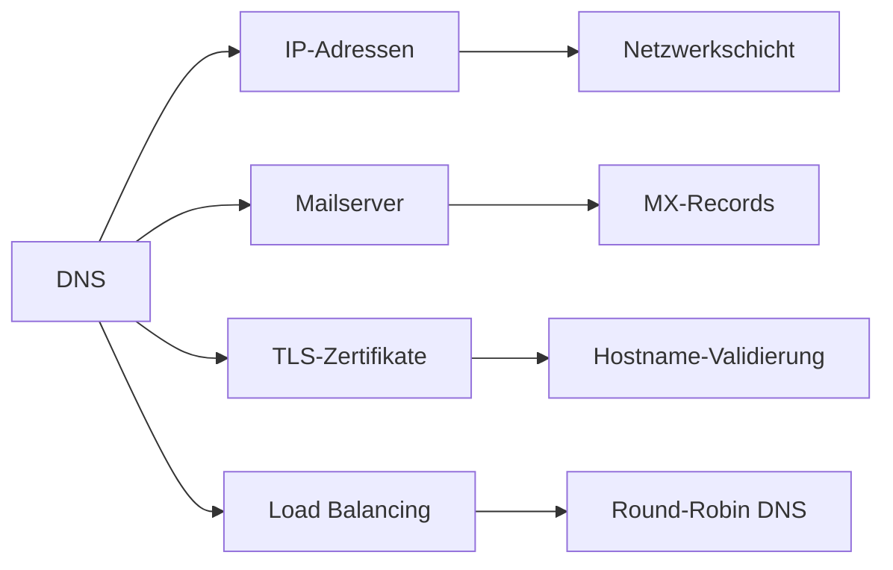

# DNS – Domain Name System

> [!info] **Lernziele**
> Nach diesem Kapitel solltest du:
> - Den Zweck von DNS verstehen (Namensauflösung)
> - Die DNS-Hierarchie (Root, TLD, SLD) erklären können
> - Den Unterschied zwischen rekursiver und iterativer Auflösung verstehen
> - Die wichtigsten Record-Typen (A, AAAA, MX, CNAME, NS, PTR) kennen
> - Das Konzept von Zonen und Zone Transfers verstehen
> - DNS-Sicherheitsrisiken (Spoofing, Cache Poisoning) und Gegenmaßnahmen (DNSSEC, DoH/DoT) kennen

---

## Das Problem: Menschen vs. Computer

> [!important] **Kernkonzept**
> Das **Domain Name System (DNS)** ist ein hierarchisches, verteiltes System zur Namensauflösung. Es übersetzt menschenlesbare Domainnamen (z.B. `www.example.de`) in IP-Adressen (z.B. `93.184.216.34`) und umgekehrt – das "Telefonbuch des Internets".

### Warum ist DNS notwendig?

```
┌─────────────────────────────────────────────────────────────────┐
│              Das Problem: Menschen vs. Computer                 │
├─────────────────────────────────────────────────────────────────┤
│                                                                  │
│   Menschen merken sich:     Computer brauchen:                  │
│   ────────────────────      ──────────────────                  │
│   www.google.de             142.250.185.99                      │
│   mail.example.org          93.184.216.34                       │
│   ftp.firma.local           192.168.1.50                        │
│                                                                  │
│   DNS ist das "Telefonbuch" des Internets:                     │
│   Name → IP-Adresse (Forward Lookup)                           │
│   IP-Adresse → Name (Reverse Lookup)                           │
│                                                                  │
└─────────────────────────────────────────────────────────────────┘
```

> [!example] **Analogie: Telefonbuch**
> - Du kennst den **Namen** deines Freundes (= Domainname)
> - Du brauchst aber die **Telefonnummer** (= IP-Adresse)
> - Das **Telefonbuch** (= DNS) liefert die Zuordnung
> - Große Städte haben eigene Telefonbücher (= DNS-Zonen)
> - Bei Umzug: Eintrag aktualisieren (= DNS-Record ändern)

---

## DNS im Protokollstapel

> [!info] **Schichtzuordnung**
> DNS ist ein **Layer-7-Protokoll** (Anwendungsschicht), das primär **UDP Port 53** verwendet. Für Zonentransfers und große Antworten (>512 Bytes) wird **TCP Port 53** genutzt.

---

## DNS-Hierarchie

```
┌─────────────────────────────────────────────────────────────────┐
│                    DNS-Hierarchie (Baumstruktur)                │
├─────────────────────────────────────────────────────────────────┤
│                                                                  │
│                            . (Root)                             │
│                    13 Root-Server weltweit                      │
│                    a.root-servers.net bis                       │
│                    m.root-servers.net                           │
│                               │                                  │
│         ┌─────────────────────┼─────────────────────┐           │
│         │                     │                     │           │
│        com                   de                    org          │
│    (Generic TLD)        (Country Code       (Generic TLD)       │
│                           TLD - ccTLD)                          │
│         │                     │                     │           │
│    ┌────┴────┐          ┌─────┴─────┐              │           │
│    │         │          │           │              │           │
│  google   amazon     example     bund         wikipedia         │
│ (SLD)    (SLD)       (SLD)      (SLD)          (SLD)           │
│    │                    │                                       │
│   www                 mail                                      │
│ (Host)              (Host)                                      │
│                                                                  │
│   FQDN: www.google.com.  (beachte den Punkt am Ende!)          │
│                                                                  │
└─────────────────────────────────────────────────────────────────┘
```

### Hierarchie-Ebenen

| Ebene | Name | Beispiel | Beschreibung |
|-------|------|----------|--------------|
| **0** | Root | `.` | 13 Root-Server (a-m.root-servers.net) |
| **1** | TLD | `.de`, `.com`, `.org` | Top-Level-Domain |
| **2** | SLD | `example.de` | Second-Level-Domain |
| **3+** | Subdomain | `www.example.de` | Subdomains/Hosts |

---

## DNS-Auflösung

### Rekursive vs. Iterative Auflösung

```
┌─────────────────────────────────────────────────────────────────┐
│              Rekursive Auflösung (Client-Sicht)                │
├─────────────────────────────────────────────────────────────────┤
│                                                                  │
│   Client ───────────────────────────► Resolver                  │
│     │                                     │                     │
│     │  "Löse www.example.de auf"         │                     │
│     │ ─────────────────────────────────► │                     │
│     │                                     │ ← Resolver          │
│     │                                     │   erledigt alles    │
│     │  "Antwort: 93.184.216.34"          │                     │
│     │ ◄───────────────────────────────── │                     │
│                                                                  │
│   → Client fragt einmal, Resolver liefert Endergebnis          │
│                                                                  │
└─────────────────────────────────────────────────────────────────┘

┌─────────────────────────────────────────────────────────────────┐
│              Iterative Auflösung (Resolver-Sicht)              │
├─────────────────────────────────────────────────────────────────┤
│                                                                  │
│   Resolver    Root-Server    TLD-Server    Auth-Server         │
│      │             │              │              │              │
│      │ "www.example.de?"         │              │              │
│      │────────────►│              │              │              │
│      │             │              │              │              │
│      │ "Frag .de-Server"         │              │              │
│      │◄────────────│              │              │              │
│      │                            │              │              │
│      │ "www.example.de?"         │              │              │
│      │───────────────────────────►│              │              │
│      │                            │              │              │
│      │ "Frag ns1.example.de"     │              │              │
│      │◄───────────────────────────│              │              │
│      │                                           │              │
│      │ "www.example.de?"                        │              │
│      │──────────────────────────────────────────►│              │
│      │                                           │              │
│      │ "93.184.216.34"                          │              │
│      │◄──────────────────────────────────────────│              │
│                                                                  │
│   → Resolver erhält bei jedem Schritt nur einen Verweis        │
│                                                                  │
└─────────────────────────────────────────────────────────────────┘
```

---

## DNS-Caching

```
┌─────────────────────────────────────────────────────────────────┐
│                    DNS-Caching                                  │
├─────────────────────────────────────────────────────────────────┤
│                                                                  │
│   Caching-Ebenen:                                               │
│   ┌─────────────────────────────────────────────────────────┐  │
│   │ 1. Browser-Cache (Chrome, Firefox, etc.)                │  │
│   │ 2. Betriebssystem-Cache (nscd, systemd-resolved)        │  │
│   │ 3. Lokaler Resolver-Cache (Router, Pi-hole)             │  │
│   │ 4. ISP-Resolver-Cache                                   │  │
│   │ 5. Öffentliche Resolver (8.8.8.8, 1.1.1.1)             │  │
│   └─────────────────────────────────────────────────────────┘  │
│                                                                  │
│   TTL (Time To Live):                                          │
│   • Bestimmt, wie lange ein Eintrag gecacht werden darf       │
│   • Typische Werte: 300s (5 Min) bis 86400s (1 Tag)           │
│   • Nach Ablauf: Neue Anfrage erforderlich                    │
│                                                                  │
└─────────────────────────────────────────────────────────────────┘
```

---

## DNS Record-Typen

| Typ | IPv4 | IPv6 | Beschreibung | Beispiel |
|-----|------|------|--------------|----------|
| **A** | ✓ | - | Name → IPv4-Adresse | `www IN A 192.168.1.2` |
| **AAAA** | - | ✓ | Name → IPv6-Adresse | `www IN AAAA 2001:db8::1` |
| **PTR** | ✓ | ✓ | IP → Name (Reverse) | `2.1.168.192.in-addr.arpa. IN PTR www` |
| **CNAME** | ✓ | ✓ | Alias für Namen | `www IN CNAME webserver.example.de.` |
| **NS** | ✓ | ✓ | Nameserver für Zone | `example.de. IN NS ns1.example.de.` |
| **MX** | ✓ | ✓ | Mailserver (mit Priorität) | `example.de. IN MX 10 mail.example.de.` |
| **TXT** | ✓ | ✓ | Textinformation | SPF, DKIM, DMARC |
| **SOA** | ✓ | ✓ | Start of Authority | Seriennummer, Refresh, etc. |
| **SRV** | ✓ | ✓ | Service-Lokalisierung | `_ldap._tcp IN SRV 0 100 389 dc` |

### Beispiel: Zonendatei

```dns
$TTL 86400
@       IN  SOA     ns1.example.de. admin.example.de. (
                    2024101301  ; Serial
                    3600        ; Refresh (1h)
                    1800        ; Retry (30min)
                    604800      ; Expire (1 Woche)
                    86400 )     ; Minimum TTL (1 Tag)

; Nameserver
@       IN  NS      ns1.example.de.
@       IN  NS      ns2.example.de.

; Mailserver
@       IN  MX  10  mail.example.de.

; A-Records
@       IN  A       93.184.216.34
www     IN  A       93.184.216.34
mail    IN  A       93.184.216.35

; CNAME
ftp     IN  CNAME   www.example.de.
```

---

## DNS-Zonen und Zone Transfers

### Zonentypen

| Zonentyp | Beschreibung |
|----------|--------------|
| **Primary (Master)** | Originale Zonendaten, Änderungen nur hier |
| **Secondary (Slave)** | Kopie vom Primary, für Redundanz |
| **Stub Zone** | Nur NS-Records, für Delegationen |
| **Forward Zone** | Leitet Anfragen an anderen Server weiter |

### Zone Transfers

```
┌─────────────────────────────────────────────────────────────────┐
│                    DNS Zone Transfer                            │
├─────────────────────────────────────────────────────────────────┤
│                                                                  │
│   Primary                                      Secondary        │
│   (Master)                                     (Slave)          │
│      │                                            │             │
│      │  1. SOA-Anfrage (UDP)                     │             │
│      │◄───────────────────────────────────────────│             │
│      │                                            │             │
│      │  2. SOA-Antwort mit Seriennummer          │             │
│      │────────────────────────────────────────────►│             │
│      │                                            │             │
│      │     Seriennummer geändert? → Transfer!    │             │
│      │                                            │             │
│      │  3. AXFR/IXFR Request (TCP)               │             │
│      │◄───────────────────────────────────────────│             │
│      │                                            │             │
│      │  4. Zonendaten übertragen (TCP)           │             │
│      │────────────────────────────────────────────►│             │
│                                                                  │
│   AXFR = Full Transfer (komplette Zone)                        │
│   IXFR = Incremental Transfer (nur Änderungen)                 │
│                                                                  │
└─────────────────────────────────────────────────────────────────┘
```

---

## Sicherheit

### DNS Cache Poisoning

```
┌─────────────────────────────────────────────────────────────────┐
│                    DNS Cache Poisoning                          │
├─────────────────────────────────────────────────────────────────┤
│                                                                  │
│   Client         Resolver         Angreifer      Auth-Server   │
│      │               │                │               │         │
│      │  Anfrage      │                │               │         │
│      │──────────────►│                │               │         │
│      │               │  Anfrage       │               │         │
│      │               │────────────────┼──────────────►│         │
│      │               │                │               │         │
│      │               │  Gefälschte    │  Echte       │         │
│      │               │  Antwort!      │  Antwort     │         │
│      │               │◄───────────────│               │         │
│      │               │◄───────────────┼───────────────│         │
│                                                                  │
│   Resolver akzeptiert die schnellere (gefälschte) Antwort!    │
│   → Nutzer wird auf Phishing-Seite umgeleitet                  │
│                                                                  │
└─────────────────────────────────────────────────────────────────┘
```

### DNSSEC (DNS Security Extensions)

```
┌─────────────────────────────────────────────────────────────────┐
│                    DNSSEC-Funktionsweise                        │
├─────────────────────────────────────────────────────────────────┤
│                                                                  │
│   DNSSEC fügt kryptographische Signaturen zu DNS hinzu:        │
│                                                                  │
│   Neue Record-Typen:                                            │
│   • RRSIG  - Signatur für einen Record-Set                     │
│   • DNSKEY - Öffentlicher Schlüssel der Zone                   │
│   • DS     - Delegation Signer (Vertrauenskette)               │
│   • NSEC   - Authenticated Denial of Existence                 │
│                                                                  │
│   ✓ Authentizität: Record stammt vom Zoneninhaber             │
│   ✓ Integrität: Record wurde nicht verändert                   │
│   ✗ Keine Verschlüsselung! Nur Signierung.                     │
│                                                                  │
└─────────────────────────────────────────────────────────────────┘
```

### DoH und DoT (Verschlüsseltes DNS)

| Protokoll | Name | Port | Beschreibung |
|-----------|------|------|--------------|
| **DoT** | DNS over TLS | 853 | DNS in TLS-Tunnel |
| **DoH** | DNS over HTTPS | 443 | DNS als HTTPS-Anfrage |
| **DoQ** | DNS over QUIC | 853 | DNS über QUIC-Protokoll |

---

## Praxisbeispiele

> [!example] DNS-Abfragen
> 
> **nslookup (Windows/Linux):**
> ```bash
> $ nslookup www.example.de
> Server:     8.8.8.8
> Address:    8.8.8.8#53
> 
> Non-authoritative answer:
> Name:   www.example.de
> Address: 93.184.216.34
> ```
> 
> **dig (Linux):**
> ```bash
> $ dig www.example.de
> $ dig example.de MX         # Mailserver
> $ dig example.de NS         # Nameserver
> $ dig +trace example.de     # Vollständige Auflösung
> $ dig @1.1.1.1 example.de   # Bestimmten Server fragen
> ```

---

## Zusammenhänge



- [[02-DHCP|DHCP]] → Liefert DNS-Server-Adressen
- [[04-NTP|NTP]] → Zeitsynchronisation für DNSSEC wichtig
- [[../05-Sicherheit/03-TLS|TLS]] → Zertifikate basieren auf DNS-Namen
- [[../03-Referenzmodelle/08-Anwendungsschicht/02-HTTP|HTTP]] → Nutzt DNS für Hostname-Auflösung

---

## Prüfungstipps

> [!warning] **Prüfungsrelevant**
> - DNS-Hierarchie (Root, TLD, SLD, Subdomain)
> - Rekursive vs. iterative Auflösung
> - Wichtige Record-Typen (A, AAAA, MX, CNAME, NS, PTR)
> - TTL und Caching
> - Zone Transfers (AXFR, IXFR)
> - DNSSEC Grundprinzip (Signierung, keine Verschlüsselung)

> [!question] **Häufige Prüfungsfragen**
> 1. Beschreiben Sie den Ablauf einer DNS-Auflösung für www.example.de.
> 2. Was ist der Unterschied zwischen einem A- und einem CNAME-Record?
> 3. Warum ist DNS anfällig für Spoofing? Wie hilft DNSSEC?
> 4. Was bedeutet TTL und welche Auswirkungen hat ein niedriger Wert?
> 5. Erklären Sie Primary vs. Secondary DNS-Server.

> [!tip] **Merkhilfen**
> - **A** = **A**ddress (IPv4)
> - **AAAA** = Address (IPv6, 4× A weil 128 Bit statt 32)
> - **MX** = **M**ail e**X**change
> - **NS** = **N**ame **S**erver
> - **PTR** = **P**oin**T**e**R** (Reverse)
> - **CNAME** = **C**anonical **NAME** (Alias)
> - **Port 53** = DNS (UDP für Queries, TCP für Transfers)

---

## Weiterführende Ressourcen

> [!note] **RFC und Standards**
> - [[A-RFC-Index#RFC 1034|RFC 1034]] - Domain Names – Concepts and Facilities
> - [[A-RFC-Index#RFC 1035|RFC 1035]] - Domain Names – Implementation and Specification
> - [[A-RFC-Index#RFC 4033|RFC 4033]] - DNS Security Introduction (DNSSEC)
> - [[A-RFC-Index#RFC 8484|RFC 8484]] - DNS Queries over HTTPS (DoH)

> [!tip] **Praktische Tools**
> - **dig** → Detaillierte DNS-Abfragen (Linux)
> - **nslookup** → Einfache DNS-Abfragen (Windows/Linux)
> - **Wireshark** → DNS-Traffic analysieren (Filter: `dns`)
> - **DNSViz** → DNSSEC-Validierung visualisieren

---

## Quellen

- Tanenbaum, Andrew S.: Computernetzwerke – Ausführliche Behandlung der DNS-Architektur und -Protokolle.
- Kurose, Ross: Computernetze – Ein Top-Down-Ansatz – Didaktisch aufbereitete Darstellung der Anwendungsschicht mit DNS-Fokus.
- RFC 1034/1035 – Domain Names – Die grundlegenden Spezifikationen für DNS, die auch heute noch gültig sind.
