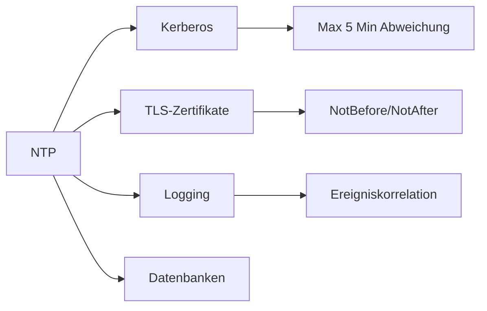

# NTP – Network Time Protocol

> [!info] **Lernziele**
> Nach diesem Kapitel solltest du:
> - Den Zweck von NTP verstehen (Zeitsynchronisation)
> - Die Stratum-Hierarchie (0-16) erklären können
> - Das Grundprinzip der Offset-Berechnung verstehen
> - Die Unterschiede zwischen NTP, SNTP und PTP kennen
> - Sicherheitsrisiken (Amplification) und Gegenmaßnahmen (NTS) verstehen
> - Wissen, warum präzise Zeit für Kerberos, TLS und Logging kritisch ist

---

## Das Problem: Unsynchronisierte Uhren

> [!important] **Kernkonzept**
> Das **Network Time Protocol (NTP)** synchronisiert Systemuhren über Netzwerke hinweg mit einer Genauigkeit von typischerweise 1-10 Millisekunden. Präzise Zeitsynchronisation ist kritisch für Logging, Authentifizierung, Zertifikate und verteilte Systeme.

### Warum ist Zeitsynchronisation wichtig?

```
┌─────────────────────────────────────────────────────────────────┐
│              Warum ist genaue Zeit wichtig?                    │
├─────────────────────────────────────────────────────────────────┤
│                                                                  │
│   ✓ Logging & Forensik                                         │
│     → Ereignisse verschiedener Systeme korrelieren             │
│     → "Was passierte zuerst?"                                  │
│                                                                  │
│   ✓ Authentifizierung (Kerberos)                               │
│     → Tickets haben Zeitstempel                                │
│     → Max. 5 Minuten Abweichung erlaubt                        │
│                                                                  │
│   ✓ TLS-Zertifikate                                            │
│     → "Not Before" / "Not After" Zeitstempel                   │
│     → Falsche Uhr → Zertifikat ungültig!                       │
│                                                                  │
│   ✓ Datenbank-Replikation                                      │
│     → Konfliktauflösung basiert auf Zeitstempeln               │
│                                                                  │
│   ✓ Verteilte Systeme                                          │
│     → Konsistenzgarantien                                      │
│                                                                  │
└─────────────────────────────────────────────────────────────────┘
```

> [!example] **Analogie: Zugfahrplan**
> - Alle Bahnhöfe brauchen **synchronisierte Uhren**
> - Sonst: Züge verpassen Anschlüsse, Fahrpläne nutzlos
> - Eine **Zentraluhr** (= Stratum 0/1) gibt den Takt vor
> - Bahnhöfe synchronisieren sich hierarchisch (= Stratum-Ebenen)
> - Kleine Abweichungen werden **sanft korrigiert** (= Slewing)

---

## NTP im Protokollstapel

> [!info] **Schichtzuordnung**
> NTP ist ein **Layer-7-Protokoll** (Anwendungsschicht), das **UDP Port 123** verwendet. Für die neue NTS-Erweiterung (Network Time Security) wird zusätzlich **TCP Port 4460** genutzt.

---

## NTP-Stratum-Hierarchie

```
┌─────────────────────────────────────────────────────────────────┐
│                    NTP-Stratum-Hierarchie                       │
├─────────────────────────────────────────────────────────────────┤
│                                                                  │
│   Stratum 0    ┌─────────────────────────────────────────────┐  │
│   (Referenz)   │  GPS  │  Atomuhr  │  DCF77  │  GLONASS     │  │
│                │       │ (Caesium) │ (77.5kHz)│              │  │
│                └────────────────────┬────────────────────────┘  │
│                                     │                           │
│                                     │ Direkte Verbindung        │
│                                     │                           │
│   Stratum 1    ┌────────────────────┴────────────────────────┐  │
│   (Primary)    │        Primäre NTP-Server                   │  │
│                │  time.google.com, ptbtime1.ptb.de           │  │
│                └────────────────────┬────────────────────────┘  │
│                                     │                           │
│   Stratum 2    ┌────────────────────┴────────────────────────┐  │
│   (Secondary)  │       Sekundäre NTP-Server                  │  │
│                │  ISP-Server, Unternehmens-Server            │  │
│                └────────────────────┬────────────────────────┘  │
│                                     │                           │
│   Stratum 3+   ┌────────────────────┴────────────────────────┐  │
│                │    Clients, weitere Server                  │  │
│                │    (Desktop, Server, IoT-Geräte)           │  │
│                └─────────────────────────────────────────────┘  │
│                                                                  │
│   Stratum 16 = unsynchronisiert (ungültig)                     │
│                                                                  │
└─────────────────────────────────────────────────────────────────┘
```

### Stratum-Regeln

| Stratum | Beschreibung | Genauigkeit |
|---------|--------------|-------------|
| **0** | Referenzuhren (GPS, Atomuhr, DCF77) | Nanosekunden |
| **1** | Direkt an Stratum 0 angeschlossen | Mikrosekunden |
| **2** | Synchronisiert mit Stratum 1 | < 10 ms |
| **3-15** | Weitere Hierarchiestufen | Zunehmend ungenauer |
| **16** | Unsynchronisiert | Ungültig |

---

## Zeitmessung und Offset-Berechnung

```
┌─────────────────────────────────────────────────────────────────┐
│              NTP-Zeitmessung (Algorithmus)                     │
├─────────────────────────────────────────────────────────────────┤
│                                                                  │
│   Client                                             Server     │
│      │                                                  │       │
│   t1 │ ──────────── NTP Request ────────────────────► │ t2     │
│      │              (Zeitstempel t1)                    │       │
│      │                                                  │       │
│   t4 │ ◄─────────── NTP Response ─────────────────── │ t3     │
│      │              (Zeitstempel t1, t2, t3)           │       │
│                                                                  │
│   Berechnung:                                                   │
│   ┌─────────────────────────────────────────────────────────┐  │
│   │                                                          │  │
│   │   Offset (θ) = ((t2 - t1) + (t3 - t4)) / 2              │  │
│   │                                                          │  │
│   │   → Wie weit geht die Client-Uhr falsch?                │  │
│   │                                                          │  │
│   │   Delay (δ) = (t4 - t1) - (t3 - t2)                     │  │
│   │                                                          │  │
│   │   → Round-Trip-Zeit (ohne Server-Verarbeitung)          │  │
│   │                                                          │  │
│   └─────────────────────────────────────────────────────────┘  │
│                                                                  │
│   t1 = Client-Sendezeit       t2 = Server-Empfangszeit         │
│   t3 = Server-Sendezeit       t4 = Client-Empfangszeit         │
│                                                                  │
└─────────────────────────────────────────────────────────────────┘
```

### NTP-Algorithmen

| Algorithmus | Funktion |
|-------------|----------|
| **Clock Filter** | Wählt beste Samples aus mehreren Messungen |
| **Clock Selection** | Wählt beste Server aus mehreren Quellen |
| **Clock Clustering** | Eliminiert Ausreißer (Falsetickers) |
| **Clock Discipline** | Steuert Uhr sanft nach (keine Sprünge) |

---

## NTP vs. SNTP vs. PTP

| Aspekt | NTP | SNTP | PTP (IEEE 1588) |
|--------|-----|------|-----------------|
| **Genauigkeit** | 1-10 ms | 100+ ms | < 1 µs |
| **Komplexität** | Hoch | Niedrig | Sehr hoch |
| **Hardware** | Software | Software | Hardware-Support |
| **Einsatz** | Allgemein | Embedded, IoT | Industrie, Finanz |
| **Port** | UDP 123 | UDP 123 | UDP 319, 320 |

---

## Sicherheit

### NTP-Amplification-Angriffe

```
┌─────────────────────────────────────────────────────────────────┐
│              NTP Amplification Attack (DDoS)                   │
├─────────────────────────────────────────────────────────────────┤
│                                                                  │
│   Angreifer           NTP-Server             Opfer             │
│      │                    │                    │               │
│      │  Kleine Anfrage    │                    │               │
│      │  (Source IP =      │                    │               │
│      │   Opfer-IP!)       │                    │               │
│      │────────────────────►│                    │               │
│      │                    │                    │               │
│      │                    │  Große Antwort    │               │
│      │                    │  (z.B. monlist)   │               │
│      │                    │───────────────────►│               │
│                                                                  │
│   Amplification-Faktor: bis zu 556x!                           │
│                                                                  │
│   Gegenmaßnahmen:                                               │
│   • monlist deaktivieren (ntpd: "disable monitor")             │
│   • Rate Limiting                                              │
│   • BCP38 (Ingress Filtering)                                  │
│                                                                  │
└─────────────────────────────────────────────────────────────────┘
```

### NTS (Network Time Security)

```
┌─────────────────────────────────────────────────────────────────┐
│              NTS - Network Time Security                       │
├─────────────────────────────────────────────────────────────────┤
│                                                                  │
│   Problem: NTP ist unverschlüsselt und unauthentifiziert       │
│   → Man-in-the-Middle kann Zeit manipulieren                   │
│                                                                  │
│   Lösung: NTS (RFC 8915)                                       │
│   ┌─────────────────────────────────────────────────────────┐  │
│   │ 1. NTS-KE (Key Exchange) über TLS (TCP 4460)           │  │
│   │    → Authentifizierung, Schlüsselaustausch             │  │
│   │                                                          │  │
│   │ 2. NTP mit AEAD (Authenticated Encryption)              │  │
│   │    → Integrität und Authentizität der Zeitdaten        │  │
│   └─────────────────────────────────────────────────────────┘  │
│                                                                  │
│   Unterstützung: time.cloudflare.com, Chrony 4.0+, NTPsec     │
│                                                                  │
└─────────────────────────────────────────────────────────────────┘
```

---

## Praxisbeispiele

> [!example] NTP-Befehle
> 
> **Linux (ntpq):**
> ```bash
> $ ntpq -p
>      remote           refid      st t when poll reach   delay   offset  jitter
> ==============================================================================
> *time.google.com .GOOG.           1 u   23   64  377   12.345   -0.123   0.456
> ```
> 
> **Linux (chronyc):**
> ```bash
> $ chronyc sources
> MS Name/IP address         Stratum Poll Reach LastRx Last sample
> ===============================================================
> ^* time.google.com               1   6   377    23   -123us
> ```
> 
> **Windows:**
> ```cmd
> C:\> w32tm /query /status
> C:\> w32tm /resync
> ```

### Öffentliche NTP-Server

| Server | Anbieter | Stratum |
|--------|----------|---------|
| `time.google.com` | Google | 1 |
| `time.cloudflare.com` | Cloudflare | 3 (NTS!) |
| `time.windows.com` | Microsoft | 2 |
| `ptbtime1.ptb.de` | PTB Deutschland | 1 |
| `pool.ntp.org` | NTP Pool Project | variiert |

---

## Zusammenhänge



- [[../05-Sicherheit/03-TLS|TLS]] → Zertifikate benötigen korrekte Zeit
- [[02-DHCP|DHCP]] → Kann NTP-Server-Adresse liefern (Option 42)
- [[03-DNS|DNS]] → NTP-Server werden per DNS aufgelöst
- [[../../02-Betriebssysteme/04-Synchronisation/00-Synchronisation-Index|Synchronisation (BS)]] → Uhren in verteilten Systemen

---

## Prüfungstipps

> [!warning] **Prüfungsrelevant**
> - Stratum-Hierarchie (0-16)
> - Warum ist Zeitsynchronisation wichtig?
> - Offset-Berechnung (Grundprinzip)
> - NTP vs. SNTP vs. PTP
> - Sicherheitsrisiken (Amplification)

> [!question] **Häufige Prüfungsfragen**
> 1. Was bedeutet Stratum 2?
> 2. Warum nutzt NTP UDP statt TCP?
> 3. Wie berechnet NTP den Offset?
> 4. Welche Probleme entstehen ohne Zeitsynchronisation?
> 5. Was ist ein NTP-Amplification-Angriff?

> [!tip] **Merkhilfen**
> - **Stratum 0** = Referenzuhren (GPS, Atomuhr)
> - **Stratum 1** = Direkt angeschlossen
> - **Stratum 16** = Unsynchronisiert (ungültig)
> - **Port 123** = NTP (UDP)
> - **Offset** = Wie weit geht die Uhr falsch
> - **Kerberos** = Max. 5 Minuten Abweichung

---

## Weiterführende Ressourcen

> [!note] **RFC und Standards**
> - [[A-RFC-Index#RFC 5905|RFC 5905]] - Network Time Protocol Version 4
> - [[A-RFC-Index#RFC 4330|RFC 4330]] - Simple Network Time Protocol (SNTP)
> - [[A-RFC-Index#RFC 8915|RFC 8915]] - Network Time Security for NTP

> [!tip] **Praktische Tools**
> - **ntpq** → NTP-Status abfragen
> - **chronyc** → Chrony-Status abfragen
> - **Wireshark** → NTP-Traffic analysieren (Filter: `ntp`)

---

## Quellen

- Tanenbaum, Andrew S.: Computernetzwerke – Grundlagen der Zeitsynchronisation in verteilten Systemen.
- Mills, David L.: Computer Network Time Synchronization – Das Standardwerk vom NTP-Erfinder.
- RFC 5905 – Network Time Protocol Version 4 – Die aktuelle NTP-Spezifikation mit detaillierter Algorithmusbeschreibung.
