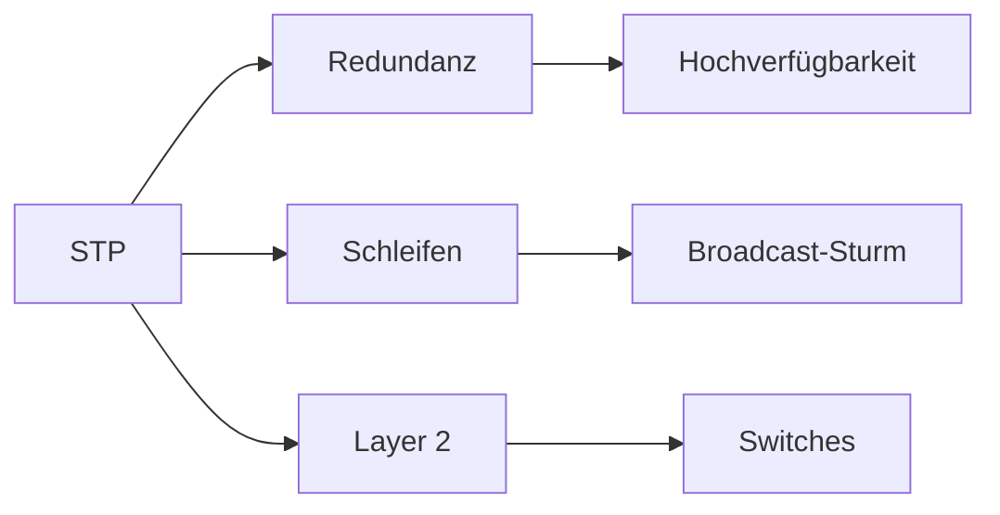

# Spanning Tree Protocol (STP)

> [!info] **Lernziele**
> Nach diesem Kapitel solltest du:
> - Das Layer-2-Schleifenproblem verstehen (Broadcast-Sturm, MAC-Flapping)
> - Die Root Bridge Election erklären können (Bridge ID = Priority + MAC)
> - Port-Rollen (Root, Designated, Blocked) unterscheiden können
> - Port-Zustände (Blocking, Listening, Learning, Forwarding) kennen
> - Den Unterschied zwischen STP und RSTP verstehen (Konvergenzzeit)
> - Sicherheitsmaßnahmen (BPDU Guard, Root Guard) kennen

---

## Das Problem: Layer-2-Schleifen sind fatal

> [!important] **Kernkonzept**
> Das **Spanning Tree Protocol (STP)** verhindert Schleifen in geswitchten Layer-2-Netzwerken. Es erstellt einen schleifenfreien Spannbaum, indem es redundante Pfade blockiert und nur einen aktiven Pfad zwischen je zwei Netzwerkknoten zulässt.

### Warum sind Layer-2-Schleifen fatal?

![[stp-loop-problem.png]]
*<span class="fig-id">04-05-stp-loop-problem</span>: Layer-2-Schleife ohne STP – Switches A, B, C bilden einen Ring.*

**Problem 1: Broadcast-Sturm**
- Host X sendet einen Broadcast
- Switch C flutet an A und B
- A flutet an B, B flutet an A
- Endlosschleife! Netzwerk kollabiert!

**Problem 2: MAC-Flapping**
- Switch sieht dieselbe MAC an verschiedenen Ports
- MAC-Tabelle wird instabil
- Pakete werden falsch zugestellt

**Problem 3: Mehrfachzustellung**
- Unicast-Frames erreichen Ziel mehrfach
- Anwendungsprobleme, Duplikate

> [!example] **Analogie: Einbahnstraßen-Netz**
> - Eine Stadt mit **kreisförmigen Straßen** (= Schleifen)
> - Autos fahren **endlos im Kreis** (= Broadcast-Sturm)
> - Verkehr kollabiert, nichts kommt mehr an
> - Lösung: **Straßensperren** aufstellen (= Ports blockieren)
> - Bei Unfall: Alternative Route **automatisch freigeben** (= Failover)

---

## STP im Protokollstapel

> [!info] **Schichtzuordnung**
> STP ist ein **Layer-2-Protokoll** (Sicherungsschicht). Es arbeitet mit MAC-Adressen und Ethernet-Frames. Die BPDUs (Bridge Protocol Data Units) werden als Multicast an `01:80:C2:00:00:00` gesendet.

---

## STP-Lösung: Der Spannbaum

![[stp-before-after.png]]
*<span class="fig-id">04-05-stp-before-after</span>: STP blockiert redundante Ports für einen schleifenfreien Spannbaum.*

---

## Root Bridge Election

Der erste Schritt in STP ist die Wahl der **Root Bridge** – der zentrale Punkt des Spannbaums.

![[stp-bridge-id.png]]
*<span class="fig-id">04-05-stp-bridge-id</span>: Aufbau der Bridge ID – Priority (2 Byte) + MAC-Adresse (6 Byte).*

**Regel:** Die **niedrigste** Bridge ID gewinnt!

> [!example] **Beispiel Root Bridge Election**
> - Switch A: Priority 32768, MAC 00:11:22:33:44:55
> - Switch B: Priority 32768, MAC 00:11:22:33:44:44 ← **Root!**
> - Switch C: Priority 32768, MAC 00:11:22:33:44:66
> 
> → Switch B wird Root Bridge (niedrigste MAC bei gleicher Priority)

---

## Pfadkosten

Nach der Root Bridge Election berechnet jeder Switch den kürzesten Pfad zur Root Bridge basierend auf **Pfadkosten**.

| Bandbreite | STP-Kosten (802.1D-1998) | RSTP-Kosten (802.1D-2004) |
|------------|--------------------------|---------------------------|
| 10 Mbps | 100 | 2.000.000 |
| 100 Mbps | 19 | 200.000 |
| 1 Gbps | 4 | 20.000 |
| 10 Gbps | 2 | 2.000 |

---

## Port-Rollen

| Rolle | Beschreibung | Zustand |
|-------|--------------|---------|
| **Root Port (RP)** | Port mit kürzestem Pfad zur Root Bridge | Forwarding |
| **Designated Port (DP)** | Bester Port für ein Segment zur Root Bridge | Forwarding |
| **Blocked/Alternate Port** | Redundanter Port, deaktiviert | Blocking |

![[stp-port-roles.png]]
*<span class="fig-id">04-05-stp-port-roles</span>: Port-Rollen im Spannbaum – Root Port, Designated Port und Blocked Port.*

---

## Port-Zustände (STP)

| Zustand | Frames | MAC lernen | BPDUs | Dauer |
|---------|--------|------------|-------|-------|
| **Disabled** | ✗ | ✗ | ✗ | — |
| **Blocking** | ✗ | ✗ | RX | 20s (max age) |
| **Listening** | ✗ | ✗ | RX/TX | 15s (forward delay) |
| **Learning** | ✗ | ✓ | RX/TX | 15s (forward delay) |
| **Forwarding** | ✓ | ✓ | RX/TX | — |

![[stp-port-states.png]]
*<span class="fig-id">04-05-stp-port-states</span>: STP Port-Zustandsübergänge – 30-50 Sekunden Konvergenzzeit.*

---

## RSTP (Rapid Spanning Tree)

RSTP (IEEE 802.1w) verbessert die Konvergenzzeit drastisch:

**STP:** Blocking → Listening → Learning → Forwarding (20s + 15s + 15s = **30-50 Sekunden**)

**RSTP:** Discarding → Forwarding via Proposal/Agreement-Mechanismus (**< 1 Sekunde**, oft Millisekunden!)

### RSTP Proposal/Agreement

![[rstp-proposal-agreement.png]]
*<span class="fig-id">04-05-rstp-proposal-agreement</span>: RSTP Proposal/Agreement – sofortige Konvergenz ohne Timer.*

---

## MSTP (Multiple Spanning Tree)

MSTP (IEEE 802.1s) ermöglicht mehrere STP-Instanzen für verschiedene VLANs innerhalb einer **MSTP-Region**.

**Problem mit klassischem STP/RSTP:**
- Nur eine einzige Root Bridge für das gesamte Netzwerk
- Alle VLANs nutzen denselben Spannbaum
- Suboptimale Pfade: Traffic muss immer über die Root Bridge
- Keine Möglichkeit zur Lastverteilung auf redundanten Links

**MSTP-Lösung:**
- Mehrere **Spanning Tree Instances** (MSTIs) pro Region
- Jede Instance kann eine eigene Root Bridge haben
- VLANs werden auf Instances gemappt

**Beispiel-Konfiguration:**
- **Instance 1** (VLAN 10, 20): Root = Switch A → Traffic über Link West
- **Instance 2** (VLAN 30, 40): Root = Switch B → Traffic über Link Ost
- Ergebnis: Lastverteilung über beide redundanten Pfade

**MSTP-Region:**
- Switches mit identischer Konfiguration (Region Name, Revision, VLAN-Mapping)
- Innerhalb der Region: Mehrere Instances
- Zwischen Regionen: Eine gemeinsame Instance (IST – Internal Spanning Tree)

**Vorteile gegenüber PVST+:**
- Weniger CPU-Last (nicht eine Instance pro VLAN)
- Skaliert besser bei vielen VLANs
- Standardisiert (IEEE 802.1s, in 802.1Q integriert)

---

## Sicherheit

### BPDU Guard

BPDU Guard schützt Access-Ports vor unautorisierten Switches oder Angriffen auf die STP-Topologie.

**Einsatzszenario:**
- Access-Ports, an denen nur Endgeräte (PCs, Drucker, IP-Telefone) angeschlossen werden
- Ports mit aktiviertem PortFast (sofortiges Forwarding)
- Edge-Ports in Richtung Benutzer

**Bedrohung ohne BPDU Guard:**
- Angreifer schließt eigenen Switch mit niedriger Priority an
- Sendet BPDUs und wird zur Root Bridge gewählt
- Gesamter Traffic fließt über den Angreifer-Switch
- Man-in-the-Middle (MITM) Angriff möglich!
- Auch versehentlich: Mitarbeiter bringt privaten Switch mit

**Schutzverhalten:**
- Port überwacht eingehende BPDUs
- Bei Empfang einer BPDU: Port wird sofort in **err-disabled** State versetzt
- Kein automatisches Recovery – Admin-Eingriff erforderlich
- Optional: Auto-Recovery nach konfigurierbarer Zeit

**Cisco-Konfiguration:**
```
! BPDU Guard auf einzelnem Port
Switch(config-if)# spanning-tree bpduguard enable

! BPDU Guard global für alle PortFast-Ports
Switch(config)# spanning-tree portfast bpduguard default

! Auto-Recovery nach 300 Sekunden (optional)
Switch(config)# errdisable recovery cause bpduguard
Switch(config)# errdisable recovery interval 300
```

> [!warning] **Best Practice**
> BPDU Guard sollte auf **allen Access-Ports** aktiviert sein. In Kombination mit PortFast sorgt er dafür, dass Endgeräte sofort Netzwerkzugang haben, aber unautorisierte Switches sofort blockiert werden.

### Root Guard

Root Guard schützt die Position der Root Bridge und verhindert, dass Downstream-Switches die Topologie übernehmen.

**Einsatzszenario:**
- Ports in Richtung Access- oder Distribution-Layer
- Verbindungen zu Partner-Netzwerken oder fremden Switches
- Überall dort, wo die Root Bridge nicht wechseln darf

**Bedrohung ohne Root Guard:**
- Downstream-Switch sendet BPDUs mit besserer (niedrigerer) Bridge ID
- Wird zur neuen Root Bridge gewählt
- Traffic-Pfade ändern sich unkontrolliert
- Mögliche Ursachen: Fehlkonfiguration, absichtlicher Angriff, defekter Switch

**Unterschied zu BPDU Guard:**

| Aspekt | BPDU Guard | Root Guard |
|--------|------------|------------|
| Einsatzort | Access-Ports (Endgeräte) | Trunk-Ports (zu anderen Switches) |
| Trigger | Jede BPDU | Nur Superior BPDUs |
| Reaktion | Port err-disabled | Port root-inconsistent |
| Recovery | Manuell (oder Timer) | Automatisch wenn BPDUs stoppen |

**Schutzverhalten:**
- Port akzeptiert BPDUs, aber prüft deren Inhalt
- Bei **Superior BPDU** (bessere Bridge ID als aktuelle Root): Port geht in **root-inconsistent** State
- Port blockiert Traffic, bleibt aber aktiv für BPDUs
- Automatische Erholung sobald keine Superior BPDUs mehr empfangen werden

**Cisco-Konfiguration:**
```
! Root Guard auf Trunk-Port aktivieren
Switch(config-if)# spanning-tree guard root

! Status prüfen
Switch# show spanning-tree inconsistentports
```

> [!tip] **Designregel**
> Root Guard auf allen Ports aktivieren, hinter denen **keine Root Bridge** stehen sollte. Die Root Bridge gehört ins Netzwerk-Core – nicht in den Access-Layer oder bei Partnern.

---

## Praxisbeispiele

> [!example] Switch-Befehle (Cisco IOS)
> 
> ```
> ! STP-Status anzeigen
> Switch# show spanning-tree
> 
> VLAN0001
>   Spanning tree enabled protocol rstp
>   Root ID    Priority    4096
>              Address     0011.2233.4455
>              This bridge is the root
> 
> ! Priority setzen (Root Bridge werden)
> Switch(config)# spanning-tree vlan 1 priority 4096
> 
> ! PortFast aktivieren (Access-Ports)
> Switch(config-if)# spanning-tree portfast
> ```

---

## Zusammenhänge



- [[../03-Referenzmodelle/05-Sicherungsschicht/00-Sicherungsschicht-Index|Sicherungsschicht]] → STP arbeitet auf Layer 2
- [[../03-Referenzmodelle/05-Sicherungsschicht/04-Broadcast-Kollisionsdomaene|Broadcast-Domäne]] → STP verhindert Broadcast-Stürme
- [[01-ARP|ARP]] → Broadcasts, die ohne STP zu Stürmen führen würden

---

## Prüfungstipps

> [!warning] **Prüfungsrelevant**
> - Warum sind Layer-2-Schleifen problematisch?
> - Root Bridge Election (Bridge ID = Priority + MAC)
> - Port-Rollen (Root, Designated, Blocked)
> - Port-Zustände (Blocking, Listening, Learning, Forwarding)
> - STP vs. RSTP Konvergenzzeit
> - BPDU Guard / Root Guard

> [!question] **Häufige Prüfungsfragen**
> 1. Was passiert ohne STP bei redundanten Verbindungen?
> 2. Wie wird die Root Bridge gewählt?
> 3. Was ist der Unterschied zwischen Root Port und Designated Port?
> 4. Warum ist RSTP schneller als STP?
> 5. Wie schützt BPDU Guard vor Angriffen?

> [!tip] **Merkhilfen**
> - **Root Bridge** = Niedrigste Bridge ID gewinnt
> - **Root Port** = Bester Weg **ZUR** Root
> - **Designated Port** = Bester Weg **VON** der Root (pro Segment)
> - **STP-Konvergenz** = 30-50 Sekunden
> - **RSTP-Konvergenz** = < 1 Sekunde
> - **Multicast** = `01:80:C2:00:00:00`

---

## Weiterführende Ressourcen

> [!note] **IEEE-Standards**
> - IEEE 802.1D-2004 – MAC Bridges and Bridged Networks (STP/RSTP)
> - IEEE 802.1w – Rapid Spanning Tree Protocol
> - IEEE 802.1Q – VLAN und MSTP

> [!tip] **Praktische Tools**
> - **Wireshark** → STP-Traffic analysieren (Filter: `stp`)
> - **Cisco Packet Tracer** → STP simulieren
> - **GNS3** → Realistische Netzwerksimulation

---

## Quellen

- Tanenbaum, Andrew S.: Computernetzwerke – Grundlagen der Layer-2-Technologien und Bridging.
- IEEE 802.1D-2004 – MAC Bridges and Bridged Networks – Die offizielle Spezifikation für STP und RSTP.
- Cisco Systems: Spanning Tree Protocol Design Guide – Praxisorientierte Konfigurationsanleitungen.
