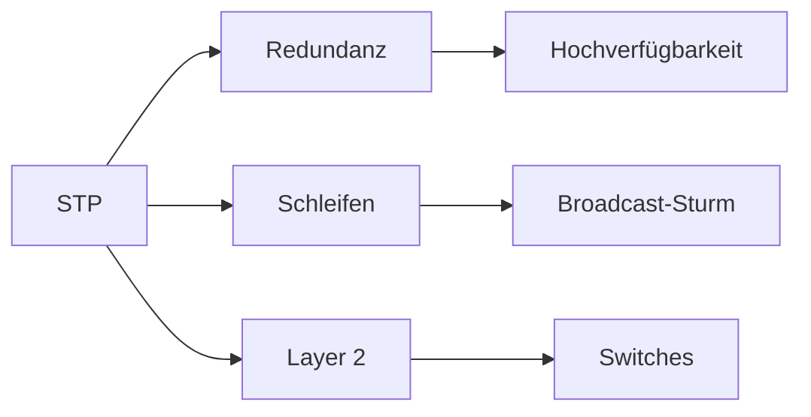

# Spanning Tree Protocol (STP)

> [!info] **Lernziele**
> Nach diesem Kapitel solltest du:
> - Das Layer-2-Schleifenproblem verstehen (Broadcast-Sturm, MAC-Flapping)
> - Die Root Bridge Election erklären können (Bridge ID = Priority + MAC)
> - Port-Rollen (Root, Designated, Blocked) unterscheiden können
> - Port-Zustände (Blocking, Listening, Learning, Forwarding) kennen
> - Den Unterschied zwischen STP und RSTP verstehen (Konvergenzzeit)
> - Sicherheitsmaßnahmen (BPDU Guard, Root Guard) kennen

---

## Das Problem: Layer-2-Schleifen sind fatal

> [!important] **Kernkonzept**
> Das **Spanning Tree Protocol (STP)** verhindert Schleifen in geswitchten Layer-2-Netzwerken. Es erstellt einen schleifenfreien Spannbaum, indem es redundante Pfade blockiert und nur einen aktiven Pfad zwischen je zwei Netzwerkknoten zulässt.

### Warum sind Layer-2-Schleifen fatal?

```
┌─────────────────────────────────────────────────────────────────┐
│              Warum sind Layer-2-Schleifen fatal?               │
├─────────────────────────────────────────────────────────────────┤
│                                                                  │
│   OHNE STP (Schleife vorhanden):                               │
│                                                                  │
│        Switch A ◄─────────────────────► Switch B               │
│            │                                │                   │
│            └────────────► Switch C ◄────────┘                   │
│                              │                                  │
│                           Host X                                │
│                                                                  │
│   Problem 1: Broadcast-Sturm                                    │
│   ┌─────────────────────────────────────────────────────────┐  │
│   │ Host X sendet einen Broadcast                           │  │
│   │ → Switch C flutet an A und B                            │  │
│   │ → A flutet an B, B flutet an A                          │  │
│   │ → Endlosschleife! Netzwerk kollabiert!                  │  │
│   └─────────────────────────────────────────────────────────┘  │
│                                                                  │
│   Problem 2: MAC-Flapping                                       │
│   ┌─────────────────────────────────────────────────────────┐  │
│   │ Switch sieht dieselbe MAC an verschiedenen Ports       │  │
│   │ → MAC-Tabelle instabil → Pakete falsch zugestellt      │  │
│   └─────────────────────────────────────────────────────────┘  │
│                                                                  │
│   Problem 3: Mehrfachzustellung                                │
│   ┌─────────────────────────────────────────────────────────┐  │
│   │ Unicast-Frames erreichen Ziel mehrfach                  │  │
│   │ → Anwendungsprobleme, Duplikate                         │  │
│   └─────────────────────────────────────────────────────────┘  │
│                                                                  │
└─────────────────────────────────────────────────────────────────┘
```

> [!example] **Analogie: Einbahnstraßen-Netz**
> - Eine Stadt mit **kreisförmigen Straßen** (= Schleifen)
> - Autos fahren **endlos im Kreis** (= Broadcast-Sturm)
> - Verkehr kollabiert, nichts kommt mehr an
> - Lösung: **Straßensperren** aufstellen (= Ports blockieren)
> - Bei Unfall: Alternative Route **automatisch freigeben** (= Failover)

---

## STP im Protokollstapel

> [!info] **Schichtzuordnung**
> STP ist ein **Layer-2-Protokoll** (Sicherungsschicht). Es arbeitet mit MAC-Adressen und Ethernet-Frames. Die BPDUs (Bridge Protocol Data Units) werden als Multicast an `01:80:C2:00:00:00` gesendet.

---

## STP-Lösung: Der Spannbaum

```
┌─────────────────────────────────────────────────────────────────┐
│              STP erstellt schleifenfreien Baum                 │
├─────────────────────────────────────────────────────────────────┤
│                                                                  │
│   VORHER (mit Schleife):        NACHHER (mit STP):             │
│                                                                  │
│        A ◄────────► B                A ◄────────► B             │
│        │            │                │    Root     │            │
│        │            │                │   Bridge    │            │
│        └─────► C ◄──┘                └─────► C ◄───┘            │
│             Schleife!                      │ X                  │
│                                       Blocked                   │
│                                                                  │
│   STP blockiert einen Port, um die Schleife zu unterbrechen.   │
│   Bei Ausfall wird der blockierte Port automatisch aktiviert.  │
│                                                                  │
└─────────────────────────────────────────────────────────────────┘
```

---

## Root Bridge Election

Der erste Schritt in STP ist die Wahl der **Root Bridge** – der zentrale Punkt des Spannbaums.

```
┌─────────────────────────────────────────────────────────────────┐
│                    Root Bridge Election                         │
├─────────────────────────────────────────────────────────────────┤
│                                                                  │
│   Jeder Switch hat eine Bridge ID (8 Bytes):                   │
│                                                                  │
│   ┌──────────────────┬──────────────────────────────────────┐  │
│   │ Priority (2 Byte)│      MAC-Adresse (6 Byte)            │  │
│   │   0 - 65535      │      z.B. 00:1A:2B:3C:4D:5E          │  │
│   │   Default: 32768 │                                       │  │
│   └──────────────────┴──────────────────────────────────────┘  │
│                                                                  │
│   Regel: Die NIEDRIGSTE Bridge ID gewinnt!                     │
│                                                                  │
│   Beispiel:                                                     │
│   Switch A: Priority 32768, MAC 00:11:22:33:44:55              │
│   Switch B: Priority 32768, MAC 00:11:22:33:44:44  ← Root!     │
│   Switch C: Priority 32768, MAC 00:11:22:33:44:66              │
│                                                                  │
│   → Switch B wird Root Bridge (niedrigste MAC bei gleicher     │
│     Priority)                                                   │
│                                                                  │
└─────────────────────────────────────────────────────────────────┘
```

---

## Pfadkosten

Nach der Root Bridge Election berechnet jeder Switch den kürzesten Pfad zur Root Bridge basierend auf **Pfadkosten**.

| Bandbreite | STP-Kosten (802.1D-1998) | RSTP-Kosten (802.1D-2004) |
|------------|--------------------------|---------------------------|
| 10 Mbps | 100 | 2.000.000 |
| 100 Mbps | 19 | 200.000 |
| 1 Gbps | 4 | 20.000 |
| 10 Gbps | 2 | 2.000 |

---

## Port-Rollen

| Rolle | Beschreibung | Zustand |
|-------|--------------|---------|
| **Root Port (RP)** | Port mit kürzestem Pfad zur Root Bridge | Forwarding |
| **Designated Port (DP)** | Bester Port für ein Segment zur Root Bridge | Forwarding |
| **Blocked/Alternate Port** | Redundanter Port, deaktiviert | Blocking |

```
┌─────────────────────────────────────────────────────────────────┐
│                    Port-Rollen Beispiel                         │
├─────────────────────────────────────────────────────────────────┤
│                                                                  │
│                     Root Bridge (A)                             │
│                    ┌──────────────┐                             │
│                    │   DP    DP   │                             │
│                    └───┬──────┬───┘                             │
│                        │      │                                 │
│              ┌─────────┘      └─────────┐                       │
│              │                          │                       │
│         ┌────┴────┐                ┌────┴────┐                  │
│         │RP    DP │                │ RP   DP │                  │
│         │ Switch B│                │Switch C │                  │
│         └────┬────┘                └────┬────┘                  │
│              │                          │                       │
│              │         ┌────────────────┘                       │
│              │         │                                        │
│         ┌────┴─────────┴────┐                                   │
│         │RP      Blocked    │                                   │
│         │     Switch D      │                                   │
│         └───────────────────┘                                   │
│                                                                  │
│   RP = Root Port, DP = Designated Port                         │
│                                                                  │
└─────────────────────────────────────────────────────────────────┘
```

---

## Port-Zustände (STP)

| Zustand | Frames | MAC lernen | BPDUs | Dauer |
|---------|--------|------------|-------|-------|
| **Disabled** | ✗ | ✗ | ✗ | — |
| **Blocking** | ✗ | ✗ | RX | 20s (max age) |
| **Listening** | ✗ | ✗ | RX/TX | 15s (forward delay) |
| **Learning** | ✗ | ✓ | RX/TX | 15s (forward delay) |
| **Forwarding** | ✓ | ✓ | RX/TX | — |

```
┌─────────────────────────────────────────────────────────────────┐
│              STP Port-Zustandsübergänge                        │
├─────────────────────────────────────────────────────────────────┤
│                                                                  │
│   Port aktiviert                                                │
│        │                                                        │
│        ▼                                                        │
│   ┌─────────┐                                                   │
│   │Blocking │ ←──── Port wird blockiert                        │
│   └────┬────┘                                                   │
│        │ (20s Max Age)                                         │
│        ▼                                                        │
│   ┌─────────┐                                                   │
│   │Listening│  ←── Sendet/empfängt BPDUs                       │
│   └────┬────┘       (15s Forward Delay)                        │
│        ▼                                                        │
│   ┌─────────┐                                                   │
│   │Learning │  ←── Lernt MAC-Adressen                          │
│   └────┬────┘       (15s Forward Delay)                        │
│        ▼                                                        │
│   ┌──────────┐                                                  │
│   │Forwarding│ ←── Leitet Frames weiter                        │
│   └──────────┘                                                  │
│                                                                  │
│   Gesamte Konvergenzzeit: 30-50 Sekunden!                      │
│                                                                  │
└─────────────────────────────────────────────────────────────────┘
```

---

## RSTP (Rapid Spanning Tree)

RSTP (IEEE 802.1w) verbessert die Konvergenzzeit drastisch:

```
┌─────────────────────────────────────────────────────────────────┐
│              STP vs. RSTP Konvergenz                           │
├─────────────────────────────────────────────────────────────────┤
│                                                                  │
│   STP:  Blocking → Listening → Learning → Forwarding           │
│         (20s)       (15s)       (15s)                          │
│         Gesamt: 30-50 Sekunden                                 │
│                                                                  │
│   RSTP: Discarding ────────────────────► Forwarding            │
│         Proposal/Agreement-Mechanismus                         │
│         Gesamt: < 1 Sekunde (oft Millisekunden!)               │
│                                                                  │
└─────────────────────────────────────────────────────────────────┘
```

### RSTP Proposal/Agreement

```
┌─────────────────────────────────────────────────────────────────┐
│              RSTP Proposal/Agreement                           │
├─────────────────────────────────────────────────────────────────┤
│                                                                  │
│   Switch A (Root)                    Switch B                   │
│       │                                  │                      │
│       │  BPDU mit Proposal-Flag         │                      │
│       │────────────────────────────────►│                      │
│       │                                  │                      │
│       │                        B blockiert alle                 │
│       │                        anderen Ports                    │
│       │                                  │                      │
│       │  BPDU mit Agreement-Flag        │                      │
│       │◄────────────────────────────────│                      │
│       │                                  │                      │
│       │  Port geht sofort auf           │                      │
│       │  Forwarding!                    │                      │
│                                                                  │
│   → Kein Warten auf Timer, sofortige Konvergenz!               │
│                                                                  │
└─────────────────────────────────────────────────────────────────┘
```

---

## MSTP (Multiple Spanning Tree)

MSTP (IEEE 802.1s) ermöglicht mehrere STP-Instanzen für verschiedene VLANs:

```
┌─────────────────────────────────────────────────────────────────┐
│              MSTP - Multiple Instances                         │
├─────────────────────────────────────────────────────────────────┤
│                                                                  │
│   Problem mit klassischem STP:                                 │
│   → Eine Root Bridge für alle VLANs                            │
│   → Suboptimale Pfade, keine Lastverteilung                   │
│                                                                  │
│   MSTP-Lösung:                                                  │
│   ┌─────────────────────────────────────────────────────────┐  │
│   │ Instance 1 (VLAN 10, 20):    Root = Switch A            │  │
│   │ Instance 2 (VLAN 30, 40):    Root = Switch B            │  │
│   └─────────────────────────────────────────────────────────┘  │
│                                                                  │
│   → Lastverteilung über verschiedene Pfade                     │
│                                                                  │
└─────────────────────────────────────────────────────────────────┘
```

---

## Sicherheit

### BPDU Guard

```
┌─────────────────────────────────────────────────────────────────┐
│                    BPDU Guard                                   │
├─────────────────────────────────────────────────────────────────┤
│                                                                  │
│   Problem: Angreifer schließt Switch mit niedriger Priority an │
│           → Wird zur Root Bridge → MITM möglich!               │
│                                                                  │
│   Lösung: BPDU Guard auf Access-Ports                          │
│                                                                  │
│   ┌──────────────────────────────────────────┐                 │
│   │ Wenn BPDU empfangen wird:                │                 │
│   │ → Port wird sofort disabled (err-disabled)│                 │
│   │ → Admin-Eingriff nötig zur Reaktivierung │                 │
│   └──────────────────────────────────────────┘                 │
│                                                                  │
│   Cisco-Konfiguration:                                         │
│   Switch(config-if)# spanning-tree bpduguard enable           │
│                                                                  │
└─────────────────────────────────────────────────────────────────┘
```

### Root Guard

```
┌─────────────────────────────────────────────────────────────────┐
│                    Root Guard                                   │
├─────────────────────────────────────────────────────────────────┤
│                                                                  │
│   Problem: Downstream-Switch sendet bessere BPDUs             │
│           → Wird zur Root Bridge                               │
│                                                                  │
│   Lösung: Root Guard auf Ports zu Downstream-Switches          │
│                                                                  │
│   ┌──────────────────────────────────────────┐                 │
│   │ Wenn Superior BPDU empfangen wird:       │                 │
│   │ → Port geht in "root-inconsistent" State │                 │
│   │ → Automatische Erholung wenn BPDU stoppt │                 │
│   └──────────────────────────────────────────┘                 │
│                                                                  │
│   Cisco-Konfiguration:                                         │
│   Switch(config-if)# spanning-tree guard root                 │
│                                                                  │
└─────────────────────────────────────────────────────────────────┘
```

---

## Praxisbeispiele

> [!example] Switch-Befehle (Cisco IOS)
> 
> ```
> ! STP-Status anzeigen
> Switch# show spanning-tree
> 
> VLAN0001
>   Spanning tree enabled protocol rstp
>   Root ID    Priority    4096
>              Address     0011.2233.4455
>              This bridge is the root
> 
> ! Priority setzen (Root Bridge werden)
> Switch(config)# spanning-tree vlan 1 priority 4096
> 
> ! PortFast aktivieren (Access-Ports)
> Switch(config-if)# spanning-tree portfast
> ```

---

## Zusammenhänge



- [[../03-Referenzmodelle/05-Sicherungsschicht/00-Sicherungsschicht-Index|Sicherungsschicht]] → STP arbeitet auf Layer 2
- [[../03-Referenzmodelle/05-Sicherungsschicht/04-Broadcast-Kollisionsdomaene|Broadcast-Domäne]] → STP verhindert Broadcast-Stürme
- [[01-ARP|ARP]] → Broadcasts, die ohne STP zu Stürmen führen würden

---

## Prüfungstipps

> [!warning] **Prüfungsrelevant**
> - Warum sind Layer-2-Schleifen problematisch?
> - Root Bridge Election (Bridge ID = Priority + MAC)
> - Port-Rollen (Root, Designated, Blocked)
> - Port-Zustände (Blocking, Listening, Learning, Forwarding)
> - STP vs. RSTP Konvergenzzeit
> - BPDU Guard / Root Guard

> [!question] **Häufige Prüfungsfragen**
> 1. Was passiert ohne STP bei redundanten Verbindungen?
> 2. Wie wird die Root Bridge gewählt?
> 3. Was ist der Unterschied zwischen Root Port und Designated Port?
> 4. Warum ist RSTP schneller als STP?
> 5. Wie schützt BPDU Guard vor Angriffen?

> [!tip] **Merkhilfen**
> - **Root Bridge** = Niedrigste Bridge ID gewinnt
> - **Root Port** = Bester Weg **ZUR** Root
> - **Designated Port** = Bester Weg **VON** der Root (pro Segment)
> - **STP-Konvergenz** = 30-50 Sekunden
> - **RSTP-Konvergenz** = < 1 Sekunde
> - **Multicast** = `01:80:C2:00:00:00`

---

## Weiterführende Ressourcen

> [!note] **IEEE-Standards**
> - IEEE 802.1D-2004 – MAC Bridges and Bridged Networks (STP/RSTP)
> - IEEE 802.1w – Rapid Spanning Tree Protocol
> - IEEE 802.1Q – VLAN und MSTP

> [!tip] **Praktische Tools**
> - **Wireshark** → STP-Traffic analysieren (Filter: `stp`)
> - **Cisco Packet Tracer** → STP simulieren
> - **GNS3** → Realistische Netzwerksimulation

---

## Quellen

- Tanenbaum, Andrew S.: Computernetzwerke – Grundlagen der Layer-2-Technologien und Bridging.
- IEEE 802.1D-2004 – MAC Bridges and Bridged Networks – Die offizielle Spezifikation für STP und RSTP.
- Cisco Systems: Spanning Tree Protocol Design Guide – Praxisorientierte Konfigurationsanleitungen.
