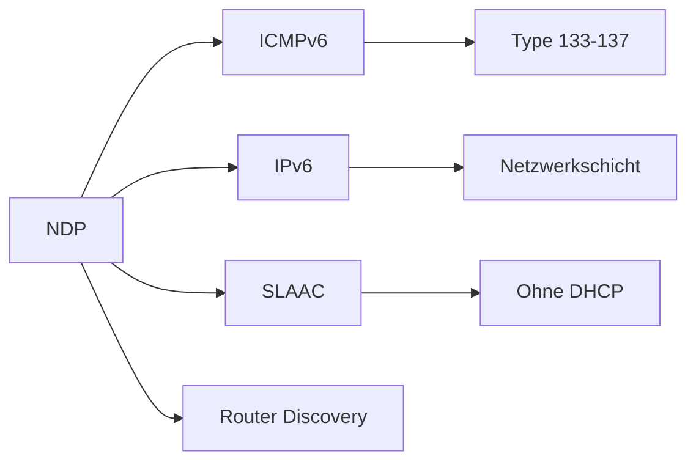

# NDP – Neighbor Discovery Protocol

> [!info] **Lernziele**
> Nach diesem Kapitel solltest du:
> - NDP als IPv6-Ersatz für ARP verstehen
> - Die ICMPv6-Nachrichtentypen (RS, RA, NS, NA) erklären können
> - Das Konzept von Solicited-Node Multicast verstehen
> - SLAAC (Stateless Address Autoconfiguration) erklären können
> - DAD (Duplicate Address Detection) verstehen
> - Sicherheitsrisiken (NDP-Spoofing) und Gegenmaßnahmen (RA Guard, SEND) kennen

---

## Das Problem: ARP funktioniert nur mit IPv4

> [!important] **Kernkonzept**
> Das **Neighbor Discovery Protocol (NDP)** ist der IPv6-Ersatz für ARP – und mehr. Es nutzt ICMPv6 und bietet neben der Adressauflösung auch Router Discovery, Prefix Discovery, Duplicate Address Detection und Redirect-Funktionalität. NDP vereint mehrere IPv4-Protokolle in einem.

### NDP vs. ARP

```
┌─────────────────────────────────────────────────────────────────┐
│                    NDP vs. ARP Vergleich                        │
├─────────────────────────────────────────────────────────────────┤
│                                                                  │
│   Funktion              │ IPv4 (ARP)      │ IPv6 (NDP)         │
│   ──────────────────────┼─────────────────┼────────────────────│
│   Adressauflösung       │ ARP             │ NS/NA              │
│   Router Discovery      │ IRDP (optional) │ RS/RA (integriert) │
│   Prefix Discovery      │ DHCP            │ RA (integriert)    │
│   Duplicate Detection   │ Gratuitous ARP  │ DAD (integriert)   │
│   Redirect              │ ICMP Redirect   │ NDP Redirect       │
│   Transport             │ Eigenes Proto.  │ ICMPv6             │
│   Übertragung           │ Broadcast       │ Multicast          │
│   Sicherheit            │ Keine           │ SEND (optional)    │
│                                                                  │
│   NDP = "ARP + DHCP-Teile + Router Discovery" in einem!        │
│                                                                  │
└─────────────────────────────────────────────────────────────────┘
```

> [!example] **Analogie: Verbesserte Nachbarschaftssuche**
> - ARP ist wie **laut rufen** auf der Straße: "Wer wohnt hier?" (Broadcast – alle hören)
> - NDP ist wie **gezielte Klingel**: Man klingelt nur bei passenden Häusern (Multicast)
> - NDP liefert zusätzlich die **Wegbeschreibung** zum nächsten Bahnhof (Router Discovery)
> - Und prüft automatisch, ob die neue Hausnummer **schon vergeben** ist (DAD)

---

## NDP im Protokollstapel

> [!info] **Schichtzuordnung**
> NDP ist ein **Layer-3-Protokoll**, das auf ICMPv6 basiert. Es verwendet spezielle ICMPv6-Nachrichtentypen (133-137) und arbeitet mit Multicast statt Broadcast.

---

## ICMPv6-Nachrichtentypen für NDP

| Typ | Name | Abkürzung | Funktion |
|-----|------|-----------|----------|
| **133** | Router Solicitation | RS | Host sucht Router |
| **134** | Router Advertisement | RA | Router antwortet mit Prefix/Optionen |
| **135** | Neighbor Solicitation | NS | MAC-Auflösung (wie ARP Request) |
| **136** | Neighbor Advertisement | NA | MAC-Antwort (wie ARP Reply) |
| **137** | Redirect | — | Router leitet zu besserem Next-Hop um |

---

## Neighbor Discovery (Adressauflösung)

```
┌─────────────────────────────────────────────────────────────────┐
│              Neighbor Solicitation / Advertisement             │
├─────────────────────────────────────────────────────────────────┤
│                                                                  │
│   Host A                                              Host B    │
│   fe80::1                                         fe80::2       │
│   MAC: AA:AA:AA:AA:AA:AA                    MAC: BB:BB:BB:BB:..│
│       │                                               │         │
│       │  Neighbor Solicitation (Type 135)            │         │
│       │  ──────────────────────────────────────────► │         │
│       │                                               │         │
│       │  Quell-IP: fe80::1                           │         │
│       │  Ziel-IP:  ff02::1:ff00:0002                │         │
│       │            (Solicited-Node Multicast)        │         │
│       │  Ziel-MAC: 33:33:ff:00:00:02                │         │
│       │  Inhalt:   "Wer hat fe80::2?"               │         │
│       │                                               │         │
│       │  Neighbor Advertisement (Type 136)           │         │
│       │  ◄────────────────────────────────────────── │         │
│       │                                               │         │
│       │  Quell-IP: fe80::2                           │         │
│       │  Ziel-IP:  fe80::1 (Unicast)                │         │
│       │  Inhalt:   "fe80::2 ist bei BB:BB:..."      │         │
│                                                                  │
└─────────────────────────────────────────────────────────────────┘
```

### Solicited-Node Multicast

```
┌─────────────────────────────────────────────────────────────────┐
│              Solicited-Node Multicast-Adresse                  │
├─────────────────────────────────────────────────────────────────┤
│                                                                  │
│   Statt Broadcast (wie bei ARP) nutzt NDP Multicast:           │
│                                                                  │
│   IPv6-Adresse:    2001:0db8:0000:0000:0000:0000:0000:0001     │
│                                                    ─────────    │
│                                                    letzte 24 Bit│
│                                                                  │
│   Solicited-Node:  ff02::1:ff00:0001                           │
│                    ──────── ────────                            │
│                    Prefix   letzte 24 Bit der IPv6-Adresse     │
│                                                                  │
│   Multicast-MAC:   33:33:ff:00:00:01                           │
│                    ───── ───────────                            │
│                    Prefix letzte 32 Bit der Multicast-IP       │
│                                                                  │
│   Vorteil: Nur Hosts mit passenden letzten 24 Bit empfangen!   │
│   → Weniger Traffic als Broadcast                               │
│                                                                  │
└─────────────────────────────────────────────────────────────────┘
```

---

## Router Discovery

```
┌─────────────────────────────────────────────────────────────────┐
│              Router Solicitation / Advertisement               │
├─────────────────────────────────────────────────────────────────┤
│                                                                  │
│   Host (neu im Netz)                              Router        │
│       │                                               │         │
│       │  Router Solicitation (Type 133)              │         │
│       │  ──────────────────────────────────────────► │         │
│       │                                               │         │
│       │  Quell-IP: :: oder fe80::1                   │         │
│       │  Ziel-IP:  ff02::2 (All-Routers Multicast)  │         │
│       │  Inhalt:   "Gibt es einen Router?"           │         │
│       │                                               │         │
│       │  Router Advertisement (Type 134)             │         │
│       │  ◄────────────────────────────────────────── │         │
│       │                                               │         │
│       │  Inhalt:                                     │         │
│       │  • Prefix: 2001:db8:1::/64                  │         │
│       │  • Flags: M=0, O=0 (SLAAC)                  │         │
│       │  • Router Lifetime: 1800s                    │         │
│       │  • MTU: 1500                                 │         │
│       │  • DNS-Server (RDNSS)                        │         │
│                                                                  │
└─────────────────────────────────────────────────────────────────┘
```

### RA-Flags (M und O)

| M-Flag | O-Flag | Bedeutung |
|--------|--------|-----------|
| 0 | 0 | **SLAAC only** – Adresse selbst generieren |
| 0 | 1 | SLAAC für Adresse, **DHCPv6 für andere Infos** (DNS, etc.) |
| 1 | 0 | **Stateful DHCPv6** für Adresse |
| 1 | 1 | Stateful DHCPv6 für Adresse und andere Infos |

---

## SLAAC (Stateless Address Autoconfiguration)

```
┌─────────────────────────────────────────────────────────────────┐
│              SLAAC - Adresse ohne DHCP                         │
├─────────────────────────────────────────────────────────────────┤
│                                                                  │
│   1. Host sendet Router Solicitation                           │
│                                                                  │
│   2. Router antwortet mit RA                                   │
│      • Prefix: 2001:db8:1::/64                                 │
│                                                                  │
│   3. Host generiert Interface Identifier (64 Bit)              │
│      Option A: EUI-64 aus MAC-Adresse                          │
│      Option B: Privacy Extensions (zufällig)                   │
│                                                                  │
│   4. Host kombiniert Prefix + Interface ID                     │
│      ┌────────────────────────┬────────────────────────┐       │
│      │    Prefix (64 Bit)     │  Interface ID (64 Bit) │       │
│      │    2001:db8:1::        │  1234:5678:9abc:def0   │       │
│      └────────────────────────┴────────────────────────┘       │
│      → Globale Adresse: 2001:db8:1::1234:5678:9abc:def0       │
│                                                                  │
│   5. Host führt DAD durch (Neighbor Solicitation)              │
│                                                                  │
│   6. Bei keiner Antwort: Adresse ist gültig!                   │
│                                                                  │
└─────────────────────────────────────────────────────────────────┘
```

### EUI-64 aus MAC-Adresse

```
┌─────────────────────────────────────────────────────────────────┐
│              EUI-64 Generierung                                │
├─────────────────────────────────────────────────────────────────┤
│                                                                  │
│   MAC-Adresse:     00:1A:2B:3C:4D:5E                           │
│                                                                  │
│   Schritt 1: FFFE einfügen                                     │
│              00:1A:2B:FF:FE:3C:4D:5E                           │
│                      ─────                                      │
│                      eingefügt                                  │
│                                                                  │
│   Schritt 2: Universal/Local Bit flippen (Bit 7)               │
│              00 = 0000 0000 → 02 = 0000 0010                   │
│                                                                  │
│   EUI-64:    02:1A:2B:FF:FE:3C:4D:5E                           │
│              → ::021a:2bff:fe3c:4d5e                           │
│                                                                  │
└─────────────────────────────────────────────────────────────────┘
```

---

## Duplicate Address Detection (DAD)

```
┌─────────────────────────────────────────────────────────────────┐
│              DAD - Duplicate Address Detection                 │
├─────────────────────────────────────────────────────────────────┤
│                                                                  │
│   Host möchte Adresse 2001:db8::1 verwenden                    │
│       │                                                         │
│       │  Neighbor Solicitation                                  │
│       │  ──────────────────────────────────────────►           │
│       │                                                         │
│       │  Quell-IP: :: (unspecified)                            │
│       │  Ziel-IP:  ff02::1:ff00:0001 (Solicited-Node)         │
│       │  Target:   2001:db8::1                                 │
│       │                                                         │
│       │  Warte ~1 Sekunde...                                   │
│       │                                                         │
│   Fall 1: Keine Antwort                                        │
│           → Adresse ist einzigartig, kann verwendet werden     │
│                                                                  │
│   Fall 2: Neighbor Advertisement empfangen                     │
│           → Adresse bereits vergeben!                          │
│           → Host darf Adresse NICHT verwenden                  │
│                                                                  │
└─────────────────────────────────────────────────────────────────┘
```

---

## Neighbor Cache

Der Neighbor Cache ist das IPv6-Äquivalent zum ARP-Cache:

| Zustand | Beschreibung | Aktion |
|---------|--------------|--------|
| **INCOMPLETE** | NS gesendet, warte auf NA | Pakete werden gepuffert |
| **REACHABLE** | Kürzlich bestätigt | Normal verwenden |
| **STALE** | Timeout abgelaufen | Bei nächster Nutzung prüfen |
| **DELAY** | Warte auf Upper-Layer Hint | 5 Sekunden warten |
| **PROBE** | Sende NS zur Bestätigung | Max. 3 Versuche |

> [!example] Neighbor Cache anzeigen (Linux)
> ```bash
> $ ip -6 neigh show
> fe80::1 dev eth0 lladdr 00:1a:2b:3c:4d:5e REACHABLE
> 2001:db8::1 dev eth0 lladdr aa:bb:cc:dd:ee:ff STALE
> ```

---

## Sicherheit

### NDP-Spoofing

```
┌─────────────────────────────────────────────────────────────────┐
│              NDP-Spoofing (wie ARP-Spoofing)                   │
├─────────────────────────────────────────────────────────────────┤
│                                                                  │
│   Angreifer kann gefälschte NA senden:                         │
│   → "fe80::gateway ist bei ANGREIFER-MAC"                      │
│   → Man-in-the-Middle möglich                                  │
│                                                                  │
│   Angreifer kann gefälschte RA senden:                         │
│   → "Ich bin der Router, nutzt Prefix 2001:db8:evil::/64"     │
│   → Traffic-Umleitung, DNS-Manipulation                        │
│                                                                  │
└─────────────────────────────────────────────────────────────────┘
```

### Gegenmaßnahmen

| Maßnahme | Beschreibung |
|----------|--------------|
| **SEND** (RFC 3971) | Kryptographisch signierte NDP-Nachrichten |
| **RA Guard** | Switch blockiert RAs von nicht-Router-Ports |
| **DHCPv6 Guard** | Switch blockiert DHCPv6 von nicht-Server-Ports |
| **Source Guard** | Bindet IPv6 an MAC/Port |

```
┌─────────────────────────────────────────────────────────────────┐
│              RA Guard auf Switches                             │
├─────────────────────────────────────────────────────────────────┤
│                                                                  │
│   Switch                                                        │
│   ┌─────────────────────────────────────────────────────────┐  │
│   │ Port 1: Router (RA erlaubt)        ✓ RA                │  │
│   │ Port 2: Host (RA blockiert)        ✗ RA                │  │
│   │ Port 3: Host (RA blockiert)        ✗ RA                │  │
│   └─────────────────────────────────────────────────────────┘  │
│                                                                  │
│   Cisco-Konfiguration:                                         │
│   Switch(config)# ipv6 nd raguard policy BLOCK-RA             │
│   Switch(config-nd-raguard)# device-role host                 │
│                                                                  │
└─────────────────────────────────────────────────────────────────┘
```

---

## Zusammenhänge



- [[01-ARP|ARP]] → IPv4-Pendant zu NDP
- [[../03-Referenzmodelle/06-Netzwerkschicht/03-IPv6|IPv6]] → Netzwerkschicht
- [[../03-Referenzmodelle/06-Netzwerkschicht/05-ICMP|ICMP]] → ICMPv6 ist die Basis für NDP
- [[02-DHCP|DHCP]] → DHCPv6 als Alternative zu SLAAC

---

## Prüfungstipps

> [!warning] **Prüfungsrelevant**
> - NDP als IPv6-Ersatz für ARP
> - ICMPv6-Nachrichtentypen (RS, RA, NS, NA)
> - Solicited-Node Multicast (ff02::1:ffXX:XXXX)
> - SLAAC-Prozess
> - DAD (Duplicate Address Detection)
> - Unterschied Multicast vs. Broadcast

> [!question] **Häufige Prüfungsfragen**
> 1. Warum nutzt NDP Multicast statt Broadcast?
> 2. Wie generiert ein Host seine IPv6-Adresse mit SLAAC?
> 3. Was bedeuten die M- und O-Flags in Router Advertisements?
> 4. Wie funktioniert Duplicate Address Detection?
> 5. Welche Sicherheitsrisiken hat NDP und wie kann man sie mitigieren?

> [!tip] **Merkhilfen**
> - **Type 133** = RS (Router **S**olicitation)
> - **Type 134** = RA (Router **A**dvertisement)
> - **Type 135** = NS (Neighbor **S**olicitation) = "ARP Request"
> - **Type 136** = NA (Neighbor **A**dvertisement) = "ARP Reply"
> - **ff02::1** = All Nodes, **ff02::2** = All Routers
> - **Solicited-Node** = ff02::1:ff + letzte 24 Bit der IPv6
> - **SLAAC** = Prefix (RA) + Interface ID (EUI-64 oder Random)

---

## Weiterführende Ressourcen

> [!note] **RFC und Standards**
> - [[A-RFC-Index#RFC 4861|RFC 4861]] - Neighbor Discovery for IPv6
> - [[A-RFC-Index#RFC 4862|RFC 4862]] - IPv6 Stateless Address Autoconfiguration
> - [[A-RFC-Index#RFC 3971|RFC 3971]] - SEcure Neighbor Discovery (SEND)
> - [[A-RFC-Index#RFC 4941|RFC 4941]] - Privacy Extensions for SLAAC

> [!tip] **Praktische Tools**
> - **Wireshark** → NDP-Traffic analysieren (Filter: `icmpv6.type >= 133 and icmpv6.type <= 137`)
> - **radvd** → Linux Router Advertisement Daemon
> - **ndptool** → NDP-Pakete senden und empfangen

---

## Quellen

- Tanenbaum, Andrew S.: Computernetzwerke – IPv6-Grundlagen und Neighbor Discovery.
- Hagen, Silvia: IPv6 Essentials – Das Standardwerk für IPv6 mit ausführlicher NDP-Behandlung.
- RFC 4861 – Neighbor Discovery for IPv6 – Die maßgebliche Spezifikation für NDP.
