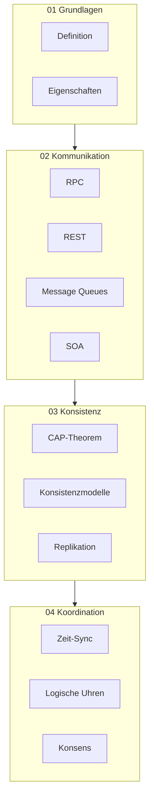

# Verteilte Systeme

Übersicht über den Bereich **Verteilte Systeme** – Systeme, bei denen mehrere autonome Rechner zusammenarbeiten, um einen gemeinsamen Dienst zu erbringen.

## Kapitelübersicht

| Nr. | Kapitel | Beschreibung |
|-----|---------|--------------|
| 01 | [[01-Grundlagen/00-Grundlagen-Index\|Grundlagen]] | Definition, Eigenschaften und Architekturen |
| 02 | [[02-Kommunikation/00-Kommunikation-Index\|Kommunikation]] | RPC, REST, SOAP, Message Queues, SOA |
| 03 | [[03-Konsistenz/00-Konsistenz-Index\|Konsistenz]] | CAP-Theorem, Konsistenzmodelle, Replikation |
| 04 | [[04-Koordination/00-Koordination-Index\|Koordination]] | Zeit-Synchronisation, Logische Uhren, Konsens |

## Themenüberblick



## Lernziele des Bereichs

Nach Abschluss dieses Bereichs solltest du in der Lage sein:

- Definition und Merkmale verteilter Systeme zu erklären
- Kommunikationsmechanismen (RPC, REST, SOAP, Message Queues) zu unterscheiden
- Das CAP-Theorem und seine Implikationen zu verstehen
- Konsistenzmodelle hierarchisch einzuordnen
- Zeitsynchronisation und logische Uhren anzuwenden
- Grundlegende Konsensalgorithmen zu erklären

## Empfohlener Lernpfad

1. **[[01-Grundlagen/01-Definition|Definition]]** → Was ist ein verteiltes System?
2. **[[01-Grundlagen/02-Eigenschaften|Eigenschaften]]** → Transparenz, Skalierbarkeit, ACID
3. **[[02-Kommunikation/01-RPC|RPC]]** → Grundlegendes Kommunikationsparadigma
4. **[[02-Kommunikation/03-REST|REST]]** → Moderne Web-APIs
5. **[[03-Konsistenz/01-CAP-Theorem|CAP-Theorem]]** → Fundamentale Trade-offs
6. **[[04-Koordination/02-Logische-Uhren|Logische Uhren]]** → Kausalität ohne Zeit
7. **[[04-Koordination/03-Konsensalgorithmen|Konsens]]** → Verteilte Einigung

## Alle Dateien in diesem Bereich

```dataview
LIST
FROM "04-Verteilte-Systeme"
WHERE file.name != "00-VS-Index"
SORT file.path ASC
```
