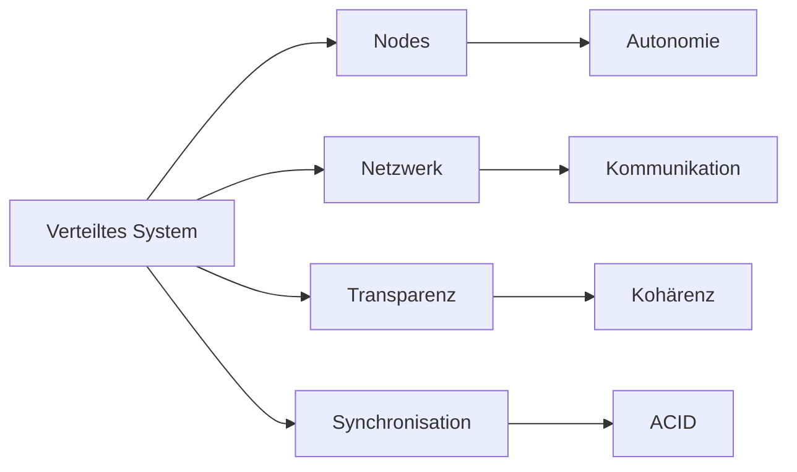

# Definition verteilter Systeme

> [!info] **Lernziele**
> Nach diesem Kapitel solltest du:
> - Die klassischen Definitionen verteilter Systeme kennen (Tanenbaum, Bal, Lamport)
> - Den Unterschied zwischen Distributed Computing, Parallel Computing und Multiprocessing verstehen
> - Die Begriffe Node, Nebenläufigkeit und Transparenz einordnen können
> - Die grundlegenden Merkmale verteilter Systeme benennen können

---

## Was ist ein verteiltes System?

> [!important] **Kernkonzept**
> Ein **verteiltes System** ist eine Sammlung von unabhängigen Computern, die sich gegenüber dem Anwender als ein kohärentes System darstellen. Die Verteilung ist für den Benutzer transparent – er nimmt das System als Einheit wahr.

### Klassische Definitionen

> [!quote] **Tanenbaum**
> "Verteilte Systeme sind eine Sammlung von unabhängigen Computern, die sich gegenüber dem Anwender als ein kohärentes System darstellen."

Tanenbaums Definition betont die **Benutzerperspektive**: Egal wie viele Server im Hintergrund arbeiten – für den Anwender erscheint alles als eine Einheit. Wenn du Netflix schaust, siehst du einen Streaming-Dienst, nicht die tausenden Server weltweit, die den Stream liefern.

> [!quote] **Bal**
> "Ein verteiltes Computersystem besteht aus mehreren autonomen Prozessoren, die sich keinen Hauptspeicher teilen, aber mittels Austausch von Nachrichten über ein Netzwerk miteinander kooperieren."

Bal beschreibt die **technische Architektur**: Jeder Node hat seinen eigenen Speicher (kein Shared Memory wie bei Multiprozessorsystemen). Die Kommunikation erfolgt ausschließlich über Nachrichten – das ist fundamental anders als bei Threads, die über gemeinsamen Speicher kommunizieren können.

> [!quote] **Lamport**
> "Ein verteiltes System ist es, wenn ein Fehler eines Computers, von dessen Existenz Du nichts wusstest, deinen eigenen Rechner unbrauchbar macht."

Lamports humorvolle Definition trifft den Kern der **Komplexität**: In verteilten Systemen entstehen Abhängigkeiten, die nicht offensichtlich sind. Ein DNS-Server in Frankfurt kann einen Webshop in München lahmlegen – obwohl der Shopbetreiber von diesem Server nie gehört hat. Diese versteckten Abhängigkeiten machen Debugging und Fehleranalyse in verteilten Systemen besonders herausfordernd.

> [!example] **Analogie: Restaurant-Kette**
> - Viele **Filialen** (= Nodes) arbeiten unabhängig
> - Gemeinsames **Bestellsystem** (= verteilte Anwendung)
> - Kunde sieht nur "**eine Firma**" (= Transparenz)
> - Fällt eine Filiale aus, läuft der Rest weiter (= Fehlertoleranz)
> - Bei mehr Kunden: mehr Filialen öffnen (= Skalierbarkeit)

---

## Abgrenzung: Distributed vs. Parallel vs. Multi

| Begriff | Beschreibung |
|---------|--------------|
| **Multithreading** | Quasi-gleichzeitiges Abarbeiten mehrerer Threads des selben Prozesses |
| **Multitasking** | Quasi-gleichzeitiges Abarbeiten mehrerer Prozesse |
| **Multiprocessing** | Echtes gleichzeitiges Abarbeiten auf mehreren Prozessoren |

Alle drei Konzepte sind **nebenläufig** (concurrent) und haben das gemeinsame Ziel: *Optimale Ausnutzung der Ressourcen und schnellerer Ablauf der Programme.*

### Distributed Computing vs. Parallel Computing

![[distributed-vs-parallel.png]]
*04-01-01-distributed-vs-parallel: Architekturvergleich – Distributed Computing (Netzwerk), Parallel Computing (Shared Memory) und Hybrid-Ansatz (Shared Storage).*

| Aspekt | Distributed | Parallel | Hybrid |
|--------|-------------|----------|--------|
| **Kopplung** | Lose gekoppelt | Eng gekoppelt | Kombination |
| **Speicher** | Kein gemeinsamer | Shared Memory | Lokal + Shared |
| **Kommunikation** | Netzwerk | Bus | Flexible Architektur |

Der entscheidende Unterschied liegt in der **Speicherarchitektur**: Bei Parallel Computing teilen sich alle CPUs denselben Speicher – Kommunikation erfolgt durch Lesen und Schreiben gemeinsamer Variablen. Bei Distributed Computing hat jeder Node seinen eigenen Speicher – Kommunikation erfordert expliziten Nachrichtenaustausch über das Netzwerk. 

Diese Unterscheidung hat weitreichende Konsequenzen: Parallele Systeme sind schneller (kein Netzwerk-Overhead), aber begrenzt durch die Speicherbandbreite. Verteilte Systeme skalieren besser (mehr Nodes hinzufügen), müssen aber mit Netzwerklatenz, Paketverlusten und Partitionierung umgehen.

---

## Nodes

Ein **Node** ist ein Teilnehmer in einem verteilten System:

| Eigenschaft | Beschreibung |
|-------------|--------------|
| **Autonomie** | Jeder Node kann eigenständig agieren |
| **Synonym** | Computer, Prozess, Prozessor |
| **Vollständig** | Kann ein vollwertiges System mit eigenem OS sein |
| **Teil** | Kann Teil eines Mehrprozessorsystems sein |
| **Vernetzt** | Nodes sind miteinander über ein Netzwerk verbunden |

Der Begriff "Node" ist bewusst abstrakt gehalten: Ein Node kann ein physischer Server im Rechenzentrum sein, ein Docker-Container, ein Smartphone oder ein Sensor im IoT-Netzwerk. Entscheidend ist, dass jeder Node **autonom** handeln kann – er hat eigene Rechenkapazität, eigenen Speicher und kann unabhängig von anderen Nodes Entscheidungen treffen. Diese Autonomie unterscheidet Nodes von Threads oder Prozessen innerhalb eines Systems.

---

## Grundlegende Definitionen

> [!summary] **Kernpunkte verteilter Systeme**
> - Teilnehmer werden als **Nodes** bezeichnet
> - Die teilnehmenden Nodes sind miteinander **vernetzt**
> - Nodes kommunizieren auf unterschiedliche Weise
> - Prozessor, Speicher und Kommunikation müssen **gemeinsam betrachtet** werden
> - Konflikte und kritische Abschnitte erfordern sorgfältige **Synchronisation**
> - Transaktionsverwaltung muss **Konsistenz** garantieren
> - Persistenz der (flüchtigen) Daten muss sichergestellt sein
> - Der Service verbirgt die Komplexität gegenüber dem Benutzer (**Transparenz**)
> - Es erscheint als würde der Dienst von "einem" System erbracht

---

## Zusammenhänge

- [[02-Eigenschaften|Eigenschaften]] → Skalierbarkeit, Fehlertoleranz, Transparenz
- [[03-Fallacies|Fallacies]] → Die 8 Irrtümer verteilter Systeme
- [[../02-Kommunikation/00-Kommunikation-Index|Kommunikation]] → Nachrichtenaustausch, RPC, REST
- [[../03-Konsistenz/01-CAP-Theorem|CAP-Theorem]] → Consistency, Availability, Partition Tolerance

---

## Prüfungstipps

> [!warning] **Prüfungsrelevant**
> - Unterschied Distributed vs. Parallel Computing
> - Begriff "Node" und dessen Eigenschaften
> - Transparenz als zentrales Merkmal

> [!question] **Häufige Prüfungsfragen**
> 1. Definieren Sie ein verteiltes System nach Tanenbaum.
> 2. Was unterscheidet Distributed Computing von Parallel Computing?
> 3. Was bedeutet Transparenz im Kontext verteilter Systeme?
> 4. Was ist ein Node und welche Eigenschaften hat er?
> 5. Erklären Sie Lamports humorvolle Definition.

> [!tip] **Merkhilfen**
> - **Tanenbaum** = "kohärentes System" (Zusammenhalt)
> - **Bal** = "Nachrichten über Netzwerk" (kein gemeinsamer Speicher)
> - **Lamport** = "Fehler macht deinen Rechner kaputt" (Abhängigkeiten)
> - **Distributed** = Netzwerk, **Parallel** = gemeinsamer Speicher

---

## Weiterführende Ressourcen

> [!note] **Literatur**
> - Tanenbaum, van Steen: Verteilte Systeme – Das Standardwerk
> - Coulouris et al.: Distributed Systems – Concepts and Design

> [!tip] **Praktische Beispiele**
> - **AWS/Azure/GCP** – Cloud-Plattformen als verteilte Systeme
> - **Kubernetes** – Container-Orchestrierung
> - **Apache Kafka** – Verteiltes Message-System

---

## Quellen

- Tanenbaum, Andrew S.; van Steen, Maarten: Verteilte Systeme – Das Standardwerk für verteilte Systeme mit den klassischen Definitionen.
- Bal, Henri E.: Programming Distributed Systems – Grundlegende Konzepte der Verteilung.
- Lamport, Leslie: Diverse Publikationen – Fundamentale Arbeiten zu verteilten Algorithmen und Uhren.
