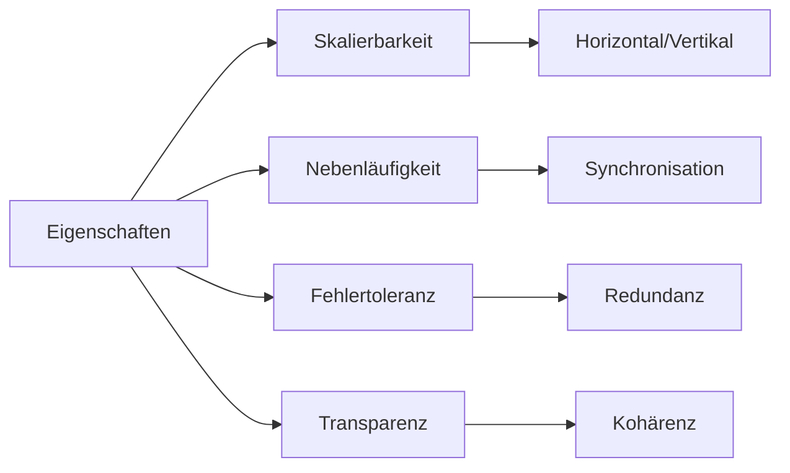

# Eigenschaften verteilter Systeme

> [!info] **Lernziele**
> Nach diesem Kapitel solltest du:
> - Die vier Hauptmerkmale verteilter Systeme kennen (Skalierbarkeit, Nebenläufigkeit, Fehlertoleranz, Transparenz)
> - Horizontale und vertikale Skalierung unterscheiden können
> - Die verschiedenen Arten von Transparenz verstehen
> - Client/Server- und Multitier-Architekturen erklären können
> - Fat- vs. Thin-Clients unterscheiden können

---

## Die vier Hauptmerkmale

> [!important] **Kernkonzept**
> Verteilte Systeme zeichnen sich durch vier abgeleitete Merkmale aus: **Skalierbarkeit**, **Nebenläufigkeit**, **Fehlertoleranz** und **Transparenz**. Diese Eigenschaften ergeben sich aus der verteilten Architektur und sind gleichzeitig ihre größten Stärken.

```
┌─────────────────────────────────────────────────────────────────┐
│         Abgeleitete Merkmale eines verteilten Systems          │
├─────────────────────────────────────────────────────────────────┤
│                                                                  │
│   ✓ Skalierbarkeit                                              │
│     Ein verteiltes System kann (beliebig) mit zusätzlichen     │
│     Ressourcen erweitert werden, wobei die Art der Ressourcen  │
│     sehr heterogen sein kann.                                   │
│                                                                  │
│   ✓ Nebenläufigkeit                                             │
│     Auf Basis von Synchronisationsalgorithmen können Teil-     │
│     aufgaben koordiniert auf verschiedenen Systemen parallel   │
│     abgearbeitet werden.                                        │
│                                                                  │
│   ✓ Fehlertoleranz                                              │
│     Resilienz ist ein zwingendes Grundprinzip für verteilte    │
│     Systeme, da aufgrund der Verteilung und der hierbei        │
│     eingesetzten umfangreichen Kommunikation häufig Fehler     │
│     auftreten können.                                           │
│                                                                  │
│   ✓ Transparenz                                                 │
│     Für den Benutzer ist nicht ersichtlich, wie die Aufgaben   │
│     auf die Ressourcen verteilt werden und wo sich diese       │
│     befinden.                                                   │
│                                                                  │
└─────────────────────────────────────────────────────────────────┘
```

> [!example] **Analogie: Supermarkt-Kette**
> - **Skalierbarkeit**: Mehr Filialen öffnen bei mehr Kunden
> - **Nebenläufigkeit**: Alle Filialen bedienen gleichzeitig Kunden
> - **Fehlertoleranz**: Eine geschlossene Filiale stoppt nicht den Betrieb
> - **Transparenz**: Kunde sieht "den Supermarkt", nicht die Logistik dahinter

---

## Skalierbarkeit und Verteilung

```
┌─────────────────────────────────────────────────────────────────┐
│              Skalierbarkeit und Verteilung                     │
├─────────────────────────────────────────────────────────────────┤
│                                                                  │
│   Horizontale Verteilung (gleiche Aufgaben):                   │
│   ┌──────┐  ┌──────┐  ┌──────┐      ┌──────┐  ┌──────┐        │
│   │ •••  │  │ •••  │  │ •••  │  …   │ •••  │  │ •••  │        │
│   └──────┘  └──────┘  └──────┘      └──────┘  └──────┘        │
│                                                                  │
│   Vertikale Verteilung (verschiedene Aufgaben):                │
│   ┌──────┐                                                      │
│   │ •••  │  ← Präsentation                                     │
│   ├──────┤                                                      │
│   │ •••  │  ← Geschäftslogik                                   │
│   ├──────┤                                                      │
│   │ •••  │  ← Datenhaltung                                     │
│   └──────┘                                                      │
│                                                                  │
│   ─────────────────────────────────────────────────────────    │
│                                                                  │
│   Horizontale Skalierung (Scale-Out):                          │
│   ┌──────┐  ┌──────┐  ┌──────┐  →  ┌──────┐  ┌──────┐ ...     │
│   │ •••  │  │ •••  │  │ •••  │     │ •••  │  │ •••  │         │
│   └──────┘  └──────┘  └──────┘     └──────┘  └──────┘         │
│   → Mehr Server hinzufügen                                     │
│                                                                  │
│   Vertikale Skalierung (Scale-Up):                             │
│   ┌──────┐        ┌──────────┐                                 │
│   │ •••  │   →    │   •••    │                                 │
│   └──────┘        │   •••    │                                 │
│                   └──────────┘                                 │
│   → Mehr Leistung pro Server                                   │
│                                                                  │
└─────────────────────────────────────────────────────────────────┘
```

| Skalierung | Beschreibung | Vorteile | Nachteile |
|------------|--------------|----------|-----------|
| **Horizontal** | Mehr Server | Beliebig erweiterbar, kostengünstig | Komplexere Koordination |
| **Vertikal** | Stärkere Server | Einfacher, keine Verteilung | Grenzen, teuer |

---

## Client/Server und Multitier-Architekturen

```
┌─────────────────────────────────────────────────────────────────┐
│        Client/Server (2-Tier) vs. Multitier-Architektur       │
├─────────────────────────────────────────────────────────────────┤
│                                                                  │
│   Client/Server (2-Tier):           Multitier (n-Tier):        │
│                                                                  │
│   ┌─────────────┐                   ┌─────────────┐            │
│   │   Client    │ P                 │   Client    │ P          │
│   │             │ C                 │             │ C          │
│   └──────┬──────┘                   └──────┬──────┘            │
│          │                                  │                   │
│   ┌──────┴──────┐                   ┌──────┴──────┐            │
│   │   Server    │ Webserver         │  Webserver  │ Client     │
│   │             │                   └──────┬──────┘            │
│   └─────────────┘                          │                   │
│                                     ┌──────┴──────┐            │
│                                     │  DB-Server  │ Server     │
│                                     └─────────────┘            │
│                                                                  │
│   P = Präsentation, C = Compute                                │
│                                                                  │
│   Client und Server sind Rollen-Bezeichnungen:                 │
│   Ein Server kann als Druckserver agieren und gleichzeitig    │
│   Client eines Dateiservers sein.                              │
│                                                                  │
└─────────────────────────────────────────────────────────────────┘
```

---

## Fat- vs. Thin-Clients

```
┌─────────────────────────────────────────────────────────────────┐
│                   Fat- vs. Thin-Clients                        │
├─────────────────────────────────────────────────────────────────┤
│                                                                  │
│   Thin-Client:                      Fat-Client:                │
│   ┌─────────────┐                   ┌─────────────┐            │
│   │ Darstellung │ ←── Client        │ Darstellung │            │
│   └──────┬──────┘                   │   Logik     │ ←── Client │
│          │                          │   Daten     │            │
│   ┌──────┴──────┐                   └──────┬──────┘            │
│   │   Logik     │                          │                   │
│   │   Daten     │ ←── Server        ┌──────┴──────┐            │
│   └─────────────┘                   │   Daten     │ ←── Server │
│                                     └─────────────┘            │
│                                                                  │
└─────────────────────────────────────────────────────────────────┘
```

| Typ | Beschreibung | Vorteile | Nachteile |
|-----|--------------|----------|-----------|
| **Thin-Client** | Minimale Logik, Server macht alles | Einfache Wartung, zentrale Updates | Abhängig vom Server |
| **Fat-Client** | Viel Logik lokal | Offline-fähig, schneller | Wartungsaufwand, Updates verteilen |

---

## Verteiltes System auf Client/Server-Basis

```
┌─────────────────────────────────────────────────────────────────┐
│          Verteiltes System auf Client/Server-Basis             │
├─────────────────────────────────────────────────────────────────┤
│                                                                  │
│                        (Thin) Clients                           │
│                     ┌──────┐  ┌──────┐                         │
│                     │ •••  │  │ •••  │                         │
│                     └──┬───┘  └───┬──┘                         │
│                        │          │                             │
│                        └────┬─────┘                             │
│                             │                                   │
│   ┌─────────────────────────┴─────────────────────────┐        │
│   │             Anwendungs-Server                     │        │
│   │         ┌──────┐  ┌──────┐  ┌──────┐             │        │
│   │         │ •••  │  │ •••  │  │ •••  │             │        │
│   │         └──────┘  └──────┘  └──────┘             │        │
│   │              Aufgabenverteilung                   │        │
│   │                  Kapselung                        │        │
│   └─────────────────────────┬─────────────────────────┘        │
│                             │                                   │
│   ┌─────────────────────────┴─────────────────────────┐        │
│   │              Datenbank-Server                     │        │
│   │         ┌──────┐  ┌──────┐  ┌──────┐             │        │
│   │         │ •••  │  │ •••  │  │ •••  │             │        │
│   │         └──────┘  └──────┘  └──────┘             │        │
│   │         Redundanz     Lastverteilung              │        │
│   └───────────────────────────────────────────────────┘        │
│                                                                  │
└─────────────────────────────────────────────────────────────────┘
```

---

## Cloud Computing

```
┌─────────────────────────────────────────────────────────────────┐
│                     Cloud Computing                            │
├─────────────────────────────────────────────────────────────────┤
│                                                                  │
│   Definition:                                                   │
│   On-Demand-Bereitstellung von Rechenleistung, Speicher und    │
│   Diensten über das Internet.                                  │
│                                                                  │
│   → Nutzungsbasierte Abrechnung (Pay-as-you-go)               │
│   → Kostenkontrolle notwendig!                                 │
│                                                                  │
│   Service-Modelle:                                              │
│   ┌─────────────┬─────────────────┬─────────────────┐          │
│   │    IaaS     │      PaaS       │      SaaS       │          │
│   │Infrastructure│  Platform as   │  Software as    │          │
│   │ as a Service │   a Service    │   a Service     │          │
│   ├─────────────┼─────────────────┼─────────────────┤          │
│   │ Mehr        │  IT-Ressourcen  │    Weniger      │          │
│   │ Kontrolle   │                 │    Kontrolle    │          │
│   ├─────────────┼─────────────────┼─────────────────┤          │
│   │ VMs, Netz,  │  Laufzeit,      │  Fertige        │          │
│   │ Storage     │  Datenbank      │  Anwendungen    │          │
│   ├─────────────┼─────────────────┼─────────────────┤          │
│   │ AWS EC2     │  Heroku         │  Office 365     │          │
│   │ Azure VMs   │  Google App Eng.│  Salesforce     │          │
│   └─────────────┴─────────────────┴─────────────────┘          │
│                                                                  │
└─────────────────────────────────────────────────────────────────┘
```

---

## Zusammenhänge



- [[01-Definition|Definition]] → Grundlegende Begriffe
- [[03-Fallacies|Fallacies]] → Was schiefgehen kann
- [[../02-Kommunikation/00-Kommunikation-Index|Kommunikation]] → Wie Nodes kommunizieren
- [[../03-Konsistenz/01-CAP-Theorem|CAP-Theorem]] → Trade-offs bei Verteilung

---

## Prüfungstipps

> [!warning] **Prüfungsrelevant**
> - Die vier Hauptmerkmale (Skalierbarkeit, Nebenläufigkeit, Fehlertoleranz, Transparenz)
> - Horizontale vs. vertikale Skalierung
> - Client/Server vs. Multitier
> - Fat- vs. Thin-Client
> - IaaS vs. PaaS vs. SaaS

> [!question] **Häufige Prüfungsfragen**
> 1. Nennen Sie die vier Hauptmerkmale verteilter Systeme.
> 2. Was ist der Unterschied zwischen horizontaler und vertikaler Skalierung?
> 3. Erklären Sie Fat-Client vs. Thin-Client.
> 4. Was bedeutet Transparenz in verteilten Systemen?
> 5. Unterscheiden Sie IaaS, PaaS und SaaS.

> [!tip] **Merkhilfen**
> - **Horizontal** = mehr Server (**Scale-Out**)
> - **Vertikal** = stärkere Server (**Scale-Up**)
> - **Thin** = wenig lokal, **Fat** = viel lokal
> - **IaaS** = Infrastruktur, **PaaS** = Plattform, **SaaS** = Software

---

## Weiterführende Ressourcen

> [!note] **Cloud-Anbieter**
> - AWS, Azure, Google Cloud Platform – Die großen drei
> - DigitalOcean, Hetzner – Einfachere Alternativen

> [!tip] **Praktische Übungen**
> - AWS Free Tier nutzen
> - Docker und Kubernetes ausprobieren
> - Eine einfache Multitier-Anwendung deployen

---

## Quellen

- Tanenbaum, Andrew S.; van Steen, Maarten: Verteilte Systeme – Kapitel über Architekturen und Skalierung.
- NIST Cloud Computing Definition – Offizielle Definition der Cloud-Service-Modelle.
- Gartner Reports – Analysen zu Cloud-Computing-Trends.
