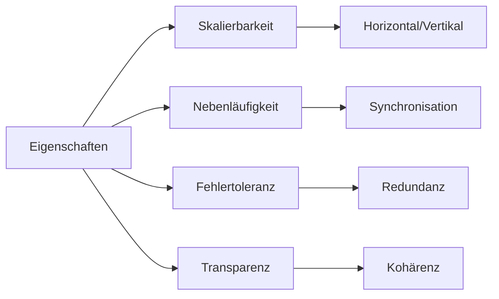

# Eigenschaften verteilter Systeme

> [!info] **Lernziele**
> Nach diesem Kapitel solltest du:
> - Die vier Hauptmerkmale verteilter Systeme kennen (Skalierbarkeit, Nebenläufigkeit, Fehlertoleranz, Transparenz)
> - Horizontale und vertikale Skalierung unterscheiden können
> - Die verschiedenen Arten von Transparenz verstehen
> - Client/Server- und Multitier-Architekturen erklären können
> - Fat- vs. Thin-Clients unterscheiden können

---

## Die vier Hauptmerkmale

> [!important] **Kernkonzept**
> Verteilte Systeme zeichnen sich durch vier abgeleitete Merkmale aus: **Skalierbarkeit**, **Nebenläufigkeit**, **Fehlertoleranz** und **Transparenz**. Diese Eigenschaften ergeben sich aus der verteilten Architektur und sind gleichzeitig ihre größten Stärken.

### Abgeleitete Merkmale eines verteilten Systems

| Merkmal | Beschreibung |
|---------|--------------|
| **Skalierbarkeit** | Ein verteiltes System kann (beliebig) mit zusätzlichen Ressourcen erweitert werden, wobei die Art der Ressourcen sehr heterogen sein kann. |
| **Nebenläufigkeit** | Auf Basis von Synchronisationsalgorithmen können Teilaufgaben koordiniert auf verschiedenen Systemen parallel abgearbeitet werden. |
| **Fehlertoleranz** | Resilienz ist ein zwingendes Grundprinzip für verteilte Systeme, da aufgrund der Verteilung und der hierbei eingesetzten umfangreichen Kommunikation häufig Fehler auftreten können. |
| **Transparenz** | Für den Benutzer ist nicht ersichtlich, wie die Aufgaben auf die Ressourcen verteilt werden und wo sich diese befinden. |

Diese vier Merkmale sind keine Garantien, sondern **Designziele**. Ein schlecht entworfenes verteiltes System kann alle vier verfehlen: nicht skalieren, Deadlocks produzieren, bei jedem Fehler abstürzen und dem Benutzer die interne Komplexität aufbürden. Die Kunst liegt darin, diese Eigenschaften durch geeignete Architekturentscheidungen zu erreichen – und das erfordert tiefes Verständnis der Trade-offs.

> [!example] **Analogie: Supermarkt-Kette**
> - **Skalierbarkeit**: Mehr Filialen öffnen bei mehr Kunden
> - **Nebenläufigkeit**: Alle Filialen bedienen gleichzeitig Kunden
> - **Fehlertoleranz**: Eine geschlossene Filiale stoppt nicht den Betrieb
> - **Transparenz**: Kunde sieht "den Supermarkt", nicht die Logistik dahinter

---

## Skalierbarkeit und Verteilung

![[skalierbarkeit-verteilung.png]]
*04-01-02-skalierbarkeit-verteilung: Horizontale und vertikale Verteilung sowie Skalierung im Vergleich.*

| Skalierung | Beschreibung | Vorteile | Nachteile |
|------------|--------------|----------|-----------|
| **Horizontal** | Mehr Server | Beliebig erweiterbar, kostengünstig | Komplexere Koordination |
| **Vertikal** | Stärkere Server | Einfacher, keine Verteilung | Grenzen, teuer |

In der Praxis kombinieren die meisten Systeme beide Ansätze: **Vertikal** bis zur wirtschaftlich sinnvollen Grenze (ein größerer Server ist oft günstiger als zwei kleine), dann **horizontal** für weitere Skalierung. Netflix beispielsweise nutzt große EC2-Instanzen (vertikal optimiert), betreibt aber hunderte davon weltweit (horizontal skaliert).

Die Unterscheidung zwischen **Verteilung** und **Skalierung** ist wichtig: Verteilung beschreibt *wie* Aufgaben aufgeteilt werden (horizontal = gleiche Aufgaben repliziert, vertikal = verschiedene Aufgaben in Schichten), während Skalierung beschreibt *wie* bei steigender Last reagiert wird.

---

## Client/Server und Multitier-Architekturen

![[client-server-multitier.png]]
*04-01-02-client-server-multitier: Vergleich zwischen klassischer 2-Tier Client/Server-Architektur und Multitier-Architektur mit getrennten Schichten.*

Client und Server sind **Rollen-Bezeichnungen**: Ein Server kann als Druckserver agieren und gleichzeitig Client eines Dateiservers sein.

Die klassische **2-Tier-Architektur** (Client + Server) war der Standard der 90er Jahre: Der Client übernimmt Präsentation und einen Teil der Logik, der Server hält die Daten. Das Problem: Bei Änderungen an der Geschäftslogik muss jeder Client aktualisiert werden.

**Multitier-Architekturen** lösen dieses Problem durch Schichtentrennung. Die Geschäftslogik wandert in eine eigene Schicht (Application Server), die zentral aktualisiert werden kann. Moderne Webanwendungen sind typischerweise 3-Tier (Browser → Webserver/API → Datenbank) oder sogar n-Tier mit zusätzlichen Caching-Schichten, Message Queues und Microservices.

---

## Fat- vs. Thin-Clients

![[fat-thin-client.png]]
*04-01-02-fat-thin-client: Verteilung der Verantwortlichkeiten zwischen Client und Server bei Thin- und Fat-Client-Architekturen.*

| Typ | Beschreibung | Vorteile | Nachteile |
|-----|--------------|----------|-----------|
| **Thin-Client** | Minimale Logik, Server macht alles | Einfache Wartung, zentrale Updates | Abhängig vom Server |
| **Fat-Client** | Viel Logik lokal | Offline-fähig, schneller | Wartungsaufwand, Updates verteilen |

Die Entwicklung hat sich mehrfach gewandelt: In den 80ern dominierten Terminals (extrem thin), in den 90ern Fat-Clients (Windows-Anwendungen mit lokaler Datenbank), ab 2000 Web-Browser (thin), und heute sehen wir mit SPAs (Single Page Applications) und PWAs (Progressive Web Apps) wieder mehr Logik im Client – allerdings mit automatischen Updates über den Browser.

Die Entscheidung hängt vom Anwendungsfall ab: **Thin** für zentral verwaltete Unternehmensanwendungen, **Fat** für Offline-Szenarien (Mobile Apps, Spiele). Viele moderne Apps sind **hybrid**: Sie cachen Daten lokal für Offline-Nutzung, synchronisieren aber mit dem Server, sobald eine Verbindung besteht.

---

## Verteiltes System auf Client/Server-Basis

![[verteiltes-system-3tier.png]]
*04-01-02-verteiltes-system-3tier: Dreischichtige Architektur mit Thin-Clients, Anwendungs-Servern und Datenbank-Servern.*

Diese Architektur zeigt die **Kombination** aus vertikaler Verteilung (drei Schichten mit unterschiedlichen Aufgaben) und horizontaler Skalierung (mehrere Server pro Schicht). Jede Schicht kann unabhängig skaliert werden: Bei hoher Rechenlast mehr Application-Server, bei vielen Lesezugriffen mehr Datenbank-Replikas.

Die **Kapselung** zwischen den Schichten ist entscheidend: Die Clients kennen nur die API der Anwendungsschicht, nicht die Datenbankstruktur. Das ermöglicht es, die Datenbank auszutauschen oder zu sharden, ohne die Clients anzupassen. Moderne Architekturen gehen noch weiter und führen **Service Meshes** ein, die Kommunikation, Authentifizierung und Monitoring zwischen den Schichten übernehmen.

---

## Cloud Computing

**Definition:** On-Demand-Bereitstellung von Rechenleistung, Speicher und Diensten über das Internet.

- Nutzungsbasierte Abrechnung (Pay-as-you-go)
- Kostenkontrolle notwendig!

Cloud Computing ist die konsequente Weiterentwicklung verteilter Systeme: Statt eigene Hardware zu betreiben, mietet man Ressourcen bei einem Provider. Das verschiebt Komplexität (Hardwarewartung, Netzwerk, Kühlung) zum Anbieter, bringt aber neue Herausforderungen: **Vendor Lock-in**, **Datenschutz** (wo liegen die Daten?), und **Kosten**, die ohne Überwachung explodieren können.

### Service-Modelle

![[cloud-service-modelle.png]]
*04-01-02-cloud-service-modelle: Verantwortlichkeiten bei verschiedenen Cloud Service-Modellen – von On-Premises (alles selbst verwaltet) bis SaaS (Provider verwaltet alles).*

| Modell | Beispiele | Du verwaltest |
|--------|-----------|---------------|
| **On-Premises** | Eigenes Rechenzentrum | Alles |
| **Colocation** | Equinix, Interxion | Alles außer Data Center |
| **Hosting** | Hetzner Dedicated | Ab Physical Servers aufwärts |
| **IaaS** | AWS EC2, Azure VMs | Ab OS aufwärts |
| **PaaS** | Heroku, Google App Engine | Nur Apps + Daten |
| **SaaS** | Office 365, Salesforce | Nichts (nur Nutzung) |

Die Wahl des Modells ist ein **Trade-off zwischen Kontrolle und Aufwand**: Je mehr der Provider übernimmt, desto weniger Einfluss hast du auf Details (Betriebssystem-Version, Netzwerkkonfiguration, Performance-Tuning). Startups beginnen oft mit PaaS/SaaS für schnelle Entwicklung und migrieren später zu IaaS oder sogar On-Premises, wenn sie die Kontrolle oder Kostenvorteile brauchen.

---

## Zusammenhänge

- [[01-Definition|Definition]] → Grundlegende Begriffe
- [[03-Fallacies|Fallacies]] → Was schiefgehen kann
- [[../02-Kommunikation/00-Kommunikation-Index|Kommunikation]] → Wie Nodes kommunizieren
- [[../03-Konsistenz/01-CAP-Theorem|CAP-Theorem]] → Trade-offs bei Verteilung

---

## Prüfungstipps

> [!warning] **Prüfungsrelevant**
> - Die vier Hauptmerkmale (Skalierbarkeit, Nebenläufigkeit, Fehlertoleranz, Transparenz)
> - Horizontale vs. vertikale Skalierung
> - Client/Server vs. Multitier
> - Fat- vs. Thin-Client
> - IaaS vs. PaaS vs. SaaS

> [!question] **Häufige Prüfungsfragen**
> 1. Nennen Sie die vier Hauptmerkmale verteilter Systeme.
> 2. Was ist der Unterschied zwischen horizontaler und vertikaler Skalierung?
> 3. Erklären Sie Fat-Client vs. Thin-Client.
> 4. Was bedeutet Transparenz in verteilten Systemen?
> 5. Unterscheiden Sie IaaS, PaaS und SaaS.

> [!tip] **Merkhilfen**
> - **Horizontal** = mehr Server (**Scale-Out**)
> - **Vertikal** = stärkere Server (**Scale-Up**)
> - **Thin** = wenig lokal, **Fat** = viel lokal
> - **IaaS** = Infrastruktur, **PaaS** = Plattform, **SaaS** = Software

---

## Weiterführende Ressourcen

> [!note] **Cloud-Anbieter**
> - AWS, Azure, Google Cloud Platform – Die großen drei
> - DigitalOcean, Hetzner – Einfachere Alternativen

> [!tip] **Praktische Übungen**
> - AWS Free Tier nutzen
> - Docker und Kubernetes ausprobieren
> - Eine einfache Multitier-Anwendung deployen

---

## Quellen

- Tanenbaum, Andrew S.; van Steen, Maarten: Verteilte Systeme – Kapitel über Architekturen und Skalierung.
- NIST Cloud Computing Definition – Offizielle Definition der Cloud-Service-Modelle.
- Gartner Reports – Analysen zu Cloud-Computing-Trends.
