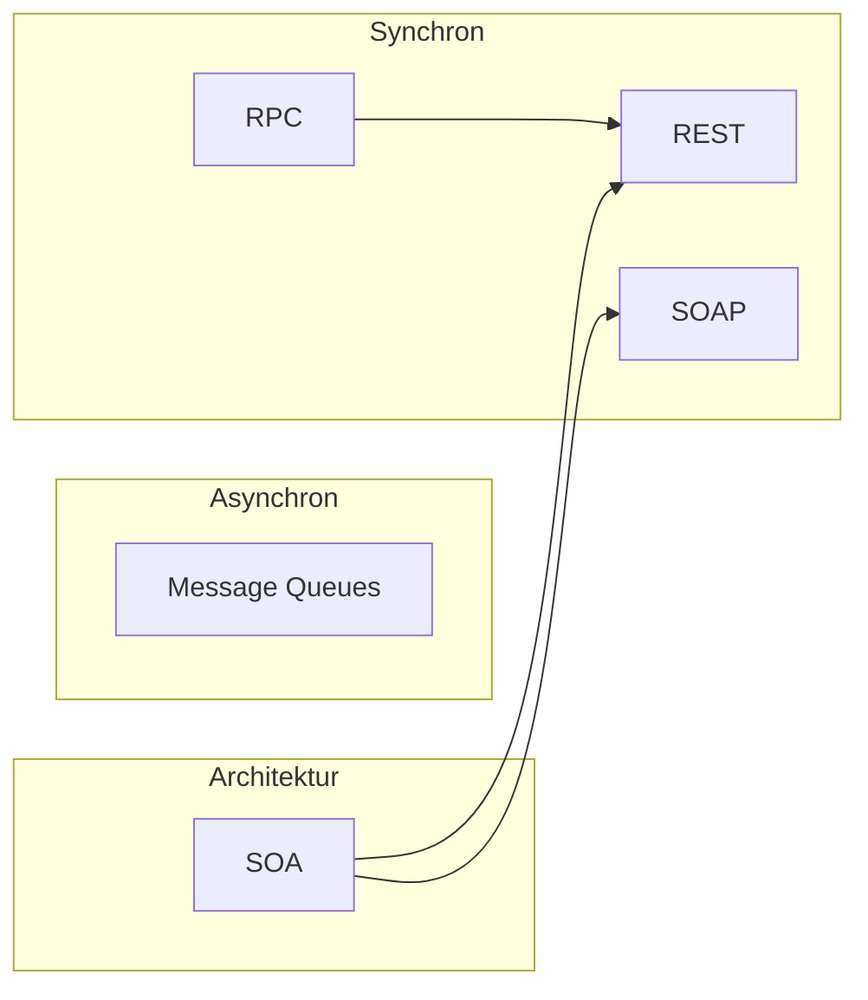

# Kommunikation in Verteilten Systemen

Dieses Kapitel behandelt die grundlegenden Kommunikationsmechanismen in verteilten Systemen – von synchronen Fernaufrufen über asynchrone Messaging-Systeme bis hin zu Architekturkonzepten.

## Inhaltsverzeichnis

| Nr. | Thema | Beschreibung |
|-----|-------|--------------|
| 01 | [[01-RPC]] | Remote Procedure Call – synchrone Fernaufrufe |
| 02 | [[02-Message-Queues]] | Asynchrone Nachrichtenwarteschlangen |
| 03 | [[03-REST]] | Representational State Transfer – HTTP-basierte APIs |
| 04 | [[04-SOAP]] | Simple Object Access Protocol – XML-basierter Nachrichtenaustausch |
| 05 | [[05-SOA]] | Service-orientierte Architektur |

## Übersicht der Kommunikationsparadigmen

## Lernpfad

1. **Grundlagen**: Beginne mit [[01-RPC]] um das fundamentale Konzept von Fernaufrufen zu verstehen
2. **Synchron vs. Asynchron**: Vergleiche [[01-RPC]] mit [[02-Message-Queues]]
3. **Web-APIs**: Vertiefe mit [[03-REST]] und [[04-SOAP]]
4. **Architektur**: Schließe mit [[05-SOA]] als übergeordnetem Konzept ab
