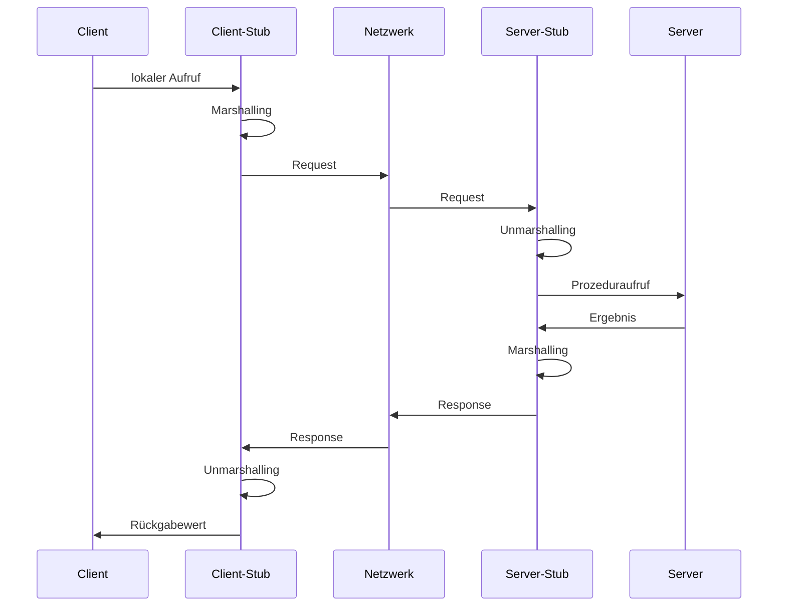
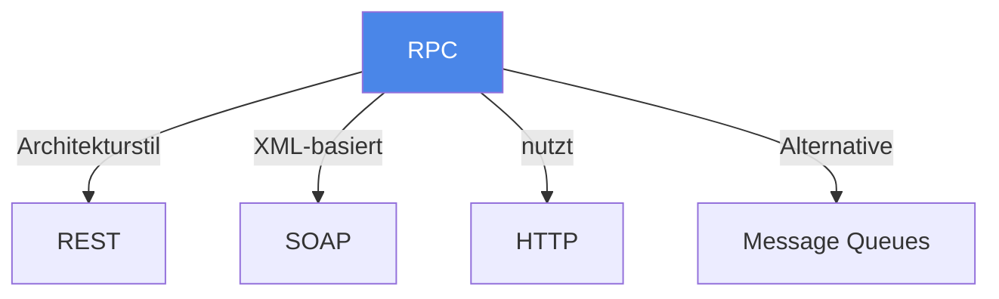

# Remote Procedure Call (RPC)

> [!info] Lernziele
> - Funktionsprinzip von RPC verstehen
> - Ablauf eines RPC-Aufrufs erklären können
> - Unterschied zwischen blockierenden und nicht-blockierenden Aufrufen kennen
> - Praktische Implementierungen benennen können

## Einleitung

Remote Procedure Call (RPC) ist ein fundamentales Kommunikationsparadigma in verteilten Systemen. Es ermöglicht einem Programm, eine Prozedur auf einem entfernten Rechner so aufzurufen, als wäre es ein lokaler Funktionsaufruf.

> [!important] Kernkonzept
> RPC ist eine Generalisierung von Fernaufrufen. Ein Client schickt eine Nachricht (ggf. zusammen mit Parametern) an einen Server, woraufhin der Server ein Programm startet und die Ausgaben dieses Programms an den Client zurückliefert.

> [!example] Analogie
> RPC funktioniert wie ein Telefonanruf bei einem Dienstleister: Du rufst an (Request), nennst dein Anliegen und Parameter (z.B. "Ich möchte eine Pizza Margherita"), der Dienstleister führt die Arbeit aus (Prozedur) und teilt dir das Ergebnis mit (Response). Während du wartest, kannst du nichts anderes tun – der Anruf blockiert.

## Funktionsprinzip

### Grundlegender Ablauf

1. **Client-Aufruf**: Der Client ruft eine lokale Stub-Funktion auf
2. **Marshalling**: Parameter werden serialisiert (in Netzwerkformat umgewandelt)
3. **Übertragung**: Request wird über das Netzwerk zum Server gesendet
4. **Server-Stub**: Empfängt die Nachricht und deserialisiert die Parameter
5. **Ausführung**: Die eigentliche Prozedur wird auf dem Server ausgeführt
6. **Rückgabe**: Ergebnis wird serialisiert und an den Client zurückgesendet
7. **Client empfängt**: Der Client-Stub deserialisiert das Ergebnis

### Blockierendes Verhalten

> [!warning] Achtung
> RPC-Aufrufe sind typischerweise **blockierend**! Der Client wartet auf die Antwort des Servers und kann währenddessen keine anderen Operationen ausführen.

## Implementierungen

| Implementierung | Beschreibung | Protokoll |
|-----------------|--------------|-----------|
| **HTTP GET/POST** | Einfachste Form von RPC | HTTP |
| **Java RMI** | Remote Method Invocation für Java | JRMP/IIOP |
| **gRPC** | Modernes Framework von Google | HTTP/2 + Protocol Buffers |
| **XML-RPC** | XML-basierte Kodierung | HTTP |
| **JSON-RPC** | JSON-basierte Kodierung | HTTP |
| **SAP RFC** | Remote Function Call in SAP | Proprietär |

### Praktische Ports

- **Windows RPC**: Port 135/tcp
- **Unix Portmapper**: Port 111/tcp

## Zusammenhänge

---

## Prüfungstipps

> [!warning] Häufige Prüfungsfragen
> - Beschreiben Sie den Ablauf eines RPC-Aufrufs
> - Was bedeutet "blockierend" bei RPC?
> - Nennen Sie praktische Implementierungen von RPC

> [!question] Verständnisfragen
> - Warum braucht man Marshalling/Unmarshalling?
> - Welche Probleme können bei RPC auftreten (Netzwerkfehler, Timeouts)?
> - Wie unterscheidet sich synchrones von asynchronem RPC?

> [!tip] Merkhilfe
> **RPC = Remote Procedure Call**: Der Client "ruft an", der Server "führt aus", das Ergebnis wird "zurückgerufen". Denke an einen Telefonanruf – während du wartest, ist die Leitung blockiert.

---

## Weiterführende Ressourcen

- [[REST]] – Vergleich mit ressourcenorientiertem Ansatz
- [[Message-Queues]] – Asynchrone Alternative
- [[02-Eigenschaften|Transparenz in verteilten Systemen]]

---

## Quellen

Die Inhalte basieren auf dem Kurshandbuch "Betriebssysteme, Rechnernetze und verteilte Systeme" der IU Internationalen Hochschule sowie den zugehörigen Vorlesungsmaterialien. Ergänzend wurden die RFCs 707, 1057 und 5531 herangezogen.
