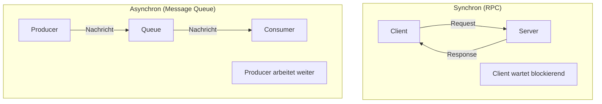
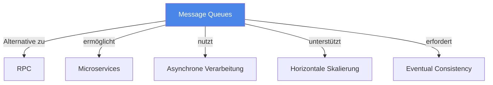

# Message Queues

> [!info] Lernziele
> - Konzept der asynchronen Kommunikation verstehen
> - Liefergarantien unterscheiden können
> - Vor- und Nachteile gegenüber synchroner Kommunikation kennen
> - Anwendungsfälle für Message Queues identifizieren

## Einleitung

Message Queues sind asynchrone Kommunikationsmechanismen, bei denen Nachrichten in einer Warteschlange zwischengespeichert werden. Sie bilden das Gegenstück zu synchronen Verfahren wie RPC.

> [!important] Kernkonzept
> Message Queues **entkoppeln** Sender und Empfänger sowohl **zeitlich** (der Empfänger muss nicht sofort verfügbar sein) als auch **räumlich** (Sender kennt den Empfänger nicht direkt). Die Warteschlange fungiert als Puffer und garantiert die Nachrichtenzustellung.

> [!example] Analogie
> Message Queues funktionieren wie ein Briefkasten: Du wirfst einen Brief ein (Nachricht senden) und gehst weiter, ohne auf eine Antwort zu warten. Der Empfänger holt den Brief ab, wenn er Zeit hat. Auch wenn der Empfänger gerade im Urlaub ist, geht der Brief nicht verloren – er wartet im Briefkasten.

## Kommunikationsmodelle

### Synchron vs. Asynchron

### Messaging-Pattern

| Pattern | Beschreibung |
|---------|--------------|
| **Point-to-Point** | Eine Nachricht wird von genau einem Consumer verarbeitet |
| **Publish/Subscribe** | Nachrichten werden an alle Subscriber verteilt |
| **Request/Reply** | Asynchrone Anfrage mit Antwort über separate Queue |
| **Fan-out** | Eine Nachricht an viele Consumer verteilen |

## Liefergarantien

> [!warning] Wichtig für die Prüfung
> Die verschiedenen Liefergarantien sind ein häufiges Prüfungsthema!

| Garantie | Beschreibung | Trade-off |
|----------|--------------|-----------|
| **At-most-once** | Nachricht wird höchstens einmal zugestellt | Kann verloren gehen |
| **At-least-once** | Nachricht wird mindestens einmal zugestellt | Kann dupliziert werden |
| **Exactly-once** | Nachricht wird genau einmal zugestellt | Aufwändig zu implementieren |

### Exactly-once Semantik

Die Exactly-once-Garantie erfordert:
- Idempotente Consumer (mehrfache Verarbeitung hat gleichen Effekt)
- Transaktionale Verarbeitung
- Deduplizierung auf Basis von Message-IDs

## Implementierungen

| System | Typ | Besonderheit |
|--------|-----|--------------|
| **Apache Kafka** | Event-Streaming | Hoher Durchsatz, Log-basiert |
| **RabbitMQ** | Message Broker | AMQP, flexible Routing |
| **Amazon SQS** | Cloud-Service | Managed, skalierbar |
| **Apache ActiveMQ** | Message Broker | JMS-kompatibel |
| **Redis Pub/Sub** | In-Memory | Sehr schnell, keine Persistenz |

## Vor- und Nachteile

### Vorteile

- **Entkopplung**: Sender und Empfänger unabhängig
- **Skalierbarkeit**: Consumer können horizontal skaliert werden
- **Fehlertoleranz**: Nachrichten überleben Ausfälle
- **Load Leveling**: Lastspitzen werden gepuffert
- **Asynchronität**: Sender blockiert nicht

### Nachteile

- **Komplexität**: Zusätzliche Infrastruktur erforderlich
- **Latenz**: Nachrichten müssen gepuffert werden
- **Monitoring**: Schwieriger zu debuggen
- **Konsistenz**: Eventual Consistency statt Strong Consistency

## Zusammenhänge

---

## Prüfungstipps

> [!warning] Häufige Prüfungsfragen
> - Erklären Sie die drei Liefergarantien
> - Nennen Sie Vor- und Nachteile von Message Queues gegenüber RPC
> - Wann würden Sie Message Queues einsetzen?

> [!question] Verständnisfragen
> - Warum ist Exactly-once so schwer zu implementieren?
> - Was passiert, wenn die Queue voll ist?
> - Wie erreicht man Ordering in verteilten Queues?

> [!tip] Merkhilfe
> **Message Queue = Asynchroner Briefkasten**:
> - **A**synchron: Sender wartet nicht
> - **P**ersistent: Nachrichten überleben
> - **E**ntkoppelt: Sender kennt Empfänger nicht
> - **S**kalierbar: Mehrere Consumer möglich

---

## Weiterführende Ressourcen

- [[01-RPC]] – Synchrone Alternative
- [[03-REST]] – HTTP-basierte Kommunikation
- [[03-Konsistenz/01-CAP-Theorem]] – Verteilte Konsistenz

---

## Quellen

Die Inhalte basieren auf dem Kurshandbuch "Betriebssysteme, Rechnernetze und verteilte Systeme" der IU Internationalen Hochschule sowie den zugehörigen Vorlesungsmaterialien. Ergänzend wurden Dokumentationen von Apache Kafka und RabbitMQ herangezogen.
