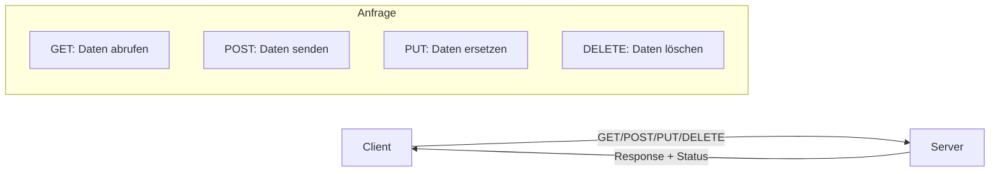
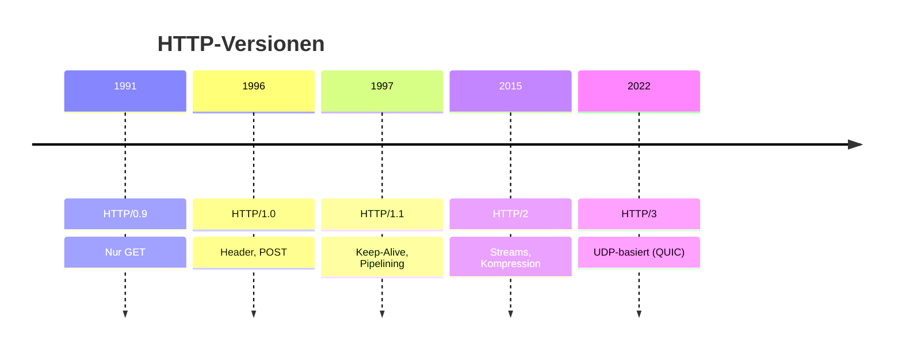
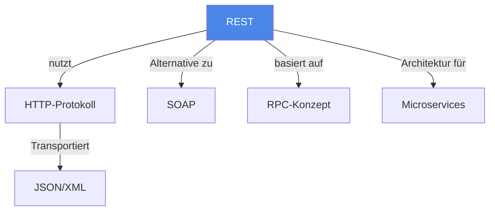

# REST (Representational State Transfer)

> [!info] Lernziele
> - REST als Architekturstil verstehen
> - HTTP-Methoden und ihre Semantik kennen
> - Unterschiede zwischen REST und SOAP erklären können
> - REST-Prinzipien nach Fielding benennen

## Einleitung

REST ist ein Architekturstil für verteilte Hypermedia-Systeme, der 2000 von Roy Fielding in seiner Dissertation beschrieben wurde. Er nutzt das HTTP-Protokoll und dessen Methoden für die Kommunikation zwischen Client und Server.

> [!important] Kernkonzept
> REST basiert auf dem Konzept von **Ressourcen**, die über eindeutige URIs identifiziert werden. Der Zustand einer Ressource wird als **Repräsentation** (z.B. JSON, XML) übertragen. Jede Anfrage ist **zustandslos** und enthält alle notwendigen Informationen.

> [!example] Analogie
> REST funktioniert wie eine Bibliothek: Jedes Buch (Ressource) hat eine eindeutige Signatur (URI). Du kannst ein Buch ansehen (GET), ein neues hinzufügen (POST), eines ersetzen (PUT) oder entfernen (DELETE). Der Bibliothekar merkt sich nicht, was du vorher gemacht hast – jeder Besuch (Request) ist unabhängig.

## HTTP-Protokoll

### HTTP-Methoden (Primitiven)

| Methode | Beschreibung | Idempotent |
|---------|--------------|------------|
| **GET** | Liefert den Inhalt einer Ressource | ✓ |
| **HEAD** | Wie GET, aber nur Metadaten (Header) | ✓ |
| **POST** | Sendet Daten zur Verarbeitung an den Server | ✗ |
| **PUT** | Speichert/ersetzt eine Ressource unter der URI | ✓ |
| **DELETE** | Löscht die angegebene Ressource | ✓ |
| **PATCH** | Partielle Aktualisierung einer Ressource | ✗ |
| **OPTIONS** | Liefert unterstützte Methoden für eine URI | ✓ |
| **TRACE** | Gibt die empfangene Anfrage zurück (Debug) | ✓ |

### Request-Typen

### Statischer vs. Dynamischer Inhalt

GET-Requests können referenzieren auf:
- **Statische Webseiten**: Direkte Auslieferung von HTML/CSS/JS-Dateien
- **Dynamische Inhalte**: Ausführung eines Programms auf dem Server
  - Server Side Includes (SSI) für einfache Modifikationen
  - Query-Parameter (`?key=value`) für parametrisierte Aufrufe

## REST-Prinzipien (nach Fielding)

1. **Client-Server-Architektur**: Klare Trennung der Verantwortlichkeiten
2. **Zustandslosigkeit (Stateless)**: Jede Anfrage ist unabhängig
3. **Cachebarkeit**: Antworten können als cachebar markiert werden
4. **Einheitliche Schnittstelle (Uniform Interface)**: 
   - Ressourcen-Identifikation durch URIs
   - Manipulation durch Repräsentationen
   - Selbstbeschreibende Nachrichten
   - HATEOAS (Hypermedia as the Engine of Application State)
5. **Schichtensystem**: Zwischengeschaltete Schichten möglich (Proxies, Load Balancer)
6. **Code on Demand** (optional): Ausführbarer Code kann übertragen werden

## REST vs. SOAP

| Aspekt | REST | SOAP |
|--------|------|------|
| **Typ** | Architekturstil | Protokoll |
| **Ressourcen** | Leichtgewichtig | Ressourcenintensiv |
| **Bandbreite** | Geringer Overhead | XML-Overhead |
| **Kopplung** | Lose Kopplung | Engere Bindung |
| **Caching** | Unterstützt | Nicht direkt |
| **Sicherheit** | HTTPS, OAuth | WS-Security (gilt als sicherer) |

> [!tip] Entscheidungshilfe
> - **REST**: Öffentliche APIs, Mobile Apps, Microservices
> - **SOAP**: Enterprise-Anwendungen mit hohen Sicherheitsanforderungen

## HTTP-Entwicklung

## Zusammenhänge

---

## Prüfungstipps

> [!warning] Häufige Prüfungsfragen
> - Nennen Sie die REST-Prinzipien nach Fielding
> - Erklären Sie die HTTP-Methoden und ihre Semantik
> - Vergleichen Sie REST und SOAP

> [!question] Verständnisfragen
> - Was bedeutet "zustandslos" und warum ist das wichtig?
> - Was ist der Unterschied zwischen PUT und POST?
> - Warum ist REST leichtgewichtiger als SOAP?

> [!tip] Merkhilfe
> **REST = Ressourcen über HTTP**: 
> - **R**essourcen haben **U**RIs
> - **E**inheitliche Schnittstelle (HTTP-Methoden)
> - **S**tateless (zustandslos)
> - **T**ransfer von Repräsentationen

---

## Weiterführende Ressourcen

- [[01-RPC]] – Grundlegendes RPC-Konzept
- [[02-Message-Queues]] – Asynchrone Alternative
- [[04-SOAP]] – XML-basiertes Protokoll

---

## Quellen

Die Inhalte basieren auf dem Kurshandbuch "Betriebssysteme, Rechnernetze und verteilte Systeme" der IU Internationalen Hochschule sowie den zugehörigen Vorlesungsmaterialien. Grundlegend ist die Dissertation von Roy Fielding (2000) "Architectural Styles and the Design of Network-based Software Architectures". HTTP-Spezifikationen finden sich in RFC 7230-7235.
