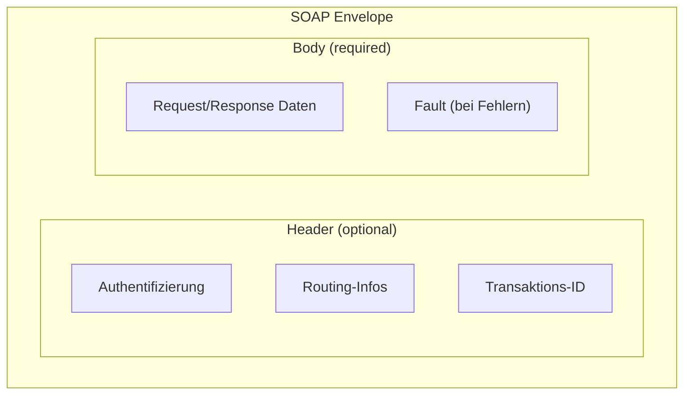
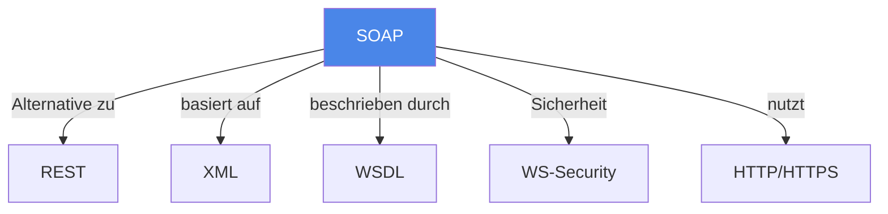

# SOAP (Simple Object Access Protocol)

> [!info] Lernziele
> - SOAP als Protokoll verstehen und von REST abgrenzen
> - Aufbau einer SOAP-Nachricht kennen
> - Vor- und Nachteile von SOAP benennen können
> - Anwendungsfälle für SOAP identifizieren

## Einleitung

SOAP (Simple Object Access Protocol, auch: Simple Object Architecture Protocol) ist ein Protokoll zum Austausch XML-basierter Datensätze über ein Rechnernetzwerk. Es wurde ursprünglich von Microsoft entwickelt und ist heute ein W3C-Standard.

> [!important] Kernkonzept
> SOAP ist ein **Protokoll** (nicht nur ein Architekturstil wie REST), das XML für den Nachrichtenaustausch verwendet. Es definiert eine strikte Nachrichtenstruktur mit Envelope, Header und Body und bietet eingebaute Standards für Sicherheit (WS-Security) und Transaktionen.

> [!example] Analogie
> SOAP ist wie ein formeller Geschäftsbrief mit strenger Struktur: Er hat einen Umschlag (Envelope) mit Absender und Empfänger, einen Briefkopf (Header) mit Metadaten und formellen Angaben, und den eigentlichen Briefinhalt (Body). Jedes Element hat seinen festen Platz – keine Abweichungen erlaubt.

## SOAP-Nachrichtenstruktur

### Aufbau einer SOAP-Nachricht

```xml
<?xml version="1.0"?>
<s:Envelope xmlns:s="http://www.w3.org/2003/05/soap-envelope">
  <s:Header>
    <!-- Metadaten, Authentifizierung, Routing -->
  </s:Header>
  <s:Body>
    <!-- Eigentliche Nutzdaten / Payload -->
  </s:Body>
</s:Envelope>
```



### Komponenten

| Komponente | Pflicht | Beschreibung |
|------------|---------|--------------|
| **Envelope** | ✓ | Wurzelelement, definiert den Namespace |
| **Header** | ✗ | Metadaten, Authentifizierung, Routing |
| **Body** | ✓ | Eigentliche Nutzdaten oder Fault-Element |
| **Fault** | ✗ | Standardisierte Fehlerinformationen |

## SOAP vs. REST

| Aspekt | SOAP | REST |
|--------|------|------|
| **Typ** | Protokoll | Architekturstil |
| **Format** | Nur XML | JSON, XML, andere |
| **Bandbreite** | Höherer Overhead | Leichtgewichtig |
| **Kopplung** | Engere Bindung Client/Server | Lose Kopplung |
| **Caching** | Nicht direkt möglich | Unterstützt |
| **Sicherheit** | WS-Security (sehr robust) | HTTPS, OAuth |
| **Standardisierung** | Stark (WSDL, WS-*) | Weniger formal |

## Vor- und Nachteile

### Vorteile

- **Sicherheit**: WS-Security bietet umfassende Sicherheitsmechanismen
- **Transaktionen**: ACID-Transaktionen über WS-AtomicTransaction
- **Zuverlässigkeit**: WS-ReliableMessaging für garantierte Zustellung
- **Typsicherheit**: WSDL definiert exakte Schnittstellen
- **Plattformunabhängig**: XML als universelles Format

### Nachteile

- **Overhead**: XML-Struktur erhöht Datenmenge erheblich
- **Komplexität**: Viele Standards (WS-*) zu beherrschen
- **Performance**: Parsing von XML ist aufwändig
- **Flexibilität**: Strikte Struktur weniger agil

## WSDL (Web Services Description Language)

WSDL beschreibt SOAP-Services maschinenlesbar:
- **Types**: Datentypen (meist XML Schema)
- **Messages**: Ein- und Ausgabenachrichten
- **PortType**: Operationen des Services
- **Binding**: Protokoll und Format
- **Service**: Konkrete Endpunkt-Adresse

## Anwendungsfälle

SOAP eignet sich besonders für:
- **Enterprise-Anwendungen** mit hohen Sicherheitsanforderungen
- **Finanzsektor** (Banken, Versicherungen)
- **B2B-Integration** mit verschiedenen Partnern
- **Systeme mit ACID-Transaktionsanforderungen**
- **Legacy-Systeme** mit bestehenden SOAP-Schnittstellen

## Zusammenhänge



---

## Prüfungstipps

> [!warning] Häufige Prüfungsfragen
> - Erklären Sie den Aufbau einer SOAP-Nachricht
> - Vergleichen Sie SOAP und REST
> - Wann würden Sie SOAP statt REST einsetzen?

> [!question] Verständnisfragen
> - Warum gilt SOAP als sicherer als REST?
> - Was ist der Unterschied zwischen einem Protokoll und einem Architekturstil?
> - Welche Rolle spielt WSDL bei SOAP?

> [!tip] Merkhilfe
> **SOAP = Sicherer, aber aufwändiger**:
> - **S**trikt strukturiert (XML)
> - **O**verhead durch Envelope
> - **A**CID-Transaktionen möglich
> - **P**rotokoll (nicht nur Stil)

---

## Weiterführende Ressourcen

- [[03-REST]] – Leichtgewichtige Alternative
- [[01-RPC]] – Grundlegendes Aufrufkonzept
- [[05-SOA]] – Service-orientierte Architektur

---

## Quellen

Die Inhalte basieren auf dem Kurshandbuch "Betriebssysteme, Rechnernetze und verteilte Systeme" der IU Internationalen Hochschule sowie den zugehörigen Vorlesungsmaterialien. SOAP-Spezifikation: https://www.w3.org/TR/soap12-part1/
