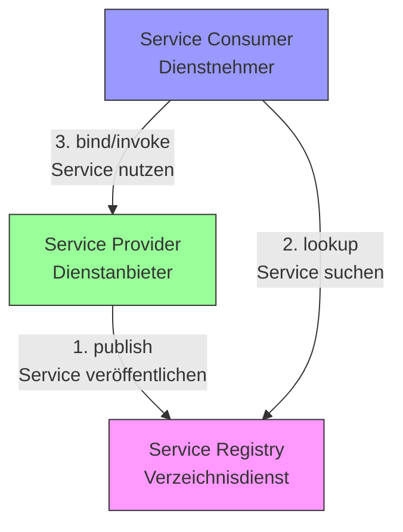
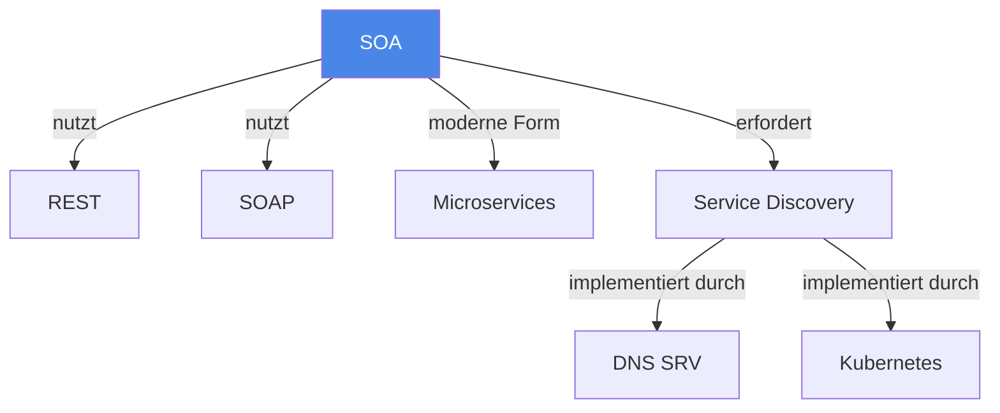

# Service-orientierte Architektur (SOA)

> [!info] Lernziele
> - SOA als Organisationskonzept verstehen
> - Unterschied zwischen SOA und konkreten Protokollen kennen
> - Vorteile von SOA benennen können
> - Zusammenhang mit Microservices verstehen

## Einleitung

SOA (Service Oriented Architecture) ist ein Organisationskonzept für verteilte Systeme. Anders als RPC, REST oder SOAP ist SOA kein Protokoll, sondern ein Architekturparadigma, das beschreibt, wie Dienste in einem Netzwerk organisiert und bereitgestellt werden.

> [!important] Kernkonzept
> In SOA werden Dienste nicht "nur" angeboten – der Server **veröffentlicht**, dass er diese Dienste anbietet, etwa in einem **Verzeichnisdienst** (Service Registry). Clients können dann dynamisch nach benötigten Diensten suchen und diese nutzen.

> [!example] Analogie
> SOA funktioniert wie ein Branchenbuch (Gelbe Seiten): Anbieter tragen ihre Dienste ein (Service Provider), das Branchenbuch verwaltet die Einträge (Service Registry), und Kunden suchen darin nach dem passenden Anbieter (Service Consumer). Der Kunde muss nicht im Voraus wissen, welcher Anbieter existiert – er schlägt einfach nach.

## SOA-Dreiecksmodell



### Komponenten

| Komponente | Rolle | Beispiel |
|------------|-------|----------|
| **Service Provider** | Bietet Dienste an und registriert sie | Webserver, API-Server |
| **Service Registry** | Verzeichnis aller verfügbaren Dienste | UDDI, DNS SRV, Consul |
| **Service Consumer** | Sucht und nutzt Dienste | Client-Anwendung |

## Ziele von SOA

SOA zielt auf:

- **Wiederverwendung von Code**: Services können von mehreren Anwendungen genutzt werden
- **Größere Flexibilität**: Lose Kopplung ermöglicht Änderungen ohne Auswirkungen auf andere Systeme
- **Skalierbarkeit**: Services können unabhängig skaliert werden
- **Höhere Zuverlässigkeit**: Ausfälle einzelner Services beeinträchtigen nicht das Gesamtsystem
- **Bessere Verfügbarkeit**: Services können redundant bereitgestellt werden

## Praktische Implementierungen

### DNS Service Location Records (SRV)

Ein praktisches Beispiel für Service Discovery:

```
_http._tcp.abc.com. IN SRV 0 5 80 ws1.abc.com.
```

Dieses SRV-Record ordnet einen HTTP-Service (`_http._tcp`) der Domain `abc.com` dem Server `ws1.abc.com` auf Port 80 zu.

### Moderne Implementierungen

| System | Beschreibung |
|--------|--------------|
| **Kubernetes Service Discovery** | Container-native Service Registry |
| **Consul** | Service Mesh mit Health Checks |
| **etcd** | Distributed Key-Value Store |
| **Apache ZooKeeper** | Koordination verteilter Systeme |
| **Active Directory** | Windows-basiertes Service Location |

## SOA und Microservices

Microservices sind eine moderne Ausprägung des SOA-Paradigmas:

| Aspekt | Klassische SOA | Microservices |
|--------|----------------|---------------|
| **Granularität** | Grobkörnig | Feinkörnig |
| **Kommunikation** | ESB (Enterprise Service Bus) | Direkt (REST, gRPC) |
| **Daten** | Gemeinsame Datenbank möglich | Eigene Datenbank pro Service |
| **Deployment** | Oft gemeinsam | Unabhängig |
| **Technologie** | Homogen | Polyglott |

## Zusammenhänge



---

## Prüfungstipps

> [!warning] Häufige Prüfungsfragen
> - Erklären Sie das SOA-Dreiecksmodell (Provider, Registry, Consumer)
> - Was unterscheidet SOA von einem Protokoll wie SOAP?
> - Welche Vorteile bietet SOA?

> [!question] Verständnisfragen
> - Warum ist ein Verzeichnisdienst wichtig für SOA?
> - Wie hängen SOA und Microservices zusammen?
> - Was passiert, wenn die Service Registry ausfällt?

> [!tip] Merkhilfe
> **SOA = Gelbe Seiten für Services**:
> - **S**ervices werden veröffentlicht (publish)
> - **O**rganisiert in einem Verzeichnis (registry)
> - **A**bgerufen bei Bedarf (lookup + bind)

---

## Weiterführende Ressourcen

- [[03-REST]] – Häufiges Protokoll für SOA
- [[04-SOAP]] – Enterprise-Protokoll für SOA
- [[01-RPC]] – Grundlegendes Kommunikationskonzept

---

## Quellen

Die Inhalte basieren auf dem Kurshandbuch "Betriebssysteme, Rechnernetze und verteilte Systeme" der IU Internationalen Hochschule sowie den zugehörigen Vorlesungsmaterialien.
