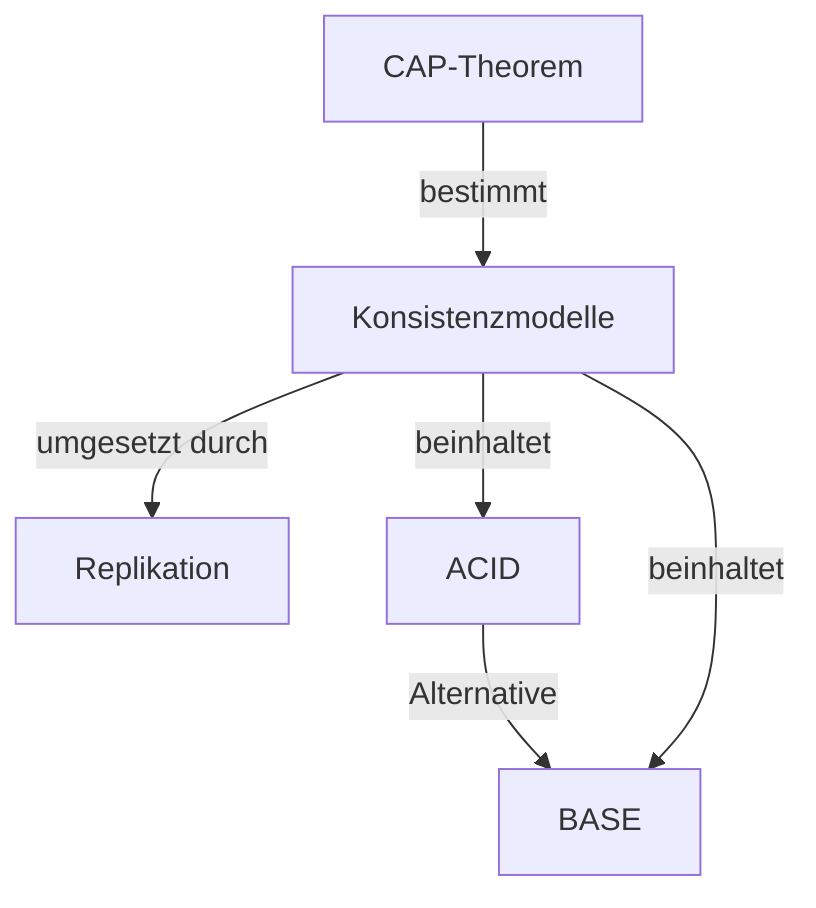

# Konsistenz in Verteilten Systemen

Dieses Kapitel behandelt die fundamentalen Konzepte der Konsistenz in verteilten Systemen – von theoretischen Grenzen über Konsistenzmodelle bis hin zu Replikationsstrategien.

## Inhaltsverzeichnis

| Nr. | Thema | Beschreibung |
|-----|-------|--------------|
| 01 | [[01-CAP-Theorem]] | Fundamentale Trade-offs in verteilten Systemen |
| 02 | [[02-Konsistenzmodelle]] | ACID, BASE und verschiedene Konsistenzstufen |
| 03 | [[03-Replikation]] | Strategien zur Datenhaltung auf mehreren Knoten |

## Überblick

## Lernpfad

1. **Grundlagen**: Beginne mit dem [[01-CAP-Theorem]] um die fundamentalen Trade-offs zu verstehen
2. **Modelle**: Vertiefe mit [[02-Konsistenzmodelle]] die verschiedenen Konsistenzstufen und ACID/BASE
3. **Umsetzung**: Schließe mit [[03-Replikation]] ab, um zu verstehen, wie Konsistenz praktisch erreicht wird

## Kernfragen

- Warum kann ein verteiltes System nicht gleichzeitig konsistent, verfügbar und partitionstolerant sein?
- Was ist der Unterschied zwischen Strong und Eventual Consistency?
- Wann ist welches Konsistenzmodell angemessen?
