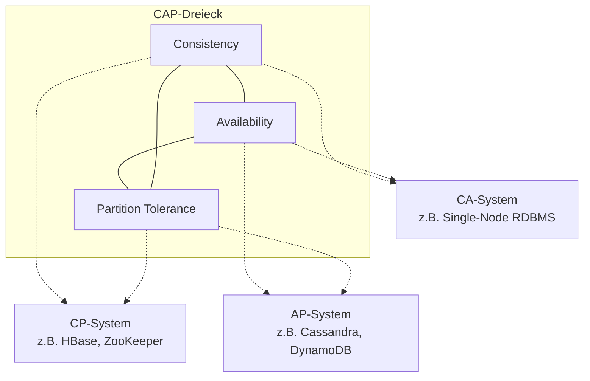
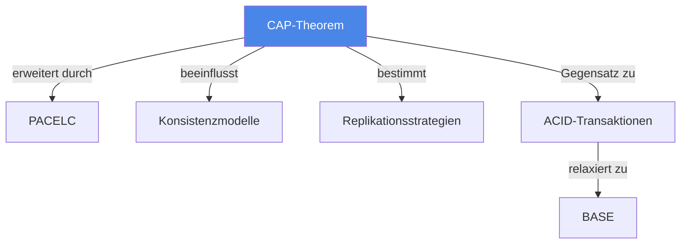

# CAP-Theorem

> [!info] Lernziele
> - CAP-Theorem und seine drei Eigenschaften verstehen
> - Trade-offs in verteilten Systemen erklären können
> - Praktische Systeme als CP oder AP klassifizieren
> - PACELC als Erweiterung kennen

## Einleitung

Das CAP-Theorem ist eines der fundamentalsten Konzepte in verteilten Systemen. Es beschreibt die unvermeidlichen Trade-offs, die Designer bei der Architektur verteilter Datenspeicher treffen müssen.

> [!important] Kernkonzept
> Das CAP-Theorem (Brewer, 2000) besagt: Ein verteiltes System kann höchstens **zwei** der drei Eigenschaften **Consistency** (C), **Availability** (A) und **Partition Tolerance** (P) gleichzeitig garantieren. Da Netzwerkpartitionen in der Praxis unvermeidlich sind, ist P meist unverhandelbar – die Wahl liegt zwischen C und A.

> [!example] Analogie
> Stell dir ein Filialnetz einer Bank vor: Bei einer Netzwerkstörung (Partition) zwischen Filialen kannst du entweder **Konsistenz** wahren (Kontostände werden eingefroren bis die Verbindung wiederhergestellt ist – keine Abhebungen möglich) oder **Verfügbarkeit** (Filialen arbeiten unabhängig weiter, aber Kontostände könnten temporär abweichen). Beides gleichzeitig ist unmöglich.

## Die drei CAP-Eigenschaften

### Consistency (Konsistenz)

> Alle Knoten sehen zur gleichen Zeit dieselben Daten.

- Jede Leseoperation liefert den Wert der letzten Schreiboperation
- Entspricht der **Linearisierbarkeit** in der Theorie
- Erfordert Koordination zwischen allen Knoten

### Availability (Verfügbarkeit)

> Jede Anfrage erhält eine (nicht-fehlerhafte) Antwort – ohne Garantie auf Aktualität.

- Keine Anfrage bleibt unbeantwortet
- System antwortet auch bei Teilausfällen
- Antwort muss korrekt sein (keine Fehlermeldung)

### Partition Tolerance (Partitionstoleranz)

> Das System arbeitet trotz Nachrichtenverlust oder Netzwerkpartitionen weiter.

- Kommunikation zwischen Knoten kann unterbrochen sein
- System muss trotzdem funktionsfähig bleiben
- In verteilten Systemen praktisch unvermeidlich

## CAP-Trade-offs

### Systemklassifikation

| Klasse | Eigenschaften | Verhalten bei Partition | Beispiele |
|--------|---------------|------------------------|-----------|
| **CP** | Consistency + Partition Tolerance | Opfert Verfügbarkeit | HBase, MongoDB (strict), ZooKeeper |
| **AP** | Availability + Partition Tolerance | Opfert Konsistenz | Cassandra, DynamoDB, CouchDB |
| **CA** | Consistency + Availability | Nicht partitionstolerant | Traditionelle RDBMS (single-node) |

> [!warning] Wichtig
> CA-Systeme existieren praktisch nicht in verteilten Umgebungen, da Netzwerkpartitionen nicht ausgeschlossen werden können. Die reale Wahl liegt zwischen CP und AP.

## PACELC-Erweiterung

Das PACELC-Theorem erweitert CAP um das Verhalten im Normalfall (ohne Partition):

> **P**artition → **A**vailability vs. **C**onsistency  
> **E**lse → **L**atency vs. **C**onsistency

| System | Partition | Else (Normal) |
|--------|-----------|---------------|
| Cassandra | AP | EL (niedrige Latenz, eventual consistent) |
| MongoDB | CP | EC (Konsistenz vor Latenz) |
| DynamoDB | AP | EC oder EL (konfigurierbar) |

## Zusammenhänge

---

## Prüfungstipps

> [!warning] Häufige Prüfungsfragen
> - Erklären Sie das CAP-Theorem und seine drei Eigenschaften
> - Klassifizieren Sie gegebene Systeme als CP oder AP
> - Warum gibt es praktisch keine CA-Systeme?

> [!question] Verständnisfragen
> - Was passiert bei einem CP-System während einer Partition?
> - Wie verhält sich ein AP-System bei Netzwerkausfällen?
> - Was bedeutet PACELC und wie erweitert es CAP?

> [!tip] Merkhilfe
> **CAP = "Choose Any Pair"**:
> - **C**onsistency: Alle sehen das Gleiche
> - **A**vailability: Alle bekommen Antwort
> - **P**artition Tolerance: Funktioniert trotz Netzausfall
> 
> Bei Partition (unvermeidlich): CP = "Lieber nichts als Falsches", AP = "Lieber was als nichts"

---

## Weiterführende Ressourcen

- [[02-Konsistenzmodelle]] – Verschiedene Konsistenzstufen
- [[03-Replikation]] – Replikationsstrategien
- [[../01-Grundlagen/02-Eigenschaften]] – ACID-Eigenschaften

---

## Quellen

Die Inhalte basieren auf dem Kurshandbuch "Betriebssysteme, Rechnernetze und verteilte Systeme" der IU Internationalen Hochschule sowie den zugehörigen Vorlesungsmaterialien. Grundlegend ist Eric Brewer's Keynote "Towards Robust Distributed Systems" (PODC 2000) und das formale Proof von Gilbert & Lynch (2002).
