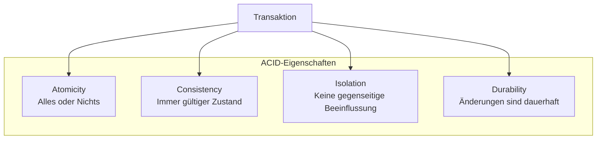
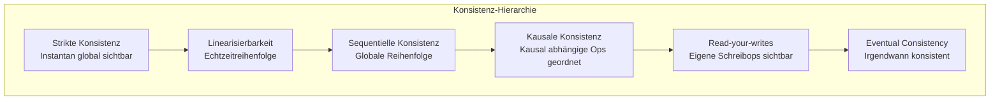
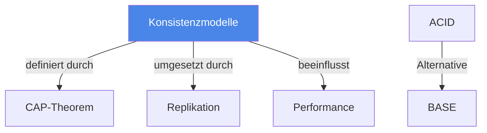

# Konsistenzmodelle

> [!info] Lernziele
> - Verschiedene Konsistenzmodelle kennen und einordnen
> - ACID-Eigenschaften erklären können
> - Unterschied zwischen Strong und Eventual Consistency verstehen
> - Anwendungsfälle für verschiedene Modelle benennen

## Einleitung

Konsistenzmodelle definieren, welche Garantien ein verteiltes System bezüglich der Sichtbarkeit und Reihenfolge von Datenänderungen bietet. Sie bilden die Grundlage für Entscheidungen über Systemarchitekturen.

> [!important] Kernkonzept
> **Konsistenz** garantiert, dass sich Daten für einen Beobachter immer in einem **gültigen Zustand** befinden. Zwischenzustände sind nach außen nicht sichtbar. Je stärker das Konsistenzmodell, desto mehr Koordination ist erforderlich – und desto geringer die Performance.

> [!example] Analogie
> Konsistenzmodelle sind wie verschiedene Nachrichtenkanäle: **Strikte Konsistenz** ist ein Live-Telefonat – beide hören sofort, was der andere sagt. **Eventual Consistency** ist wie ein Gruppenchat mit schlechter Verbindung – alle sehen irgendwann alle Nachrichten, aber nicht unbedingt in derselben Reihenfolge oder zum selben Zeitpunkt.

## ACID-Eigenschaften

Transaktionen in Datenbanksystemen müssen den **ACID-Eigenschaften** genügen:

| Eigenschaft | Beschreibung |
|-------------|--------------|
| **A**tomicity (Atomarität) | Transaktion ist entweder vollständig oder gar nicht – bei Fehlern wird der vorherige Zustand wiederhergestellt |
| **C**onsistency (Konsistenz) | Daten befinden sich immer in einem gültigen Zustand – keine Zwischenzustände sichtbar |
| **I**solation (Isolierung) | Gleichzeitige Zugriffe beeinflussen sich nicht – Schreibzugriffe werden serialisiert |
| **D**urability (Dauerhaftigkeit) | Erfolgreiche Änderungen bleiben auch bei Systemausfällen bestehen |

## Hierarchie der Konsistenzmodelle

Von stark zu schwach geordnet:

### Modelle im Detail

| Modell | Garantie | Performance | Anwendung |
|--------|----------|-------------|-----------|
| **Strikte Konsistenz** | Alle Ops instantan global sichtbar | Sehr niedrig | Theoretisches Ideal |
| **Linearisierbarkeit** | Echtzeitreihenfolge wird eingehalten | Niedrig | Bankensysteme, Locks |
| **Sequentielle Konsistenz** | Eine globale Reihenfolge aller Ops | Mittel | Multi-Prozessor-Systeme |
| **Kausale Konsistenz** | Kausal abhängige Ops geordnet | Höher | Social Media, Messaging |
| **Read-your-writes** | Eigene Schreibops sofort sichtbar | Hoch | Session-basierte Apps |
| **Eventual Consistency** | Konvergenz nach endlicher Zeit | Sehr hoch | DNS, CDNs, Caches |

## Strong vs. Eventual Consistency

| Aspekt | Strong Consistency | Eventual Consistency |
|--------|-------------------|---------------------|
| **Garantie** | Neuester Wert sofort | Irgendwann konsistent |
| **Latenz** | Höher (Koordination nötig) | Niedriger |
| **Verfügbarkeit** | Bei Partition eingeschränkt | Bleibt verfügbar |
| **Komplexität** | System komplexer | Anwendung komplexer |
| **Anwendung** | Finanztransaktionen | Social Media, IoT |

## BASE als Alternative zu ACID

Für hochverfügbare Systeme:

| ACID | BASE |
|------|------|
| **A**tomicity | **B**asically **A**vailable |
| **C**onsistency | **S**oft state |
| **I**solation | **E**ventual consistency |
| **D**urability | – |

## Zusammenhänge

---

## Prüfungstipps

> [!warning] Häufige Prüfungsfragen
> - Erklären Sie die ACID-Eigenschaften
> - Ordnen Sie die Konsistenzmodelle hierarchisch
> - Unterscheiden Sie Strong und Eventual Consistency

> [!question] Verständnisfragen
> - Warum ist strikte Konsistenz praktisch nicht erreichbar?
> - Wann ist Eventual Consistency akzeptabel?
> - Was bedeutet BASE und wie unterscheidet es sich von ACID?

> [!tip] Merkhilfe
> **ACID = Zuverlässig aber langsam** (traditionelle Datenbanken)
> **BASE = Schnell aber eventuell inkonsistent** (NoSQL, verteilte Systeme)
> 
> Eselsbrücke: ACID ist wie ein Bankautomat (sicher), BASE wie ein Social-Media-Feed (schnell, aber manchmal verzögert)

---

## Weiterführende Ressourcen

- [[01-CAP-Theorem]] – Trade-offs in verteilten Systemen
- [[03-Replikation]] – Umsetzung von Konsistenz
- [[../04-Koordination/02-Logische-Uhren]] – Kausalität erfassen

---

## Quellen

Die Inhalte basieren auf dem Kurshandbuch "Betriebssysteme, Rechnernetze und verteilte Systeme" der IU Internationalen Hochschule sowie den zugehörigen Vorlesungsmaterialien. ACID wurde erstmals von Härder & Reuter (1983) formalisiert.
