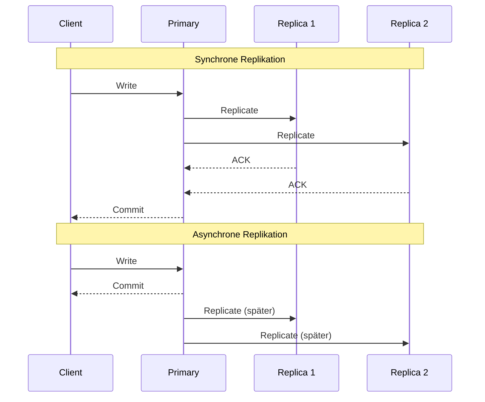
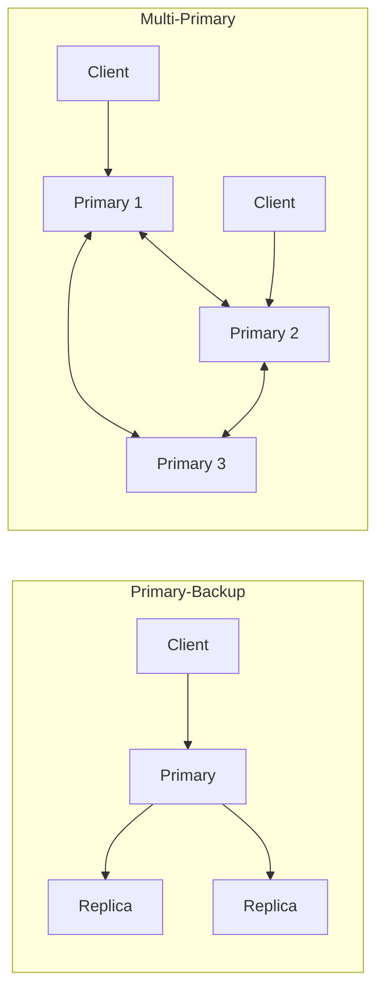
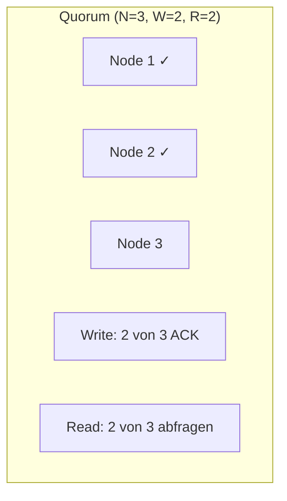
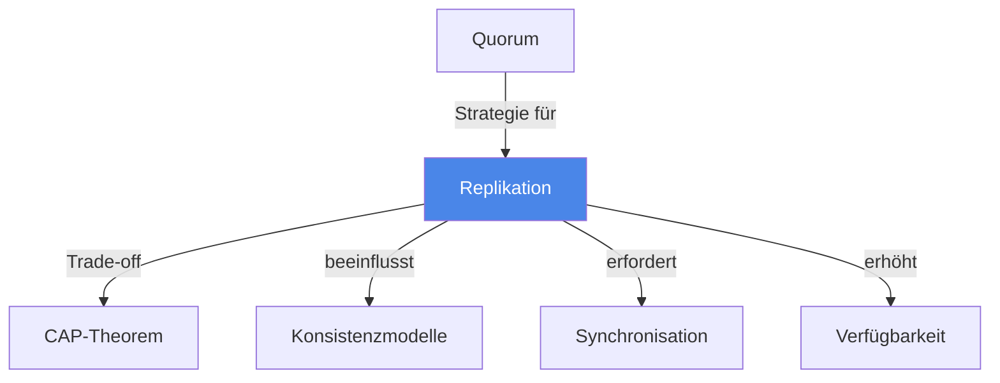

# Replikation

> [!info] Lernziele
> - Replikationsstrategien und ihre Trade-offs verstehen
> - Synchrone vs. asynchrone Replikation unterscheiden
> - Quorum-basierte Replikation erklären können
> - Primary-Backup vs. Multi-Primary Architekturen kennen

## Einleitung

Replikation ist das Speichern von Kopien derselben Daten auf mehreren Knoten eines verteilten Systems. Sie dient der Erhöhung von Verfügbarkeit, Fehlertoleranz und Leseperformance.

> [!important] Kernkonzept
> Replikation schafft **Redundanz**: Dieselben Daten existieren auf mehreren Knoten. Der Trade-off liegt zwischen **Konsistenz** (alle Kopien synchron halten) und **Performance/Verfügbarkeit** (nicht auf alle Kopien warten). Die Wahl der Replikationsstrategie bestimmt das Verhalten des Systems im Fehlerfall.

> [!example] Analogie
> Replikation ist wie das Führen von Kopien eines wichtigen Dokuments: **Synchrone Replikation** entspricht einem Notar, der erst bestätigt, wenn alle Parteien unterschrieben haben – sicher, aber langsam. **Asynchrone Replikation** ist wie eine E-Mail an alle mit dem Dokument – schnell, aber ohne Garantie, dass alle es sofort gelesen haben.

## Replikationsstrategien

### Synchron vs. Asynchron

| Aspekt | Synchron | Asynchron |
|--------|----------|-----------|
| **Latenz** | Höher (wartet auf alle) | Niedriger |
| **Konsistenz** | Strong | Eventual |
| **Verfügbarkeit** | Niedriger bei Ausfällen | Höher |
| **Datenverlust** | Kein | Möglich bei Failover |

### Primary-Backup vs. Multi-Primary

| Architektur | Beschreibung | Vorteile | Nachteile |
|-------------|--------------|----------|-----------|
| **Primary-Backup** | Ein Primary für Schreiboperationen | Einfach, keine Konflikte | Single Point of Failure, Failover nötig |
| **Multi-Primary** | Mehrere Knoten akzeptieren Writes | Höhere Verfügbarkeit | Konfliktauflösung nötig |

## Quorum-basierte Replikation

Bei N Replikaten:
- **W** = Anzahl Knoten, die bei Write bestätigen müssen
- **R** = Anzahl Knoten, die bei Read abgefragt werden

> [!warning] Quorum-Formel
> **R + W > N** garantiert, dass mindestens ein Knoten bei Read den aktuellen Wert hat.

### Konfigurationsbeispiele (N=3)

| Konfiguration | W | R | Eigenschaften |
|---------------|---|---|---------------|
| **Write-optimiert** | 1 | 3 | Schnelle Writes, langsame Reads |
| **Read-optimiert** | 3 | 1 | Langsame Writes, schnelle Reads |
| **Balanced** | 2 | 2 | Kompromiss |

## Vor- und Nachteile

### Vorteile

- **Verfügbarkeit**: System läuft bei Knotenausfällen weiter
- **Performance**: Lesezugriffe können lokal bedient werden
- **Latenz**: Geografisch verteilte Replikate reduzieren Netzwerklatenz
- **Lastverteilung**: Anfragen auf mehrere Knoten verteilen

### Nachteile

- **Komplexität**: Synchronisation und Konfliktauflösung nötig
- **Speicher**: Mehrfache Datenhaltung
- **Konsistenz**: Trade-off mit Performance
- **Bandbreite**: Replikationstraffic

## Zusammenhänge

---

## Prüfungstipps

> [!warning] Häufige Prüfungsfragen
> - Vergleichen Sie synchrone und asynchrone Replikation
> - Erklären Sie die Quorum-Formel R + W > N
> - Was sind Vor- und Nachteile von Primary-Backup?

> [!question] Verständnisfragen
> - Wann kann bei asynchroner Replikation Datenverlust auftreten?
> - Wie löst Multi-Primary Schreibkonflikte?
> - Warum garantiert R + W > N Konsistenz?

> [!tip] Merkhilfe
> **Quorum-Formel**: R + W > N
> - Bei N=3: Wenn W=2 und R=2, dann 2+2=4 > 3 ✓
> - Mindestens ein Knoten hat bei jedem Read den aktuellen Wert
> 
> **Eselsbrücke**: "Read plus Write muss größer als die Anzahl Nodes sein"

---

## Weiterführende Ressourcen

- [[01-CAP-Theorem]] – Trade-offs bei Replikation
- [[02-Konsistenzmodelle]] – Konsistenzgarantien
- [[../04-Koordination/03-Konsensalgorithmen]] – Koordination zwischen Replikaten

---

## Quellen

Die Inhalte basieren auf dem Kurshandbuch "Betriebssysteme, Rechnernetze und verteilte Systeme" der IU Internationalen Hochschule sowie den zugehörigen Vorlesungsmaterialien.
