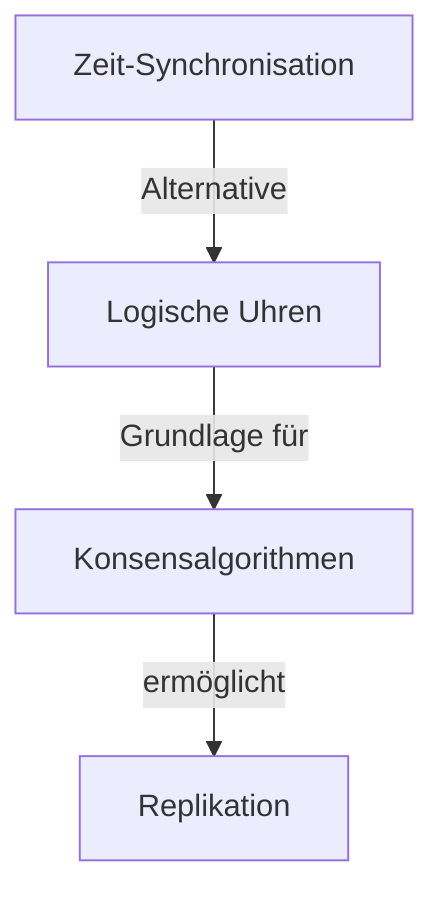

# Koordination in Verteilten Systemen

Dieses Kapitel behandelt Mechanismen zur Koordination zwischen verteilten Knoten – von Zeitsynchronisation über logische Uhren bis hin zu Konsensalgorithmen.

## Inhaltsverzeichnis

| Nr. | Thema | Beschreibung |
|-----|-------|--------------|
| 01 | [[01-Zeit-Synchronisation]] | NTP und Algorithmen zur physikalischen Zeitsynchronisation |
| 02 | [[02-Logische-Uhren]] | Lamport-Uhren, Vektoruhren und kausale Ordnung |
| 03 | [[03-Konsensalgorithmen]] | Paxos, Raft und verteilte Einigung |

## Überblick

## Lernpfad

1. **Physikalisch**: Beginne mit [[01-Zeit-Synchronisation]] um das Problem der Uhrendrift zu verstehen
2. **Logisch**: Lerne mit [[02-Logische-Uhren]] wie kausale Ordnung ohne physikalische Zeit erfasst wird
3. **Konsens**: Schließe mit [[03-Konsensalgorithmen]] ab, um zu verstehen, wie verteilte Systeme Einigung erreichen

## Kernfragen

- Warum ist Zeitsynchronisation in verteilten Systemen so schwierig?
- Was ist der Unterschied zwischen Lamport-Uhren und Vektoruhren?
- Wie können verteilte Systeme trotz Ausfällen Konsens erreichen?
