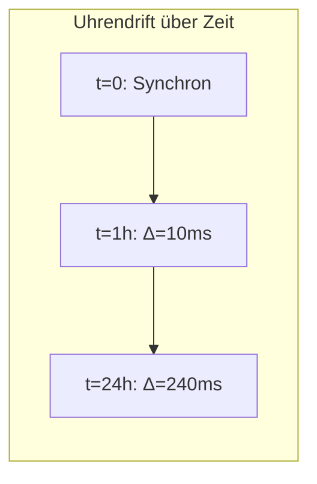
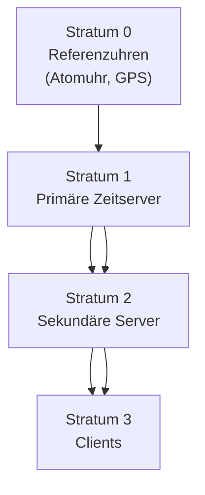
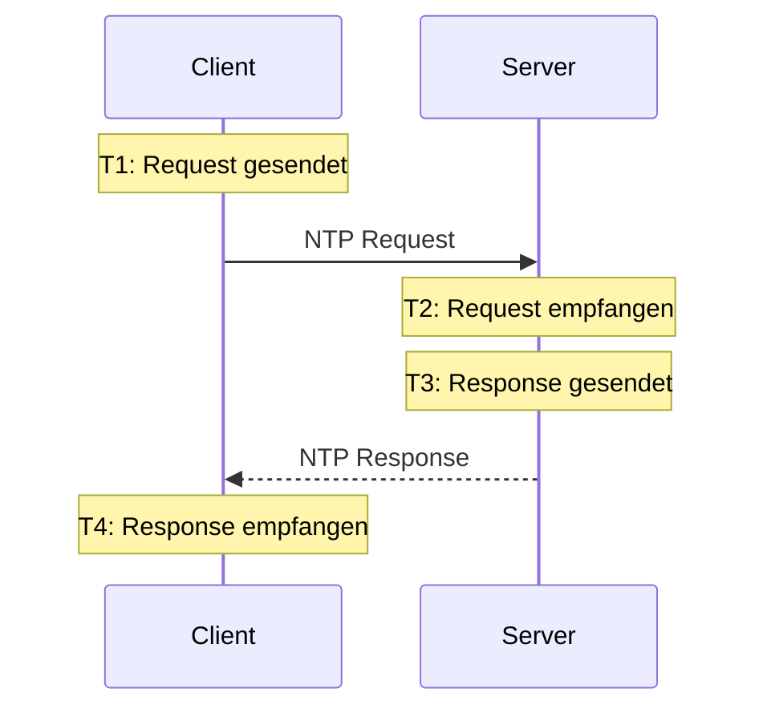
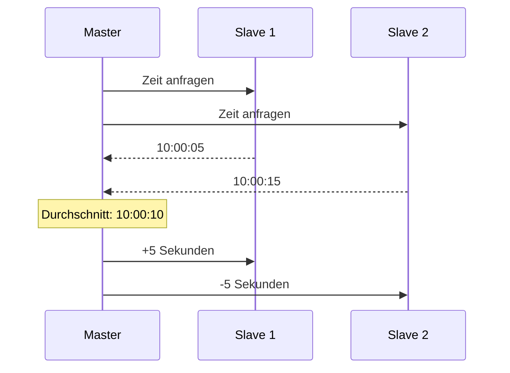
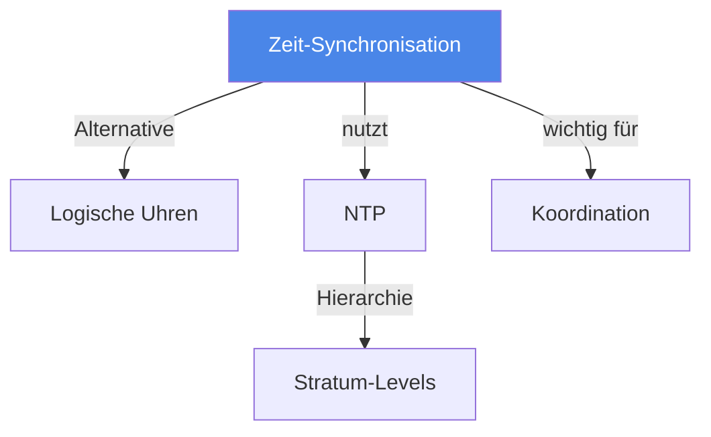

# Zeit-Synchronisation

> [!info] Lernziele
> - Problem der Zeitsynchronisation in verteilten Systemen verstehen
> - NTP-Funktionsweise und Stratum-Hierarchie erklären können
> - Cristians und Berkeley-Algorithmus kennen
> - Grenzen physikalischer Zeitsynchronisation verstehen

## Einleitung

Zeit-Synchronisation ist eine fundamentale Herausforderung in verteilten Systemen. Da physikalische Uhren aufgrund von Quarz-Ungenauigkeiten driften, müssen Mechanismen zur Synchronisation eingesetzt werden.

> [!important] Kernkonzept
> **Physikalische Uhren driften** – keine zwei Uhren laufen exakt gleich. In verteilten Systemen, wo verschiedene Knoten basierend auf Zeitstempeln Entscheidungen treffen, kann Uhrendrift zu inkonsistenten Zuständen führen. Synchronisationsprotokolle wie **NTP** reduzieren diese Drift, können sie aber nicht vollständig eliminieren.

> [!example] Analogie
> Zeit-Synchronisation ist wie das Stellen von Uhren in verschiedenen Büros: Selbst wenn alle Uhren morgens synchronisiert werden, gehen sie abends unterschiedlich – manche vor, manche nach. Ein Mitarbeiter, der um 17:00 Uhr einen Bericht abschickt, könnte laut der Uhr eines anderen Büros "aus der Zukunft" senden. NTP ist wie ein regelmäßiger Rundgang, bei dem alle Uhren nachgestellt werden.

## Probleme physikalischer Uhren

### Uhrendrift



| Problem | Ursache | Auswirkung |
|---------|---------|------------|
| **Drift** | Quarz-Ungenauigkeit | Uhren weichen voneinander ab |
| **Skew** | Unterschiedliche Geschwindigkeit | Relative Abweichung wächst |
| **Offset** | Absoluter Zeitunterschied | Ereignisreihenfolge unklar |

## NTP (Network Time Protocol)

### Stratum-Hierarchie



| Stratum | Beschreibung | Genauigkeit |
|---------|--------------|-------------|
| **0** | Referenzuhren (Atomuhr, GPS) | Nanosekunden |
| **1** | Direkt mit Stratum 0 verbunden | Mikrosekunden |
| **2** | Sekundäre Server | Millisekunden |
| **3+** | Clients, weitere Server | ~10-100ms |

### NTP-Zeitmessung

NTP berechnet Offset und Round-Trip-Delay:

```
Offset θ = ((T2 - T1) + (T3 - T4)) / 2
Delay δ = (T4 - T1) - (T3 - T2)
```



## Synchronisationsalgorithmen

### Cristians Algorithmus

1. Client sendet Request an Zeitserver
2. Server antwortet mit seiner Zeit T
3. Client setzt Uhr auf: T + RTT/2

> [!warning] Limitation
> Geht von symmetrischen Netzwerklatenzen aus, was oft nicht zutrifft.

### Berkeley-Algorithmus

Für Systeme ohne externe Referenz (interne Synchronisation):

1. Master fragt alle Slaves nach ihrer Zeit
2. Master berechnet Durchschnitt (ohne Ausreißer)
3. Master sendet Korrekturen an alle



## Moderne Ansätze

| System | Mechanismus | Genauigkeit |
|--------|-------------|-------------|
| **NTP** | Internet-Protokoll | ~10-100ms |
| **PTP** (IEEE 1588) | Hardware-Zeitstempel | ~1µs |
| **GPS** | Satellitenbasiert | ~10ns |
| **Google TrueTime** | GPS + Atomuhren | ~7ms Unsicherheit |

> [!tip] Google TrueTime
> Spanner nutzt TrueTime, das nicht nur eine Zeit, sondern ein **Intervall** zurückgibt: [earliest, latest]. So kann Unsicherheit explizit berücksichtigt werden.

## Zusammenhänge



---

## Prüfungstipps

> [!warning] Häufige Prüfungsfragen
> - Erklären Sie die NTP-Stratum-Hierarchie
> - Beschreiben Sie Cristians Algorithmus
> - Was sind die Grenzen physikalischer Zeitsynchronisation?

> [!question] Verständnisfragen
> - Warum kann NTP keine perfekte Synchronisation erreichen?
> - Was ist der Unterschied zwischen Drift und Skew?
> - Wann ist der Berkeley-Algorithmus sinnvoll?

> [!tip] Merkhilfe
> **NTP Stratum = Schichten wie bei Erdöl**:
> - Stratum 0 = Quelle (Atomuhr) – das Beste
> - Je höher die Zahl, desto weiter entfernt und ungenauer
> 
> **Cristian**: Server hat die Zeit → Client stellt nach
> **Berkeley**: Demokratie → Durchschnitt aller Uhren

---

## Weiterführende Ressourcen

- [[02-Logische-Uhren]] – Alternative ohne physikalische Zeit
- [[03-Konsensalgorithmen]] – Koordination zwischen Knoten
- [[../03-Konsistenz/01-CAP-Theorem]] – Bedeutung für Konsistenz

---

## Quellen

Die Inhalte basieren auf dem Kurshandbuch "Betriebssysteme, Rechnernetze und verteilte Systeme" der IU Internationalen Hochschule sowie den zugehörigen Vorlesungsmaterialien. NTP ist in RFC 5905 spezifiziert.
