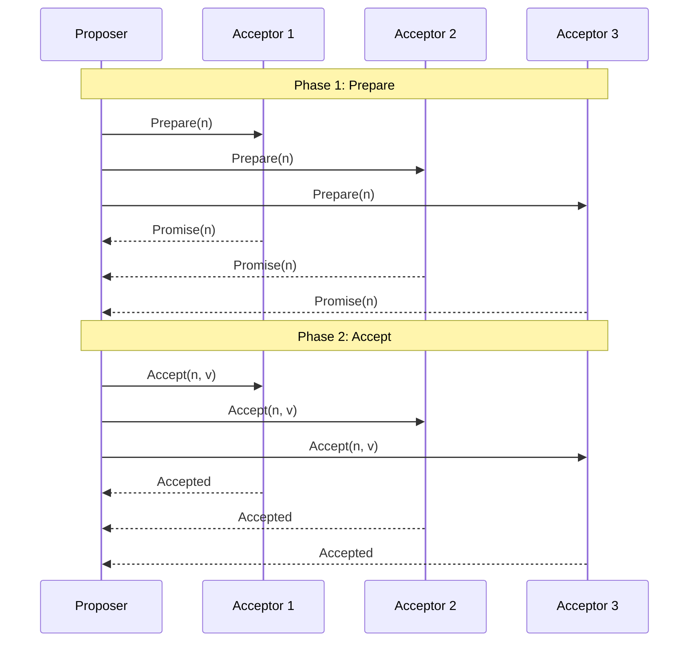
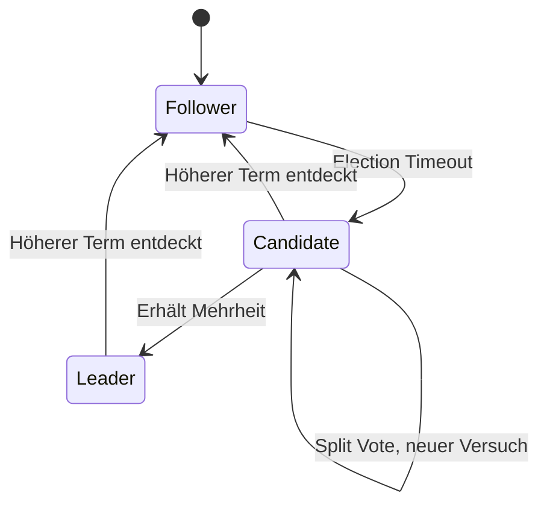
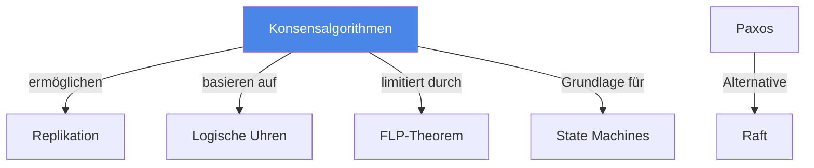

# Konsensalgorithmen

> [!info] Lernziele
> - Das Konsensproblem in verteilten Systemen verstehen
> - Paxos-Algorithmus erklären können
> - Raft als verständlichere Alternative kennen
> - FLP-Unmöglichkeitstheorem verstehen

## Einleitung

Konsensalgorithmen ermöglichen es verteilten Systemen, sich auf einen gemeinsamen Wert oder eine Entscheidung zu einigen, selbst wenn einzelne Knoten ausfallen. Sie sind fundamental für replizierte State Machines, Leader Election und verteilte Datenbanken.

> [!important] Kernkonzept
> Das **Konsensproblem**: Mehrere verteilte Prozesse müssen sich auf einen gemeinsamen Wert einigen. Die Herausforderung: Prozesse können ausfallen, Nachrichten können verloren gehen oder verzögert werden. Ein Konsensalgorithmus garantiert, dass alle korrekten Prozesse denselben Wert akzeptieren.

> [!example] Analogie
> Konsens ist wie eine Abstimmung in einer Gruppe mit schlechter Telefonverbindung: Alle sollen sich auf ein Restaurant einigen, aber manche Teilnehmer sind nicht erreichbar, und Nachrichten kommen verzögert oder gar nicht an. Trotzdem muss am Ende eine Entscheidung stehen, auf die sich alle einigen können.

## Konsensproblem

### Anforderungen

| Eigenschaft | Beschreibung |
|-------------|--------------|
| **Agreement** | Alle korrekten Prozesse einigen sich auf denselben Wert |
| **Validity** | Der gewählte Wert wurde von mindestens einem Prozess vorgeschlagen |
| **Termination** | Alle korrekten Prozesse treffen irgendwann eine Entscheidung |
| **Integrity** | Ein Prozess entscheidet höchstens einmal |

### Fehlermodelle

| Fehlertyp | Beschreibung | Benötigte Knoten |
|-----------|--------------|------------------|
| **Crash-Failure** | Knoten stoppt, sendet keine falschen Nachrichten | 2f + 1 für f Fehler |
| **Byzantine** | Knoten kann beliebig falsch handeln | 3f + 1 für f Fehler |

## FLP-Unmöglichkeitstheorem

> [!warning] FLP-Theorem (Fischer, Lynch, Paterson, 1985)
> In einem **asynchronen** System ist es **unmöglich**, einen deterministischen Konsensalgorithmus zu konstruieren, der alle drei Eigenschaften (Agreement, Validity, Termination) garantiert, wenn auch nur ein Prozess ausfallen kann.

**Konsequenz**: Praktische Algorithmen nutzen:
- Timeouts (machen System teilweise synchron)
- Randomisierung
- Schwächere Garantien

## Paxos

### Rollen

| Rolle | Aufgabe |
|-------|---------|
| **Proposer** | Schlägt Werte vor |
| **Acceptor** | Stimmt über Vorschläge ab |
| **Learner** | Lernt den akzeptierten Wert |

### Phasen

1. **Phase 1a (Prepare)**: Proposer sendet Prepare(n) mit Proposal-Nummer n
2. **Phase 1b (Promise)**: Acceptor antwortet mit Promise, wenn n höher als alle bisherigen
3. **Phase 2a (Accept)**: Proposer sendet Accept(n, v) mit Wert v
4. **Phase 2b (Accepted)**: Acceptor akzeptiert, wenn kein höheres n gesehen

## Raft

Raft wurde als "verständlichere Alternative zu Paxos" entwickelt.

### Rollen

| Rolle | Beschreibung |
|-------|--------------|
| **Leader** | Einziger, der Anfragen verarbeitet und Log repliziert |
| **Follower** | Passiv, reagiert auf Leader |
| **Candidate** | Bewirbt sich als Leader |

### Leader Election

### Ablauf

1. **Leader Election**: Bei Timeout wählen Knoten neuen Leader
2. **Log Replication**: Leader repliziert Einträge zu Followern
3. **Safety**: Nur Knoten mit vollständigem Log können Leader werden

## Vergleich

| Aspekt | Paxos | Raft |
|--------|-------|------|
| **Verständlichkeit** | Komplex | Einfacher |
| **Leader** | Optional | Zwingend |
| **Log-Ordnung** | Beliebig | Strikt |
| **Praktischer Einsatz** | Chubby, Spanner | etcd, CockroachDB |

## Praktische Implementierungen

| System | Algorithmus | Anwendung |
|--------|-------------|-----------|
| **Google Chubby** | Paxos | Lock-Service |
| **Google Spanner** | Paxos | Global verteilte DB |
| **etcd** | Raft | Kubernetes, Config |
| **Apache ZooKeeper** | Zab | Koordination |
| **CockroachDB** | Raft | Verteilte SQL-DB |

## Zusammenhänge

---

## Prüfungstipps

> [!warning] Häufige Prüfungsfragen
> - Erklären Sie die zwei Phasen von Paxos
> - Was besagt das FLP-Theorem?
> - Beschreiben Sie die Leader Election in Raft

> [!question] Verständnisfragen
> - Warum braucht man für f Crash-Failures 2f+1 Knoten?
> - Wie umgehen praktische Algorithmen das FLP-Theorem?
> - Was passiert bei einem Split Vote in Raft?

> [!tip] Merkhilfe
> **Paxos**: "Prepare-Promise, Accept-Accepted" (2 Phasen, 2 Schritte)
> 
> **Raft**: "Leader macht alles" – einfacher zu verstehen
> - **F**ollower: Passiv, wartet
> - **C**andidate: Bewirbt sich
> - **L**eader: Aktiv, repliziert
> 
> **FLP**: "Asynchron + 1 Fehler = Unmöglich" (deterministisch)

---

## Weiterführende Ressourcen

- [[02-Logische-Uhren]] – Ordnung für Konsens
- [[01-Zeit-Synchronisation]] – Timing für Timeouts
- [[../03-Konsistenz/03-Replikation]] – Anwendung von Konsens

---

## Quellen

Die Inhalte basieren auf dem Kurshandbuch "Betriebssysteme, Rechnernetze und verteilte Systeme" der IU Internationalen Hochschule sowie den zugehörigen Vorlesungsmaterialien. Grundlegend sind Lamports "Paxos Made Simple" und das Raft-Paper von Ongaro & Ousterhout (2014).
