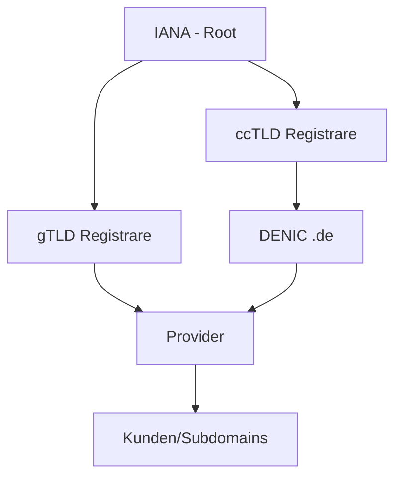

# DNS – Domain Name System

> [!info] Lernziele
> - DNS-Funktionsweise verstehen
> - Zusammenspiel von DNS und IP-Kommunikation erklären
> - Forward- und Reverse-Lookup unterscheiden
> - DNS-Befehle anwenden können

## Überblick

**DNS** steht für **Domain Name System** (auch: Domain Name Service) und bildet uns vertraute Domainnamen auf IP-Adressen ab.

### Warum DNS?

- **Menschen** können sich Namen besser merken als Zahlen
- **Entkopplung** von Name und IP-Adresse ermöglicht einfachere Migration von Rechnern in andere Netze
- **Eindeutigkeit** durch hierarchische Baumstruktur

### DNS in der Kommunikationskette

DNS kommt in der ARP/IPv4-Kommunikation **vor** der eigentlichen Kontaktaufnahme zum Zielrechner:

```
┌─────────────────────────────────────────────────────────────────┐
│ Schritt 0: DNS-Anfrage beim DNS-Server                          │
│            (wenn nur Domain-Name bekannt)                       │
├─────────────────────────────────────────────────────────────────┤
│ Schritt 1: Berechne, ob Ziel-IP in eigener Broadcast-Domain     │
├─────────────────────────────────────────────────────────────────┤
│ Schritt 1.A: Wenn ja → ARP-Request direkt                       │
│ Schritt 1.B: Wenn nein → ARP-Request zum Router (Weiterleitung) │
└─────────────────────────────────────────────────────────────────┘
```

## Domain-Hierarchie

### Root und Top-Level-Domains

Die **IANA** (Internet Assigned Numbers Authority) verwaltet Root und Top-Level-Domains (TLD):

| Typ | Beschreibung | Beispiele |
|-----|--------------|-----------|
| **gTLD** | Generic Top-Level-Domains | .com, .org, .net, .info |
| **ccTLD** | Country Code TLDs (ISO-3166-1) | .de, .at, .ch, .uk |

> [!note] Historisch
> Von den initialen sieben gTLDs aus 1985 waren zunächst nur drei frei registrierbar. 2001 hat die IANA neue aufgenommen.

### Verwaltungsstruktur



- Die **DENIC** verwaltet die .de-Domain
- Provider registrieren Domains im Namen ihrer Kunden
- Manche Provider bieten eigene Subdomains als Service an

## DNS-Server

### Regeln für Nameserver

1. **Jeder Registrar** muss einen weltweit zugänglichen Nameserver betreiben
2. **Weitergabe der Adressen**: Wer Adressbereiche weiterreicht, gibt die Nameserver-Adresse mit
3. **Gateway-Konfiguration**: Jeder Nameserver kennt einen übergeordneten Server für unbekannte Anfragen
4. **Reverse-DNS**: Nameserver reichen eigene `in-addr.arpa`-Subbäume nach oben weiter

### Forward- und Reverse-Lookup

Jeder Nameserver hat zwei Bereiche:

#### Forward-Lookup-Zone

Auflösung von **Namen → IP-Adressen**:

- Baum mit allen auflösbaren Domainnamen
- An den Blättern sind IP-Adressen vermerkt
- Nicht auflösbare Namen werden an höhere Instanzen weitergereicht

```bash
# Namen zur IPv4-Adresse auflösen
nslookup example.com
```

#### Reverse-Lookup-Zone

Auflösung von **IP-Adressen → Namen**:

- Baum mit allen IP-Adressen
- An den Blättern sind Domainnamen vermerkt

```bash
# IPv4-Adresse zum Namen auflösen
nslookup 8.8.8.8
```

## Praktische Anwendung

### DNS-Befehle

| Befehl | Beschreibung |
|--------|--------------|
| `nslookup <domain>` | Domain zu IP auflösen |
| `nslookup <ip>` | IP zu Domain auflösen |
| `dig <domain>` | Detaillierte DNS-Abfrage (Linux) |
| `host <domain>` | Einfache DNS-Abfrage (Linux) |

### Beispiel: Google DNS

```bash
# IP-Adresse von dns.google ermitteln
$ nslookup dns.google
Server:  192.168.1.1
Address: 192.168.1.1#53

Non-authoritative answer:
Name:    dns.google
Address: 8.8.8.8
Address: 8.8.4.4

# Reverse-Lookup
$ nslookup 8.8.8.8
8.8.8.8.in-addr.arpa    name = dns.google.
```

---

> [!tip] Übung
> 1. Ermitteln Sie die IP-Adresse von `dns.google`
> 2. Ermitteln Sie den Domainnamen von `8.8.8.8`
> 3. Vergleichen Sie die Ergebnisse von `nslookup` und `dig`

## Weiterführende Links

- [netplanet.org](https://www.netplanet.org) – Grundlagen Internetprotokolle
- [ISO-3166-1 Ländercodes](https://de.wikipedia.org/wiki/ISO-3166-1-Kodierliste)
- [DENIC](https://www.denic.de/) – Deutsche Domainverwaltung

---

> [!quote] Quellenhinweis
> Basiert auf Materialien von proTirone (Karsten Reincke), lizenziert unter CC-BY-4.0.
> Inhalte wurden für das Open-Lectures-Format angepasst.
