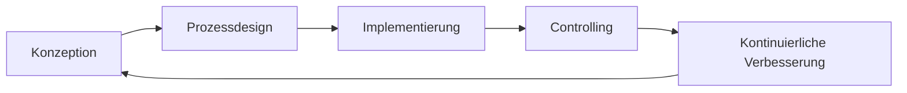

# Prozessdokumentation – Grundlagen

> [!info] Lernziele
> - Prozessbegriff definieren und anwenden
> - Geschäftsprozesse analysieren
> - Prozessebenen und -phasen unterscheiden
> - Dokumentationstechniken auswählen

## Prozessbegriff

### Definition: Prozess

**Prozesse** im Allgemeinen:
- Sind **Schrittfolgen**, die einen initialen Zustand in einen anderen überführen
- Sind als Schrittfolgen **beschreibbar** und **wiederholbar**
- **Transformieren** Input zu Output (sowohl als Ganzes als auch auf Schrittebene)
- Haben eine **innere Ordnung**, die sich im Kontrollfluss manifestiert

```
┌─────────┐     ┌─────────┐     ┌─────────┐     ┌─────────┐
│  Input  │────▶│Schritt 1│────▶│Schritt 2│────▶│ Output  │
└─────────┘     └─────────┘     └─────────┘     └─────────┘
                     │               │
                     └───────────────┘
                      Kontrollfluss
```

### Definition: Geschäftsprozess

Ein **Geschäftsprozess** ist:
- Ein **wiederkehrender, unternehmensbezogener** Arbeitsablauf
- Soll ein **unternehmensbezogenes Ziel** erreichen
- Lässt sich als **Abfolge von Einzelschritten** darstellen
- Findet **wiederholt** statt
- Wird oft **arbeitsteilig** ausgeführt
- **Startet** mit Input (Informationen und/oder Ressourcen)
- **Endet** mit Output (Informationen und/oder Produkte)

## Prozessanalyse

### Analyseebenen

| Ebene | Fokus | Beispiel |
|-------|-------|----------|
| **Strategisch** | Unternehmensziele, Marktposition | "Marktführer werden" |
| **Fachlich-konzeptionell** | Abläufe, Verantwortlichkeiten | "Bestellprozess optimieren" |
| **Operativ** | Tägliche Ausführung | "Bestellung erfassen" |

### Implementierungsphasen



1. **Konzeption** – Anforderungen erfassen
2. **Prozessdesign** – Ablauf modellieren
3. **Prozessimplementierung** – In IT-Systeme umsetzen
4. **Prozess-Controlling** – Kennzahlen überwachen
5. **Kontinuierliche Verbesserung** – Optimierungen durchführen

### Betrachtungsperspektiven

| Perspektive | Fragestellung |
|-------------|---------------|
| **Organisatorisch** | Wer ist verantwortlich? Welche Abteilungen? |
| **Geschäftsobjekt** | Was wird verarbeitet? (Daten, Waren, Dokumente) |
| **Prozess als Objekt** | Wie effizient? Wie messbar? |
| **Ressourcen** | Welche Mittel werden benötigt? |

> [!important] Kernaussage
> Keine verschiedenen Blickwinkel ohne **Prozessdokumentation**.
> Keine Prozessdokumentation ohne **Prozessanalyse**.

## Dokumentationstechniken

### Übersicht

| Technik | Stärke | Einsatzgebiet |
|---------|--------|---------------|
| **Flussdiagramm** | Einfach, universell | Algorithmen, einfache Abläufe |
| **UML-Aktivitätsdiagramm** | Präzise, standardisiert | Softwareentwicklung |
| **UML-Sequenzdiagramm** | Interaktionen zwischen Akteuren | Kommunikationsabläufe |
| **BPMN** | Geschäftsprozess-Standard | Unternehmensweite Prozesse |
| **EPK** | Ereignisgesteuert | SAP-Umfeld, deutsche Unternehmen |

### Flussdiagramm

Einfachste Form der Prozessdokumentation:

```
    ┌─────────────┐
    │   Start     │
    └──────┬──────┘
           ▼
    ┌─────────────┐
    │  Schritt 1  │
    └──────┬──────┘
           ▼
      ◇─────────◇
     ╱ Bedingung ╲
    ◇─────────────◇
    │ Ja      │ Nein
    ▼         ▼
┌───────┐ ┌───────┐
│Schritt│ │Schritt│
│  2a   │ │  2b   │
└───┬───┘ └───┬───┘
    └────┬────┘
         ▼
    ┌─────────────┐
    │    Ende     │
    └─────────────┘
```

**Symbole:**
- ⬭ Oval: Start/Ende
- ▭ Rechteck: Aktivität/Schritt
- ◇ Raute: Entscheidung
- → Pfeil: Kontrollfluss

### BPMN (Business Process Model and Notation)

Industriestandard für Geschäftsprozessmodellierung:

**Grundelemente:**
- **Events** (Kreise): Start, Zwischen, Ende
- **Activities** (Rechtecke): Tasks, Sub-Prozesse
- **Gateways** (Rauten): Entscheidungen, Parallelisierung
- **Flows** (Pfeile): Sequenz-, Nachrichten-, Assoziationsfluss

### EPK (Ereignisgesteuerte Prozesskette)

Besonders in Deutschland verbreitet (SAP-Umfeld):

**Grundelemente:**
- **Ereignis** (Sechseck): Zustand, der eingetreten ist
- **Funktion** (Rechteck mit abgerundeten Ecken): Auszuführende Tätigkeit
- **Konnektoren**: UND, ODER, XOR für Verzweigungen

## Beispiel: Einfacher Prozess

### Unix-Pipeline als Prozess

```bash
cat MIT.dirty.txt | \
  sed 's/  */ /g' | \
  tr -d '\r' | \
  tr '\n' '$' | \
  sed 's/\$\$/\n\n/g' | \
  tr -d '$' \
>> cleaned.txt
```

**Prozessschritte:**
1. `cat` – Liest Daten aus Datei
2. `sed` – Ersetzt mehrfache Leerzeichen
3. `tr -d '\r'` – Entfernt Carriage Returns
4. `tr '\n' '$'` – Ersetzt Zeilenumbrüche durch $
5. `sed` – Wandelt $$ in Absätze um
6. `tr -d '$'` – Entfernt verbleibende $

### Als Aktivitätsdiagramm

```
┌───────────────────┐
│ Datei einlesen    │
└─────────┬─────────┘
          ▼
┌───────────────────┐
│ Mehrfache Spaces  │
│ normalisieren     │
└─────────┬─────────┘
          ▼
┌───────────────────┐
│ CR entfernen      │
└─────────┬─────────┘
          ▼
┌───────────────────┐
│ Zeilenumbrüche    │
│ markieren         │
└─────────┬─────────┘
          ▼
┌───────────────────┐
│ Absätze           │
│ wiederherstellen  │
└─────────┬─────────┘
          ▼
┌───────────────────┐
│ Markierungen      │
│ entfernen         │
└─────────┬─────────┘
          ▼
┌───────────────────┐
│ Ergebnis speichern│
└───────────────────┘
```

---

> [!tip] Übungen
> 1. Dokumentieren Sie einen alltäglichen Prozess (z.B. Einkaufen) als BPMN-Diagramm
> 2. Vergleichen Sie die Darstellung desselben Prozesses als Flussdiagramm und EPK
> 3. Identifizieren Sie Optimierungspotenziale in einem dokumentierten Prozess

## Weiterführende Literatur

- Kersken: Daten- und Prozessanalyse für Fachinformatiker*innen, 2021, S. 424ff
- [BPMN 2.0 Spezifikation](https://www.omg.org/spec/BPMN/)
- [EPK bei Wikipedia](https://de.wikipedia.org/wiki/Ereignisgesteuerte_Prozesskette)

---

> [!quote] Quellenhinweis
> Basiert auf Materialien von proTirone (Karsten Reincke), lizenziert unter CC-BY-4.0.
> Inhalte wurden für das Open-Lectures-Format angepasst.
