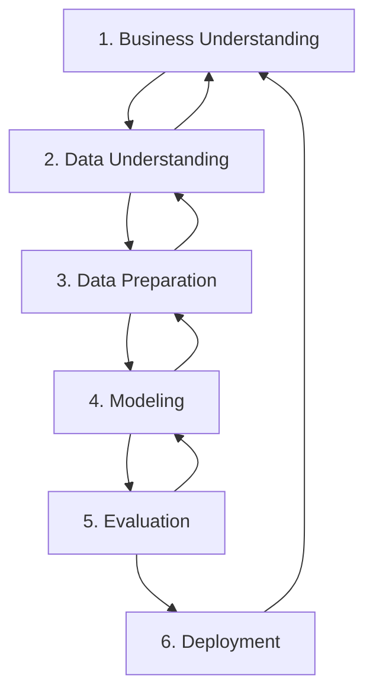

# Datenqualität – Kriterien und Bewertung

> [!info] Lernziele
> - Datenqualitätskriterien definieren und anwenden
> - Vollständigkeit und Korrektheit unterscheiden
> - Konsistenz und Redundanzfreiheit prüfen
> - CRISP-DM-Prozess verstehen

## Definition

**Datenqualität** bezeichnet die Güte der Daten hinsichtlich:
- Wie gut bilden sie einen **Weltausschnitt** ab?
- Inwieweit können sie **weiterverwendet** werden?

## Qualitätskriterien

### Vollständigkeit

> *Erfassen die Daten den Weltausschnitt hinreichend umfassend?*
> *Sind sie für die Weiterverarbeitung hinreichend komplett?*

**Beispiel:** Ein Algorithmus zur Auflistung aller Schüler einer Klasse ist **vollständig**, wenn er **alle** Schüler dieser Klasse ausgibt.

### Korrektheit

> *Erfassen die Daten den Weltausschnitt hinreichend genau?*
> *Ist die Datenerfassung transparent?*
> *Sind Manipulationen ausgeschlossen?*

**Beispiel:** Ein Algorithmus ist **korrekt**, wenn er **nur** Schüler der fraglichen Klasse ausgibt (keine falschen Einträge).

### Zusammenhang aus der Logik

| Eigenschaft | Nur vollständig | Nur korrekt |
|-------------|-----------------|-------------|
| **Ergebnis** | Gibt alle richtigen aus + evtl. falsche | Gibt nur richtige aus, aber evtl. nicht alle |
| **Problem** | False Positives | False Negatives |

> [!tip] Ideal
> Ein **vollständiger UND korrekter** Algorithmus gibt **genau** die richtigen Ergebnisse aus – nicht mehr und nicht weniger.

### Konsistenz

**Widerspruchsfreiheit** der Daten:

| Art | Beschreibung |
|-----|--------------|
| **Innere Konsistenz** | Daten widersprechen sich nicht intern |
| **Äußere Konsistenz** | Daten widersprechen nicht anderen Quellen |

> [!quote] Aristoteles
> "Etwas kann nicht in derselben Hinsicht zugleich zukommen und nicht zukommen."

**Beispiel:** Zwei Messverfahren für die Gravitationskonstante liefern unterschiedliche Werte. Die Daten jedes Verfahrens können **intern konsistent** sein, auch wenn sie **extern inkonsistent** (widersprüchlich) zueinander sind.

### Redundanzfreiheit

> *Ist dieselbe Tatsache mehrfach erfasst?*

**Probleme bei Redundanz:**
- Erhöhter **Verarbeitungsaufwand**
- **Inkonsistenzgefahr** bei Updates
- Oft durch **Daten-Merging** verursacht

### Verfügbarkeit

| Aspekt | Fragestellung |
|--------|---------------|
| **Technisch** | Sind die Daten technisch verarbeitbar? |
| **Rechtlich** | Sind die Daten rechtlich nutzbar? (DSGVO, Urheberrecht) |

### Einheitlichkeit

> *Ist das syntaktische Format konsistent?*
> *Entspricht es einem Standard?*

**Beispiele:**
- Datumsformat: `DD.MM.YYYY` vs. `YYYY-MM-DD`
- Dezimaltrennzeichen: `,` vs. `.`
- Zeichencodierung: UTF-8 vs. Latin-1

## Datenformate

### Strukturierte Datenformate

| Format | Beschreibung | Beispiel |
|--------|--------------|----------|
| **JSON** | JavaScript Object Notation | `{"name": "Max", "age": 25}` |
| **XML** | Extensible Markup Language | `<person><name>Max</name></person>` |
| **CSV** | Comma-Separated Values | `Max,Müller,25` |
| **YAML** | YAML Ain't Markup Language | `name: Max` |
| **INI** | Schlüssel-Wert-Paare | `name=Max` |

### Beispiele

**JSON:**
```json
{
  "students": [
    {"name": "Anna", "grade": 1.3},
    {"name": "Ben", "grade": 2.0}
  ]
}
```

**CSV:**
```csv
name,grade
Anna,1.3
Ben,2.0
```

**XML:**
```xml
<students>
  <student>
    <name>Anna</name>
    <grade>1.3</grade>
  </student>
</students>
```

## CRISP-DM

### Cross Industry Standard Process for Data Mining

Für **sehr große Datenmengen**, bei denen klassische Qualitätsprüfung nicht mehr möglich ist:



### Phasen

| Phase | Beschreibung |
|-------|--------------|
| **1. Business Understanding** | Geschäftsziele und Anforderungen verstehen |
| **2. Data Understanding** | Daten sammeln, erkunden, Qualität prüfen |
| **3. Data Preparation** | Daten bereinigen, transformieren, integrieren |
| **4. Modeling** | Data-Mining-Methoden auswählen und anwenden |
| **5. Evaluation** | Ergebnisse mit Geschäftszielen abgleichen |
| **6. Deployment** | Erkenntnisse in Produktion überführen |

## Prüfung der Datenqualität

### Checkliste

```
┌─────────────────────────────────────────────────────────────┐
│                 DATENQUALITÄTS-CHECK                        │
├─────────────────────────────────────────────────────────────┤
│ □ Vollständigkeit                                           │
│   ├─ Alle erwarteten Datensätze vorhanden?                  │
│   └─ Alle Pflichtfelder gefüllt?                            │
├─────────────────────────────────────────────────────────────┤
│ □ Korrektheit                                               │
│   ├─ Werte plausibel? (z.B. Alter > 0)                      │
│   └─ Keine offensichtlichen Fehler?                         │
├─────────────────────────────────────────────────────────────┤
│ □ Konsistenz                                                │
│   ├─ Keine Widersprüche innerhalb der Daten?                │
│   └─ Übereinstimmung mit anderen Quellen?                   │
├─────────────────────────────────────────────────────────────┤
│ □ Redundanzfreiheit                                         │
│   └─ Keine Duplikate?                                       │
├─────────────────────────────────────────────────────────────┤
│ □ Einheitlichkeit                                           │
│   ├─ Einheitliches Format?                                  │
│   └─ Standardkonform?                                       │
├─────────────────────────────────────────────────────────────┤
│ □ Verfügbarkeit                                             │
│   ├─ Technisch zugreifbar?                                  │
│   └─ Rechtlich nutzbar?                                     │
└─────────────────────────────────────────────────────────────┘
```

### Automatisierte Prüfung (Python-Beispiel)

```python
import pandas as pd

def check_data_quality(df):
    """Einfache Datenqualitätsprüfung"""
    report = {}
    
    # Vollständigkeit
    report['missing_values'] = df.isnull().sum().to_dict()
    report['completeness'] = 1 - df.isnull().sum().sum() / df.size
    
    # Duplikate (Redundanz)
    report['duplicates'] = df.duplicated().sum()
    
    # Datentypen (Einheitlichkeit)
    report['dtypes'] = df.dtypes.to_dict()
    
    return report

# Anwendung
df = pd.read_csv('data.csv')
quality = check_data_quality(df)
print(f"Vollständigkeit: {quality['completeness']:.2%}")
print(f"Duplikate: {quality['duplicates']}")
```

---

> [!tip] Übungen
> 1. Prüfen Sie einen Datensatz auf alle Qualitätskriterien
> 2. Erstellen Sie ein Python-Skript zur automatisierten Qualitätsprüfung
> 3. Dokumentieren Sie Qualitätsmängel und Korrekturmaßnahmen

## Weiterführende Links

- [CRISP-DM bei Wikipedia](https://de.wikipedia.org/wiki/Cross_Industry_Standard_Process_for_Data_Mining)
- [Pandas Dokumentation](https://pandas.pydata.org/docs/)

---

> [!quote] Quellenhinweis
> Basiert auf Materialien von proTirone (Karsten Reincke), lizenziert unter CC-BY-4.0.
> Inhalte wurden für das Open-Lectures-Format angepasst.
