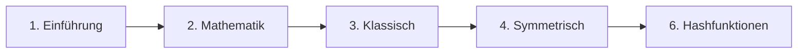

# Lernpfade

## Übersicht

Je nach Zielgruppe und Vorkenntnissen empfehlen wir unterschiedliche Lernpfade durch die Schulung.

---

## 🟢 Grundlagen (Einsteiger)

**Zielgruppe:** Technisch interessierte Einsteiger ohne Vorkenntnisse

**Module:** 1 → 2 → 3 → 4 → 6

**Dauer:** ca. 15–18 Stunden

**Lernziele:**
- Kryptographische Grundbegriffe verstehen
- Symmetrische Verschlüsselung anwenden können
- Hashfunktionen und deren Einsatzzwecke kennen

---

## 🔵 Softwareentwicklung

**Zielgruppe:** Entwickler, die Kryptographie in Anwendungen einsetzen

**Module:** 1 → 2 → 3 → 4 → 5 → 6 → 7 → 9 → 12

**Dauer:** ca. 30–35 Stunden

**Lernziele:**
- Kryptographische APIs sicher nutzen
- Typische Fehler vermeiden
- Protokolle wie TLS verstehen

**Empfehlung:** Ergänzend [[00-SecDev-Index|Modul 19: Secure Software Development]]

---

## 🟠 IT-Administration

**Zielgruppe:** Systemadministratoren, DevOps-Engineers

**Module:** 1 → 4 → 5 → 6 → 7 → 8 → 9 → 10 → 11 → 14

**Dauer:** ca. 35–40 Stunden

**Lernziele:**
- PKI und Zertifikate verwalten
- Schlüsselmanagement umsetzen
- Verschlüsselung in der Praxis einsetzen

**Empfehlung:** [[00-Uebungen-Index|Modul 15: Praktische Übungen]]

---

## 🔴 IT-Security

**Zielgruppe:** Security Engineers, Penetration Tester

**Module:** 1–14 (alle Kernmodule)

**Dauer:** ca. 50–60 Stunden

**Lernziele:**
- Umfassendes Verständnis aller Verfahren
- Schwachstellen erkennen und bewerten
- Sicherheitsarchitekturen entwerfen

**Empfehlung:** Alle Vertiefungsmodule (16–20)

---

## 🟣 PKI-Spezialisierung

**Zielgruppe:** PKI-Administratoren, Certificate Manager

**Module:** 5 → 7 → 8 → 9 → 10 → 14

**Dauer:** ca. 25–30 Stunden

**Lernziele:**
- PKI-Architektur verstehen und aufbauen
- Zertifikatsmanagement beherrschen
- Compliance-Anforderungen erfüllen

---

## ⚫ Post-Quanten-Kryptographie

**Zielgruppe:** Security-Architekten, Zukunftsplanung

**Module:** 2 → 5 → 7 → 10 → 13 → 14

**Dauer:** ca. 25–30 Stunden

**Lernziele:**
- Quantenbedrohung verstehen
- PQC-Algorithmen kennen
- Migrationsstrategien entwickeln

---

## Individuelle Lernpfade

Nutzen Sie die Modulübersicht in [[00-Meta-Index]], um einen individuellen Lernpfad zusammenzustellen. Beachten Sie dabei die Voraussetzungen der einzelnen Module.
