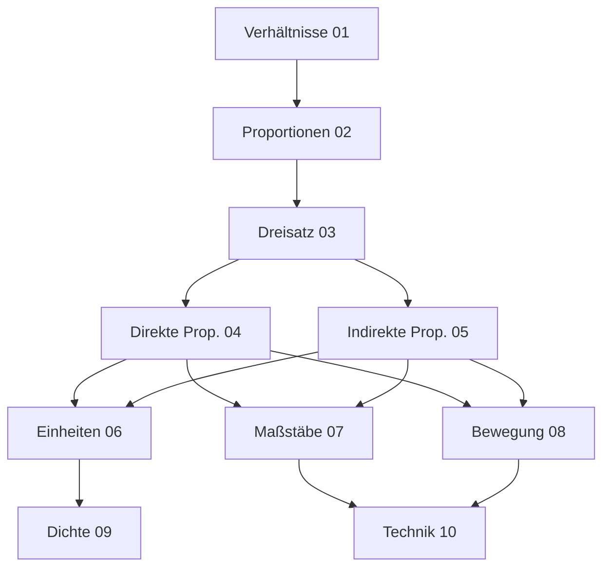

# Verhältnisse und Proportionalität

## Überblick

Dieses Kapitel behandelt Verhältnisse, Proportionen und den Dreisatz als fundamentale Werkzeuge für proportionales Rechnen in Alltag, Technik und Naturwissenschaften.

### Warum Verhältnisse so wichtig sind

Das Denken in Verhältnissen ist eine der ältesten und grundlegendsten mathematischen Fähigkeiten. Schon in der Antike erkannten griechische Mathematiker wie **Pythagoras** (ca. 570–510 v. Chr.) und **Euklid** (ca. 300 v. Chr.), dass Verhältnisse der Schlüssel zum Verständnis von Harmonie in Musik, Schönheit in der Kunst und Ordnung in der Natur sind.

Der **Goldene Schnitt** (etwa 1 : 1,618) galt den Griechen als das vollkommenste aller Verhältnisse. Er findet sich im Parthenon-Tempel in Athen, in Leonardo da Vincis „Vitruvianischem Menschen" und sogar in der Anordnung von Blütenblättern und Schneckenhäusern. Dieses uralte Wissen zeigt: Verhältnisse sind nicht nur abstrakte Mathematik – sie beschreiben, wie die Welt aufgebaut ist.

Im Alltag begegnen uns Verhältnisse ständig: beim Kochen (Mischungsverhältnisse), beim Kartenlesen (Maßstäbe), beim Tanken (Verbrauch pro 100 km) oder beim Vergleichen von Preisen (€ pro kg). Der Dreisatz, den wir in diesem Kapitel lernen, ist dabei das universelle Werkzeug, um solche Verhältnisaufgaben systematisch zu lösen.

## Kapitelstruktur

### Grundlagen (01-03)
- [[01-Verhaeltnisse]] - Verhältnisse verstehen und darstellen
- [[02-Proportionen]] - Gleichheit von Verhältnissen
- [[03-Dreisatz]] - Der klassische Lösungsweg

### Proportionalitätsarten (04-05)
- [[04-Direkte-Proportionalitaet]] - Je mehr, desto mehr
- [[05-Indirekte-Proportionalitaet]] - Je mehr, desto weniger

### Anwendungen (06-10)
- [[06-Umrechnungen-von-Einheiten]] - Maßeinheiten umrechnen
- [[07-Massstaebe]] - Karten, Pläne, Modelle
- [[08-Geschwindigkeit-Strecke-und-Zeit]] - Bewegungsaufgaben
- [[09-Dichte-und-Masse]] - Physikalische Anwendungen
- [[10-Technische-Verhaeltnisberechnungen]] - Mischungen, Übersetzungen

## Lernpfad

## Verbindungen zu anderen Kapiteln

| Voraussetzung | Dieses Kapitel | Weiterführend |
|--------------|----------------|---------------|
| [[03-Bruchrechnung/00-Bruchrechnung-Index\|Bruchrechnung]] | Verhältnisse | Funktionen |
| [[04-Dezimalzahlen-und-Prozentrechnung/00-Dezimalzahlen-und-Prozentrechnung-Index\|Prozentrechnung]] | Dreisatz | Lineare Gleichungen |

## Prüfungsrelevanz

> [!warning] Prüfungsrelevanz: Sehr hoch
> Der Dreisatz und proportionales Rechnen sind Kernkompetenzen. Typische Aufgaben:
> - Textaufgaben mit Dreisatz
> - Maßstabsberechnungen
> - Geschwindigkeit-Zeit-Strecke
> - Mischungsaufgaben

> [!tip] **Lernstrategie für dieses Kapitel**
> 1. **Verstehe zuerst das Grundprinzip**: Verhältnisse sind Vergleiche durch Division
> 2. **Erkenne die Richtung**: Frage dich bei jeder Aufgabe – wird das Ergebnis größer oder kleiner?
> 3. **Übe den Dreisatz**: Er ist das Schweizer Taschenmesser der Mathematik – vielseitig einsetzbar
> 4. **Verbinde mit dem Alltag**: Jedes Mal, wenn du Preise vergleichst oder ein Rezept umrechnest, übst du Verhältnisrechnung
