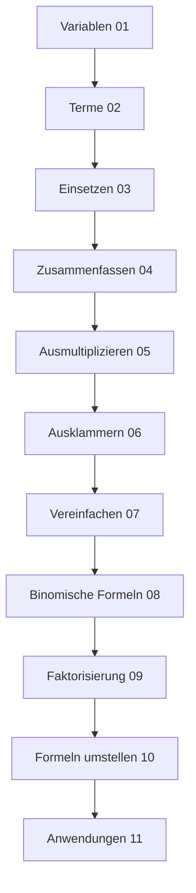

# Terme und algebraische Ausdrücke

## Überblick

Dieses Kapitel führt in die Welt der Algebra ein: Variablen, Terme und ihre Umformungen bilden die Grundlage für das Lösen von Gleichungen und mathematisches Modellieren.

Das Wort **Algebra** stammt vom arabischen Begriff *al-jabr* (الجبر), was „Wiederherstellen" oder „Ergänzen" bedeutet. Der persische Mathematiker **Muhammad ibn Musa al-Chwarizmi** verwendete diesen Begriff um 825 n. Chr. in seinem einflussreichen Werk „Kitab al-jabr wa-l-muqabala" (Buch der Vervollständigung und des Ausgleichens). Dieses Werk gilt als Geburtsstunde der Algebra als eigenständige mathematische Disziplin.

Die Algebra revolutionierte das mathematische Denken: Anstatt nur mit konkreten Zahlen zu rechnen, können wir mit **Variablen** allgemeine Zusammenhänge beschreiben. Eine Formel wie $A = a \cdot b$ für die Fläche eines Rechtecks gilt für jedes Rechteck – egal ob es 2 cm × 3 cm oder 100 m × 200 m groß ist.

> [!info] **Warum ist Algebra wichtig?**
> Die Algebra ist das Werkzeug, mit dem Wissenschaftler und Ingenieure die Welt beschreiben. Jede physikalische Formel, jede Programmiersprache und jedes Tabellenkalkulationsprogramm basiert auf algebraischen Prinzipien. Wer Terme versteht und umformen kann, hat den Schlüssel zu unzähligen Anwendungen in der Hand.

## Kapitelstruktur

### Grundlagen (01-03)
- [[01-Variablen-und-Platzhalter]] - Einführung in Variablen
- [[02-Mathematische-Terme]] - Aufbau von Termen
- [[03-Einsetzen-von-Variablen]] - Termwerte berechnen

### Termumformungen (04-07)
- [[04-Zusammenfassen-gleichartiger-Terme]] - Addition und Subtraktion
- [[05-Ausmultiplizieren]] - Klammern auflösen
- [[06-Ausklammern]] - Gemeinsame Faktoren finden
- [[07-Vereinfachen-von-Termen]] - Systematisches Vereinfachen

### Binomische Formeln und Faktorisierung (08-10)
- [[08-Binomische-Formeln]] - Die drei binomischen Formeln
- [[09-Faktorisierung]] - Terme in Produkte zerlegen
- [[10-Umstellen-einfacher-Formeln]] - Formeln nach Variablen auflösen

### Anwendungen (11)
- [[11-Anwendungen-der-Algebra]] - Sachkontexte und Modellierung

## Lernpfad

## Verbindungen

| Voraussetzung | Dieses Kapitel | Weiterführend |
|--------------|----------------|---------------|
| [[06-Potenzen-Wurzeln-und-Zahlendarstellung/00-Potenzen-Wurzeln-Index\|Potenzen]] | Terme & Algebra | [[08-Gleichungen-und-Ungleichungen/00-Gleichungen-Index\|Gleichungen]] |

## Prüfungsrelevanz

> [!warning] Prüfungsrelevanz: Sehr hoch
> Termumformungen sind Grundlage für fast alle weiteren Themen. Typische Aufgaben:
> - Terme vereinfachen
> - Binomische Formeln anwenden
> - Klammern auflösen und ausklammern
