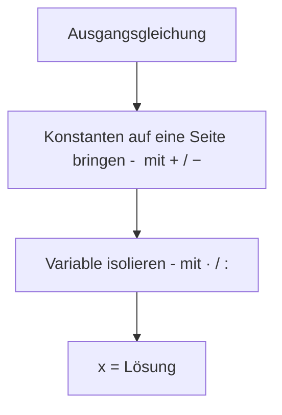

# Äquivalenzumformungen

> [!info] Lernziele
> - Das Konzept der Äquivalenzumformung verstehen
> - Erlaubte Umformungen sicher anwenden können
> - Nicht-äquivalente Umformungen erkennen
> - Gleichungen systematisch nach der Variablen auflösen

## Historischer Kontext

Das systematische Lösen von Gleichungen durch Umformungen geht auf den persischen Mathematiker **Muhammad ibn Musa al-Chwarizmi** (ca. 780–850 n. Chr.) zurück. In seinem Werk „Kitab al-jabr wa-l-muqabala" beschrieb er zwei grundlegende Operationen:

- **al-jabr** („Ergänzung"): Einen Term von einer Seite auf die andere bringen und das Vorzeichen ändern
- **al-muqabala** („Ausgleichen"): Gleiche Terme auf beiden Seiten zusammenfassen

Vom Wort „al-jabr" leitet sich unser Begriff **Algebra** ab. Al-Chwarizmis Methoden wurden im mittelalterlichen Europa übersetzt und bildeten die Grundlage für den modernen Mathematikunterricht.

> [!tip] **Die Waagen-Analogie**
> Al-Chwarizmi selbst beschrieb Gleichungen als „zwei Waagschalen im Gleichgewicht". Diese Vorstellung hilft bis heute: Jede Operation, die wir auf der einen Seite durchführen, müssen wir auch auf der anderen Seite ausführen, damit die „Waage" im Gleichgewicht bleibt.

## Begriff der Äquivalenzumformung

Eine **Äquivalenzumformung** ist eine Umformung einer Gleichung, die die Lösungsmenge nicht verändert. Das bedeutet: Die ursprüngliche Gleichung und die umgeformte Gleichung haben exakt dieselben Lösungen.

$$\text{Gleichung 1} \overset{\text{Äquivalenzumformung}}{\Longleftrightarrow} \text{Gleichung 2}$$

Das Symbol $\Leftrightarrow$ bedeutet: Beide Gleichungen haben exakt dieselben Lösungen.

Der Begriff kommt vom lateinischen „aequivalere" (gleichwertig sein) – die umgeformte Gleichung ist also „gleichwertig" zur ursprünglichen.

## Erlaubte Äquivalenzumformungen

Nicht jede Rechenoperation ist eine Äquivalenzumformung. Erlaubt sind genau diejenigen, die sich auf beiden Seiten gleich auswirken und dabei das Gleichgewicht der „Waage" nicht stören. Die folgenden vier Grundoperationen bilden deshalb das Handwerkszeug, mit dem sich praktisch jede lineare Gleichung Schritt für Schritt zur Lösung umformen lässt.

### 1. Addition und Subtraktion

Auf beiden Seiten darf dieselbe Zahl addiert oder subtrahiert werden.

> [!example] Beispiel: Addition
> $$x - 5 = 12 \quad | +5$$
> $$x = 17$$

> [!example] Beispiel: Subtraktion
> $$x + 8 = 15 \quad | -8$$
> $$x = 7$$

### 2. Multiplikation und Division

Auf beiden Seiten darf mit derselben Zahl multipliziert oder dividiert werden, **sofern diese Zahl nicht Null ist**.

> [!example] Beispiel: Division
> $$4x = 20 \quad | :4$$
> $$x = 5$$

> [!example] Beispiel: Multiplikation
> $$\frac{x}{3} = 7 \quad | \cdot 3$$
> $$x = 21$$

> [!warning] Achtung: Division durch Null
> Division durch Null ist **verboten**! Dies ist eine der fundamentalsten Regeln der Mathematik.
> $$3x = 0 \quad | :x \quad \text{← FALSCH, falls } x = 0$$
> 
> Warum? Wenn $x = 0$ wäre, würden wir durch 0 dividieren, was mathematisch nicht definiert ist. Stattdessen sollte man hier direkt erkennen: Wenn $3x = 0$, dann muss $x = 0$ sein (denn nur $3 \cdot 0 = 0$).

> [!warning] **Häufiger Fehler: Division durch Variable**
> Viele Schüler teilen vorschnell durch die Variable und verlieren dabei Lösungen:
> - **Falsch:** $x^2 = 5x \Rightarrow x = 5$ (Division durch $x$)
> - **Richtig:** $x^2 - 5x = 0 \Rightarrow x(x-5) = 0 \Rightarrow x = 0$ oder $x = 5$
> 
> Bei der falschen Methode geht die Lösung $x = 0$ verloren!

### Übersicht der erlaubten Umformungen

| Umformung | Beispiel | Bedingung |
|---|---|---|
| $+ a$ auf beiden Seiten | $x - 3 = 5 \Leftrightarrow x = 8$ | Immer erlaubt |
| $- a$ auf beiden Seiten | $x + 4 = 9 \Leftrightarrow x = 5$ | Immer erlaubt |
| $\cdot a$ auf beiden Seiten | $\frac{x}{2} = 6 \Leftrightarrow x = 12$ | $a \neq 0$ |
| $: a$ auf beiden Seiten | $5x = 15 \Leftrightarrow x = 3$ | $a \neq 0$ |

## Das Prinzip des Isolierens

**Ziel**: Die Variable auf einer Seite allein stehen haben. Man „schält" die Variable quasi wie eine Zwiebel frei, indem man Schicht für Schicht die umgebenden Operationen rückgängig macht.

### Strategie

> [!tip] **Merkregel: Umgekehrte Reihenfolge**
> Beim Isolieren macht man die Rechenoperationen in **umgekehrter Reihenfolge** rückgängig:
> - Zuerst Addition/Subtraktion aufheben (äußere Schicht)
> - Dann Multiplikation/Division aufheben (innere Schicht)
> 
> Beispiel: Bei $3x + 5 = 17$ wurde zuerst multipliziert ($3 \cdot x$), dann addiert ($+5$).
> Also: Zuerst $-5$, dann $:3$.

### Ausführliches Beispiel

$$3x + 7 = 22$$

**Schritt 1**: Konstante auf die rechte Seite bringen
$$3x + 7 = 22 \quad | -7$$
$$3x = 15$$

**Schritt 2**: Koeffizienten eliminieren
$$3x = 15 \quad | :3$$
$$x = 5$$

**Probe**: $3 \cdot 5 + 7 = 15 + 7 = 22$ ✓

## Umformungen mit Variablen auf beiden Seiten

Wenn die Variable auf beiden Seiten vorkommt, müssen alle Terme mit der Variablen auf eine Seite gebracht werden.

> [!example] Beispiel
> $$5x - 3 = 2x + 9$$
> 
> **Schritt 1**: Variable auf eine Seite ($-2x$)
> $$5x - 3 - 2x = 9$$
> $$3x - 3 = 9$$
> 
> **Schritt 2**: Konstante isolieren ($+3$)
> $$3x = 12$$
> 
> **Schritt 3**: Durch Koeffizienten dividieren ($:3$)
> $$x = 4$$

## Nicht-äquivalente Umformungen

So verlässlich die erlaubten Umformungen sind, so wichtig ist es zu wissen, wo die Grenze verläuft. Manche Operationen sehen harmlos aus, verändern aber die Lösungsmenge – sie fügen Lösungen hinzu oder lassen welche verschwinden. Wer sie unbedacht einsetzt, erhält am Ende ein falsches Ergebnis, ohne es zu merken. Gerade deshalb lohnt sich der Blick auf die folgenden Fälle.

> [!danger] Vorsicht: Diese Umformungen verändern die Lösungsmenge!

### Quadrieren

Beim Quadrieren können **zusätzliche Lösungen** entstehen.

$$x = 3 \quad \Rightarrow \quad x^2 = 9$$

Aber: $x^2 = 9$ hat zwei Lösungen: $x = 3$ und $x = -3$

### Wurzelziehen

Beim Wurzelziehen können **Lösungen verloren gehen**.

$$x^2 = 9 \quad \Rightarrow \quad x = 3$$

Hier fehlt die Lösung $x = -3$.

### Multiplikation mit Null

$$x = 5 \quad | \cdot 0$$
$$0 = 0$$

Diese Aussage ist immer wahr – die Information über $x$ geht verloren!

## Notation der Umformungsschritte

Damit ein Lösungsweg nachvollziehbar bleibt, schreibt man die einzelnen Umformungen übersichtlich auf. Welche Schreibweise man wählt, ist Geschmackssache – wichtig ist nur, dass bei jedem Schritt klar wird, welche Operation auf beide Seiten angewendet wurde. Die folgenden drei Varianten sind dafür gleichermaßen gebräuchlich.

Es gibt verschiedene Schreibweisen:

### Variante 1: Mit Trennstrich

$$3x + 5 = 17 \quad | -5$$
$$3x = 12 \quad | :3$$
$$x = 4$$

### Variante 2: Mit Pfeil

$$3x + 5 = 17$$
$$\Leftrightarrow 3x = 12$$
$$\Leftrightarrow x = 4$$

### Variante 3: Mit Begründung

$$3x + 5 = 17$$
$$3x = 12 \quad \text{(Subtraktion von 5)}$$
$$x = 4 \quad \text{(Division durch 3)}$$

## Komplexeres Beispiel

$$4(2x - 3) - 5 = 3(x + 2) + 6$$

**Schritt 1**: Klammern auflösen
$$8x - 12 - 5 = 3x + 6 + 6$$
$$8x - 17 = 3x + 12$$

**Schritt 2**: Variablen zusammenführen ($-3x$)
$$5x - 17 = 12$$

**Schritt 3**: Konstante isolieren ($+17$)
$$5x = 29$$

**Schritt 4**: Dividieren ($:5$)
$$x = \frac{29}{5} = 5{,}8$$

## Zusammenfassung

> [!abstract] Kernpunkte
> - Äquivalenzumformungen ändern die Lösungsmenge nicht
> - Erlaubt: Addition, Subtraktion, Multiplikation und Division (außer mit 0)
> - Ziel: Die Variable auf einer Seite isolieren
> - Quadrieren und Wurzelziehen sind keine Äquivalenzumformungen
> - Probe am Ende zur Kontrolle!

## Zusammenhänge

Querverweise zu verwandten Themen:

- → [[01-Grundlagen-von-Gleichungen|Grundlagen von Gleichungen]] – Was ist eine Gleichung?
- → [[03-Ueberpruefung-von-Loesungen|Überprüfung von Lösungen]] – Warum die Probe wichtig ist
- → [[07-Terme-und-algebraische-Ausdruecke/07-Vereinfachen-von-Termen|Vereinfachen von Termen]] – Terme vor dem Umformen vereinfachen
- → [[04-Lineare-Gleichungen|Lineare Gleichungen]] – Anwendung der Äquivalenzumformungen

## Übungsaufgaben

Löse die Gleichungen durch Äquivalenzumformungen:

1. $5x + 3 = 28$
2. $2x - 7 = x + 4$
3. $3(x + 2) = 2(x - 1) + 13$
4. $\frac{x}{4} + 5 = 8$
5. $6x - 4 = 2x + 12$

---

**Navigation**: [[01-Grundlagen-von-Gleichungen|← Grundlagen]] | [[00-Gleichungen-und-Ungleichungen-Index|Übersicht]] | [[03-Ueberpruefung-von-Loesungen|Überprüfung von Lösungen →]]
