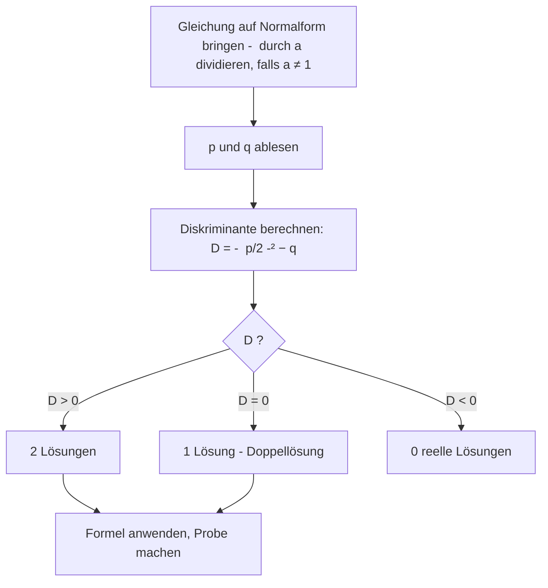

# Lösungsformel für quadratische Gleichungen

> [!info] Lernziele
> - Die p-q-Formel sicher anwenden können
> - Die Mitternachtsformel als Alternative kennen
> - Die Bedeutung der Diskriminante für die Lösungen verstehen
> - Quadratische Gleichungen vollständig lösen können

## Historischer Hintergrund

Die Lösungsformel für quadratische Gleichungen hat eine jahrtausendealte Geschichte. Die **Babylonier** (ca. 2000 v. Chr.) kannten bereits Lösungsverfahren, formulierten sie aber in Worten, nicht als Formel.

Der indische Mathematiker **Brahmagupta** (628 n. Chr.) gab erstmals eine allgemeine Lösung an, die auch negative Zahlen berücksichtigte. Der persische Mathematiker **al-Chwarizmi** (ca. 820 n. Chr.) systematisierte die Verfahren in seinem berühmten Werk „al-Kitab al-mukhtasar fi hisab al-jabr wa-l-muqabala".

Die moderne symbolische Schreibweise der Formel entstand erst im 16. Jahrhundert in Europa. Die **Mitternachtsformel** trägt ihren Namen, weil Schüler sie angeblich auch um Mitternacht im Schlaf aufsagen können sollten – so grundlegend ist sie für die Mathematik.

## Die p-q-Formel

Während sich reinquadratische Gleichungen noch durch Wurzelziehen und Ausklammern lösen lassen, braucht man für den allgemeinen Fall ein verlässliches Universalwerkzeug. Genau das leistet die Lösungsformel: Sie liefert zu jeder quadratischen Gleichung auf einen Schlag beide Lösungen, ohne dass man einen geschickten Umformungstrick finden muss. Die p-q-Formel ist dabei die Variante für die Normalform.

Für eine quadratische Gleichung in **Normalform**:

$$x^2 + px + q = 0$$

gilt die **p-q-Formel**:

$$x_{1,2} = -\frac{p}{2} \pm \sqrt{\left(\frac{p}{2}\right)^2 - q}$$

> [!tip] **Merksatz mit Rhythmus**
> „Minus p halbe, plus minus Wurzel aus p halbe Quadrat minus q"
>
> Viele Schüler lernen die Formel mit einem Rhythmus oder Reim:
> - „Minus p halbe – das ist der Start,
> - plus-minus Wurzel – das macht's apart,
> - p halbe zum Quadrat, minus q – 
> - so löst du jede Gleichung im Nu!"

### Anwendung Schritt für Schritt

**Beispiel**: $x^2 - 6x + 5 = 0$

**Schritt 1**: Parameter ablesen
- $p = -6$
- $q = 5$

**Schritt 2**: In die Formel einsetzen
$$x_{1,2} = -\frac{-6}{2} \pm \sqrt{\left(\frac{-6}{2}\right)^2 - 5}$$

**Schritt 3**: Ausrechnen
$$x_{1,2} = 3 \pm \sqrt{9 - 5}$$
$$x_{1,2} = 3 \pm \sqrt{4}$$
$$x_{1,2} = 3 \pm 2$$

**Schritt 4**: Beide Lösungen bestimmen
$$x_1 = 3 + 2 = 5$$
$$x_2 = 3 - 2 = 1$$

**Probe**: 
- $5^2 - 6 \cdot 5 + 5 = 25 - 30 + 5 = 0$ ✓
- $1^2 - 6 \cdot 1 + 5 = 1 - 6 + 5 = 0$ ✓

## Die Mitternachtsformel (abc-Formel)

Die p-q-Formel setzt voraus, dass der Koeffizient vor $x^2$ bereits 1 ist. Oft ist das nicht der Fall, und man müsste erst durch diesen Koeffizienten teilen. Die Mitternachtsformel erspart diesen Zwischenschritt: Sie arbeitet direkt mit den Koeffizienten der allgemeinen Form und ist damit die flexiblere der beiden Formeln.

Für die **allgemeine Form**:

$$ax^2 + bx + c = 0$$

gilt die **Mitternachtsformel**:

$$x_{1,2} = \frac{-b \pm \sqrt{b^2 - 4ac}}{2a}$$

> [!note] **Warum „Mitternachtsformel"?**
> Ein Schüler sollte diese Formel auch um Mitternacht im Schlaf aufsagen können – sie ist so wichtig! In anderen Ländern heißt sie auch „abc-Formel" (nach den Koeffizienten) oder „Quadratic Formula" (im Englischen).
>
> Die Formel ist universeller als die p-q-Formel, weil sie direkt auf die allgemeine Form anwendbar ist, ohne erst durch $a$ dividieren zu müssen.

### Beispiel mit Mitternachtsformel

$$2x^2 + 8x - 10 = 0$$

**Parameter**: $a = 2$, $b = 8$, $c = -10$

$$x_{1,2} = \frac{-8 \pm \sqrt{64 - 4 \cdot 2 \cdot (-10)}}{2 \cdot 2}$$
$$x_{1,2} = \frac{-8 \pm \sqrt{64 + 80}}{4}$$
$$x_{1,2} = \frac{-8 \pm \sqrt{144}}{4}$$
$$x_{1,2} = \frac{-8 \pm 12}{4}$$

$$x_1 = \frac{-8 + 12}{4} = \frac{4}{4} = 1$$
$$x_2 = \frac{-8 - 12}{4} = \frac{-20}{4} = -5$$

## Vergleich der Formeln

| | p-q-Formel | Mitternachtsformel |
|---|---|---|
| **Voraussetzung** | Normalform ($a = 1$) | Allgemeine Form |
| **Vorteil** | Einfacher, weniger Rechnung | Direkt anwendbar |
| **Nachteil** | Erst in Normalform bringen | Mehr Terme |

> [!tip] Empfehlung
> - Kleine, einfache Koeffizienten → Normalform + p-q-Formel
> - Große oder komplizierte Koeffizienten → Mitternachtsformel direkt

## Die Diskriminante

Ob eine quadratische Gleichung zwei, eine oder keine Lösung besitzt, entscheidet sich genau an einer Stelle der Formel: unter der Wurzel. Steht dort eine positive Zahl, gibt es zwei Lösungen; steht dort null, fallen beide zusammen; ist der Ausdruck negativ, lässt sich keine reelle Wurzel ziehen. Dieser Ausdruck trägt deshalb einen eigenen Namen und verdient besondere Aufmerksamkeit.

Der Ausdruck unter der Wurzel heißt **Diskriminante** $D$:

$$D = \left(\frac{p}{2}\right)^2 - q \quad \text{(p-q-Formel)}$$
$$D = b^2 - 4ac \quad \text{(Mitternachtsformel)}$$

### Interpretation

| Diskriminante | Wurzel | Lösungen |
|---|---|---|
| $D > 0$ | Positiv, zwei Werte | $x_1 \neq x_2$ |
| $D = 0$ | Null | $x_1 = x_2$ (Doppellösung) |
| $D < 0$ | Nicht definiert (reell) | Keine reelle Lösung |

### Beispiele zu allen Fällen

**Fall 1**: $D > 0$ (zwei Lösungen)
$$x^2 - 5x + 6 = 0$$
$$D = \left(\frac{-5}{2}\right)^2 - 6 = 6{,}25 - 6 = 0{,}25 > 0$$
$$x_{1,2} = 2{,}5 \pm 0{,}5 \Rightarrow x_1 = 3, x_2 = 2$$

**Fall 2**: $D = 0$ (eine Doppellösung)
$$x^2 - 4x + 4 = 0$$
$$D = \left(\frac{-4}{2}\right)^2 - 4 = 4 - 4 = 0$$
$$x = 2$$ (Doppellösung)

**Fall 3**: $D < 0$ (keine reelle Lösung)
$$x^2 + 2x + 5 = 0$$
$$D = \left(\frac{2}{2}\right)^2 - 5 = 1 - 5 = -4 < 0$$
$$\mathbb{L} = \emptyset$$

## Häufige Fehler vermeiden

> [!warning] **Typische Fehler**

**Fehler 1**: Vorzeichen von $p$ vergessen
$$x^2 \mathbf{- 4}x + 3 = 0 \Rightarrow p = \mathbf{-4}$$
In der Formel: $-\frac{p}{2} = -\frac{-4}{2} = +2$

Das doppelte Minus ergibt ein Plus! Viele Schüler übersehen dies.

**Fehler 2**: Nicht in Normalform gebracht
$$2x^2 - 8x + 6 = 0 \quad | :2$$
$$x^2 - 4x + 3 = 0$$ ← Jetzt erst p-q-Formel anwenden!

Vor der p-q-Formel muss der Koeffizient vor $x^2$ gleich 1 sein.

**Fehler 3**: Klammer bei $\left(\frac{p}{2}\right)^2$ vergessen
$$p = -6: \quad \left(\frac{-6}{2}\right)^2 = (-3)^2 = 9$$ ✓
Nicht: $-3^2 = -9$ ✗

Die Klammer ist wichtig: Erst die Division, dann das Quadrieren – und das Quadrat eines negativen Wertes ist immer positiv!

## Lösungsschema

## Zusammenfassung

> [!abstract] Kernpunkte
> - Die p-q-Formel gilt für die Normalform $x^2 + px + q = 0$
> - Die Mitternachtsformel gilt für $ax^2 + bx + c = 0$
> - Die Diskriminante bestimmt die Anzahl der Lösungen
> - Vorzeichen sorgfältig beachten!
> - Immer Probe machen zur Kontrolle

## Zusammenhänge

Querverweise zu verwandten Themen:

- → [[08-Quadratische-Gleichungen|Quadratische Gleichungen]] – Grundlagen und Klassifikation
- → [[10-Faktorisierung-quadratischer-Gleichungen|Faktorisierung]] – Alternative Lösungsmethode mit Satz von Vieta
- → [[06-Potenzen-Wurzeln-und-Zahlendarstellung/06-Quadratwurzeln|Quadratwurzeln]] – Für die Berechnung der Diskriminante
- → [[09-Funktionen-und-Koordinatensysteme/09-Parabeln|Parabeln]] – Grafische Bedeutung der Lösungen als Nullstellen

## Übungsaufgaben

Löse mit der p-q-Formel oder Mitternachtsformel:

1. $x^2 + 4x - 12 = 0$
2. $x^2 - 10x + 25 = 0$
3. $x^2 + 2x + 5 = 0$
4. $2x^2 - 12x + 10 = 0$
5. $3x^2 + 6x - 9 = 0$
6. $x^2 - x - 6 = 0$

---

**Navigation**: [[08-Quadratische-Gleichungen|← Quadratische Gleichungen]] | [[00-Gleichungen-und-Ungleichungen-Index|Übersicht]] | [[10-Faktorisierung-quadratischer-Gleichungen|Faktorisierung →]]
