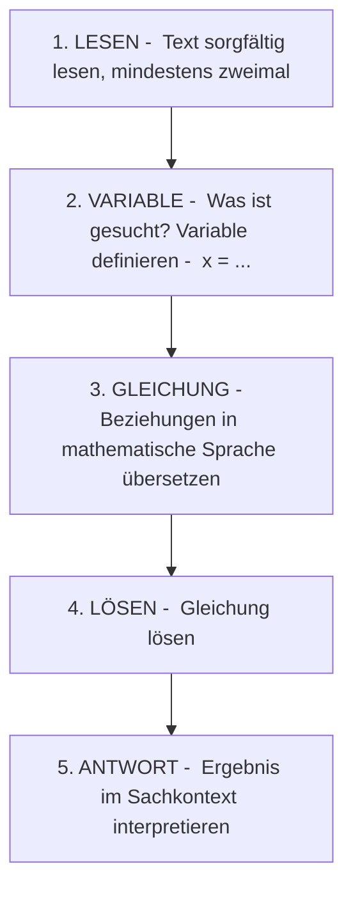

# Textaufgaben

> [!info] Lernziele
> - Textaufgaben systematisch analysieren können
> - Die richtige Gleichung aus einem Text aufstellen
> - Lösungen im Sachkontext interpretieren
> - Typische Aufgabentypen erkennen und bearbeiten

## Historischer Kontext

Textaufgaben sind so alt wie die Mathematik selbst. Schon die **Babylonier** (ca. 1800 v. Chr.) formulierten mathematische Probleme als Geschichten: „Ein Graben soll ausgehoben werden. Die Länge ist 5 Ruten. Die Breite ist ..." Die ägyptischen Papyri und indischen Lehrbücher enthalten ähnliche Aufgaben.

Die berühmten „Rechenaufgaben" von **Adam Ries** (1492–1559), dem bedeutendsten deutschen Rechenmeister, waren fast ausschließlich Textaufgaben aus dem Handels- und Geschäftsleben. Er wusste: Mathematik lernt man am besten, wenn sie einen Bezug zum echten Leben hat.

> [!tip] **Warum Textaufgaben?**
> Textaufgaben sind nicht nur Prüfungsstoff – sie sind die eigentliche Anwendung der Mathematik:
> - Im Beruf werden Probleme immer als Text beschrieben, nie als fertige Gleichung
> - Die Fähigkeit, Text in Mathematik zu „übersetzen", ist eine Schlüsselkompetenz
> - Textaufgaben trainieren logisches Denken und strukturiertes Vorgehen

## Strategie für Textaufgaben

### Das Fünf-Schritte-Schema

Dieses Schema hat sich über Jahrhunderte bewährt und wird von erfolgreichen Problemlösern intuitiv angewendet:

> [!warning] **Häufiger Fehler: Zu schnell rechnen**
> Viele Schüler stürzen sich sofort auf die Zahlen im Text und versuchen, irgendwie zu rechnen. Das führt oft zu falschen Gleichungen. Nimm dir Zeit für Schritt 1 und 2!

## Typische Aufgabentypen

So verschieden Textaufgaben auf den ersten Blick wirken, sie lassen sich in einige wenige Grundmuster einordnen. Wer diese Muster kennt, erkennt schneller, welche Variable sich anbietet und wie die Gleichung aufzustellen ist. Die folgenden Typen decken die häufigsten Aufgabenstellungen ab – vom einfachen Zahlenrätsel bis zur Preisaufgabe mit zwei Unbekannten, bei der ein Gleichungssystem entsteht.

### Typ 1: Zahlenrätsel

> [!example] Beispiel
> „Wenn man eine Zahl mit 3 multipliziert und 7 addiert, erhält man 22. Welche Zahl ist es?"

**Variable**: $x$ = die gesuchte Zahl

**Gleichung**: $3x + 7 = 22$

**Lösung**:
$$3x = 15$$
$$x = 5$$

**Antwort**: Die gesuchte Zahl ist 5.

**Probe**: $3 \cdot 5 + 7 = 15 + 7 = 22$ ✓

### Typ 2: Altersaufgaben

> [!example] Beispiel
> „Mutter ist 35 Jahre alt, Tochter 11 Jahre. In wie vielen Jahren ist die Mutter doppelt so alt wie die Tochter?"

**Variable**: $x$ = Anzahl der Jahre

**Überlegung**:
- Alter der Mutter in $x$ Jahren: $35 + x$
- Alter der Tochter in $x$ Jahren: $11 + x$

**Gleichung**: $35 + x = 2(11 + x)$

**Lösung**:
$$35 + x = 22 + 2x$$
$$35 - 22 = 2x - x$$
$$13 = x$$

**Antwort**: In 13 Jahren ist die Mutter doppelt so alt wie die Tochter.

**Probe**: Mutter: $35 + 13 = 48$, Tochter: $11 + 13 = 24$, $48 = 2 \cdot 24$ ✓

### Typ 3: Bewegungsaufgaben

> [!example] Beispiel
> „Ein Radfahrer fährt mit 15 km/h los. Eine Stunde später startet ein Autofahrer mit 60 km/h. Nach welcher Zeit überholt das Auto den Radfahrer?"

**Variable**: $t$ = Zeit (in Stunden) nach Start des Autos

**Überlegung**:
- Strecke Auto: $60t$ km
- Strecke Rad: $15(t + 1)$ km (fährt 1h länger)

**Gleichung** (Überholen = gleiche Strecke):
$$60t = 15(t + 1)$$

**Lösung**:
$$60t = 15t + 15$$
$$45t = 15$$
$$t = \frac{1}{3} \text{ h} = 20 \text{ min}$$

**Antwort**: Das Auto überholt nach 20 Minuten (nach seinem Start).

### Typ 4: Mischungsaufgaben

> [!example] Beispiel
> „Wie viel Wasser muss man zu 500 ml einer 20%igen Salzlösung geben, um eine 8%ige Lösung zu erhalten?"

**Variable**: $x$ = Menge des Wassers (in ml)

**Überlegung**:
- Salzmenge bleibt gleich: $500 \cdot 0{,}20 = 100$ g
- Neue Gesamtmenge: $500 + x$ ml

**Gleichung** (Salzgehalt der neuen Lösung):
$$\frac{100}{500 + x} = 0{,}08$$

**Lösung**:
$$100 = 0{,}08 \cdot (500 + x)$$
$$100 = 40 + 0{,}08x$$
$$60 = 0{,}08x$$
$$x = 750$$

**Antwort**: Man muss 750 ml Wasser hinzufügen.

### Typ 5: Preisaufgaben

> [!example] Beispiel
> „Äpfel kosten 2 € pro kg, Birnen 3 € pro kg. Lisa kauft insgesamt 5 kg Obst für 12 €. Wie viel kg von jeder Sorte?"

**Variablen**: 
- $x$ = kg Äpfel
- $y$ = kg Birnen

**Gleichungen**:
$$\begin{cases} x + y = 5 & \text{(Gewicht)} \\ 2x + 3y = 12 & \text{(Preis)} \end{cases}$$

**Lösung** (Einsetzungsverfahren):
Aus (I): $y = 5 - x$

In (II): $2x + 3(5 - x) = 12$
$$2x + 15 - 3x = 12$$
$$-x = -3$$
$$x = 3$$

Also: $y = 5 - 3 = 2$

**Antwort**: Lisa kauft 3 kg Äpfel und 2 kg Birnen.

## Schlüsselwörter übersetzen

Der schwierigste Schritt bei einer Textaufgabe ist meist das Aufstellen der Gleichung. Hier hilft es, auf bestimmte Signalwörter zu achten: Sie lassen sich fast wörtlich in Rechenoperationen übertragen. Die folgende Übersicht sammelt die häufigsten Formulierungen und ihre mathematische Entsprechung – eine Art kleines Wörterbuch zwischen Alltagssprache und Mathematik.

| Textformulierung | Mathematisch |
|---|---|
| „um ... mehr" | $+ ...$ |
| „um ... weniger" | $- ...$ |
| „das Doppelte/Zweifache" | $\cdot 2$ |
| „die Hälfte" | $: 2$ oder $\cdot \frac{1}{2}$ |
| „... mal so groß" | $\cdot ...$ |
| „der ... te Teil" | $: ...$ |
| „insgesamt" | Summe |
| „Unterschied" | Differenz |

## Häufige Fehler vermeiden

Gerade weil Textaufgaben den Umweg über die Sprache nehmen, passieren hier andere Fehler als beim reinen Rechnen. Oft stimmt die Rechnung, aber die Variable war unklar definiert, die Einheit fehlt oder das Ergebnis ist im Sachzusammenhang gar nicht möglich. Die folgenden Punkte zeigen, worauf man deshalb besonders achten sollte.

> [!warning] **Typische Fehler**
> 
> **Fehler 1**: Variable nicht klar definieren
> - Falsch: „$x$ ist das Alter"
> - Richtig: „$x$ = Alter der Tochter in Jahren"
> 
> Eine präzise Definition verhindert Verwechslungen und macht die Lösung nachvollziehbar.
>
> **Fehler 2**: Einheiten vergessen
> - Nicht: $x = 5$
> - Sondern: $x = 5$ km oder $x = 5$ €
>
> Ohne Einheit ist das Ergebnis unvollständig und kann missverstanden werden.
> 
> **Fehler 3**: Ergebnis nicht prüfen
> - Ist die Lösung im Sachkontext sinnvoll?
> - Kann ein Alter negativ sein? Kann eine Geschwindigkeit größer als die Lichtgeschwindigkeit sein?
>
> Ein mathematisch korrektes Ergebnis kann trotzdem sachlich unsinnig sein!

> [!tip] **Textaufgaben-Strategien für Prüfungen**
> 1. **Unterstreichen**: Markiere alle Zahlen und wichtigen Begriffe im Text
> 2. **Skizze**: Bei Bewegungs- oder Geometrieaufgaben hilft oft eine Zeichnung
> 3. **Tabelle**: Bei Mischungs- oder Altersaufgaben kann eine Tabelle helfen
> 4. **Rückwärts prüfen**: Setze das Ergebnis in den ursprünglichen Text ein – ergibt es Sinn?

## Checkliste für Textaufgaben

> [!tip] Vor dem Abgeben prüfen
> - [ ] Variable(n) klar definiert?
> - [ ] Gleichung(en) korrekt aufgestellt?
> - [ ] Rechnung nachvollziehbar?
> - [ ] Probe gemacht?
> - [ ] Ergebnis im Sachkontext sinnvoll?
> - [ ] Vollständiger Antwortsatz mit Einheit?

## Zusammenfassung

> [!abstract] Kernpunkte
> - Textaufgaben systematisch nach dem 5-Schritte-Schema bearbeiten
> - Variable immer klar mit Worten definieren
> - Schlüsselwörter in mathematische Operationen übersetzen
> - Ergebnis im Sachkontext interpretieren und auf Sinnhaftigkeit prüfen
> - Vollständigen Antwortsatz mit Einheiten formulieren

## Zusammenhänge

Querverweise zu verwandten Themen:

- → [[04-Lineare-Gleichungen|Lineare Gleichungen]] – Häufigster Gleichungstyp bei Textaufgaben
- → [[11-Lineare-Gleichungssysteme|Gleichungssysteme]] – Für Aufgaben mit mehreren Unbekannten
- → [[05-Verhaeltnisse-und-Proportionalitaet/03-Dreisatz|Dreisatz]] – Alternative Lösungsmethode für Proportionalitätsaufgaben
- → [[04-Dezimalzahlen-und-Prozentrechnung/09-Rabatte-und-Preisberechnungen|Preisberechnungen]] – Wirtschaftliche Textaufgaben

## Übungsaufgaben

1. **Zahlenrätsel**: Das Dreifache einer Zahl, vermindert um 8, ergibt 25. Welche Zahl ist es?

2. **Alter**: Vater ist 40, Sohn ist 10. Vor wie vielen Jahren war der Vater fünfmal so alt wie der Sohn?

3. **Bewegung**: Zwei Autos starten gleichzeitig in entgegengesetzte Richtungen mit 60 km/h und 80 km/h. Nach welcher Zeit sind sie 280 km voneinander entfernt?

4. **Preis**: Ein Stift und ein Heft kosten zusammen 2,50 €. Das Heft kostet 0,50 € mehr als der Stift. Was kosten Stift und Heft einzeln?

5. **Mischung**: Ein Behälter enthält 20 Liter einer 15%igen Zuckerlösung. Wie viel reinen Zucker muss man hinzufügen, um eine 20%ige Lösung zu erhalten?

---

**Navigation**: [[11-Lineare-Gleichungssysteme|← Gleichungssysteme]] | [[00-Gleichungen-und-Ungleichungen-Index|Übersicht]] | [[../09-Funktionen-und-Koordinatensysteme/00-Funktionen-Index|Funktionen →]]
