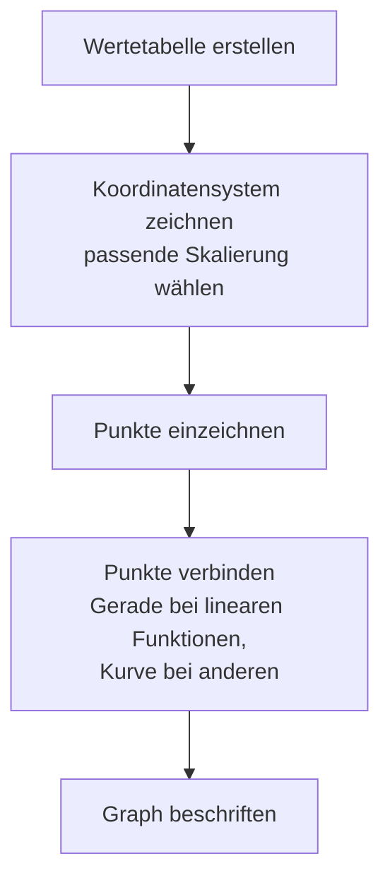

# Funktionstabellen und graphische Darstellung

> [!info] Lernziele
> - Wertetabellen systematisch erstellen können
> - Funktionsgraphen aus Wertetabellen zeichnen
> - Eigenschaften aus Graphen ablesen können
> - Den Zusammenhang zwischen Gleichung und Graph verstehen

## Wertetabellen erstellen

### Grundprinzip

Eine **Wertetabelle** zeigt Paare von Eingabe- und Ausgabewerten. Sie ist wie ein „Fahrplan" für die Funktion: Für jeden gewählten x-Wert wird der zugehörige Funktionswert berechnet.

| $x$ | Berechnung | $f(x)$ |
|---|---|---|
| gewählt | Formel anwenden | Ergebnis |

> [!info] **Historischer Hintergrund**
> Vor der Erfindung des Taschenrechners waren Wertetabellen von enormer praktischer Bedeutung. Wissenschaftler wie Johannes Kepler verbrachten Jahre damit, umfangreiche Logarithmentafeln zu berechnen. Diese Tabellen waren so wertvoll, dass sie in speziellen Büchern veröffentlicht wurden, die Generationen von Ingenieuren und Wissenschaftlern dienten.

### Schritt-für-Schritt

**Beispiel**: $f(x) = 2x - 1$

1. **x-Werte wählen**: sinnvoller Bereich, oft symmetrisch um 0
2. **Funktionswerte berechnen**: $f(x)$ für jeden x-Wert
3. **Tabelle ausfüllen**

| $x$ | $-2$ | $-1$ | $0$ | $1$ | $2$ | $3$ |
|---|---|---|---|---|---|---|
| $f(x)$ | $-5$ | $-3$ | $-1$ | $1$ | $3$ | $5$ |

**Rechenweg für $x = -2$**:
$$f(-2) = 2 \cdot (-2) - 1 = -4 - 1 = -5$$

## Graphen zeichnen

### Vorgehensweise

### Beispiel: Linearer Graph

$f(x) = \frac{1}{2}x + 1$

| $x$ | $-4$ | $-2$ | $0$ | $2$ | $4$ |
|---|---|---|---|---|---|
| $f(x)$ | $-1$ | $0$ | $1$ | $2$ | $3$ |

![[graph-linear.png]]
*01-09-04-graph-linear: Graph der linearen Funktion $f(x)=\frac{1}{2}x+1$ – die Punkte aus der Wertetabelle liegen auf einer Geraden, die mit dem Lineal verbunden wird.*

### Beispiel: Quadratischer Graph (Parabel)

$f(x) = x^2 - 2$

| $x$ | $-2$ | $-1$ | $0$ | $1$ | $2$ |
|---|---|---|---|---|---|
| $f(x)$ | $2$ | $-1$ | $-2$ | $-1$ | $2$ |

![[graph-parabel.png]]
*01-09-04-graph-parabel: Graph der quadratischen Funktion $f(x)=x^2-2$ – die Punkte aus der Wertetabelle werden zu einer nach oben geöffneten Parabel mit Scheitel bei $(0, -2)$ verbunden.*

## Eigenschaften aus Graphen ablesen

Ein Graph ist mehr als nur eine hübsche Linie: Aus seinem Verlauf lassen sich viele Eigenschaften der Funktion direkt ablesen, ohne zu rechnen. Das ist eine der größten Stärken der grafischen Darstellung – man sieht auf einen Blick, wo die Funktion null wird, wo sie steigt oder fällt und ob sie symmetrisch ist. Wir nutzen als durchgehendes Beispiel die Parabel $f(x) = x^2 - 2$ aus dem Abschnitt oben.

### Nullstellen

**Nullstellen** sind die x-Werte, an denen der Graph die **x-Achse schneidet**. An diesen Stellen ist der Funktionswert null:

$$f(x) = 0$$

Grafisch erkennst du Nullstellen als die **Durchstoßpunkte durch die x-Achse**. Eine lineare Funktion hat höchstens eine Nullstelle, eine Parabel kann keine, eine oder zwei haben – je nachdem, ob und wie oft sie die x-Achse berührt.

> [!example] Beispiel am Parabel-Graphen
> Der Graph von $f(x) = x^2 - 2$ schneidet die x-Achse bei etwa $x \approx -1{,}41$ und $x \approx 1{,}41$. Das sind die Nullstellen $x = \pm\sqrt{2}$ – man kann sie am Graphen abschätzen und später rechnerisch bestätigen.

### Schnittpunkt mit der y-Achse

Der **y-Achsenabschnitt** ist der Punkt, an dem der Graph die **y-Achse schneidet**. Da auf der y-Achse immer $x = 0$ gilt, findest du ihn, indem du null einsetzt:

$$f(0) = ?$$

Jeder Funktionsgraph schneidet die y-Achse **höchstens einmal** – das folgt direkt aus der Eindeutigkeit von Funktionen (zu $x = 0$ gehört genau ein y-Wert).

> [!example] Beispiel am Parabel-Graphen
> Für $f(x) = x^2 - 2$ ist $f(0) = 0^2 - 2 = -2$. Der Graph schneidet die y-Achse also bei $(0, -2)$ – genau im Scheitelpunkt der Parabel.

### Steigungsverhalten

Am Verlauf des Graphen von links nach rechts erkennst du, ob die Funktion wächst oder fällt (ihre **Monotonie**):

| Verlauf | Bedeutung |
|---|---|
| Graph steigt (von links nach rechts) | $f$ ist monoton steigend |
| Graph fällt | $f$ ist monoton fallend |
| Graph hat Maximum/Minimum | Lokale Extremstelle |

Viele Funktionen wechseln ihr Steigungsverhalten. Die Parabel $f(x) = x^2 - 2$ etwa **fällt** für $x < 0$ und **steigt** für $x > 0$; der Übergang liegt im tiefsten Punkt, dem **Scheitel** bei $(0, -2)$. Dieser Tiefpunkt ist ein Minimum.

### Symmetrie

Symmetrie hilft, einen Graphen schneller zu zeichnen: Kennst du eine Hälfte, ergibt sich die andere durch Spiegelung.

| Symmetrieart | Eigenschaft | Beispiel |
|---|---|---|
| Achsensymmetrisch zur y-Achse | $f(-x) = f(x)$ | $f(x) = x^2$ |
| Punktsymmetrisch zum Ursprung | $f(-x) = -f(x)$ | $f(x) = x^3$ |

> [!example] Beispiel am Parabel-Graphen
> $f(x) = x^2 - 2$ ist achsensymmetrisch zur y-Achse: Es gilt $f(-x) = (-x)^2 - 2 = x^2 - 2 = f(x)$. Deshalb liegen in der Wertetabelle die Werte links und rechts von $x = 0$ spiegelbildlich (z. B. $f(-2) = f(2) = 2$).

## Werte aus Graphen ablesen

### Funktionswert ablesen

**Aufgabe**: Bestimme $f(2)$ aus dem Graphen.

1. Auf der x-Achse den Wert 2 suchen
2. Senkrecht nach oben/unten zum Graphen gehen
3. Waagerecht zur y-Achse gehen
4. y-Wert ablesen

### x-Wert zu gegebenem y-Wert finden

**Aufgabe**: Für welche x gilt $f(x) = 3$?

1. Auf der y-Achse den Wert 3 suchen
2. Waagerecht zum Graphen gehen
3. Senkrecht zur x-Achse gehen
4. x-Wert(e) ablesen

> [!note] Mehrere Lösungen möglich
> Bei nicht-linearen Funktionen kann ein y-Wert zu mehreren x-Werten gehören.

## Skalierung und Darstellung

### Tipps für gute Zeichnungen

> [!tip] Praktische Hinweise
> - **Ausreichend Punkte**: Bei Geraden reichen 2-3, bei Kurven mehr
> - **Charakteristische Punkte**: Nullstellen, Extrema, Wendepunkte einbeziehen
> - **Passende Skalierung**: Alle wichtigen Punkte sollen sichtbar sein
> - **Gleichmäßige Abstände**: x-Werte mit gleichen Abständen wählen

### Häufige Fehler

> [!warning] **Zu vermeiden**
> - Punkte mit Lineal bei Kurven verbinden (nur bei Geraden!)
> - Zu wenige Punkte berechnen
> - Punkte falsch einzeichnen (x und y vertauscht)
> - Graph über den sinnvollen Bereich hinaus zeichnen
> - Bei negativen x-Werten die Vorzeichen beim Einsetzen vergessen

> [!tip] **Kontrolle durch Probe**
> Prüfe nach dem Zeichnen: Liegt ein einfach zu berechnender Punkt (z.B. $x = 0$ oder $x = 1$) tatsächlich auf deinem Graphen? Das hilft, Flüchtigkeitsfehler zu entdecken.

## Graphen im Alltag

Funktionsgraphen begegnen uns überall:

| Kontext | x-Achse | y-Achse |
|---|---|---|
| Aktienkurs | Zeit | Preis in € |
| Fieberkurve | Zeit | Temperatur in °C |
| Tacho im Auto | Zeit | Geschwindigkeit in km/h |
| Klimadiagramm | Monat | Temperatur / Niederschlag |
| Fitness-Tracker | Tag | Schritte |

Die Fähigkeit, Graphen zu lesen und zu interpretieren, ist eine wichtige Kompetenz in vielen Lebensbereichen – von der Zeitung bis zum Arztbesuch.

## Zusammenfassung

> [!abstract] Kernpunkte
> - Wertetabellen: x-Werte wählen, f(x) berechnen, Tabelle füllen
> - Graphen zeichnen: Punkte einzeichnen, sinnvoll verbinden
> - Aus Graphen ablesen: Nullstellen, y-Abschnitt, Steigung
> - Lineare Funktionen: Gerade; quadratische: Parabel
> - Die Skalierung dem Problem anpassen

## Zusammenhänge

- → [[03-Einfuehrung-Funktionen|Einführung Funktionen]] – Grundbegriffe des Funktionsbegriffs
- → [[05-Lineare-Funktionen|Lineare Funktionen]] – Graphen als Geraden
- → [[08-Quadratische-Funktionen|Quadratische Funktionen]] – Graphen als Parabeln
- → [[10-Schnittpunkte|Schnittpunkte]] – Ablesen und Berechnen von Schnittpunkten

## Übungsaufgaben

1. Erstelle eine Wertetabelle und zeichne den Graphen:
   - $f(x) = -x + 3$ für $x \in \{-2, -1, 0, 1, 2, 3, 4\}$
   - $g(x) = x^2 - 4$ für $x \in \{-3, -2, -1, 0, 1, 2, 3\}$

2. Lies aus dem Graphen von $f(x) = x^2 - 1$ ab:
   - Die Nullstellen
   - Den y-Achsenabschnitt
   - $f(1{,}5)$
   - Alle $x$ mit $f(x) = 3$

3. Skizziere ohne Rechnung den Graphen von:
   - $f(x) = 2x$
   - $g(x) = -x^2$
   - $h(x) = |x|$

---

**Navigation**: [[03-Einfuehrung-Funktionen|← Einführung]] | [[00-Funktionen-Index|Übersicht]] | [[05-Lineare-Funktionen|Lineare Funktionen →]]
