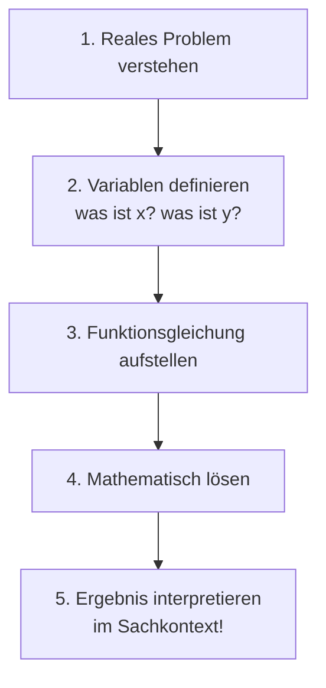

# Anwendungen von Funktionen

> [!info] Lernziele
> - Reale Situationen mit Funktionen modellieren
> - Funktionen aus Sachkontexten aufstellen
> - Berechnete Ergebnisse im Kontext interpretieren
> - Optimierungsprobleme mit quadratischen Funktionen lösen

## Warum mathematische Modellierung?

Funktionen sind nicht nur abstrakte mathematische Objekte – sie sind mächtige Werkzeuge, um die reale Welt zu beschreiben und vorherzusagen. Der Prozess, ein reales Problem in mathematische Sprache zu übersetzen, heißt **Modellierung**.

> [!info] **Geschichte der mathematischen Modellierung**
> Schon Galileo Galilei (1564–1642) erkannte, dass die Natur in der Sprache der Mathematik geschrieben ist. Er entdeckte, dass fallende Körper und geworfene Objekte mathematischen Gesetzen folgen. Seitdem nutzen Wissenschaftler und Ingenieure Funktionen, um alles zu modellieren – von Planetenbahnen bis zu Börsenkursen.

## Lineare Funktionen in der Praxis

Lineare Funktionen beschreiben Situationen mit **konstantem Zuwachs** oder **konstanter Rate**. Das Schema ist immer ähnlich: Grundgebühr (Fixkosten) plus variable Kosten.

### Beispiel 1: Taxikosten

Ein Taxi berechnet 3,50 € Grundgebühr plus 1,80 € pro Kilometer.

**Modell**: $K(x) = 1{,}80x + 3{,}50$

wobei $x$ = Kilometer, $K(x)$ = Kosten in Euro

> [!example] Fragen
> - Was kostet eine Fahrt von 8 km?
>   $K(8) = 1{,}80 \cdot 8 + 3{,}50 = 14{,}40 + 3{,}50 = 17{,}90$ €
> 
> - Wie weit kommt man mit 25 €?
>   $25 = 1{,}80x + 3{,}50$
>   $x = \frac{21{,}50}{1{,}80} \approx 11{,}9$ km

### Beispiel 2: Handytarif-Vergleich

| Tarif | Grundgebühr | pro Minute |
|---|---|---|
| A | 5 € | 0,10 € |
| B | 0 € | 0,25 € |

**Funktionen**:
- $K_A(x) = 0{,}10x + 5$
- $K_B(x) = 0{,}25x$

**Ab wann lohnt sich Tarif A?**

$0{,}10x + 5 < 0{,}25x$
$5 < 0{,}15x$
$x > 33{,}33$

**Ab 34 Minuten ist Tarif A günstiger.**

## Quadratische Funktionen: Wurfbewegung

### Der schiefe Wurf

Die Höhe eines geworfenen Balls folgt einer Parabel:

$$h(t) = -\frac{1}{2}gt^2 + v_0 t + h_0$$

oder vereinfacht (mit konkreten Werten):

$$h(x) = -0{,}1x^2 + x + 1{,}5$$

wobei $x$ = horizontale Entfernung (m), $h(x)$ = Höhe (m)

> [!example] Analyse
> **Starthöhe**: $h(0) = 1{,}5$ m
> 
> **Maximale Höhe** (Scheitelpunkt):
> $x_S = -\frac{1}{2 \cdot (-0{,}1)} = 5$ m
> $h(5) = -0{,}1 \cdot 25 + 5 + 1{,}5 = 4$ m
> 
> **Wurfweite** (Nullstelle mit $x > 0$):
> $-0{,}1x^2 + x + 1{,}5 = 0$
> $x \approx 11{,}4$ m

## Optimierungsprobleme

### Beispiel: Maximaler Flächeninhalt

Ein Bauer hat 100 m Zaun und möchte eine rechteckige Weide an einer Hauswand abzäunen (drei Seiten Zaun nötig).

![[weide-hauswand.png]]
*01-09-11-weide-hauswand: Rechteckige Weide an einer Hauswand – die Wand bildet die vierte Seite, sodass nur die beiden Seiten der Länge $x$ und die Breite $y$ eingezäunt werden müssen. Der gesamte Zaun beträgt $2x + y$.*

**Nebenbedingung**: $2x + y = 100$ → $y = 100 - 2x$

**Zielfunktion** (zu maximieren):
$$A(x) = x \cdot y = x(100 - 2x) = 100x - 2x^2 = -2x^2 + 100x$$

**Maximum** (Scheitelpunkt der nach unten geöffneten Parabel):
$$x_S = -\frac{100}{2 \cdot (-2)} = 25$$

**Ergebnis**:
- $x = 25$ m
- $y = 100 - 2 \cdot 25 = 50$ m
- $A_{max} = 25 \cdot 50 = 1250$ m²

### Beispiel: Gewinnmaximierung

Ein Unternehmen verkauft Produkte. Der Gewinn hängt vom Verkaufspreis ab:

$$G(p) = -2p^2 + 80p - 600$$

wobei $p$ = Preis in Euro, $G(p)$ = Gewinn in Euro

**Optimaler Preis**:
$$p_S = -\frac{80}{2 \cdot (-2)} = 20$$

**Maximaler Gewinn**:
$$G(20) = -2 \cdot 400 + 80 \cdot 20 - 600 = -800 + 1600 - 600 = 200 €$$

**Gewinnschwelle** (Break-Even, $G(p) = 0$):
$$-2p^2 + 80p - 600 = 0$$
$$p^2 - 40p + 300 = 0$$
$$p_{1,2} = 20 \pm \sqrt{400 - 300} = 20 \pm 10$$

$p_1 = 10$ €, $p_2 = 30$ €

→ Gewinn wird erzielt für Preise zwischen 10 € und 30 €.

## Modellierungsprozess

## Wichtige Hinweise

> [!warning] Bei Anwendungsaufgaben beachten
> - **Definitionsbereich** prüfen: Negative Längen, Preise, Zeiten sind oft nicht sinnvoll
> - **Einheiten** angeben: Das Ergebnis braucht die richtige Einheit
> - **Antwort im Kontext** formulieren: Nicht nur „$x = 25$", sondern „Die optimale Länge beträgt 25 m"
> - **Plausibilität** prüfen: Ist das Ergebnis realistisch?

> [!tip] **Strategie für Textaufgaben**
> 1. **Lesen**: Aufgabe zweimal lesen, wichtige Informationen markieren
> 2. **Variablen**: Was ist gesucht? Was ist gegeben? Variablen festlegen und aufschreiben
> 3. **Gleichung**: Zusammenhang als Funktion formulieren
> 4. **Rechnen**: Mathematisch lösen (Nullstellen, Scheitelpunkt, etc.)
> 5. **Antworten**: Ergebnis im Sachzusammenhang interpretieren und mit Einheit angeben
> 6. **Prüfen**: Ist das Ergebnis plausibel? Probe machen!

## Typische Anwendungsgebiete

| Bereich | Lineare Funktionen | Quadratische Funktionen |
|---|---|---|
| **Wirtschaft** | Fixkosten + variable Kosten | Gewinnmaximierung, Preiselastizität |
| **Physik** | Gleichförmige Bewegung | Wurfbewegung, Fallbewegung |
| **Technik** | Proportionale Zusammenhänge | Optimale Abmessungen |
| **Alltag** | Handytarife, Mietkosten | Flächenoptimierung |

## Zusammenfassung

> [!abstract] Kernpunkte
> - Lineare Funktionen: Kosten, Tarife, proportionale Zusammenhänge
> - Quadratische Funktionen: Wurfbewegung, Flächen, Optimierung
> - Scheitelpunkt einer Parabel = Maximum oder Minimum
> - Nullstellen = Break-Even-Punkte, Reichweiten
> - Ergebnisse immer im Sachkontext interpretieren

## Zusammenhänge

- → [[05-Lineare-Funktionen|Lineare Funktionen]] – Grundlagen für Kostenberechnungen
- → [[08-Quadratische-Funktionen|Quadratische Funktionen]] – Grundlagen für Optimierung
- → [[09-Parabeln|Parabeln]] – Scheitelpunktform für Maximum/Minimum
- → [[10-Schnittpunkte|Schnittpunkte]] – Break-Even-Analysen
- → [[../04-Dezimalzahlen-und-Prozentrechnung/10-Zinsrechnung|Zinsrechnung]] – Finanzielle Anwendungen
- → [[../05-Verhaeltnisse-und-Proportionalitaet/03-Dreisatz|Dreisatz]] – Alternative Lösungsmethode für proportionale Probleme

## Übungsaufgaben

1. **Stromkosten**: Ein Anbieter berechnet 12 € Grundgebühr plus 0,28 € pro kWh. 
   - Stelle die Kostenfunktion auf.
   - Was kosten 250 kWh?
   - Bei welchem Verbrauch zahlt man 50 €?

2. **Wurfparabel**: Die Höhe eines Balls wird beschrieben durch $h(x) = -0{,}05x^2 + 0{,}6x + 1{,}8$ (x in m, h in m).
   - Aus welcher Höhe wurde geworfen?
   - Wie hoch fliegt der Ball maximal?
   - Wie weit fliegt er?

3. **Flächenoptimierung**: Mit 60 m Zaun soll ein rechteckiges Gehege abgezäunt werden. Bei welchen Maßen ist die Fläche maximal?

4. **Gewinn**: $G(x) = -x^2 + 10x - 16$ beschreibt den Gewinn in Abhängigkeit von der Stückzahl $x$. 
   - Bei welcher Stückzahl ist der Gewinn maximal?
   - Ab welcher Stückzahl wird Gewinn erzielt?

---

**Navigation**: [[10-Schnittpunkte|← Schnittpunkte]] | [[00-Funktionen-Index|Übersicht]] | [[../10-Grundlagen-Geometrie/00-Geometrie-Index|Geometrie →]]
