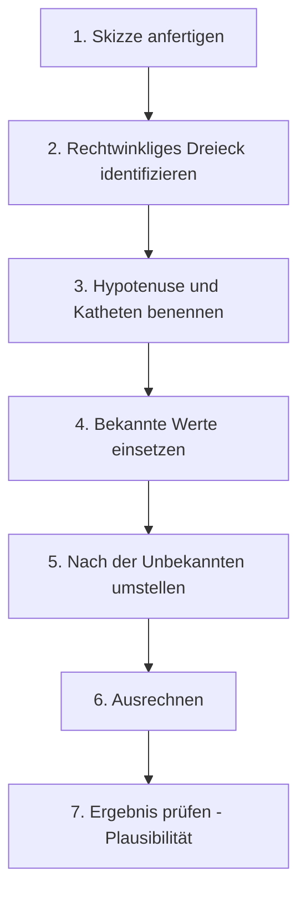

# Berechnung unbekannter Seiten

> [!info] Lernziele
> - Den Satz des Pythagoras zur Berechnung von Seiten anwenden
> - Die Formel nach der gesuchten Größe umstellen
> - Systematisch vorgehen bei der Problemlösung
> - Typische Aufgabentypen beherrschen

## Überblick

Die praktische Stärke des Satzes des Pythagoras zeigt sich bei der Berechnung unbekannter Seitenlängen. Ob Handwerker, Architekt oder Ingenieur – wer mit rechtwinkligen Dreiecken arbeitet, nutzt diese Berechnungen täglich. Das systematische Vorgehen, das du hier lernst, ist der Schlüssel zum Erfolg bei allen Pythagoras-Aufgaben.

## Systematisches Vorgehen

Ein strukturiertes Vorgehen hilft, Fehler zu vermeiden und auch komplexere Aufgaben zu lösen. Halte dich an diese bewährte Reihenfolge:

### Schritt-für-Schritt

> [!tip] **Warum eine Skizze?**
> Auch wenn die Aufgabe einfach erscheint – eine Skizze hilft enorm! Sie macht die Situation anschaulich und verhindert, dass du Hypotenuse und Katheten verwechselst. Viele Fehler passieren, weil dieser Schritt übersprungen wird.

## Hypotenuse berechnen

Die Hypotenuse zu berechnen ist der einfachste Fall: Du addierst die Quadrate der beiden Katheten und ziehst die Wurzel.

### Formel

$$c = \sqrt{a^2 + b^2}$$

> [!tip] **Merkregel**
> Bei der Hypotenuse wird **addiert** – die beiden kleineren Seiten „vereinen" sich zur größten Seite.

> [!example] Beispiel
> Ein rechtwinkliges Dreieck hat die Katheten $a = 5$ cm und $b = 12$ cm.
> 
> **Gesucht**: Hypotenuse $c$
> 
> **Lösung**:
> $$c = \sqrt{5^2 + 12^2} = \sqrt{25 + 144} = \sqrt{169} = 13 \text{ cm}$$
> 
> **Prüfung**: $c = 13$ ist größer als beide Katheten ✓
> 
> *Hinweis: (5, 12, 13) ist ein bekanntes pythagoreisches Tripel!*

## Kathete berechnen

Bei der Kathete ist Vorsicht geboten: Hier wird **subtrahiert**, nicht addiert! Die Hypotenuse ist immer größer als jede Kathete, daher ziehst du das Quadrat der bekannten Kathete vom Quadrat der Hypotenuse ab.

### Formel (nach a umgestellt)

$$a = \sqrt{c^2 - b^2}$$

### Formel (nach b umgestellt)

$$b = \sqrt{c^2 - a^2}$$

> [!warning] **Häufiger Fehler**
> Viele Schüler verwechseln die Formeln und addieren statt zu subtrahieren. Merke dir:
> - **Hypotenuse gesucht** → Katheten **addieren**: $c = \sqrt{a^2 + b^2}$
> - **Kathete gesucht** → **Subtrahieren** (Hypotenuse minus Kathete): $a = \sqrt{c^2 - b^2}$

> [!example] Beispiel
> Gegeben: $c = 10$ cm, $a = 6$ cm
> 
> **Gesucht**: Kathete $b$
> 
> **Lösung**:
> $$b = \sqrt{10^2 - 6^2} = \sqrt{100 - 36} = \sqrt{64} = 8 \text{ cm}$$
> 
> **Prüfung**: $6^2 + 8^2 = 36 + 64 = 100 = 10^2$ ✓
> 
> *Das Ergebnis (6, 8, 10) ist ein Vielfaches des 3-4-5-Tripels!*

## Praktische Beispiele

Die folgenden Beispiele zeigen typische Alltagssituationen, in denen der Satz des Pythagoras angewendet wird.

### Beispiel 1: Leiter an der Wand

Eine 5 m lange Leiter steht 1,5 m von der Hauswand entfernt. Wie hoch reicht sie?

> [!note] **Sicherheitshinweis**
> Im echten Leben gilt: Der optimale Anstellwinkel einer Leiter beträgt etwa 70–75°. Das entspricht ungefähr einem Fußabstand von einem Viertel der Leiterlänge.

![[berechnung-leiter.png]]
*11-03-berechnung-leiter: Die Leiter (5 m) bildet mit Wand und Boden ein rechtwinkliges Dreieck; der Fußabstand beträgt 1,5 m, gesucht ist die Höhe $h$.*

**Lösung**:
$$h = \sqrt{5^2 - 1{,}5^2} = \sqrt{25 - 2{,}25} = \sqrt{22{,}75} \approx 4{,}77 \text{ m}$$

### Beispiel 2: Diagonale im Rechteck

Ein Rechteck hat die Seiten 6 cm und 8 cm. Wie lang ist die Diagonale?

Diese Berechnung ist besonders wichtig bei Bildschirmen und Fernsehern – die Zollangabe bezeichnet immer die Diagonale!

![[berechnung-rechteck-diagonale.png]]
*11-03-berechnung-rechteck-diagonale: Im Rechteck ($8 \times 6$) bildet die Diagonale $d$ mit zwei Seiten ein rechtwinkliges Dreieck.*

**Lösung**:
$$d = \sqrt{6^2 + 8^2} = \sqrt{36 + 64} = \sqrt{100} = 10 \text{ cm}$$

> [!tip] **Alltagsanwendung: Fernseher**
> Ein 55-Zoll-Fernseher mit 16:9-Format hat etwa 121 cm Breite und 68 cm Höhe. Die Diagonale: $\sqrt{121^2 + 68^2} \approx 139$ cm = 55 Zoll ✓

### Beispiel 3: Entfernung zwischen zwei Punkten

Im Koordinatensystem: $A(2, 1)$ und $B(6, 4)$. Wie groß ist der Abstand?

Diese Methode wird auch als **Abstandsformel** bezeichnet und ist eine direkte Anwendung des Satzes des Pythagoras im Koordinatensystem. Sie bildet die Grundlage für GPS-Navigation und Computergrafik.

![[berechnung-abstand-koordinaten.png]]
*11-03-berechnung-abstand-koordinaten: Der Abstand der Punkte $A(2,1)$ und $B(6,4)$ ist die Hypotenuse eines Dreiecks mit den Katheten $\Delta x = 4$ und $\Delta y = 3$.*

**Lösung**:
$$d = \sqrt{(6-2)^2 + (4-1)^2} = \sqrt{16 + 9} = \sqrt{25} = 5$$

> [!note] **Allgemeine Abstandsformel**
> Für zwei Punkte $P_1(x_1, y_1)$ und $P_2(x_2, y_2)$ gilt:
> $$d = \sqrt{(x_2 - x_1)^2 + (y_2 - y_1)^2}$$
> Diese Formel ist nichts anderes als der Satz des Pythagoras, angewendet auf das Dreieck, das durch die horizontale und vertikale Differenz gebildet wird.

## Häufige Fehler vermeiden

> [!warning] Typische Fehler
> 
> **Fehler 1**: Hypotenuse und Kathete verwechseln
> - Die Hypotenuse ist IMMER die längste Seite
> - Sie liegt dem rechten Winkel gegenüber
> 
> **Fehler 2**: Falsches Vorzeichen unter der Wurzel
> - Bei der Kathete: $a = \sqrt{c^2 - b^2}$, nicht $\sqrt{b^2 - c^2}$
> - Der größere Wert ($c^2$) steht vorne!
> 
> **Fehler 3**: Wurzel vergessen
> - $a^2 = 64$ bedeutet $a = 8$, nicht $a = 64$!

## Sonderfälle

### Gleichschenklig-rechtwinkliges Dreieck

Bei $a = b$ (beide Katheten gleich):

$$c = \sqrt{a^2 + a^2} = \sqrt{2a^2} = a\sqrt{2}$$

> [!example] Beispiel
> $a = b = 5$ cm → $c = 5\sqrt{2} \approx 7{,}07$ cm

### Verdopplung/Halbierung

Wenn alle Seiten mit demselben Faktor multipliziert werden, bleibt das Dreieck rechtwinklig.

$(3, 4, 5)$ → $(6, 8, 10)$ → $(9, 12, 15)$ ...

## Zusammenfassung

> [!abstract] Kernpunkte
> - Hypotenuse: $c = \sqrt{a^2 + b^2}$
> - Kathete: $a = \sqrt{c^2 - b^2}$ oder $b = \sqrt{c^2 - a^2}$
> - Immer zuerst die Hypotenuse identifizieren
> - Bei der Kathete: größeres Quadrat minus kleineres Quadrat
> - Ergebnis auf Plausibilität prüfen

## Zusammenhänge

Querverweise zu verwandten Themen:

- → [[02-Satz-des-Pythagoras|Satz des Pythagoras]] – Die theoretische Grundlage
- → [[04-Anwendungen-Pythagoras|Anwendungen]] – Raumdiagonalen und weitere Beispiele
- → [[../06-Potenzen-Wurzeln-und-Zahlendarstellung/06-Quadratwurzeln|Quadratwurzeln]] – Rechnen mit Wurzeln
- → [[../09-Funktionen-und-Koordinatensysteme/02-Punkte-und-Koordinaten|Punkte und Koordinaten]] – Abstandsformel im Detail

## Übungsaufgaben

1. Berechne die fehlende Seite:
   - $a = 9$ cm, $b = 12$ cm, $c = ?$
   - $a = 7$ cm, $c = 25$ cm, $b = ?$
   - $b = 20$ cm, $c = 29$ cm, $a = ?$

2. Die Diagonale eines Quadrats ist 10 cm lang. Wie lang ist die Seite?

3. Ein Dach hat eine Breite von 8 m und eine Höhe von 3 m. Wie lang ist die Dachschräge?

4. Zwei Punkte haben die Koordinaten $P(1, 2)$ und $Q(7, 10)$. Berechne den Abstand.

5. Eine Rutsche ist 4 m lang. Die Plattform ist 2,5 m hoch. Wie weit von der Plattform entfernt endet die Rutsche?

---

**Navigation**: [[02-Satz-des-Pythagoras|← Satz des Pythagoras]] | [[00-Pythagoras-Trigonometrie-Index|Übersicht]] | [[04-Anwendungen-Pythagoras|Anwendungen →]]
