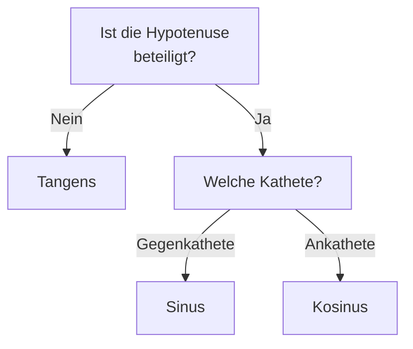

# Berechnung von Seitenlängen

> [!info] Lernziele
> - Die richtige Winkelfunktion für ein Problem auswählen
> - Systematisch Seitenlängen berechnen
> - Komplexere Aufgaben in Teilprobleme zerlegen
> - Ergebnisse überprüfen

## Überblick

In der Praxis stehen wir oft vor der Aufgabe, aus bekannten Winkeln und Seiten andere Größen zu berechnen. Das systematische Vorgehen, das du hier lernst, hilft dir, die richtige Winkelfunktion auszuwählen und Fehler zu vermeiden. Der Schlüssel liegt darin, die Situation genau zu analysieren und die Beziehungen zwischen den Seiten zu erkennen.

## Strategie zur Auswahl der richtigen Funktion

### Schritt 1: Situation analysieren

1. Skizze anfertigen
2. Rechten Winkel und gegebenen spitzen Winkel markieren
3. Bekannte Seiten eintragen
4. Gesuchte Seite markieren

### Schritt 2: Seitenbezeichnungen zuordnen

Bezogen auf den gegebenen Winkel:
- Welche Seite ist die **Hypotenuse**?
- Welche ist die **Ankathete**?
- Welche ist die **Gegenkathete**?

### Schritt 3: Funktion wählen

| Bekannt | Gesucht | Funktion |
|---|---|---|
| Hypotenuse | Gegenkathete | sin |
| Hypotenuse | Ankathete | cos |
| Ankathete | Gegenkathete | tan |
| Gegenkathete | Ankathete | tan |
| Gegenkathete | Hypotenuse | sin |
| Ankathete | Hypotenuse | cos |

### Entscheidungsbaum

Der folgende Entscheidungsbaum hilft dir, schnell die richtige Funktion zu finden:

> [!tip] **Einfache Merkregel**
> - **Keine Hypotenuse dabei?** → Tangens!
> - **Gegenkathete dabei?** → Sinus!
> - **Ankathete dabei?** → Kosinus!
>
> Die Hypotenuse entscheidet also, ob tan überhaupt in Frage kommt.

## Formelübersicht

### Mit Sinus

$$\text{Gegenkathete} = \text{Hypotenuse} \cdot \sin(\alpha)$$
$$\text{Hypotenuse} = \frac{\text{Gegenkathete}}{\sin(\alpha)}$$

### Mit Kosinus

$$\text{Ankathete} = \text{Hypotenuse} \cdot \cos(\alpha)$$
$$\text{Hypotenuse} = \frac{\text{Ankathete}}{\cos(\alpha)}$$

### Mit Tangens

$$\text{Gegenkathete} = \text{Ankathete} \cdot \tan(\alpha)$$
$$\text{Ankathete} = \frac{\text{Gegenkathete}}{\tan(\alpha)}$$

## Ausführliche Beispiele

### Beispiel 1: Mit Sinus

Ein rechtwinkliges Dreieck hat eine Hypotenuse von 15 cm und einen Winkel von 42°. Berechne die Gegenkathete.

**Lösung**:
$$a = c \cdot \sin(\alpha) = 15 \cdot \sin(42°) = 15 \cdot 0{,}669 \approx 10{,}04 \text{ cm}$$

### Beispiel 2: Mit Kosinus

Die Ankathete zu einem 55°-Winkel ist 8 cm lang. Wie lang ist die Hypotenuse?

**Lösung**:
$$c = \frac{b}{\cos(\alpha)} = \frac{8}{\cos(55°)} = \frac{8}{0{,}574} \approx 13{,}94 \text{ cm}$$

### Beispiel 3: Mit Tangens

Von einem 48 m hohen Leuchtturm sieht man ein Schiff unter einem Tiefenwinkel von 8°. Wie weit ist das Schiff entfernt?

![[seitenlaengen-leuchtturm.png]]
*11-09-seitenlaengen-leuchtturm: Von einem 48 m hohen Leuchtturm wird ein Schiff unter einem Tiefenwinkel von 8° gesehen; der Tangens liefert die Entfernung $x$.*

**Lösung**:
$$\tan(8°) = \frac{48}{x}$$
$$x = \frac{48}{\tan(8°)} = \frac{48}{0{,}141} \approx 340 \text{ m}$$

## Komplexere Aufgaben

### Zwei Berechnungsschritte

> [!example] Beispiel
> Ein Dreieck hat die Hypotenuse $c = 20$ cm und den Winkel $\alpha = 38°$. Berechne beide Katheten.
> 
> **Gegenkathete** (mit sin):
> $a = 20 \cdot \sin(38°) = 20 \cdot 0{,}616 \approx 12{,}3$ cm
> 
> **Ankathete** (mit cos):
> $b = 20 \cdot \cos(38°) = 20 \cdot 0{,}788 \approx 15{,}8$ cm
> 
> **Kontrolle mit Pythagoras**:
> $12{,}3^2 + 15{,}8^2 = 151{,}3 + 249{,}6 = 400{,}9 \approx 400 = 20^2$ ✓

## Tipps zur Kontrolle

> [!tip] Plausibilitätsprüfungen
> - Die Hypotenuse ist immer die längste Seite
> - Bei 45° sind beide Katheten gleich lang
> - Bei kleinem Winkel: Gegenkathete klein, Ankathete groß
> - Bei großem Winkel: Gegenkathete groß, Ankathete klein
> - Mit Pythagoras gegenchecken

## Zusammenfassung

> [!abstract] Kernpunkte
> - Erst analysieren: Welche Seiten sind beteiligt?
> - Funktion nach Seitenbeziehung wählen
> - Hypotenuse beteiligt → sin oder cos
> - Nur Katheten → tan
> - Nach Berechnung: Plausibilität prüfen

## Zusammenhänge

Querverweise zu verwandten Themen:

- → [[06-Sinus|Sinus]] – Wenn Gegenkathete und Hypotenuse beteiligt sind
- → [[07-Kosinus|Kosinus]] – Wenn Ankathete und Hypotenuse beteiligt sind
- → [[08-Tangens|Tangens]] – Wenn nur die Katheten beteiligt sind
- → [[10-Berechnung-Winkel|Winkelberechnung]] – Der umgekehrte Fall

## Übungsaufgaben

1. Wähle die richtige Funktion und berechne:
   - Hypotenuse 18 cm, Winkel 35°, Gegenkathete = ?
   - Ankathete 9 cm, Winkel 62°, Hypotenuse = ?
   - Ankathete 7 cm, Winkel 28°, Gegenkathete = ?

2. Ein rechtwinkliges Dreieck hat c = 25 cm und α = 53°. Berechne a und b.

3. Die Rampe zur Ladebucht eines LKWs ist 3,5 m lang und hat einen Neigungswinkel von 15°. Wie hoch ist die Ladefläche?

4. Ein Kirchturm wirft einen 42 m langen Schatten. Die Sonne steht unter einem Winkel von 52°. Wie hoch ist der Kirchturm?

---

**Navigation**: [[08-Tangens|← Tangens]] | [[00-Pythagoras-Trigonometrie-Index|Übersicht]] | [[10-Berechnung-Winkel|Winkelberechnung →]]
