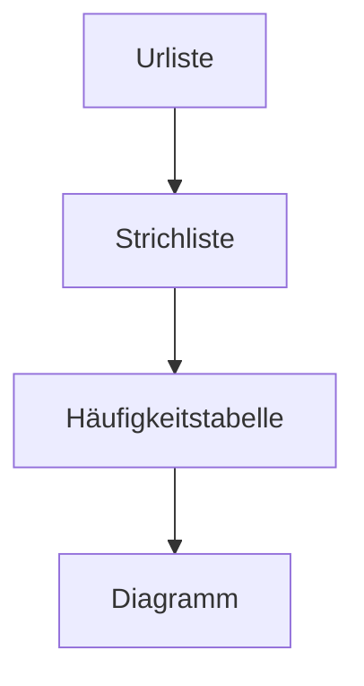

# Tabellen

## Einführung

> [!info] Lernziele
> Nach dieser Lektion können Sie:
> - Daten in Tabellen strukturieren
> - Häufigkeitstabellen erstellen
> - Tabellen richtig beschriften

Tabellen sind eines der ältesten und wichtigsten Werkzeuge zur Darstellung von Daten. Schon die Babylonier nutzten vor über 4000 Jahren Tontafeln mit tabellarischen Aufstellungen für astronomische Beobachtungen und Handelsdaten. Heute begegnen uns Tabellen überall: in Fahrplänen, Preislisten, Sportergebnissen und wissenschaftlichen Publikationen.

Der große Vorteil von Tabellen: Sie bringen Ordnung in unübersichtliche Datenmengen und ermöglichen schnelle Vergleiche. Eine gut gestaltete Tabelle kann auf einen Blick zeigen, was in einem langen Text mühsam zu erfassen wäre.

## Aufbau einer Tabelle

Eine vollständige Tabelle besteht aus mehreren Bestandteilen:

| Bestandteil | Beschreibung | Beispiel |
|-------------|--------------|----------|
| **Titel** | Beschreibt den Inhalt präzise | „Lieblingsfächer der Klasse 9a" |
| **Spaltenüberschriften** | Bezeichnung der Merkmale/Variablen | „Fach", „Anzahl", „Prozent" |
| **Zeilen** | Einzelne Datensätze oder Kategorien | Mathe, Deutsch, Sport, ... |
| **Summenzeile** | Optional, dient der Kontrolle | Gesamtsumme = 100% |
| **Quellenangabe** | Bei fremden Daten | „Quelle: Klassenbefragung, 2024" |

> [!tip] **Warum ist der Titel so wichtig?**
> Ein guter Titel beantwortet die Fragen: **Was** wurde gemessen, **wo** und **wann**?
> 
> - Schlecht: „Tabelle 1"
> - Besser: „Lieblingsfächer"
> - Optimal: „Lieblingsfächer der Schüler der Klasse 9a, Befragung Oktober 2024"

## Häufigkeitstabelle

Die Häufigkeitstabelle ist die wichtigste Tabellenform in der beschreibenden Statistik. Sie zeigt, wie oft jede Merkmalsausprägung vorkommt.

> [!example] Beispiel: Lieblingsfächer
> | Fach | Absolute Häufigkeit | Relative Häufigkeit |
> |------|--------------------:|--------------------:|
> | Mathe | 8 | 32% |
> | Deutsch | 5 | 20% |
> | Sport | 7 | 28% |
> | Kunst | 5 | 20% |
> | **Summe** | **25** | **100%** |

Die **absolute Häufigkeit** gibt an, wie oft ein Wert vorkommt (hier: 8 Schüler mögen Mathe am liebsten). Die **relative Häufigkeit** drückt denselben Sachverhalt als Anteil aus (hier: 32% der Klasse).

## Regeln für gute Tabellen

> [!tip] **Gestaltungsregeln**
> 1. **Aussagekräftiger Titel**: Was, wo, wann?
> 2. **Eindeutige Spaltenüberschriften**: Keine Abkürzungen ohne Erklärung
> 3. **Einheiten angeben**: cm, kg, €, % – immer in der Überschrift, nicht in jeder Zelle
> 4. **Zahlen rechtsbündig ausrichten**: So stehen die Stellen untereinander
> 5. **Summenzeile zur Kontrolle**: Hilft Fehler zu entdecken
> 6. **Nicht zu viele Nachkommastellen**: Nur so genau wie nötig

> [!warning] **Häufiger Fehler: Überladene Tabellen**
> Eine Tabelle mit 20 Spalten und 50 Zeilen ist unübersichtlich. Besser: Aufteilen in mehrere kleinere Tabellen oder ein Diagramm verwenden.

## Von der Urliste zur Häufigkeitstabelle

Der typische Arbeitsablauf in der Statistik:

1. **Urliste**: Rohdaten in Erhebungsreihenfolge
2. **Strichliste**: Zählen der einzelnen Ausprägungen
3. **Häufigkeitstabelle**: Geordnete Darstellung mit absoluten und relativen Häufigkeiten
4. **Diagramm**: Visuelle Darstellung (optional, je nach Zweck)

## Zusammenhänge

Querverweise zu verwandten Themen:

- → [[02-Datenerhebung|Datenerhebung]] – Woher kommen die Daten?
- → [[04-Absolute-und-relative-Haeufigkeiten|Häufigkeiten]] – Absolute und relative Häufigkeit berechnen
- → [[05-Balkendiagramme|Balkendiagramme]] – Tabellen grafisch darstellen
- → [[06-Kreisdiagramme|Kreisdiagramme]] – Anteile visualisieren

> [!warning] **Prüfungsrelevant**
> - Bestandteile einer vollständigen Tabelle benennen können
> - Eine Häufigkeitstabelle aus einer Urliste erstellen
> - Gestaltungsregeln für Tabellen kennen

---

**Navigation:** [[02-Datenerhebung|← Datenerhebung]] | [[04-Absolute-und-relative-Haeufigkeiten|Häufigkeiten →]]
