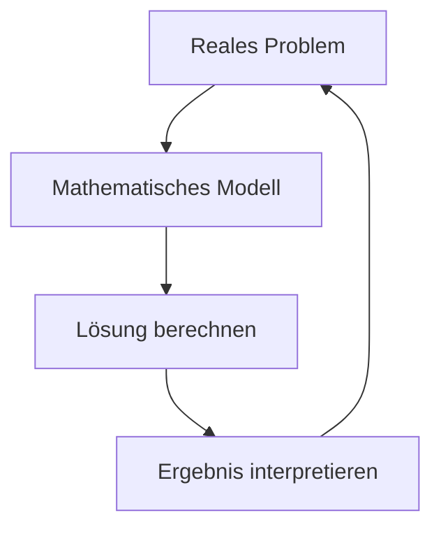

# Praktische Mathematik und Abschlussprojekt

## Kapitelübersicht

Dieses abschließende Kapitel verbindet alle gelernten Themen in praktischen Anwendungen. Sie lernen, Mathematik als Werkzeug zur Problemlösung einzusetzen.

Mathematik ist keine Sammlung isolierter Regeln, die man auswendig lernt und wieder vergisst. Sie ist ein mächtiges Werkzeug, das in nahezu jedem Berufsfeld und Lebensbereich Anwendung findet. In diesem Kapitel werden Sie erleben, wie die verschiedenen mathematischen Konzepte – von [[../02-Grundrechenarten-und-Rechengesetze/00-Grundrechenarten-Index|Grundrechenarten]] über [[../04-Dezimalzahlen-und-Prozentrechnung/00-Dezimalzahlen-Index|Prozentrechnung]] bis hin zu [[../09-Funktionen-und-Koordinatensysteme/00-Funktionen-Index|Funktionen]] – zusammenwirken, um reale Probleme zu lösen.

Die Fähigkeit, mathematische Methoden praktisch anzuwenden, unterscheidet bloßes Wissen von echter Kompetenz. Ein Handwerker, der Materialmengen berechnet, eine Kauffrau, die Rabatte kalkuliert, ein Ingenieur, der Kräfte analysiert – sie alle nutzen dieselben mathematischen Grundlagen, die Sie in diesem Kurs erlernt haben.

> [!info] Lernziele
> Nach Abschluss dieses Kapitels können Sie:
> - Textaufgaben systematisch lösen
> - Einheiten sicher umrechnen
> - Mathematik mit digitalen Werkzeugen verbinden
> - Komplexe Probleme mathematisch modellieren

## Themen in diesem Kapitel

| # | Thema | Beschreibung |
|---|-------|--------------|
| 01 | [[01-Textaufgaben-loesen\|Textaufgaben lösen]] | Systematisches Vorgehen |
| 02 | [[02-Einheiten-umrechnen\|Einheiten umrechnen]] | SI-Einheiten und Umrechnungen |
| 03 | [[03-Technische-Berechnungen\|Technische Berechnungen]] | Anwendungen in der Technik |
| 04 | [[04-Wirtschaftliche-Berechnungen\|Wirtschaftsrechnen]] | Prozente, Zinsen, Rabatte |
| 05 | [[05-Funktionen-graphisch\|Funktionen graphisch]] | Darstellung und Interpretation |
| 06 | [[06-Tabellenkalkulation\|Tabellenkalkulation]] | Excel/Calc für Statistik |
| 07 | [[07-Python-Mathematik\|Python für Mathematik]] | Programmieren mit Python |
| 08 | [[08-Simulation\|Simulation]] | Zufallsexperimente simulieren |
| 09 | [[09-Mathematische-Modelle\|Mathematische Modelle]] | Realität modellieren |
| 10 | [[10-Abschlusspruefung\|Abschlussprüfung]] | Übungsaufgaben und Tipps |

## Warum praktische Mathematik wichtig ist

Die Trennung von „Schulmathe" und „echter Mathematik" ist ein weit verbreitetes Missverständnis. In der Realität gibt es keine Aufgaben, die sauber beschriftet mit „Hier kommt Bruchrechnung" daherkommen. Stattdessen begegnen uns Situationen, die wir selbst analysieren und in mathematische Probleme übersetzen müssen.

### Mathematik im Beruf

| Berufsfeld | Typische mathematische Aufgaben |
|------------|--------------------------------|
| **Handwerk** | Materialberechnung, Flächen- und Volumenmessung, Mischungsverhältnisse |
| **Kaufmännisch** | Prozentrechnung, Zins, Rabatte, Kalkulation, Statistik |
| **Technisch** | Physikalische Formeln, Maßstab, technische Zeichnungen |
| **IT/Informatik** | Algorithmen, Logik, Simulationen, Datenanalyse |
| **Gesundheit** | Dosierungen, Verdünnungen, Vitalwerte-Interpretation |

> [!tip] **Schlüsselkompetenz Modellieren**
> Der wichtigste Schritt bei praktischen Problemen ist das **mathematische Modellieren**: die Übersetzung einer realen Situation in eine mathematische Darstellung. Diese Fähigkeit wird in [[09-Mathematische-Modelle|Kapitel 9]] systematisch trainiert.

## Der Modellierungskreislauf

Praktische Mathematik folgt einem immer wiederkehrenden Muster:

Dieser Kreislauf zeigt: Mathematik endet nicht bei der Berechnung. Das Ergebnis muss immer zurück in die Realität übersetzt und auf Plausibilität geprüft werden.

## Prüfungsrelevanz

> [!warning] Prüfungsschwerpunkte
> - Textaufgaben aus allen Bereichen
> - Einheitenumrechnung
> - Wirtschaftliches Rechnen (Prozente, Zinsen)
> - Graphisches Darstellen von Funktionen

Die Prüfungsaufgaben testen nicht nur Rechenfähigkeit, sondern vor allem das Verständnis und die Anwendungskompetenz. Typischerweise werden Aufgaben aus verschiedenen Themenbereichen kombiniert – genau wie in der Realität.

## Zusammenhänge

Dieses Kapitel verbindet Wissen aus dem gesamten Kurs:

- → [[../02-Grundrechenarten-und-Rechengesetze/00-Grundrechenarten-Index|Grundrechenarten]] – Basis aller Berechnungen
- → [[../04-Dezimalzahlen-und-Prozentrechnung/00-Dezimalzahlen-Index|Prozentrechnung]] – für wirtschaftliche Berechnungen
- → [[../05-Verhaeltnisse-und-Proportionalitaet/00-Verhaeltnisse-Index|Verhältnisse und Dreisatz]] – für Umrechnungen
- → [[../09-Funktionen-und-Koordinatensysteme/00-Funktionen-Index|Funktionen]] – für graphische Darstellungen
- → [[../13-Statistik-und-Datenanalyse/00-Statistik-Index|Statistik]] – für Datenanalyse mit digitalen Werkzeugen
- → [[../14-Wahrscheinlichkeitsrechnung/00-Wahrscheinlichkeit-Index|Wahrscheinlichkeit]] – für Simulationen

---

**Navigation:** [[../14-Wahrscheinlichkeitsrechnung/00-Wahrscheinlichkeit-Index|← Wahrscheinlichkeit]] | [[../00-Kursueberblick|Kursübersicht →]]
