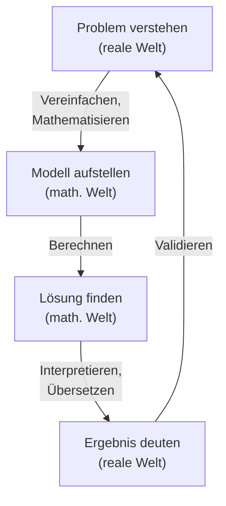

# Mathematische Modelle entwickeln

## Einführung

> [!info] Lernziele
> Nach dieser Lektion können Sie:
> - Reale Situationen mathematisch beschreiben
> - Vereinfachungen treffen
> - Modelle kritisch bewerten

Mathematische Modellierung ist die Kunst, reale Probleme in die Sprache der Mathematik zu übersetzen. Dabei wird die komplexe Wirklichkeit auf wesentliche Aspekte reduziert, um sie berechenbar zu machen. Diese Fähigkeit ist der Kern angewandter Mathematik – und wird in nahezu jedem technischen und wissenschaftlichen Beruf benötigt.

### Was ist ein mathematisches Modell?

Ein mathematisches Modell ist eine vereinfachte Darstellung der Realität mithilfe mathematischer Strukturen (Gleichungen, Funktionen, Graphen, ...). Es ist wie eine Landkarte: Sie zeigt nicht jedes Detail, aber genug, um ans Ziel zu finden.

> [!note] **Berühmte Modelle**
> - **Newtons Gravitationsgesetz**: Beschreibt die Anziehung zwischen Massen
> - **Exponentielles Wachstum**: Beschreibt Bakterienvermehrung, Zinseszins
> - **SIR-Modell**: Beschreibt die Ausbreitung von Infektionskrankheiten
> - **Klimamodelle**: Simulieren das Weltklima mit Millionen von Gleichungen

---

## Modellierungskreislauf

1. **Reales Problem** verstehen
2. **Vereinfachen** (Annahmen treffen)
3. **Mathematisieren** (Formeln aufstellen)
4. **Berechnen** (Lösung finden)
5. **Interpretieren** (zurück zur Realität)
6. **Validieren** (Ergebnis prüfen)

### Der Kreislauf im Detail

*15-09-modellierungskreislauf: Der Modellierungskreislauf pendelt zwischen realer und mathematischer Welt – vom Problem über Modell und Lösung zurück zur Interpretation.*

### Die Phasen erklärt

**1. Problem verstehen**: Was genau ist die Fragestellung? Welche Informationen sind gegeben?

**2. Vereinfachen**: Welche Faktoren sind wichtig, welche können vernachlässigt werden? Hier werden **Annahmen** getroffen.

**3. Mathematisieren**: Übersetzen in Gleichungen, Funktionen oder andere mathematische Strukturen.

**4. Berechnen**: Die mathematische Lösung finden – mit Stift und Papier, Taschenrechner oder Computer.

**5. Interpretieren**: Was bedeutet das mathematische Ergebnis für das reale Problem?

**6. Validieren**: Ist das Ergebnis plausibel? Stimmt es mit der Realität überein?

> [!tip] **Iteration ist normal**
> Modellierung ist selten beim ersten Versuch perfekt. Oft muss man zurückgehen, Annahmen überdenken und das Modell verbessern. Das ist kein Fehler, sondern Teil des Prozesses!

---

## Beispiel: Handytarif

> [!example] Welcher Tarif ist günstiger?
> - Tarif A: 10 € Grundgebühr + 0,10 €/min
> - Tarif B: 0 € Grundgebühr + 0,15 €/min
> 
> **Modell:** 
> $K_A(x) = 10 + 0{,}10x$
> $K_B(x) = 0{,}15x$
> 
> **Break-even:** $10 + 0{,}10x = 0{,}15x \Rightarrow x = 200$ min

### Die Analyse fortsetzen

Das Modell erlaubt weitere Fragen zu beantworten:

| Nutzung | Kosten Tarif A | Kosten Tarif B | Besser |
|---------|----------------|----------------|--------|
| 100 min | 20 € | 15 € | B |
| 200 min | 30 € | 30 € | gleich |
| 300 min | 40 € | 45 € | A |
| 500 min | 60 € | 75 € | A |

> [!tip] **Grafische Darstellung**
> Die beiden Kostenfunktionen lassen sich als Geraden darstellen. Der Schnittpunkt bei 200 Minuten zeigt den Break-even-Punkt, ab dem Tarif A günstiger wird.

---

## Weitere Modellierungsbeispiele

### Exponentielles Wachstum

> [!example] Bakterienwachstum
> Eine Bakterienkultur verdoppelt sich alle 20 Minuten. Zu Beginn sind 1000 Bakterien vorhanden.
> 
> **Annahmen:**
> - Unendlich Nährstoffe vorhanden
> - Keine Bakterien sterben
> - Konstante Verdopplungszeit
> 
> **Modell:** $N(t) = 1000 \cdot 2^{t/20}$ (t in Minuten)
> 
> **Berechnung:** Nach 2 Stunden (120 min):
> $N(120) = 1000 \cdot 2^{120/20} = 1000 \cdot 2^6 = 64.000$ Bakterien

### Bremswegberechnung

> [!example] Anhalteweg eines Autos
> **Reales Problem:** Wie weit fährt ein Auto noch, nachdem der Fahrer eine Gefahr erkennt?
> 
> **Annahmen:**
> - Reaktionszeit: 1 Sekunde
> - Trockene Straße, gute Bremsen
> 
> **Modell:**
> - Reaktionsweg: $s_R = v$ (in m, wenn v in m/s)
> - Bremsweg: $s_B = \frac{v^2}{2a}$ (a = Verzögerung, ca. 8 m/s²)
> - Anhalteweg: $s_A = s_R + s_B$
> 
> **Beispiel bei 50 km/h (≈ 14 m/s):**
> - Reaktionsweg: 14 m
> - Bremsweg: $\frac{14^2}{16} \approx 12$ m
> - **Anhalteweg: ca. 26 m**

---

## Grenzen von Modellen

- Vereinfachungen können zu Fehlern führen
- Modelle sind nie perfekt
- Immer kritisch hinterfragen

### Typische Vereinfachungen und ihre Grenzen

| Vereinfachung | Wann problematisch? |
|---------------|---------------------|
| Reibung vernachlässigen | Bei langsamen Bewegungen, rauhen Oberflächen |
| Lineares Wachstum annehmen | Bei Sättigungseffekten |
| Konstante Werte annehmen | Bei Temperatur-/Druckänderungen |
| Ideale Bedingungen | In der echten Welt gibt es Störfaktoren |

> [!warning] **Häufiger Fehler: Modell mit Realität verwechseln**
> Ein Modell ist immer eine Vereinfachung. Die Aussage „Laut Modell..." bedeutet nicht „In Wirklichkeit...". Gute Modelle sind nützlich, aber nie perfekt.
> 
> Der Statistiker George Box sagte: „Alle Modelle sind falsch, aber einige sind nützlich."

### Modelle verbessern

Wenn ein Modell nicht gut zur Realität passt, gibt es mehrere Möglichkeiten:
1. **Mehr Faktoren einbeziehen** (komplexeres Modell)
2. **Bessere Daten verwenden** (genauere Parameter)
3. **Annahmen überprüfen** (vielleicht ist eine Annahme unrealistisch)
4. **Gültigkeitsbereich einschränken** (das Modell gilt nur unter bestimmten Bedingungen)

---

## Zusammenhänge

Mathematische Modellierung verbindet alle Bereiche der Mathematik:

- → [[01-Textaufgaben-loesen|Textaufgaben lösen]] – Modellierung im Kleinen
- → [[../09-Funktionen-und-Koordinatensysteme/05-Lineare-Funktionen|Lineare Funktionen]] – Grundlage vieler Modelle
- → [[../04-Dezimalzahlen-und-Prozentrechnung/11-Zinseszins-Grundlagen|Zinseszins]] – exponentielles Wachstum
- → [[08-Simulation|Simulation]] – Modelle durch Simulation testen

---

**Navigation:** [[08-Simulation|← Simulation]] | [[10-Abschlusspruefung|Abschlussprüfung →]]
