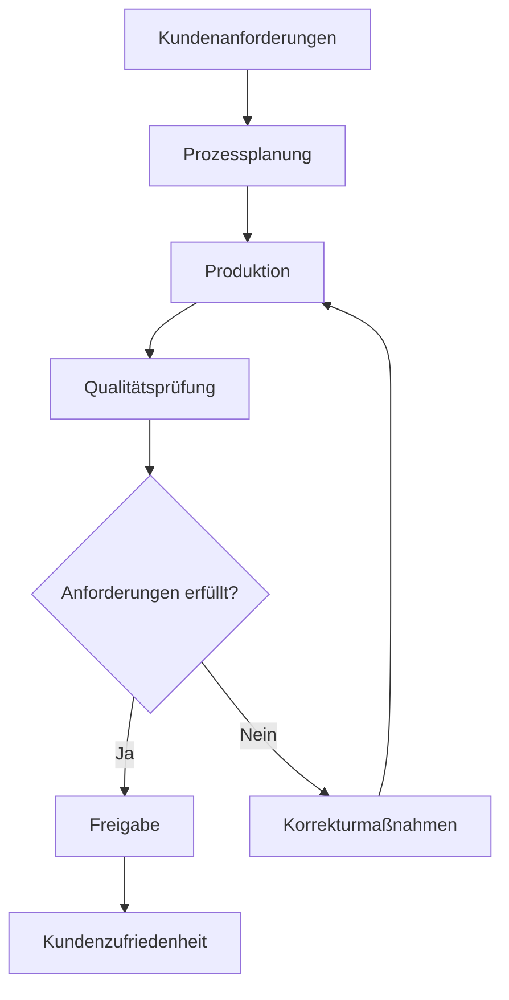
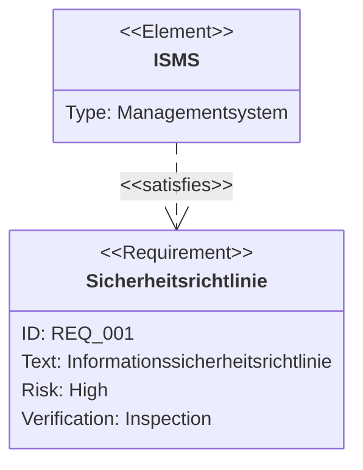
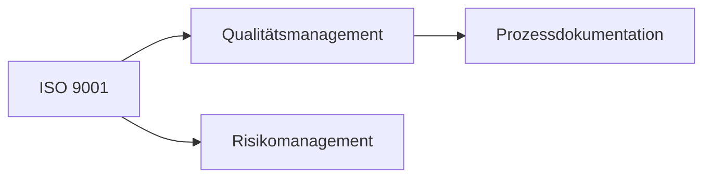
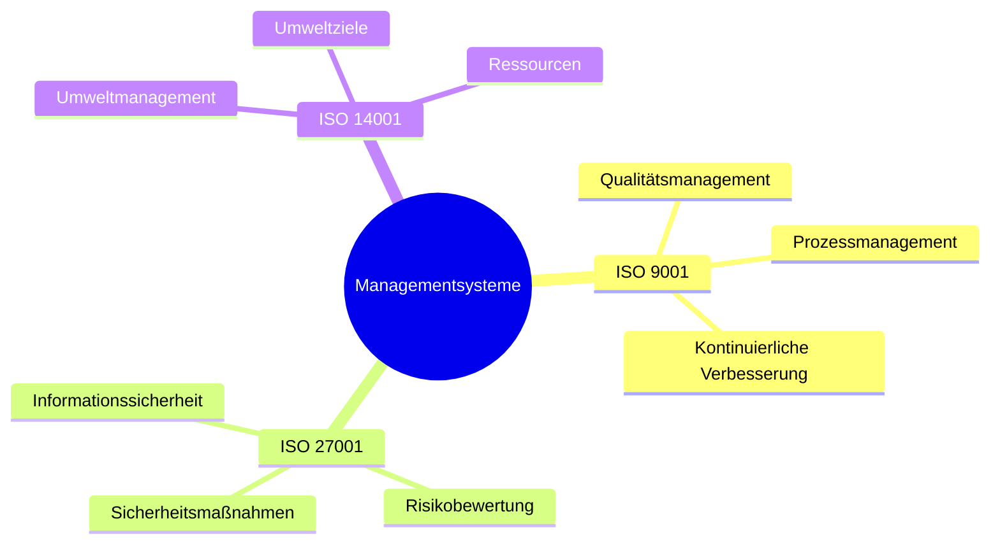
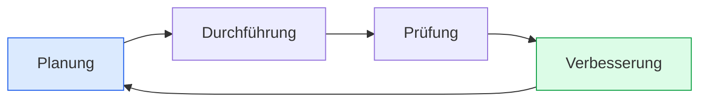

# Mermaid-Diagramme in Obsidian – Möglichkeiten und Funktionen

**Obsidian unterstützt Mermaid-Diagramme direkt, ohne zusätzliche Plugins.** Damit kannst du Prozesse, Systemarchitekturen, Datenmodelle, Projektpläne, Mindmaps und viele weitere Diagramme direkt in Markdown-Dateien erstellen.

Besonders interessant: Mermaid-Diagramme sind **textbasiert, versionierbar und teilweise mit anderen Obsidian-Notizen verlinkbar**.

## 1. Welche Diagrammtypen gibt es?

Mermaid bietet mehr als 20 Diagrammtypen. Welche davon in Obsidian funktionieren, hängt von der eingebauten Mermaid-Version ab.

| Diagrammtyp | Mermaid-Befehl | Einsatzbereich |
|---|---|---|
| **Flussdiagramm** | `flowchart` | Prozesse, Entscheidungen, Workflows |
| **Sequenzdiagramm** | `sequenceDiagram` | Kommunikation zwischen Systemen |
| **Klassendiagramm** | `classDiagram` | Softwarearchitektur, Datenmodelle |
| **Zustandsdiagramm** | `stateDiagram-v2` | Zustandsübergänge |
| **Entity-Relationship** | `erDiagram` | Datenbankmodellierung |
| **Gantt-Diagramm** | `gantt` | Projektplanung |
| **Mindmap** | `mindmap` | Wissensstrukturen |
| **Timeline** | `timeline` | Zeitliche Entwicklungen |
| **User Journey** | `journey` | Prozess- und Nutzererfahrungen |
| **Kreisdiagramm** | `pie` | Statistische Verteilungen |
| **Quadrantendiagramm** | `quadrantChart` | Risiko- und Prioritätsanalysen |
| **Git-Graph** | `gitGraph` | Git-Branches und Versionsverläufe |
| **Anforderungsdiagramm** | `requirementDiagram` | Anforderungen und Abhängigkeiten |
| **Sankey-Diagramm** | `sankey-beta` | Material- und Energieflüsse |
| **XY-Diagramm** | `xychart-beta` | Numerische Daten |
| **Blockdiagramm** | `block-beta` | Technische Systemstrukturen |
| **Architekturdiagramm** | `architecture-beta` | IT- und Systemarchitektur |
| **Kanban** | `kanban` | Aufgabenverwaltung |
| **C4-Diagramm** | `C4Context` | Softwarearchitekturen |
| **Radar-Diagramm** | `radar-beta` | Bewertungen und Vergleiche |

Die offizielle Übersicht findest du unter [Mermaid – Diagram Syntax](https://mermaid.js.org/intro/). Nicht alle experimentellen Diagrammtypen funktionieren automatisch in jeder Obsidian-Version. [mermaid.js.org](https://mermaid.js.org/intro/?utm_source=chatgpt.com)

---

## 2. Beispiel: ISO-9001-Prozessdiagramm

Da du dich zuvor für ISO 9001 und ISO 27001 interessiert hast, nehmen wir ein Beispiel aus dem Qualitätsmanagement.

In Obsidian kannst du folgenden Code einfügen:

````markdown

````

Das ergibt ein Flussdiagramm mit Entscheidungen, Verzweigungen und Rückkopplungen.

**Besonders nützlich für ISO 9001:**
- Prozesslandschaften
- Qualitätsmanagementprozesse
- Freigabeprozesse
- Auditabläufe
- Korrekturmaßnahmen
- Verantwortlichkeitsstrukturen

## 3. Anforderungsdiagramme für ISO 27001

Mermaid besitzt einen Diagrammtyp, der speziell für die Darstellung von Anforderungen entwickelt wurde: `requirementDiagram`.

Beispiel:

````markdown

````

Damit lassen sich Beziehungen zwischen Anforderungen und ihrer Umsetzung darstellen.

Das ist interessant für:
- ISO 27001
- ISO 9001
- ISO 42001
- NIS2
- DORA
- Technische Spezifikationen

**Einschränkung:** Mermaid ist ein Diagrammwerkzeug, kein vollständiges Requirements-Management-System. Anforderungen, Nachweise, Status und Versionen müsstest du zusätzlich verwalten.

---

## 4. Mermaid-Diagramme mit Obsidian-Notizen verbinden

Das ist eine der interessantesten Funktionen.

Obsidian unterstützt interne Verknüpfungen aus Mermaid-Flussdiagrammen heraus.

Beispiel:

````markdown

````

Wenn die Knotennamen passenden Obsidian-Notizen entsprechen, kannst du diese direkt aus dem Diagramm öffnen.

Beispielsweise könnte dein Vault so aussehen:

```text
Compliance/
├── ISO 9001.md
├── ISO 27001.md
├── Qualitätsmanagement.md
├── Risikomanagement.md
├── Prozessdokumentation.md
└── Diagramme/
    └── Managementsysteme.md
```

Auf diese Weise kannst du **visuelle Wissensstrukturen erstellen, die gleichzeitig als Navigation dienen**.

Diese Funktion wird ausdrücklich in der offiziellen Obsidian-Dokumentation beschrieben. [Obsidian](https://obsidian.md/de/help/advanced-syntax?utm_source=chatgpt.com)

---

## 5. Mermaid als Mindmap

Mermaid unterstützt hierarchische Mindmaps.

````markdown

````

Damit kannst du beispielsweise ein zusammenhängendes Wissenssystem für verschiedene ISO-Standards aufbauen.

Allerdings sind Mermaid-Mindmaps hierarchisch. Für komplexe, frei vernetzte Wissensgraphen eignen sich Flussdiagramme oder der Obsidian-Graph besser.

---

## 6. Welche Gestaltungsmöglichkeiten gibt es?

Mermaid erlaubt weit mehr als einfache Kästchen und Pfeile.

| Funktion | Möglichkeiten |
|---|---|
| **Farben** | Individuelle Hintergrund- und Rahmenfarben |
| **Formen** | Rechtecke, Kreise, Rauten und weitere Formen |
| **Verbindungen** | Pfeile, Linien, gestrichelte Linien |
| **Beschriftungen** | Text auf Knoten und Verbindungen |
| **Richtungen** | Oben–unten, links–rechts |
| **Gruppierung** | Subgraphs und hierarchische Bereiche |
| **Links** | Interne Obsidian-Verknüpfungen |
| **Layout** | Automatische Anordnung |
| **Styling** | CSS-Klassen und Mermaid-Styles |
| **Themes** | Anpassung an das Obsidian-Design |

Beispielsweise:

````markdown

````

So kannst du einen PDCA-Zyklus für ein Managementsystem visualisieren.

---

## 7. Mermaid grafisch bearbeiten

Normalerweise bearbeitest du Mermaid-Diagramme als Text.

Es gibt aber Community-Plugins, die grafische Bearbeitung ermöglichen.

### Mermaid GUI Editor

[Mermaid GUI Editor für Obsidian](https://community.obsidian.md/plugins/mermaid-gui-editor)

Das Plugin unterstützt unter anderem:

- Drag-and-drop-Bearbeitung von Flussdiagrammen
- Grafische Bearbeitung von Gantt-Diagrammen
- Kanban-Boards
- Formularbasierte Bearbeitung weiterer Diagrammtypen
- Live-Vorschau
- SVG-Export

Damit wird Mermaid deutlich komfortabler, wenn du größere Diagramme erstellen möchtest. [Obsidian Community](https://community.obsidian.md/plugins/mermaid-gui-editor?utm_source=chatgpt.com)

### Mehrmaid

[Mehrmaid für Obsidian](https://community.obsidian.md/plugins/mehrmaid)

Dieses Plugin erweitert Mermaid-Knoten um zusätzliche Inhalte:

- Markdown
- Mathematische Formeln
- Bilder
- Tabellen
- Interne Links

Es unterstützt dabei vor allem Flowcharts. [Obsidian Community](https://community.obsidian.md/plugins/mehrmaid?utm_source=chatgpt.com)

---

## 8. Grenzen von Mermaid in Obsidian

Mermaid hat einige Einschränkungen:

| Anforderung | Eignung |
|---|---|
| Einfache Prozessdiagramme | ✅ Sehr gut |
| ISO-Prozesslandschaften | ✅ Sehr gut |
| UML-Diagramme | ✅ Gut |
| IT-Architektur | ✅ Gut |
| Wissensgraphen | ✅ Mit Einschränkungen |
| Große Netzwerke mit Hunderten Knoten | ⚠️ Eingeschränkt |
| Frei positionierbare Elemente | ⚠️ Nur begrenzt |
| Interaktive Datenvisualisierung | ⚠️ Eingeschränkt |
| Automatisch aus Notizen generierte Diagramme | ⚠️ Zusätzliche Plugins/Skripte |
| Komplexe BPMN-2.0-Modelle | ❌ Keine vollständige BPMN-Unterstützung |

Für sehr große Diagramme oder manuell gestaltete Prozesslandschaften kann **Obsidian Canvas** besser geeignet sein.

---

## 9. Besonders interessant: Mermaid + Obsidian + Compliance

Für dein vorheriges Thema – die strukturierte Sammlung von ISO-Standards und regulatorischen Anforderungen – sehe ich vier besonders interessante Anwendungen:

| Anwendung | Geeigneter Diagrammtyp |
|---|---|
| ISO-9001-Prozesslandschaften | Flowchart |
| ISO-27001-Anforderungsstrukturen | Requirement Diagram |
| Beziehungen zwischen ISO 9001, ISO 27001 und NIS2 | Flowchart |
| Managementsystemarchitektur | Blockdiagramm |
| Auditplanung | Gantt |
| Risikobewertung | Quadrant Chart |
| Beziehungen zwischen Kontrollen und Nachweisen | ER Diagram |
| PDCA-Zyklus | Flowchart |

### Eine besonders interessante Möglichkeit

Man könnte ein Obsidian-System entwickeln, in dem jede Anforderung eine eigene Markdown-Datei ist:

```text
ISO-27001/
├── Anforderungen/
│   ├── 4.1.md
│   ├── 4.2.md
│   ├── 5.1.md
│   └── 6.1.md
├── Kontrollen/
│   ├── A.5.1.md
│   └── A.5.2.md
├── Nachweise/
├── Risiken/
└── Diagramme/
    └── ISMS-Übersicht.md
```

Die Dateien könnten Metadaten über YAML-Frontmatter besitzen und untereinander verlinkt sein. Bei ISO-Normen müsstest du dabei die Lizenzbedingungen für die Originaltexte beachten.

**In Verbindung mit Dataview, Bases oder einem eigenen Skript könnten aus diesen strukturierten Daten Mermaid-Diagramme generiert werden.**

So ließe sich eine Art **visuelles Compliance-Wissensmanagement direkt in Obsidian** aufbauen – mit versionierbaren Anforderungen, Querverbindungen und automatisch generierten Übersichten.

Die entscheidende Frage wäre dann, ob du Mermaid hauptsächlich für **statische Dokumentationsdiagramme** verwenden möchtest oder ob du **dynamische Diagramme erzeugen willst, die automatisch aus den Obsidian-Notizen und ihren Metadaten entstehen**.